# Clinoma Visual Atlas: 11 Rheumatic Heart Disease

**Discipline / Module:** `curriculum/clinical/internal-medicine/cardiology/11_rheumatic_heart_disease`  
**Total Figures:** **13** Authentic Clinical & Pathological Images  
**Repository Remote:** [`clinomaofficial/clinoma-images`](https://github.com/clinomaofficial/clinoma-images)  

| Figure | Clinical Identification & Repository Links | Academic & Bedside Description |
| :---: | :--- | :--- |
| 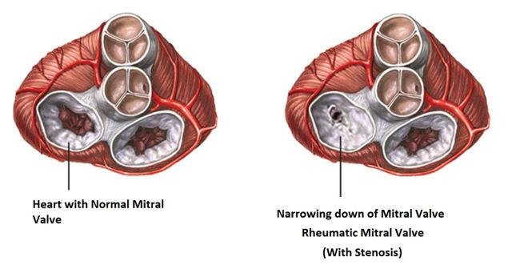 | **Comparative Anatomy of Normal Mitral Valve vs. Rheumatic Mitral Stenosis with Fish-Mouth Orifice** <code>rhd_1_Rheumatic_Fever_Heart_Valve_Disease_8_Important_Facts.jpg</code> *Schematic Diagram* [☁️ GitHub Raw](https://raw.githubusercontent.com/clinomaofficial/clinoma-images/main/curriculum/clinical/internal-medicine/cardiology/11_rheumatic_heart_disease/rhd_1_Rheumatic_Fever_Heart_Valve_Disease_8_Important_Facts.jpg) | [⚡ jsDelivr CDN](https://cdn.jsdelivr.net/gh/clinomaofficial/clinoma-images@main/curriculum/clinical/internal-medicine/cardiology/11_rheumatic_heart_disease/rhd_1_Rheumatic_Fever_Heart_Valve_Disease_8_Important_Facts.jpg) | This comparative diagram illustrates the transition from a normal wide-open mitral valve orifice to the classic 'fish-mouth' or 'buttonhole' stenosis seen in chronic rheumatic heart disease. Commissural fusion, leaflet thickening, and chordal shortening restrict diastolic filling, leading to elevated left atrial pressures and eventual pulmonary congestion.  *خد بالك يا دكتورنا إن الصمام الميترالي الطبيعي بيبقى واسع وبيسمح للدم ينزل براحته من الأذين للبطين، لكن في الروماتيزم (Rheumatic Mitral Stenosis) بيحصل التحام في الأطراف Commissural fusion ويضيق الصمام لدرجة تاخد شكل سمكة 'Fish-mouth' أو عروة الزرار، وده بيعلي الضغط في الأذين الشمال وبيعمل ارتشاح رئوي* |
| 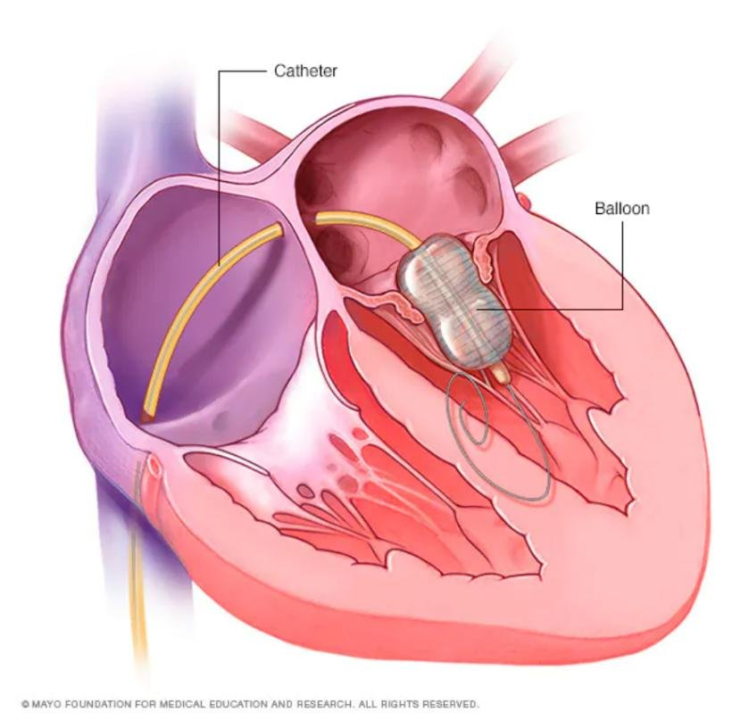 | **Percutaneous Balloon Valvotomy for Mitral Stenosis** <code>rhd_11_Prague_ICU.jpg</code> *Schematic Diagram* [☁️ GitHub Raw](https://raw.githubusercontent.com/clinomaofficial/clinoma-images/main/curriculum/clinical/internal-medicine/cardiology/11_rheumatic_heart_disease/rhd_11_Prague_ICU.jpg) | [⚡ jsDelivr CDN](https://cdn.jsdelivr.net/gh/clinomaofficial/clinoma-images@main/curriculum/clinical/internal-medicine/cardiology/11_rheumatic_heart_disease/rhd_11_Prague_ICU.jpg) | Schematic representation of percutaneous balloon mitral valvuloplasty used to treat rheumatic mitral stenosis. A catheter is advanced across the interatrial septum to position a specialized balloon across the stenotic mitral valve orifice, where mechanical inflation opens the fused commissures and improves diastolic filling.  *خد بالك يا دكتورنا، الرسم ده بيمثل عملية توسيع الصمام المترالي بالبالون (Percutaneous Balloon Valvotomy) لعلاج ضيق الصمام المترالي الناتج عن الحمى الروماتيزمية. البالون بيتدخل عن طريق القسطرة وبيتنفخ جوه الصمام عشان يفك الالتصاق بين الشرفات ويحسن تدفق الدم من الأذين الأيسر للبطين الأيسر.* |
| 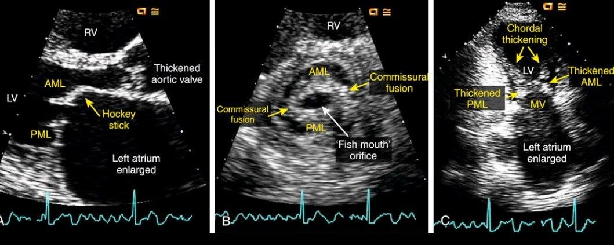 | **Transthoracic Echocardiographic Findings in Rheumatic Mitral Stenosis** <code>rhd_10_CardiovascularCorner_TrackYourHeart_on_X.jpg</code> *Echocardiogram / ECG* [☁️ GitHub Raw](https://raw.githubusercontent.com/clinomaofficial/clinoma-images/main/curriculum/clinical/internal-medicine/cardiology/11_rheumatic_heart_disease/rhd_10_CardiovascularCorner_TrackYourHeart_on_X.jpg) | [⚡ jsDelivr CDN](https://cdn.jsdelivr.net/gh/clinomaofficial/clinoma-images@main/curriculum/clinical/internal-medicine/cardiology/11_rheumatic_heart_disease/rhd_10_CardiovascularCorner_TrackYourHeart_on_X.jpg) | These transthoracic echocardiographic views demonstrate classic manifestations of rheumatic mitral stenosis, including anterior mitral leaflet 'hockey-stick' doming in parasternal long-axis (A), classic 'fish-mouth' orifice due to commissural fusion in parasternal short-axis (B), and severe subvalvular chordal thickening with left atrial enlargement in apical 4-chamber view (C). These structural changes impede diastolic left ventricular filling, leading to elevated left atrial pressures and long-term sequelae.  *خد بالك يا دكتورنا، الإيكو ده بيلخص كلاسيكيات الروماتيزم على الصمام المترالي (Mitral Stenosis). الصورة (A) مبينة الـ 'Hockey-stick' للأمامي (AML)، والصورة (B) جايبة الـ 'Fish-mouth orifice' بسبب التحام الـ Commissures، والصورة (C) موضحة تخن الـ Chords وتضخم الـ Left Atrium. علامات واضحة وقطعية لأعراض ضيق المترالي الروماتيزمي.* |
| 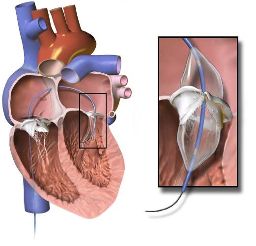 | **Percutaneous Balloon Mitral Valvuloplasty Schematic Illustration** <code>rhd_13_File_Blausen_0889_MitralValvuloplastypng_-_Wikimedia_Commons.jpg</code> *Schematic Diagram* [☁️ GitHub Raw](https://raw.githubusercontent.com/clinomaofficial/clinoma-images/main/curriculum/clinical/internal-medicine/cardiology/11_rheumatic_heart_disease/rhd_13_File_Blausen_0889_MitralValvuloplastypng_-_Wikimedia_Commons.jpg) | [⚡ jsDelivr CDN](https://cdn.jsdelivr.net/gh/clinomaofficial/clinoma-images@main/curriculum/clinical/internal-medicine/cardiology/11_rheumatic_heart_disease/rhd_13_File_Blausen_0889_MitralValvuloplastypng_-_Wikimedia_Commons.jpg) | This schematic diagram illustrates percutaneous balloon mitral valvuloplasty, a transcatheter intervention used to relieve mitral stenosis caused by rheumatic heart disease. A catheter with an inflatable balloon is advanced across the interatrial septum and positioned within the stenotic mitral valve orifice to separate fused commissures.  *الرسم التوضيحي بيبين عملية توسيع صمام ميترالي بالبالون عن طريق القسطرة لعلاج ضيق الميترالي الناتج عن الحمى الروماتيزمية. خد بالك يا دكتورنا إن البالون بيتدخل عبر الوريد الأجوف ويدخل الأذين الأيمن وبعدين يخترق الحاجز الأذيني عشان يوسع الصمام ويفك الالتصاقات.* |
| 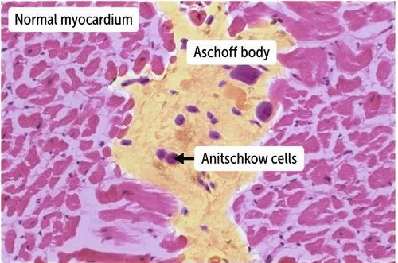 | **Aschoff Body with Anitschkow Cells in Acute Rheumatic Myocarditis** <code>rhd_4_CBL_Exam_5_ECG_Anit-arr_Flashcards_Quizlet.jpg</code> *Histological Micrograph* [☁️ GitHub Raw](https://raw.githubusercontent.com/clinomaofficial/clinoma-images/main/curriculum/clinical/internal-medicine/cardiology/11_rheumatic_heart_disease/rhd_4_CBL_Exam_5_ECG_Anit-arr_Flashcards_Quizlet.jpg) | [⚡ jsDelivr CDN](https://cdn.jsdelivr.net/gh/clinomaofficial/clinoma-images@main/curriculum/clinical/internal-medicine/cardiology/11_rheumatic_heart_disease/rhd_4_CBL_Exam_5_ECG_Anit-arr_Flashcards_Quizlet.jpg) | This histological section demonstrates an Aschoff body, the pathognomonic granulomatous lesion of acute rheumatic carditis found within the myocardial interstitium. It features central fibrinoid necrosis surrounded by characteristic Anitschkow cells (caterpillar cells), which are modified macrophages with abundant cytoplasm and central chromatin condensation.  *خد بالك يا دكتورنا، الـ Aschoff body دي هي العلامة المميزة للروماتيزم في القلب (Rheumatic Carditis) وخاصة في الميوكارديم. الـ Anitschkow cells بيكون شكل الكروماتين جواها عامل زي الدودة (Caterpillar cells) ودي أصلها ماكروفاجز حصلها تغير مميز.* |
| 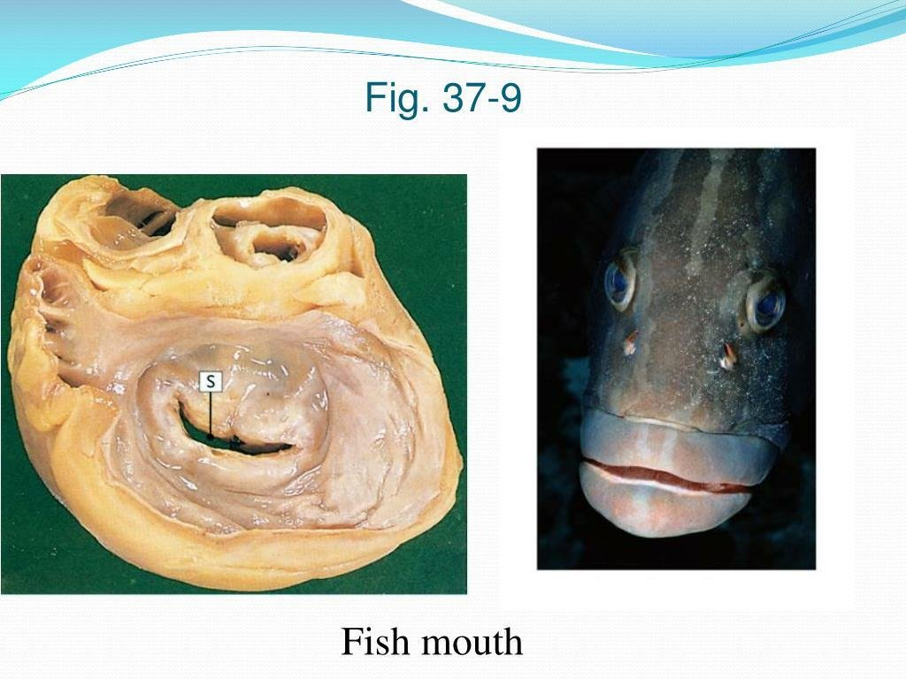 | **Mitral Stenosis 'Fish-Mouth' Orifice (Gross Pathology)** <code>rhd_5_PPT_-_Valvular_Heart_Disease_Cardiomyopathy_and_Aneursyms_Po.jpg</code> *Gross Pathology* [☁️ GitHub Raw](https://raw.githubusercontent.com/clinomaofficial/clinoma-images/main/curriculum/clinical/internal-medicine/cardiology/11_rheumatic_heart_disease/rhd_5_PPT_-_Valvular_Heart_Disease_Cardiomyopathy_and_Aneursyms_Po.jpg) | [⚡ jsDelivr CDN](https://cdn.jsdelivr.net/gh/clinomaofficial/clinoma-images@main/curriculum/clinical/internal-medicine/cardiology/11_rheumatic_heart_disease/rhd_5_PPT_-_Valvular_Heart_Disease_Cardiomyopathy_and_Aneursyms_Po.jpg) | Gross pathology specimen of a chronically stenotic mitral valve viewed from the left atrium, displaying the classic 'fish-mouth' (or buttonhole) orifice due to leaflet thickening, commissural fusion, and fibrosis. This anatomical narrowing is the hallmark of rheumatic heart disease, severely impairing diastolic filling of the left ventricle and leading to elevated left atrial pressures and pulmonary congestion.  *خد بالك يا دكتورنا، المنظر ده كلاسيكي جداً لضيق الصمام المترالي (Mitral Stenosis) الناتج عن حمى روماتيزمية قديمة. فتحة الصمام بتبقى ناشفة وضيقة شبه بوق السمكة (Fish-mouth deformity) بسبب التليف والالتصاق في أطراف الصمام، وده بيعمل إعاقة واضحة لمرور الدم من الأذين للبطين الأيسر.* |
| 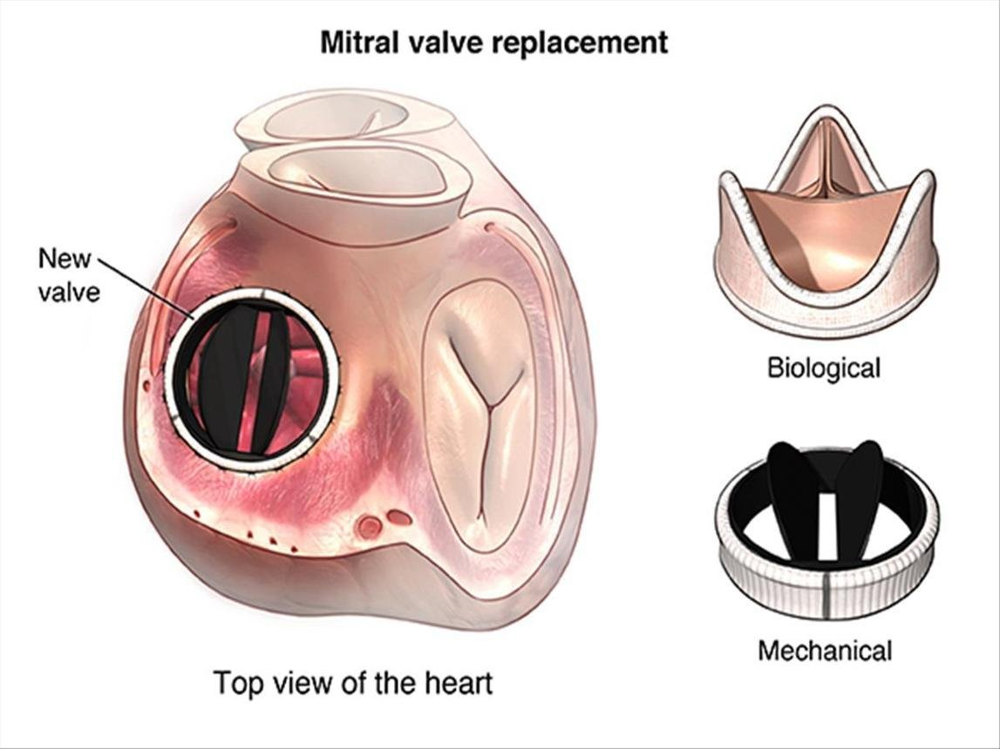 | **Mitral Valve Replacement: Biological vs Mechanical Prosthetic Valves** <code>rhd_12_Expert_Heart_Cardiac_Care_at_Medlife_Hospital_Lucknow.jpg</code> *Schematic Diagram* [☁️ GitHub Raw](https://raw.githubusercontent.com/clinomaofficial/clinoma-images/main/curriculum/clinical/internal-medicine/cardiology/11_rheumatic_heart_disease/rhd_12_Expert_Heart_Cardiac_Care_at_Medlife_Hospital_Lucknow.jpg) | [⚡ jsDelivr CDN](https://cdn.jsdelivr.net/gh/clinomaofficial/clinoma-images@main/curriculum/clinical/internal-medicine/cardiology/11_rheumatic_heart_disease/rhd_12_Expert_Heart_Cardiac_Care_at_Medlife_Hospital_Lucknow.jpg) | This schematic diagram illustrates mitral valve replacement surgical options, comparing biological tissue valves (bioprosthesis) with mechanical tilting-disc/bileaflet valves. Mechanical valves offer superior durability but require lifelong anticoagulation, whereas biological valves have a lower thrombogenic risk but undergo structural valve deterioration over time.  *خد بالك يا دكتورنا، لما تختار صمام مرجعي لمريض حمى روماتيزمية، الصمام الميكانيكي بيعيش أكتر بس بيحتاج سيولة مدى الحياة (وارفارين)، أما الصمام البيولوجي بيفادي السيولة بس بيحصل فيه تآكل على مدار السنين وغالباً بيحتاج مراجعة بعد 10-15 سنة.* |
| 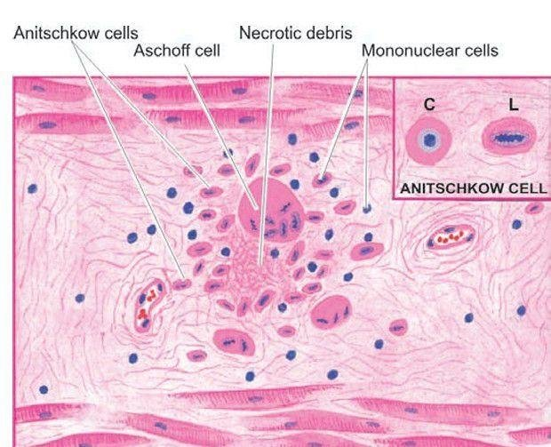 | **Aschoff Body with Anitschkow Cells in Rheumatic Myocarditis** <code>rhd_3_Aschoff_body_-_MEDizzy.jpg</code> *Histological Micrograph* [☁️ GitHub Raw](https://raw.githubusercontent.com/clinomaofficial/clinoma-images/main/curriculum/clinical/internal-medicine/cardiology/11_rheumatic_heart_disease/rhd_3_Aschoff_body_-_MEDizzy.jpg) | [⚡ jsDelivr CDN](https://cdn.jsdelivr.net/gh/clinomaofficial/clinoma-images@main/curriculum/clinical/internal-medicine/cardiology/11_rheumatic_heart_disease/rhd_3_Aschoff_body_-_MEDizzy.jpg) | Histological section of the myocardium showing a classic Aschoff body, the pathognomonic lesion of acute rheumatic carditis. It features a central zone of fibrinoid necrosis surrounded by characteristic Anitschkow cells (caterpillar cells with wavy chromatin) and mononuclear inflammatory infiltrates.  *خد بالك يا دكتورنا، العرض ده بيمثل Aschoff body المشهورة جداً في الـ Rheumatic Heart Disease، وبتتميز بوجود Anitschkow cells اللي النواة بتاعتها بتبان كأنها تعبان أو Caterpillar-like細胞. دي العلامة الباثولوجية الباثوجنومونيك في الروماتيزم الحاد اللي بتصيب عضلة القلب.* |
| 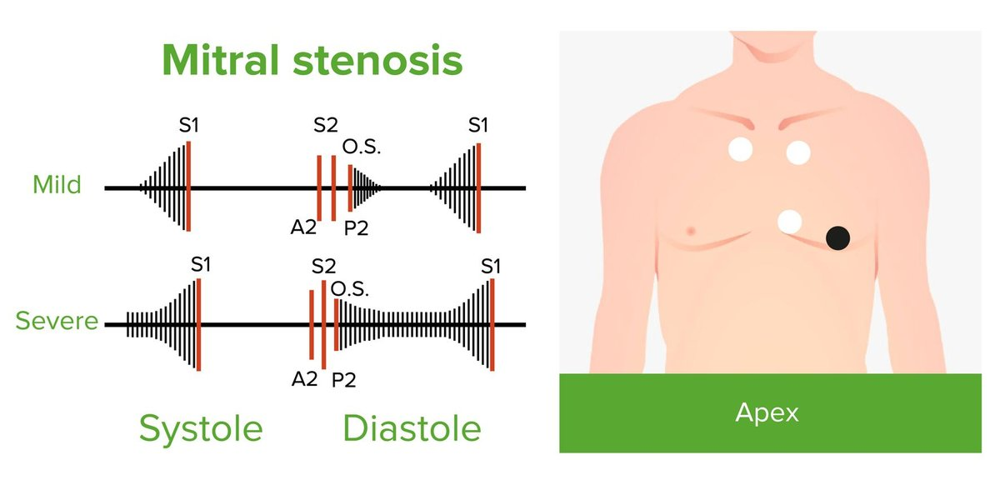 | **Auscultation Findings and Phonocardiogram of Mitral Stenosis** <code>rhd_9_Mitral_Stenosis_Concise_Medical_Knowledge.jpg</code> *Schematic Diagram* [☁️ GitHub Raw](https://raw.githubusercontent.com/clinomaofficial/clinoma-images/main/curriculum/clinical/internal-medicine/cardiology/11_rheumatic_heart_disease/rhd_9_Mitral_Stenosis_Concise_Medical_Knowledge.jpg) | [⚡ jsDelivr CDN](https://cdn.jsdelivr.net/gh/clinomaofficial/clinoma-images@main/curriculum/clinical/internal-medicine/cardiology/11_rheumatic_heart_disease/rhd_9_Mitral_Stenosis_Concise_Medical_Knowledge.jpg) | Schematic phonocardiogram and auscultation map demonstrating the classic cardiac findings in mitral stenosis, including a loud S1, an opening snap following S2, and a low-pitched diastolic rumble heard best at the cardiac apex. The interval between S2 and the opening snap inversely correlates with severity, while the duration of the diastolic murmur lengthens in severe disease.  *خد بالك يا دكتورنا إن الضغط العالي في الأتريوم الشمال بيخلي الـ Mitral Valve ينفتح بصوت مميز اسمه Opening Snap، وكل ما القفلة تقرب من الـ S2 (يعني الـ A2-OS interval يقل) ده معناه إن السايز بتاع الڤالڤ بقى ضيق جداً والحالة أصبحت Severe، والصوت ده بتسمعه بوضوح شديد عند الـ Apex بالـ Bell بتاع السماعة ومعاه Diastolic Rumble.* |
| 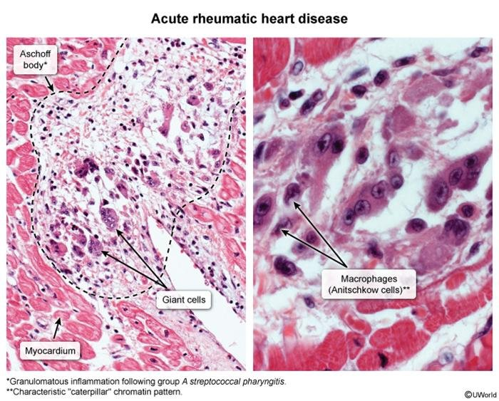 | **Acute Rheumatic Heart Disease Histopathology: Aschoff Bodies and Anitschkow Cells** <code>rhd_2_Acute_Rheumatic_Fever_-_Allergy_Immunology_UWorld_Medical_Li.jpg</code> *Histological Micrograph* [☁️ GitHub Raw](https://raw.githubusercontent.com/clinomaofficial/clinoma-images/main/curriculum/clinical/internal-medicine/cardiology/11_rheumatic_heart_disease/rhd_2_Acute_Rheumatic_Fever_-_Allergy_Immunology_UWorld_Medical_Li.jpg) | [⚡ jsDelivr CDN](https://cdn.jsdelivr.net/gh/clinomaofficial/clinoma-images@main/curriculum/clinical/internal-medicine/cardiology/11_rheumatic_heart_disease/rhd_2_Acute_Rheumatic_Fever_-_Allergy_Immunology_UWorld_Medical_Li.jpg) | Histological examination of acute rheumatic myocarditis reveals characteristic Aschoff bodies, which are granulomatous lesions consisting of T cells, plasma cells, and pathognomonic Anitschkow cells (activated macrophages with abundant cytoplasm and central chromatin condensation forming a caterpillar-like pattern). These lesions represent a delayed-type hypersensitivity reaction following group A streptococcal pharyngitis and can lead to pancarditis.  *خد بالك يا دكتورنا، العينة هنا بتوريني Aschoff body واضحة جداً في الميوق الحار (Myocardium) ومعاها الـ Anitschkow cells (اللي ليها caterpillar chromatin pattern)، ودي علامة مميزة جداً للروماتيزم الحاد بعد التهاب الحلق بالميكروب السبحاني (Group A Streptococcus)، وتعتبر باتوجنومونيك لتشخيص الـ Acute Rheumatic Fever.* |
| 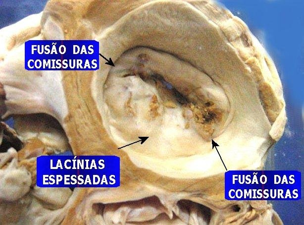 | **Mitral Stenosis with Commissural Fusion and Leaflet Thickening** <code>rhd_6_Anatpat-UNICAMP.jpg</code> *Gross Pathology* [☁️ GitHub Raw](https://raw.githubusercontent.com/clinomaofficial/clinoma-images/main/curriculum/clinical/internal-medicine/cardiology/11_rheumatic_heart_disease/rhd_6_Anatpat-UNICAMP.jpg) | [⚡ jsDelivr CDN](https://cdn.jsdelivr.net/gh/clinomaofficial/clinoma-images@main/curriculum/clinical/internal-medicine/cardiology/11_rheumatic_heart_disease/rhd_6_Anatpat-UNICAMP.jpg) | Gross pathology specimen of the mitral valve demonstrating classic features of chronic rheumatic heart disease, including commissural fusion and marked leaflet (cusp) thickening. These structural alterations lead to the characteristic 'fish-mouth' or 'buttonhole' stenosis, severely restricting diastolic blood flow from the left atrium to the left ventricle.  *خد بالك يا دكتورنا، العينة دي بتوريك الـ Mitral Stenosis الكلاسيكي اللي بيحصل بسبب الحمى الروماتيزمية، وواضح جداً التحام الـ Commissures وتغلظ الـ Leaflets (اللي بيسموها Fish-mouth appearance)، وده بيقلل مساحة الصمام ويمنع الدم من النزول براحته من الأتريوم للبطين.* |
| 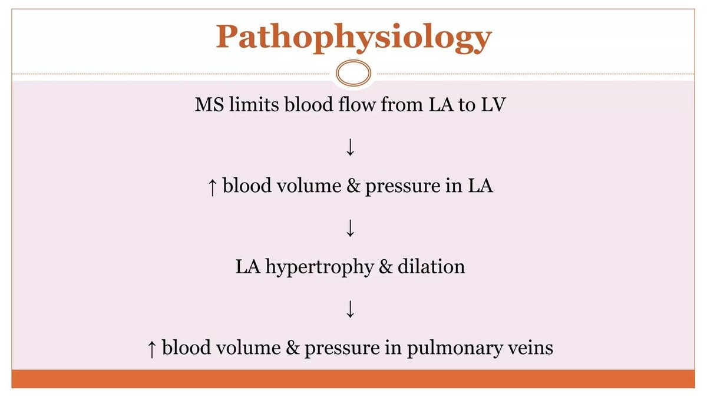 | **Pathophysiology of Mitral Stenosis: Progression from Left Atrial Pressure Overload to Pulmonary Congestion** <code>rhd_8_Mitral_PPTX_Heart_and_Cardiovascular_Diseases_Diseases_and_C.jpg</code> *Schematic Diagram* [☁️ GitHub Raw](https://raw.githubusercontent.com/clinomaofficial/clinoma-images/main/curriculum/clinical/internal-medicine/cardiology/11_rheumatic_heart_disease/rhd_8_Mitral_PPTX_Heart_and_Cardiovascular_Diseases_Diseases_and_C.jpg) | [⚡ jsDelivr CDN](https://cdn.jsdelivr.net/gh/clinomaofficial/clinoma-images@main/curriculum/clinical/internal-medicine/cardiology/11_rheumatic_heart_disease/rhd_8_Mitral_PPTX_Heart_and_Cardiovascular_Diseases_Diseases_and_C.jpg) | Mitral stenosis mechanically restricts blood flow from the left atrium (LA) to the left ventricle (LV), causing progressive pressure and volume overload in the LA. This hemodynamic barrier leads to left atrial hypertrophy and dilation, subsequently transmitting elevated pressures backward into the pulmonary veins and vasculature, culminating in pulmonary congestion.  *خد بالك يا دكتورنا، الضيق الميترالي (MS) بيقفل الباب قدام الدم وهو نازل من الأذين الأيسر للبطين الأيسر، فالدم بيتحوش جوه الأذين ويزيد ضغطه وحجمه؛ وده بيخليه يتضخم (Hypertrophy & Dilation)، ولما الضغط يعطّل لورا على الأوردة الرئوية يدخل العيان في ارتشاح رئوي وأعراض هبوط.* |
| 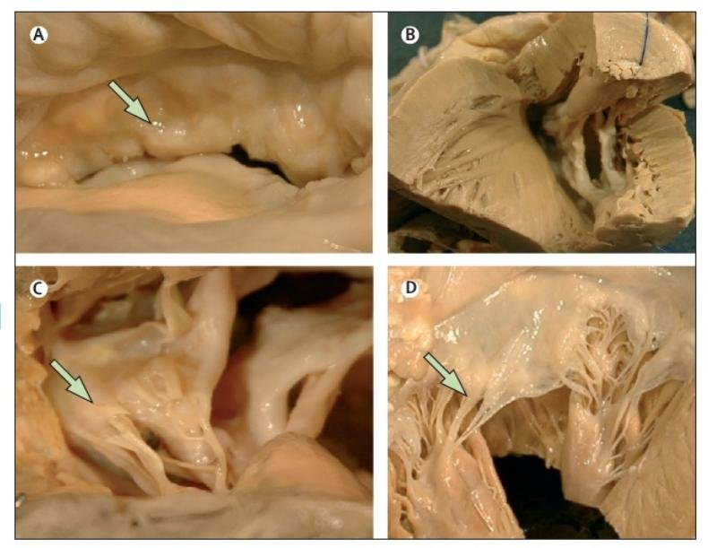 | **Pathological Features of Rheumatic Heart Disease and Valvular Deformities** <code>rhd_7.jpg</code> *Gross Pathology* [☁️ GitHub Raw](https://raw.githubusercontent.com/clinomaofficial/clinoma-images/main/curriculum/clinical/internal-medicine/cardiology/11_rheumatic_heart_disease/rhd_7.jpg) | [⚡ jsDelivr CDN](https://cdn.jsdelivr.net/gh/clinomaofficial/clinoma-images@main/curriculum/clinical/internal-medicine/cardiology/11_rheumatic_heart_disease/rhd_7.jpg) | This four-panel gross pathology montage illustrates characteristic chronic rheumatic heart disease lesions. Panels display valvular leaflet thickening, commissural fusion, and shortening of the chordae tendineae leading to severe stenosis and regurgitation.  *خد بالك يا دكتورنا إن التغيرات دي بتوريك شكل الصمامات في الحمى الروماتيزמית (Rheumatic Heart Disease) لما بتحصل فيها تليفات والتحام في الشرفات (Commissural Fusion) وقطع أو قصر في الأوتار (Chordae Tendineae)، وده بيعمل ضيق أو ارتجاع مزمن.* |
