# Clinoma Visual Atlas: 01 Malabsorption Syndrome

**Discipline / Module:** `curriculum/clinical/internal-medicine/gastroenterology/01_malabsorption_syndrome`  
**Total Figures:** **11** Authentic Clinical & Pathological Images  
**Repository Remote:** [`clinomaofficial/clinoma-images`](https://github.com/clinomaofficial/clinoma-images)  

| Figure | Clinical Identification & Repository Links | Academic & Bedside Description |
| :---: | :--- | :--- |
| 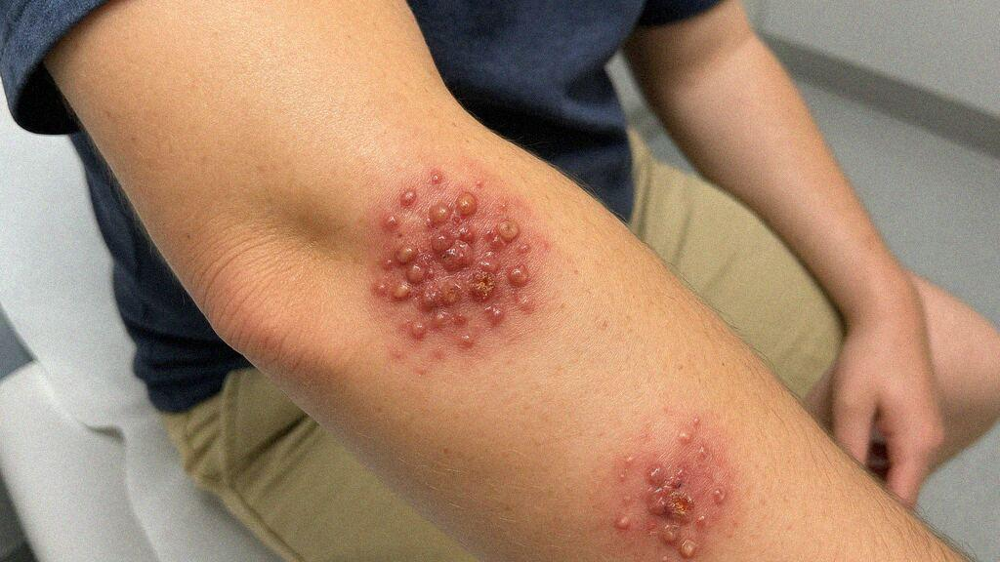 | **Herpes Zoster Vesicular Eruptions on Upper Extremity** <code>dermatitis_herpetiformis.png</code> *Clinical Photo* [☁️ GitHub Raw](https://raw.githubusercontent.com/clinomaofficial/clinoma-images/main/curriculum/clinical/internal-medicine/gastroenterology/01_malabsorption_syndrome/dermatitis_herpetiformis.png) | [⚡ jsDelivr CDN](https://cdn.jsdelivr.net/gh/clinomaofficial/clinoma-images@main/curriculum/clinical/internal-medicine/gastroenterology/01_malabsorption_syndrome/dermatitis_herpetiformis.png) | The image demonstrates grouped vesicular eruptions with an erythematous base characteristic of acute herpes zoster infection on the forearm. Prompt clinical recognition is essential for initiating early antiviral therapy to minimize acute pain and reduce the risk of post-herpetic neuralgia.  *خد بالك يا دكتورنا، الطفح الجلدي ده بيميزه إنه بيطلع في مجموعات على قاعدة محمرة وبيبقى واخد مسار عصبي معين (Dermatome)، والتشخيص السريع بيفيد جداً في بدء مضادات الفيروسات بدري عشان نقلل وجع الأعصاب اللي بيحصل بعد كده.* |
| 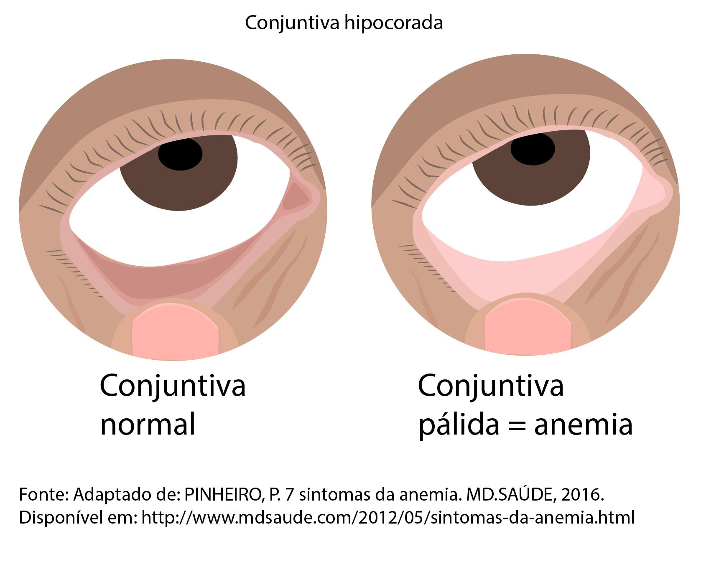 | **Conjunctival Pallor Indicating Anemia in Malabsorption Syndrome** <code>nutritional_deficiency.png</code> *Schematic Diagram* [☁️ GitHub Raw](https://raw.githubusercontent.com/clinomaofficial/clinoma-images/main/curriculum/clinical/internal-medicine/gastroenterology/01_malabsorption_syndrome/nutritional_deficiency.png) | [⚡ jsDelivr CDN](https://cdn.jsdelivr.net/gh/clinomaofficial/clinoma-images@main/curriculum/clinical/internal-medicine/gastroenterology/01_malabsorption_syndrome/nutritional_deficiency.png) | This diagram compares a normal pink conjunctiva with a pale conjunctiva (conjuntiva hipocorada), which is a classic physical examination sign of anemia. In the context of malabsorption syndromes, chronic iron, folate, or vitamin B12 deficiency leads to impaired erythropoiesis and subsequent microcytic or macrocytic anemia.  *خد بالك يا دكتورنا إن فحص الملتحمة (Conjunctiva) بالضغط عليها لأسفل بيبين لنا مدى هيموجلوبين الدم. في حالات سوء الامتصاص (Malabsorption)، نقص الحديد أو الفيتامينات بيؤدي لفقر دم يظهر بوضوح في شحوب الملتحمة كعلامة سريرية سريعة.* |
| 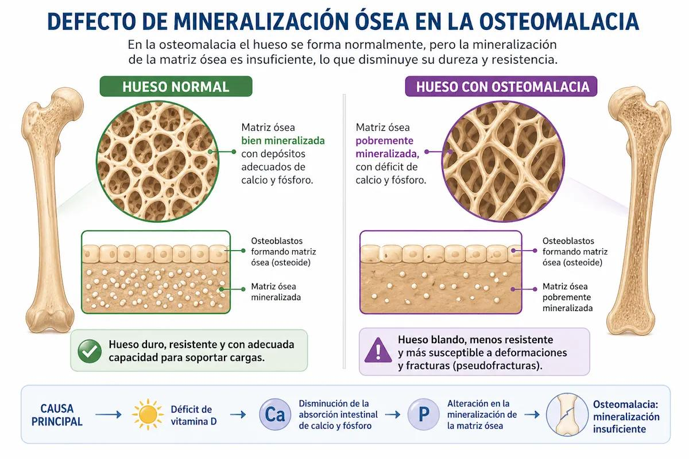 | **Bone Mineralization Defect in Osteomalacia** <code>osteomalacia_vitamin_d.png</code> *Schematic Diagram* [☁️ GitHub Raw](https://raw.githubusercontent.com/clinomaofficial/clinoma-images/main/curriculum/clinical/internal-medicine/gastroenterology/01_malabsorption_syndrome/osteomalacia_vitamin_d.png) | [⚡ jsDelivr CDN](https://cdn.jsdelivr.net/gh/clinomaofficial/clinoma-images@main/curriculum/clinical/internal-medicine/gastroenterology/01_malabsorption_syndrome/osteomalacia_vitamin_d.png) | Schematic comparison between normal bone and osteomalacia bone, illustrating the defective mineralization of bone matrix secondary to calcium, phosphorus, and vitamin D deficiency. This leads to softened bones, decreased structural strength, and increased susceptibility to deformities and pseudofractures.  *خد بالك يا دكتورنا إن نقص فيتامين (د) وسوء امتصاص الكالسيوم والفوسفور بيعملوا مشكلة كبيرة في تكوين العظم، وهي إن الخلايا البانية (Osteoblasts) بتبني الماتريكس أو الأوستيويد عادي جداً، بس الترسيب والمعادن بتكون ناقصة، وده بيخلي العظم طري وسهل يتكسر ويعمل Pseudofractures.* |
| 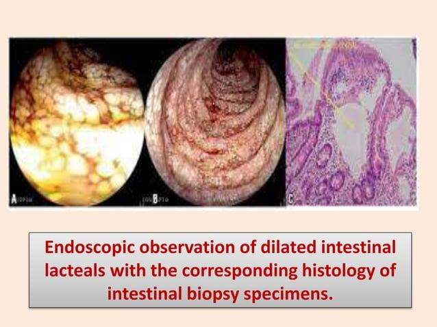 | **Endoscopic Observation and Histopathology of Dilated Intestinal Lacteals in Intestinal Lymphangiectasia** <code>intestinal_lymphangiectasia.png</code> *Endoscopy / Laparoscopy* [☁️ GitHub Raw](https://raw.githubusercontent.com/clinomaofficial/clinoma-images/main/curriculum/clinical/internal-medicine/gastroenterology/01_malabsorption_syndrome/intestinal_lymphangiectasia.png) | [⚡ jsDelivr CDN](https://cdn.jsdelivr.net/gh/clinomaofficial/clinoma-images@main/curriculum/clinical/internal-medicine/gastroenterology/01_malabsorption_syndrome/intestinal_lymphangiectasia.png) | Endoscopic views (A, B) and histological micrograph (C) demonstrating characteristic dilated intestinal lacteals within the small bowel mucosa, typical of primary or secondary intestinal lymphangiectasia. This condition results in lymphatic obstruction and protein-losing enteropathy, presenting clinically with malabsorption, edema, and severe hypoalbuminemia.  *خد بالك يا دكتورنا، المناظير دي بتوضح لنا تمدد الأوعية الليمفاوية في الأمعاء (Intestinal Lacteals) اللي بتسبب فقدان البروتينات (Protein-losing enteropathy) وسوء امتصاص؛ والتشخيص بيتاكد بالفحص الهستولوجي اللي بيبين الاتساع الواضح في القنوات الليمفاوية للخملات المعوية.* |
| 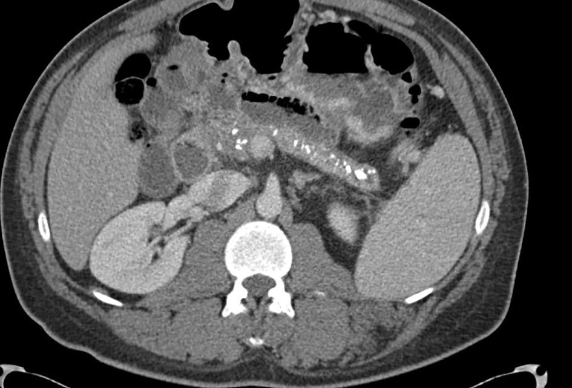 | **Diffuse Pancreatic Calcifications in Chronic Pancreatitis** <code>chronic_pancreatitis.png</code> *Radiological Imaging* [☁️ GitHub Raw](https://raw.githubusercontent.com/clinomaofficial/clinoma-images/main/curriculum/clinical/internal-medicine/gastroenterology/01_malabsorption_syndrome/chronic_pancreatitis.png) | [⚡ jsDelivr CDN](https://cdn.jsdelivr.net/gh/clinomaofficial/clinoma-images@main/curriculum/clinical/internal-medicine/gastroenterology/01_malabsorption_syndrome/chronic_pancreatitis.png) | Axial CT scan of the abdomen demonstrating extensive intraductal calcifications throughout the pancreatic parenchyma, pathognomonic for chronic pancreatitis. This structural damage leads to exocrine pancreatic insufficiency and secondary fat malabsorption (steatorrhea).  *خد بالك يا دكتورنا، الأشعة دي بتبين تكلسات منتشرة في البنكرياس (Pancreatic Calcifications) ودي علامة أساسية للالتهاب المزمن اللي بيؤدي لقصور وظائف البنكرياس ونقص إنزيمات الهضم وبالتالي سوء امتصاص الدهون (Steatorrhea).* |
| 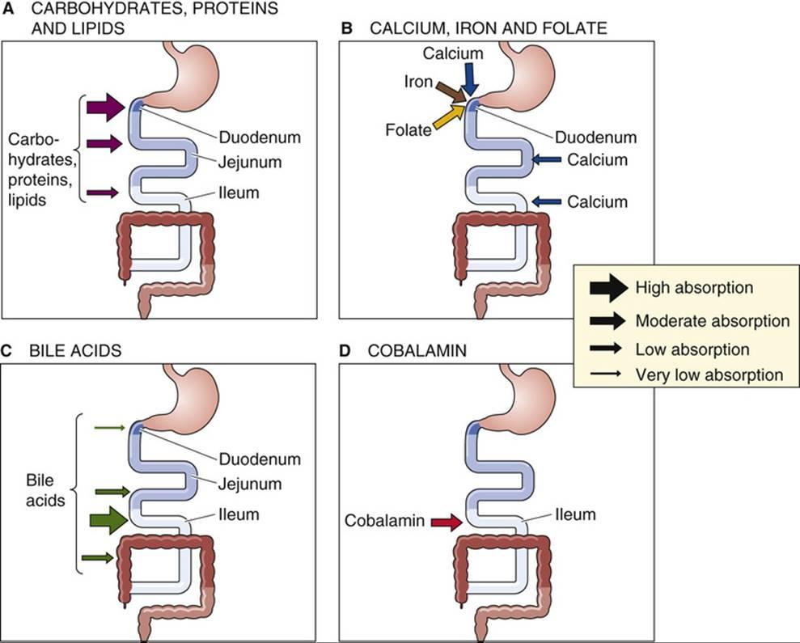 | **Anatomic Sites of Intestinal Nutrient Absorption** <code>absorption_physiology.png</code> *Schematic Diagram* [☁️ GitHub Raw](https://raw.githubusercontent.com/clinomaofficial/clinoma-images/main/curriculum/clinical/internal-medicine/gastroenterology/01_malabsorption_syndrome/absorption_physiology.png) | [⚡ jsDelivr CDN](https://cdn.jsdelivr.net/gh/clinomaofficial/clinoma-images@main/curriculum/clinical/internal-medicine/gastroenterology/01_malabsorption_syndrome/absorption_physiology.png) | This diagram maps the regional absorption sites of macronutrients and micronutrients along the small intestine, highlighting the duodenum, jejunum, and ileum. Understanding these specific anatomical zones is crucial for correlating clinical patterns of malabsorption syndromes with precise mucosal injury or resection sites.  *خد بالك يا دكتورنا، تقسيم الأمعاء لمعرفة أماكن امتصاص العناصر المختلفة (زي الحديد والكالسيوم في الإثنى عشر، وفيتامين ب12 والأملاح الصفراوية في اللفائفي) بيساعدنا جداً في تشخيص سبب سوء الامتصاص بدقة بناءً على مكان الإصابة أو الاستئصال الجراحي.* |
| 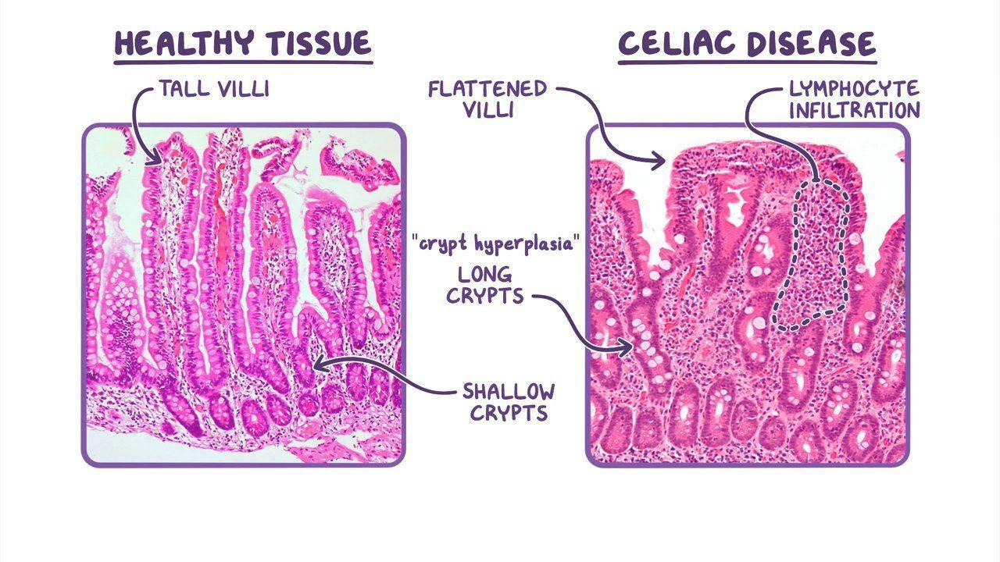 | **Histological Comparison of Healthy Intestinal Mucosa versus Celiac Disease** <code>celiac_gluten_diet.png</code> *Histological Micrograph* [☁️ GitHub Raw](https://raw.githubusercontent.com/clinomaofficial/clinoma-images/main/curriculum/clinical/internal-medicine/gastroenterology/01_malabsorption_syndrome/celiac_gluten_diet.png) | [⚡ jsDelivr CDN](https://cdn.jsdelivr.net/gh/clinomaofficial/clinoma-images@main/curriculum/clinical/internal-medicine/gastroenterology/01_malabsorption_syndrome/celiac_gluten_diet.png) | This comparative micrograph illustrates the hallmark histological changes in celiac disease, including total or subtotal villous atrophy (flattened villi), crypt hyperplasia (long crypts), and marked intraepithelial lymphocyte infiltration. These architectural abnormalities lead to a severely reduced surface area for absorption, accounting for the classic clinical presentation of malabsorption.  *خد بالك يا دكتورنا، العينة هنا بتوريك التغيرات الأساسية في مرض السيلياك (Celiac disease): ضمير وتسطيح للـ Villi، مع تضخم وطول في الـ Crypts، وزيادة واضحة في الـ Lymphocytes جوه الخلايا. المنظر ده بيفسر كويس أوي ليه المريض بيجيله Malabsorption ونقص في الامتصاص.* |
| 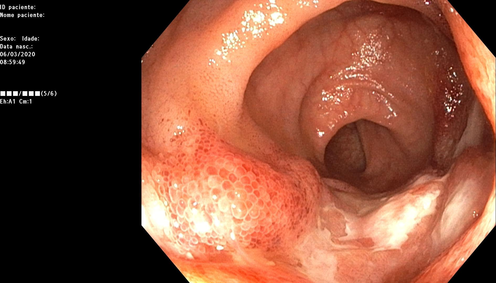 | **Endoscopic View of Celiac Sprue Duodenal Mucosa with Mosaic Pattern and Nodularity** <code>crohns_terminal_ileum.png</code> *Endoscopy / Laparoscopy* [☁️ GitHub Raw](https://raw.githubusercontent.com/clinomaofficial/clinoma-images/main/curriculum/clinical/internal-medicine/gastroenterology/01_malabsorption_syndrome/crohns_terminal_ileum.png) | [⚡ jsDelivr CDN](https://cdn.jsdelivr.net/gh/clinomaofficial/clinoma-images@main/curriculum/clinical/internal-medicine/gastroenterology/01_malabsorption_syndrome/crohns_terminal_ileum.png) | Upper endoscopy reveals characteristic features of severe celiac disease in the duodenum, including loss of folds, scalloping, fissuring, and a mosaic or nodular mucosal pattern reflecting villous atrophy. These mucosal changes are hallmarks of enteropathy-associated malabsorption syndromes and serve as key visual cues for targeted endoscopic biopsy.  *خد بالك يا دكتورنا، المناظير هنا بتوريني ضمور الخملات المعوية في الاثنى عشر اللي بيبان في صورة scalloping و mosaic pattern. دي علامات أساسية بتوجهنا لتشخيص مرض السيلياك (Celiac Disease) وأسباب سوء الامتصاص.* |
| 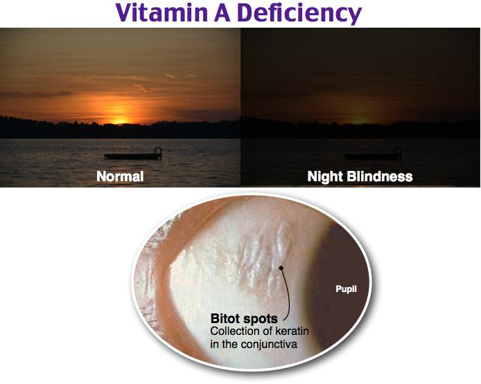 | **Vitamin A Deficiency Manifestations: Night Blindness and Bitot Spots** <code>vitamin_a_night_blindness.png</code> *Clinical Photo* [☁️ GitHub Raw](https://raw.githubusercontent.com/clinomaofficial/clinoma-images/main/curriculum/clinical/internal-medicine/gastroenterology/01_malabsorption_syndrome/vitamin_a_night_blindness.png) | [⚡ jsDelivr CDN](https://cdn.jsdelivr.net/gh/clinomaofficial/clinoma-images@main/curriculum/clinical/internal-medicine/gastroenterology/01_malabsorption_syndrome/vitamin_a_night_blindness.png) | Vitamin A deficiency impairs the regeneration of rhodopsin in retinal photoreceptors, resulting in nyctalopia (night blindness). Prolonged deficiency causes squamous metaplasia and keratin accumulation in the conjunctiva, clinically identifiable as foamy triangular Bitot spots.  *خد بالك يا دكتورنا، نقص فيتامين أ بيأثر على الرؤية الليلية بسبب ضعف تكوين الرودوبسين في الشبكية، وبيظهر في العين على شكل بقع بيضاء مثلثة الشكل في الملتحمة اسمها Bitot spots نتيجة تراكم الكيراتين.* |
| 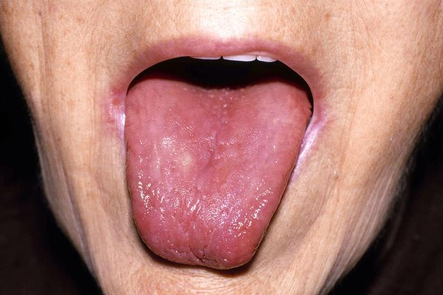 | **Atrophic Glossitis and Angular Cheilitis in Malabsorption Syndrome** <code>vitamin_b12_glossitis.png</code> *Clinical Photo* [☁️ GitHub Raw](https://raw.githubusercontent.com/clinomaofficial/clinoma-images/main/curriculum/clinical/internal-medicine/gastroenterology/01_malabsorption_syndrome/vitamin_b12_glossitis.png) | [⚡ jsDelivr CDN](https://cdn.jsdelivr.net/gh/clinomaofficial/clinoma-images@main/curriculum/clinical/internal-medicine/gastroenterology/01_malabsorption_syndrome/vitamin_b12_glossitis.png) | This clinical photograph demonstrates a smooth, red, atrophic tongue (glossitis) along with inflammation at the corners of the mouth (angular cheilitis), classic dermatologic and mucosal manifestations of severe nutritional deficiencies commonly secondary to malabsorption syndromes like celiac disease. These findings reflect impaired absorption of critical micronutrients, particularly B-complex vitamins (such as B12, folate, and riboflavin) and iron.  *خد بالك يا دكتورنا، المنظر ده بتاع اللسان الأملس الأحمر من غير حلمات (Atrophic glossitis) مع الالتهاب اللي في زوايا الفم (Angular cheilitis) بيعتبروا علامة ذهبية لنقص الفيتامينات زي B12 والحديد، وغالباً بيكونوا مؤشر قوي لمشاكل امتصاص في الأمعاء زي سيلياك ديزيز.* |
| 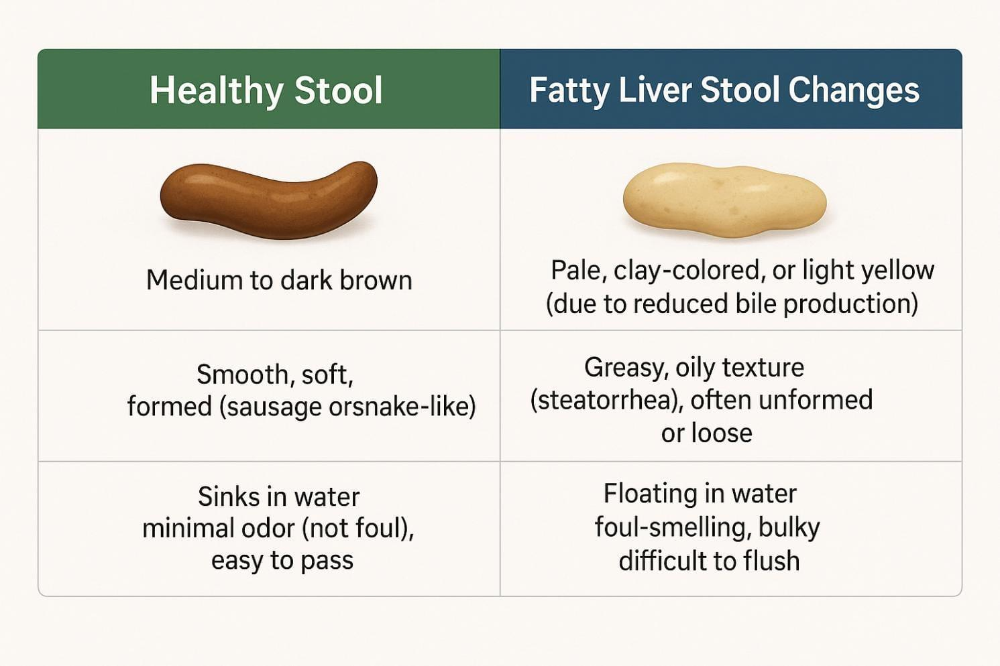 | **Comparison of Healthy Stool and Fatty Liver Stool Changes in Malabsorption Syndrome** <code>steatorrhea_fat_digestion.png</code> *Schematic Diagram* [☁️ GitHub Raw](https://raw.githubusercontent.com/clinomaofficial/clinoma-images/main/curriculum/clinical/internal-medicine/gastroenterology/01_malabsorption_syndrome/steatorrhea_fat_digestion.png) | [⚡ jsDelivr CDN](https://cdn.jsdelivr.net/gh/clinomaofficial/clinoma-images@main/curriculum/clinical/internal-medicine/gastroenterology/01_malabsorption_syndrome/steatorrhea_fat_digestion.png) | This comparative diagram illustrates the differences between healthy stool and stool changes associated with fatty liver disease and malabsorption syndromes. Reduced bile production leads to pale or clay-colored stools, while fat malabsorption results in steatorrhea, characterized by a greasy texture, floating behavior, and foul-smelling consistency.  *خد بالك يا دكتورنا، تغيرات البراز في حالات دهون الكبد وسوء التباين بتظهر واضحة في شكل steatorrhea؛ البراز بيكون باهت (clay-colored) بسبب نقص إفراز الصفراء، ودهني وبيتطفو على المية بسبب سوء امتصاص الدهون.* |
