# Clinoma Visual Atlas: Gastric And Peptic Disorders

**Discipline / Module:** `curriculum/clinical/internal-medicine/gastroenterology/gastric_and_peptic_disorders`  
**Total Figures:** **16** Authentic Clinical & Pathological Images  
**Repository Remote:** [`clinomaofficial/clinoma-images`](https://github.com/clinomaofficial/clinoma-images)  

| Figure | Clinical Identification & Repository Links | Academic & Bedside Description |
| :---: | :--- | :--- |
| 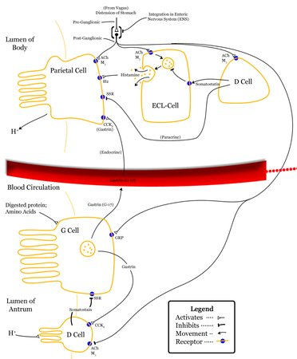 | **Gastric Acid Secretion Regulation and Neurohumoral Pathways** <code>gastric_gastric_anatomy.jpg</code> *Schematic Diagram* [☁️ GitHub Raw](https://raw.githubusercontent.com/clinomaofficial/clinoma-images/main/curriculum/clinical/internal-medicine/gastroenterology/gastric_and_peptic_disorders/gastric_gastric_anatomy.jpg) | [⚡ jsDelivr CDN](https://cdn.jsdelivr.net/gh/clinomaofficial/clinoma-images@main/curriculum/clinical/internal-medicine/gastroenterology/gastric_and_peptic_disorders/gastric_gastric_anatomy.jpg) | This schematic illustrates the complex neurohumoral regulation of gastric acid secretion involving parietal cells, enterochromaffin-like (ECL) cells, D cells, and G cells. Gastrin, histamine, and acetylcholine act as secretagogues promoting H+ release, while somatostatin provides inhibitory feedback control.  *الرسم التوضيحي بيشرح بدقة إزاي إفراز حمض المعدة بيتم تنظيمه عن طريق تفاعل معقد بين خلايا المعدة المختلفة زي خلايا Parietal و ECL و G و D. خد بالك يا دكتورنا إن فهم مسارات الهستامين والـ Gastrin والـ Somatostatin هو المفتاح الأساسي لفهم ميكانيزم عمل أدوية الـ PPIs ومثبطات مستقبلات H2 في علاج القرحة الهضمية.* |
| 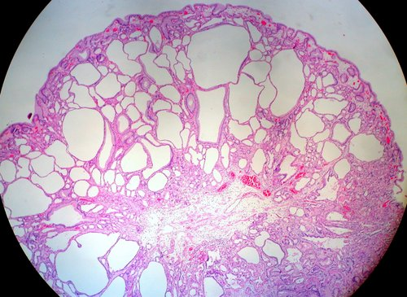 | **Gastric Hyperplastic Polyp Histopathology** <code>gastric_fundic_gland_polyp.jpg</code> *Histological Micrograph* [☁️ GitHub Raw](https://raw.githubusercontent.com/clinomaofficial/clinoma-images/main/curriculum/clinical/internal-medicine/gastroenterology/gastric_and_peptic_disorders/gastric_fundic_gland_polyp.jpg) | [⚡ jsDelivr CDN](https://cdn.jsdelivr.net/gh/clinomaofficial/clinoma-images@main/curriculum/clinical/internal-medicine/gastroenterology/gastric_and_peptic_disorders/gastric_fundic_gland_polyp.jpg) | This histological micrograph demonstrates a gastric hyperplastic polyp characterized by markedly elongated, tortuous foveolar epithelium and prominent cystic dilatation of gastric glands set within an inflamed and edematous lamina propria. These lesions commonly arise in the setting of chronic gastritis or mucosal injury and carry a low risk of malignant transformation.  *خد بالك يا دكتورنا، العينة هنا بتوضح غدد معدية متوسعة بشكل كيسى وتكاثر واضح في الخلايا الحرشفية (Foveolar hyperplasia) ودي من العلامات الأساسية للـ Hyperplastic polyps اللي غالباً بتظهر نتيجة التهاب معدي مزمن.* |
| 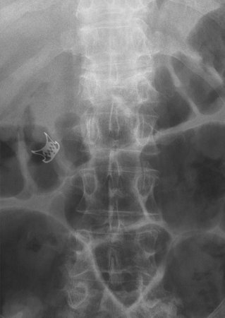 | **Biliary Stent Migration and Displacement Visible on Abdominal Radiograph** <code>gastric_duodenal_ulcer_endoscopy.jpg</code> *Radiological Imaging* [☁️ GitHub Raw](https://raw.githubusercontent.com/clinomaofficial/clinoma-images/main/curriculum/clinical/internal-medicine/gastroenterology/gastric_and_peptic_disorders/gastric_duodenal_ulcer_endoscopy.jpg) | [⚡ jsDelivr CDN](https://cdn.jsdelivr.net/gh/clinomaofficial/clinoma-images@main/curriculum/clinical/internal-medicine/gastroenterology/gastric_and_peptic_disorders/gastric_duodenal_ulcer_endoscopy.jpg) | Plain abdominal radiograph demonstrating an aberrantly displaced metallic biliary stent within the right abdomen, indicative of stent migration. Such mechanical complications require prompt endoscopic or radiological intervention to prevent luminal obstruction or perforation.  *خد بالك يا دكتورنا، الصورة دي بتوضح حالة تحرك stent (دعامة مرارة) من مكانها ونزولها في البطن. الحالات دي بتحتاج تدخل فوري ومنظار عشان نمنع أي انسداد أو مضاعفات خطيرة في الأمعاء.* |
| 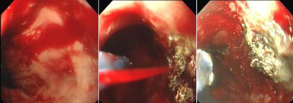 | **Endoscopic Hemostasis of Bleeding Peptic Ulcer via Coagulation and Injection** <code>gastric_forrest_bleeding_matrix.jpg</code> *Endoscopy / Laparoscopy* [☁️ GitHub Raw](https://raw.githubusercontent.com/clinomaofficial/clinoma-images/main/curriculum/clinical/internal-medicine/gastroenterology/gastric_and_peptic_disorders/gastric_forrest_bleeding_matrix.jpg) | [⚡ jsDelivr CDN](https://cdn.jsdelivr.net/gh/clinomaofficial/clinoma-images@main/curriculum/clinical/internal-medicine/gastroenterology/gastric_and_peptic_disorders/gastric_forrest_bleeding_matrix.jpg) | These endoscopic views demonstrate active bleeding from a peptic ulcer managed via therapeutic intervention. Endoscopic hemostasis utilizing thermal contact coagulation and injection therapy effectively achieves hemostasis and prevents recurrent upper gastrointestinal hemorrhage.  *خد بالك يا دكتورنا، النزيف النشط من القرحة المعدية بيحتاج تدخل منظار سريع بالكى أو الحقن لوقف النزيف وتجنب المضاعفات الخطيرة.* |
| 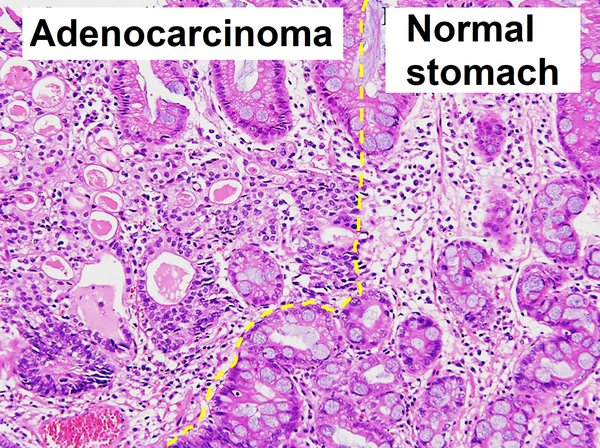 | **Gastric Adenocarcinoma Bordering Normal Stomach Tissue on Histology** <code>gastric_gastric_adenocarcinoma_ct.jpg</code> *Histological Micrograph* [☁️ GitHub Raw](https://raw.githubusercontent.com/clinomaofficial/clinoma-images/main/curriculum/clinical/internal-medicine/gastroenterology/gastric_and_peptic_disorders/gastric_gastric_adenocarcinoma_ct.jpg) | [⚡ jsDelivr CDN](https://cdn.jsdelivr.net/gh/clinomaofficial/clinoma-images@main/curriculum/clinical/internal-medicine/gastroenterology/gastric_and_peptic_disorders/gastric_gastric_adenocarcinoma_ct.jpg) | This histological micrograph shows the distinct transition zone between normal gastric mucosa and gastric adenocarcinoma, highlighting disorganized malignant glands with cellular atypia, pleomorphism, and architectural distortion. The boundary underscores the invasive front characteristic of gastric epithelial malignancies.  *خد بالك يا دكتورنا إن الصورة دي بتبين الفاصل الواضح بين الغشاء المخاطي الطبيعي للمعدة وسرطان الغدد (Adenocarcinoma). الخلايا السرطانية واضحة بإنها عاملة غدد غير منظمة وفيها تغيرات شكلية (Atypia)، ودي خطوط المعركة الأولى في تشخيص الأورام المعوية بالميكروسكوب.* |
| 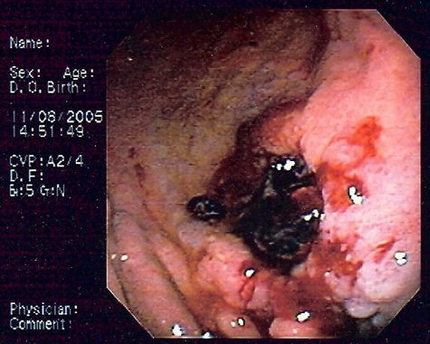 | **Gastric Ulcer with Active Bleeding and Clot on Upper Endoscopy** <code>gastric_gastric_malt_lymphoma.jpg</code> *Endoscopy / Laparoscopy* [☁️ GitHub Raw](https://raw.githubusercontent.com/clinomaofficial/clinoma-images/main/curriculum/clinical/internal-medicine/gastroenterology/gastric_and_peptic_disorders/gastric_gastric_malt_lymphoma.jpg) | [⚡ jsDelivr CDN](https://cdn.jsdelivr.net/gh/clinomaofficial/clinoma-images@main/curriculum/clinical/internal-medicine/gastroenterology/gastric_and_peptic_disorders/gastric_gastric_malt_lymphoma.jpg) | Upper endoscopy reveals a prominent gastric ulcer crater characterized by surrounding mucosal erythema and an adherent dark blood clot within the base. This finding signifies recent or ongoing gastrointestinal bleeding, requiring immediate endoscopic hemostasis and medical intervention.  *خد بالك يا دكتورنا، القرحة المعدية دي واضح فيها جلطة دموية سمراء وملتصقة بقاع القرحة ودي علامة خطر لنزيف نشط أو حديث. الحالات دي بتلزم تدخل منظاري عاجل للحقن أو الكي عشان نمنع تكرار النزيف وحفظ حياة العيان.* |
| 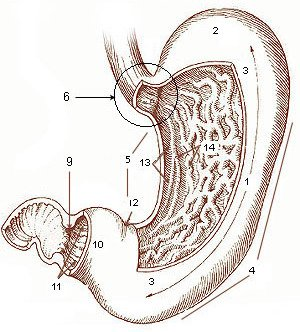 | **Anatomical Schematic of the Human Stomach and Pyloric Sphincter** <code>gastric_billroth_reconstructions.jpg</code> *Schematic Diagram* [☁️ GitHub Raw](https://raw.githubusercontent.com/clinomaofficial/clinoma-images/main/curriculum/clinical/internal-medicine/gastroenterology/gastric_and_peptic_disorders/gastric_billroth_reconstructions.jpg) | [⚡ jsDelivr CDN](https://cdn.jsdelivr.net/gh/clinomaofficial/clinoma-images@main/curriculum/clinical/internal-medicine/gastroenterology/gastric_and_peptic_disorders/gastric_billroth_reconstructions.jpg) | This diagram illustrates the gross internal and external anatomy of the human stomach, highlighting structural landmarks such as the fundus, greater and lesser curvatures, rugae, and the pyloric sphincter. Understanding these regional divisions is crucial for localizing peptic ulcer disease, evaluating gastric motility disorders, and planning surgical interventions.  *خد بالك يا دكتورنا إن معرفة المعالم التشريحية للمعدة زي الـ Rugae والـ Pyloric Sphincter مهمة جداً عشان نقدر نحدد أماكن القرح المعدية ونتوقع شكل الـ Endoscopy صح. التغيرات في الأجزاء دي بتبين لنا بداية أي Pathology زي الـ Peptic Ulcers أو الـ Gastritis.* |
| 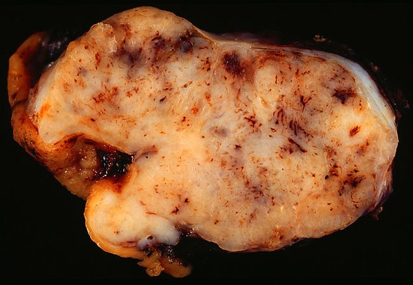 | **Gross Pathology of Gastric Gastrointestinal Stromal Tumor (GIST) Cut Surface** <code>gastric_gastric_ulcer_endoscopy.jpg</code> *Gross Pathology* [☁️ GitHub Raw](https://raw.githubusercontent.com/clinomaofficial/clinoma-images/main/curriculum/clinical/internal-medicine/gastroenterology/gastric_and_peptic_disorders/gastric_gastric_ulcer_endoscopy.jpg) | [⚡ jsDelivr CDN](https://cdn.jsdelivr.net/gh/clinomaofficial/clinoma-images@main/curriculum/clinical/internal-medicine/gastroenterology/gastric_and_peptic_disorders/gastric_gastric_ulcer_endoscopy.jpg) | This gross specimen displays a well-demarcated gastric gastrointestinal stromal tumor (GIST) featuring a tan-white, whorled cut surface with characteristic foci of hemorrhage and necrosis. GISTs originate from the interstitial cells of Cajal and most frequently harbor gain-of-function mutations in KIT (CD117) or PDGFRA genes. Recognition of these macroscopic findings is critical for surgical planning, risk stratification, and targeted tyrosine kinase inhibitor therapy such as imatinib.  *ده يا دكتورنا ورم GIST في المعدة (Gastrointestinal Stromal Tumor) باين في العينة الـ Gross وله سطح مقطع لونه أبيض على بيج مع بقع نزف وتندب واضحة. الأورام دي بتطلع من خلايا كاجال (Interstitial cells of Cajal) وغالباً بتكون إيجابية لـ CD117، والتشخيص الدقيق مهم جداً عشان نقرر العلاج الموجه زي الـ Imatinib.* |
| 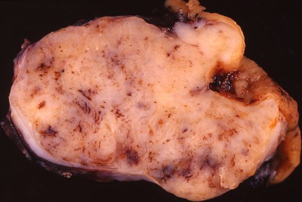 | **Gross Pathology of Gastrointestinal Stromal Tumor (GIST)** <code>gastric_gist_c_kit.jpg</code> *Gross Pathology* [☁️ GitHub Raw](https://raw.githubusercontent.com/clinomaofficial/clinoma-images/main/curriculum/clinical/internal-medicine/gastroenterology/gastric_and_peptic_disorders/gastric_gist_c_kit.jpg) | [⚡ jsDelivr CDN](https://cdn.jsdelivr.net/gh/clinomaofficial/clinoma-images@main/curriculum/clinical/internal-medicine/gastroenterology/gastric_and_peptic_disorders/gastric_gist_c_kit.jpg) | This gross pathology specimen demonstrates a well-circumscribed gastric stromal tumor (GIST) on cut section, highlighting fleshy tan-pink tissue with characteristic scattered areas of hemorrhage and cystic degeneration. GISTs originate from the interstitial cells of Cajal and most commonly occur in the stomach, presenting potential risks for gastrointestinal bleeding and malignant progression.  *خد بالك يا دكتورنا، العينة دي بتوضح ورم جدار المعدة الشهير (GIST) اللي بيبان في القطع بلونه الوردي اللحمي مع بقع نزفية وتغيرات كيسية واضحة. الأورام دي بتطلع من الخلايا البينية لـ Cajal، وغالباً بتيجي في المعدة وبتعمل نزيف في الجهاز الهضمي العلوي.* |
| 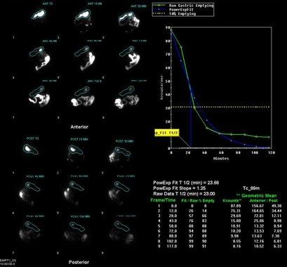 | **Gastric Emptying Scintigraphy Demonstrating Rapid Gastric Emptying (Dumping Syndrome)** <code>gastric_gastric_emptying_scan.jpg</code> *Radiological Imaging* [☁️ GitHub Raw](https://raw.githubusercontent.com/clinomaofficial/clinoma-images/main/curriculum/clinical/internal-medicine/gastroenterology/gastric_and_peptic_disorders/gastric_gastric_emptying_scan.jpg) | [⚡ jsDelivr CDN](https://cdn.jsdelivr.net/gh/clinomaofficial/clinoma-images@main/curriculum/clinical/internal-medicine/gastroenterology/gastric_and_peptic_disorders/gastric_gastric_emptying_scan.jpg) | This gastric emptying scintigraphy study illustrates accelerated gastric emptying, indicated by a half-time (T 1/2) of approximately 23 minutes on the power-exponential fit curve. Rapid transit of radiolabeled contents into the small bowel is characteristic of dumping syndrome, commonly occurring post-gastrectomy or after bariatric procedures.  *خد بالك يا دكتورنا، الرسم البياني هنا بيوضح سرعة غير طبيعية في تفريغ المعدة (Rapid Gastric Emptying) بنصف عمر أقل من 24 دقيقة، وده بيفسر أعراض الـ Dumping Syndrome اللي بتظهر بعد جراحات المعدة.* |
| 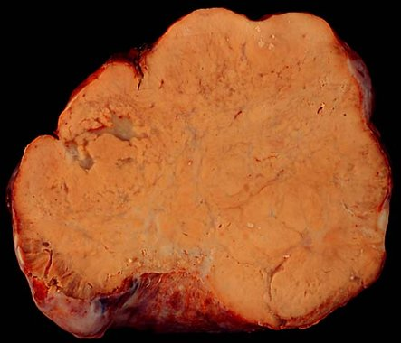 | **Gross Pathology of Gastric Gastrointestinal Stromal Tumor (GIST)** <code>gastric_krukenberg_tumor.jpg</code> *Gross Pathology* [☁️ GitHub Raw](https://raw.githubusercontent.com/clinomaofficial/clinoma-images/main/curriculum/clinical/internal-medicine/gastroenterology/gastric_and_peptic_disorders/gastric_krukenberg_tumor.jpg) | [⚡ jsDelivr CDN](https://cdn.jsdelivr.net/gh/clinomaofficial/clinoma-images@main/curriculum/clinical/internal-medicine/gastroenterology/gastric_and_peptic_disorders/gastric_krukenberg_tumor.jpg) | This gross pathology specimen shows a well-circumscribed, fleshy, tan-pink gastric gastrointestinal stromal tumor (GIST) on cut section, characterized by whorled architecture and areas of secondary hemorrhage or cystic degeneration. GISTs are the most common mesenchymal neoplasms of the gastrointestinal tract, originating from the interstitial cells of Cajal, and typically express KIT (CD117) on immunohistochemistry.  *خد بالك يا دكتورنا، العينة دي بتورّي ورم stromal في المعدة (GIST) قطعه بيبان لحمي ولونه اصفر مصفر مع نقط نزيف، وده أشهر ورم mesenchymal في الجهاز الهضمي وبيطلع من خلايا Cajal.* |
| 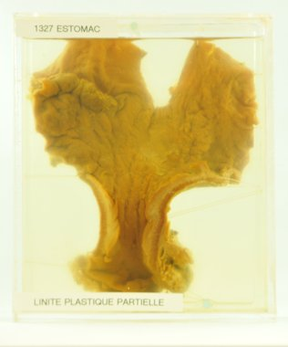 | **Partial Linitis Plastica of the Stomach Gross Specimen** <code>gastric_linitis_plastica_barium.jpg</code> *Gross Pathology* [☁️ GitHub Raw](https://raw.githubusercontent.com/clinomaofficial/clinoma-images/main/curriculum/clinical/internal-medicine/gastroenterology/gastric_and_peptic_disorders/gastric_linitis_plastica_barium.jpg) | [⚡ jsDelivr CDN](https://cdn.jsdelivr.net/gh/clinomaofficial/clinoma-images@main/curriculum/clinical/internal-medicine/gastroenterology/gastric_and_peptic_disorders/gastric_linitis_plastica_barium.jpg) | This gross pathology specimen demonstrates linitis plastica (diffuse gastric cancer), characterized by marked thickening and rigidity of the gastric wall due to infiltrative adenocarcinoma. The loss of normal mucosal folds and reduced luminal compliance ("leather bottle stomach") lead to impaired motility and severe clinical presentations like early satiety and dysphagia.  *خد بالك يا دكتورنا، الحالة دي بتمثل 'Linitis Plastica' أو المعدة الجلدية اللي بتتميز بتورم وخشونة شديدة في جدار المعدة نتيجة انتشار ورم سرطاني خبيث (Infiltrative Adenocarcinoma). المنظر ده بيفقد المعدة مرونتها الطبيعية وبيخلي المريض يشتكي من شبع مبكر وصعوبة في الهضم.* |
| 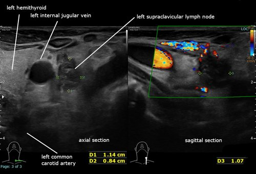 | **Ultrasound of Left Supraclavicular Lymph Node Metastasis (Troisier's Sign)** <code>gastric_virchows_node.jpg</code> *Radiological Imaging* [☁️ GitHub Raw](https://raw.githubusercontent.com/clinomaofficial/clinoma-images/main/curriculum/clinical/internal-medicine/gastroenterology/gastric_and_peptic_disorders/gastric_virchows_node.jpg) | [⚡ jsDelivr CDN](https://cdn.jsdelivr.net/gh/clinomaofficial/clinoma-images@main/curriculum/clinical/internal-medicine/gastroenterology/gastric_and_peptic_disorders/gastric_virchows_node.jpg) | B-mode and color Doppler ultrasound of the left supraclavicular fossa demonstrating Virchow's node (Troisier's sign), a classic metastatic sentinel lymph node enlargement highly indicative of occult intra-abdominal malignancies such as gastric adenocarcinoma.  *خد بالك يا دكتورنا، العقدة الليمفاوية دي (Troisier's sign) في السوبرا كلافيكولار الشمال تعتبر علامة خطيرة جداً ومفتاح لتشخيص أورام المعدة المتقدمة اللي ممكن تكون صامتة إكلينيكياً.* |
| 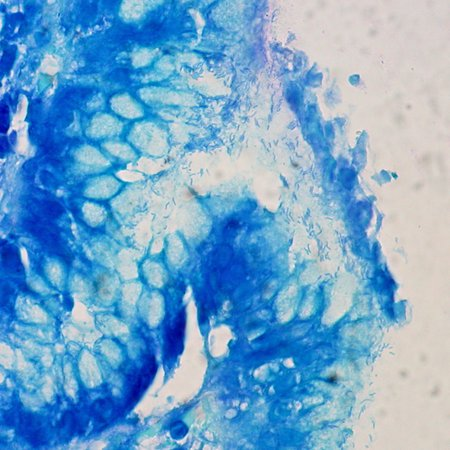 | **Helicobacter pylori Colonization on Gastric Mucosa Stained with Giemsa** <code>gastric_h_pylori_giemsa.jpg</code> *Histological Micrograph* [☁️ GitHub Raw](https://raw.githubusercontent.com/clinomaofficial/clinoma-images/main/curriculum/clinical/internal-medicine/gastroenterology/gastric_and_peptic_disorders/gastric_h_pylori_giemsa.jpg) | [⚡ jsDelivr CDN](https://cdn.jsdelivr.net/gh/clinomaofficial/clinoma-images@main/curriculum/clinical/internal-medicine/gastroenterology/gastric_and_peptic_disorders/gastric_h_pylori_giemsa.jpg) | High-power histological micrograph demonstrating curved, spiral-shaped Helicobacter pylori bacilli adherent to the apical surface of the gastric surface epithelium, highlighted by Giemsa stain. This pathogen is a primary etiologic agent of chronic gastritis, peptic ulcer disease, and gastric malignancies.  *خد بالك يا دكتورنا، الصبغة دي بتوضح بوضوح بكتيريا الهيليكوباكتر بيلوري (الملوية البوابية) وهي لازقة على الخلايا المخاطية للمعدة. الوجود ده هو السبب الرئيسي للتهابات المعدة المزمنة والتقرحات ويستاهل علاج ثنائي أو ثلاثي فوري.* |
| 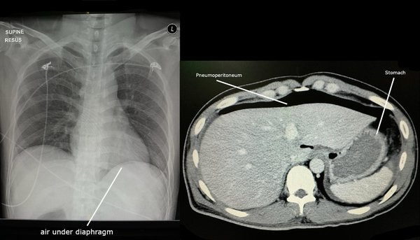 | **Pneumoperitoneum and Air Under Diaphragm Secondary to Perforated Peptic Ulcer on Radiograph and CT** <code>gastric_peptic_perforation_xray.jpg</code> *Radiological Imaging* [☁️ GitHub Raw](https://raw.githubusercontent.com/clinomaofficial/clinoma-images/main/curriculum/clinical/internal-medicine/gastroenterology/gastric_and_peptic_disorders/gastric_peptic_perforation_xray.jpg) | [⚡ jsDelivr CDN](https://cdn.jsdelivr.net/gh/clinomaofficial/clinoma-images@main/curriculum/clinical/internal-medicine/gastroenterology/gastric_and_peptic_disorders/gastric_peptic_perforation_xray.jpg) | Chest radiography and corresponding abdominal computed tomography demonstrate free air under the right hemidiaphragm (pneumoperitoneum), indicative of hollow viscus perforation, most commonly secondary to a complicated peptic ulcer. This radiographic sign is an absolute surgical emergency requiring urgent exploratory laparotomy to prevent generalized peritonitis and septic shock.  *خد بالك يا دكتورنا، الهواء تحت الحجاب الحاجز في أشعة الصدر والبطن المقطعية بيعتبر علامة أكيدة لانفجار قرحة في المعدة أو الإثني عشر (Perforated Peptic Ulcer). دي طوارئ جراحية قصوى تستوجب التدخل الجراحي الفوري لمنع التهاب البريتون الحاد والصدمة الإنتانية.* |
| 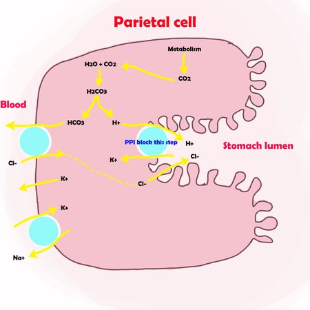 | **Gastric Parietal Cell Acid Secretion and Proton Pump Inhibitor Mechanism** <code>gastric_parietal_cell_acid.jpg</code> *Schematic Diagram* [☁️ GitHub Raw](https://raw.githubusercontent.com/clinomaofficial/clinoma-images/main/curriculum/clinical/internal-medicine/gastroenterology/gastric_and_peptic_disorders/gastric_parietal_cell_acid.jpg) | [⚡ jsDelivr CDN](https://cdn.jsdelivr.net/gh/clinomaofficial/clinoma-images@main/curriculum/clinical/internal-medicine/gastroenterology/gastric_and_peptic_disorders/gastric_parietal_cell_acid.jpg) | Schematic diagram depicting the intracellular mechanisms of gastric acid secretion in a parietal cell, highlighting the H+/K+ ATPase pump as the site of action for proton pump inhibitors (PPIs). Carbon dioxide and water combine to form carbonic acid, dissociating into hydrogen ions secreted into the lumen and bicarbonate entering the blood.  *الرسم بيوضح إزاي خلية الباريتايل في المعدة بتطلع الحامض عن طريق مضخة الـ H+/K+ ATPase، ودي بالظبط النقطة اللي بتشتغل عليها أدوية الـ PPI عشان تقفل إفراز الحمض.* |
