# Clinoma Visual Atlas: Git Master

**Discipline / Module:** `curriculum/clinical/internal-medicine/gastroenterology/git_master`  
**Total Figures:** **102** Authentic Clinical & Pathological Images  
**Repository Remote:** [`clinomaofficial/clinoma-images`](https://github.com/clinomaofficial/clinoma-images)  

| Figure | Clinical Identification & Repository Links | Academic & Bedside Description |
| :---: | :--- | :--- |
|  | **Mesenteric Changes in Crohn's Disease: Comb Sign and Creeping Fat on T1-Weighted and True FISP MRI** <code>img_002.jpg</code> *Radiological Imaging* [☁️ GitHub Raw](https://raw.githubusercontent.com/clinomaofficial/clinoma-images/main/curriculum/clinical/internal-medicine/gastroenterology/git_master/img_002.jpg) | [⚡ jsDelivr CDN](https://cdn.jsdelivr.net/gh/clinomaofficial/clinoma-images@main/curriculum/clinical/internal-medicine/gastroenterology/git_master/img_002.jpg) | Magnetic resonance imaging showing hallmark mesenteric manifestations of active Crohn's disease, including the 'comb sign' reflecting engorged, hyperemic vasa recta and prominent 'creeping fat' surrounding the inflamed bowel loops. These chronic inflammatory changes highlight transmural involvement and are critical for assessing disease activity and severity.  *خد بالك يا دكتورنا، المنظر ده في الرنين المغناطيسي بيميز نشاط مرض كرونز (Crohn's Disease)، وخصوصاً الـ Comb sign اللي بيعبر عن احتقان الأوعية الدموية الميزانتيرية والـ Creeping fat اللي بيحيط بالأمعاء الملتهبة كدلالة على الالتهاب المزمن.* |
| 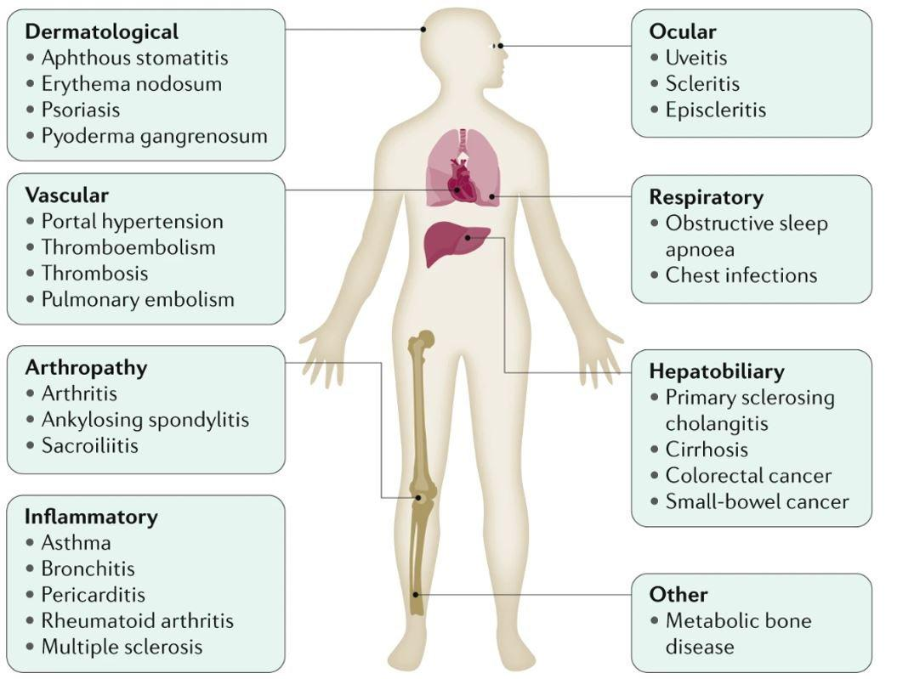 | **Extra-intestinal Manifestations of Inflammatory Bowel Disease** <code>img_000.jpg</code> *Schematic Diagram* [☁️ GitHub Raw](https://raw.githubusercontent.com/clinomaofficial/clinoma-images/main/curriculum/clinical/internal-medicine/gastroenterology/git_master/img_000.jpg) | [⚡ jsDelivr CDN](https://cdn.jsdelivr.net/gh/clinomaofficial/clinoma-images@main/curriculum/clinical/internal-medicine/gastroenterology/git_master/img_000.jpg) | This schematic diagram illustrates the extensive systemic complications associated with inflammatory bowel disease, spanning dermatological, ocular, vascular, respiratory, hepatobiliary, and musculoskeletal systems. Recognizing these extra-intestinal manifestations is crucial for prompt multidisciplinary management, as they often precede or parallel the severity of intestinal inflammation.  *خد بالك يا دكتورنا إن مرضى الالتهاب المعوي المزمن (IBD) مش بيجوا بس بأعراض في البطن، دول ممكن يشتكوا من عيونهم (Uveitis)، أو جلددهم (Erythema nodosum)، أو مفاصلهم (Sacroiliitis). المتابعة الشاملة واكتشاف المظاهر دي بدري بيحمي المريض من مضاعفات خطيرة في كل أجهزة الجسم.* |
|  | **Comparative Pathology and Endoscopy of Crohn's Disease versus Ulcerative Colitis** <code>img_004.jpg</code> *Gross Pathology* [☁️ GitHub Raw](https://raw.githubusercontent.com/clinomaofficial/clinoma-images/main/curriculum/clinical/internal-medicine/gastroenterology/git_master/img_004.jpg) | [⚡ jsDelivr CDN](https://cdn.jsdelivr.net/gh/clinomaofficial/clinoma-images@main/curriculum/clinical/internal-medicine/gastroenterology/git_master/img_004.jpg) | This comparative diagram illustrates the distinct macroscopic, histological, and endoscopic features of inflammatory bowel diseases. Crohn's disease typically presents with transmural inflammation, cobblestoning, deep fissures, and fat wrapping, whereas ulcerative colitis is characterized by continuous mucosal inflammation, loss of haustra, crypt distortion, and pseudopolyps.  *المقارنة بين مرض كرون والالتهاب التقرحي للقولون تعتبر من أهم ركائز الباطنة والجراحة؛ كرون بيتميز بوجود تقرحات عميقة وCobblestoning وTransmural inflammation، بينما الالتهاب التقرحي بياخد الميكوزا بس وبيعمل Pseudopolyps وفقدان للـ Haustra.* |
| 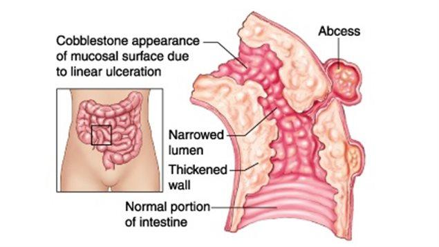 | **Crohn Disease Intestinal Lesions: Cobblestone Appearance, Narrowed Lumen, and Wall Thickening Schematic** <code>img_008.jpg</code> *Schematic Diagram* [☁️ GitHub Raw](https://raw.githubusercontent.com/clinomaofficial/clinoma-images/main/curriculum/clinical/internal-medicine/gastroenterology/git_master/img_008.jpg) | [⚡ jsDelivr CDN](https://cdn.jsdelivr.net/gh/clinomaofficial/clinoma-images@main/curriculum/clinical/internal-medicine/gastroenterology/git_master/img_008.jpg) | This diagram illustrates the transmural pathology of Crohn disease, characterized by deep linear ulcerations creating a cobblestone mucosal pattern, severe transmural wall thickening, luminal narrowing, and associated abscess formation. These hallmark morphological changes frequently lead to complications such as bowel obstruction, fistulae, and strictures.  *خد بالك يا دكتورنا، الرسم ده بيلخص التشريح المرضي لمرض كرونز (Crohn's Disease)، و اللي بيتميز بوجود تقرحات طولية بتعمل مظهر الـ Cobblestone، مع تخن شديد في جدار الأمعاء وضيق في الـ Lumen وتكون خراجات، ودي علامات أساسية بتوضح ليه العيان بيجيله انسداد معوي ومضاعفات.* |
| 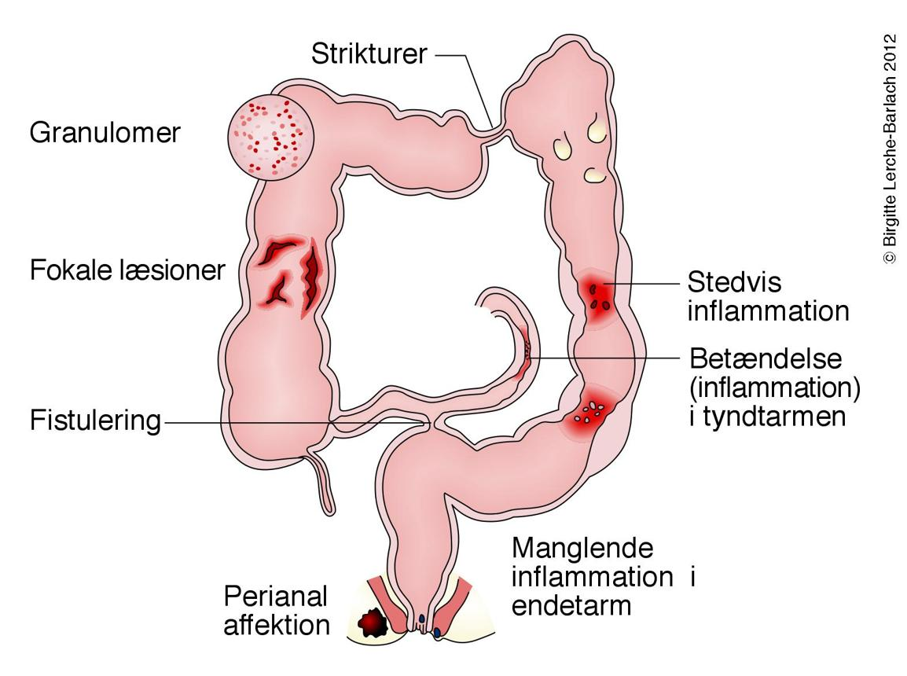 | **Pathophysiological Schematic of Crohn's Disease Clinical Manifestations** <code>img_003.jpg</code> *Schematic Diagram* [☁️ GitHub Raw](https://raw.githubusercontent.com/clinomaofficial/clinoma-images/main/curriculum/clinical/internal-medicine/gastroenterology/git_master/img_003.jpg) | [⚡ jsDelivr CDN](https://cdn.jsdelivr.net/gh/clinomaofficial/clinoma-images@main/curriculum/clinical/internal-medicine/gastroenterology/git_master/img_003.jpg) | This schematic illustrates the hallmark pathological features of Crohn's disease, including transmural inflammation that often leads to strictures and fistulizing tracts. Key diagnostic indicators shown are non-continuous 'skip lesions', the presence of non-caseating granulomas, and the characteristic rectal sparing that differentiates it from ulcerative colitis.  *خد بالك يا دكتورنا، الرسمة دي بتوضح الخصائص الجوهرية لمرض كرونز (Crohn's Disease)؛ ركز على الالتهاب المتقطع (skip lesions) اللي بيميزه عن القولون التقرحي. كمان لاحظ وجود الـ granulomas والضيق (strictures) والناسور (fistula)، وأهم نقطة تشخيصية هي سلامة المستقيم (rectal sparing) في أغلب الحالات اللي بتساعدنا في التفرقة بين أنواع الـ IBD.* |
| 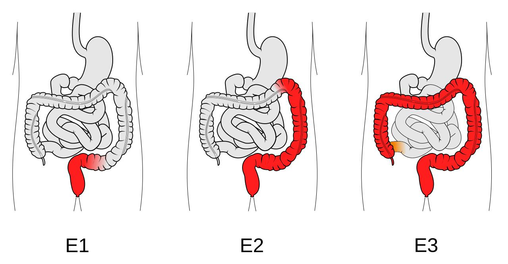 | **Montreal Classification of the Anatomical Extent of Ulcerative Colitis** <code>img_020.jpg</code> *Schematic Diagram* [☁️ GitHub Raw](https://raw.githubusercontent.com/clinomaofficial/clinoma-images/main/curriculum/clinical/internal-medicine/gastroenterology/git_master/img_020.jpg) | [⚡ jsDelivr CDN](https://cdn.jsdelivr.net/gh/clinomaofficial/clinoma-images@main/curriculum/clinical/internal-medicine/gastroenterology/git_master/img_020.jpg) | This diagram illustrates the Montreal classification for the anatomical extent of Ulcerative Colitis (UC). E1 represents ulcerative proctitis (inflammation limited to the rectum); E2 represents left-sided UC (extending up to the splenic flexure); and E3 represents extensive UC or pancolitis (extending proximal to the splenic flexure). Anatomical extent is a critical determinant of clinical severity and dictates the frequency of long-term colorectal cancer surveillance.  *الصورة دي بتوضح تقسيم مونتريال (Montreal Classification) لمدى انتشار التهاب القولون التقرحي. الـ E1 هو التهاب المستقيم فقط، الـ E2 بيمتد للناحية الشمال لحد الطنية الطحالية، أما الـ E3 فده التهاب القولون الشامل (Pancolitis) اللي بيعدي الطنية الطحالية. التقسيم ده يا دكتور بيحدد مدى خطورة الحالة ومواعيد عمل مناظير المتابعة الدورية للكشف المبكر عن الأورام.* |
|  | **IL-23 and IL-12 Cytokine Receptor Signaling Pathways and Monoclonal Antibody Targets** <code>img_019.jpg</code> *Pharmacological Pathway* [☁️ GitHub Raw](https://raw.githubusercontent.com/clinomaofficial/clinoma-images/main/curriculum/clinical/internal-medicine/gastroenterology/git_master/img_019.jpg) | [⚡ jsDelivr CDN](https://cdn.jsdelivr.net/gh/clinomaofficial/clinoma-images@main/curriculum/clinical/internal-medicine/gastroenterology/git_master/img_019.jpg) | This schematic illustrates the molecular structures of IL-23 and IL-12 and their respective receptor complexes along with intracellular JAK/TYK2-STAT signaling pathways. It highlights targeted biological therapies, including Risankizumab, Guselkumab, and Mirikizumab which target IL-23, and Ustekinumab which targets the shared p40 subunit of IL-12 and IL-23, pivotal in the pathogenesis of immune-mediated inflammatory diseases.  *الرسم بيوضح بدقة تركيبة السيتوكينات IL-23 و IL-12 و Receptor بتاعتها جوه الخلية، وازاي الأدوية البيولوجية زي Ustekinumab بتمسك في الـ p40 المشترك، بينما Risankizumab و Guselkumab بيستهدفوا الـ IL-23 بالظبط لتثبيط الالتهابات المناعية.* |
|  | **Salofalk 4g Mesalazine Enemas Pharmaceutical Packaging** <code>img_018.jpg</code> *Clinical Photo* [☁️ GitHub Raw](https://raw.githubusercontent.com/clinomaofficial/clinoma-images/main/curriculum/clinical/internal-medicine/gastroenterology/git_master/img_018.jpg) | [⚡ jsDelivr CDN](https://cdn.jsdelivr.net/gh/clinomaofficial/clinoma-images@main/curriculum/clinical/internal-medicine/gastroenterology/git_master/img_018.jpg) | Salofalk 4g enemas containing mesalazine are utilized for the targeted topical treatment of distal ulcerative colitis and proctitis. Mesalazine acts locally as an anti-inflammatory agent in the gastrointestinal mucosa, minimizing systemic absorption.  *حقن سالوفالك (Mesalazine) بريستال بتركيز 4 جرام بتستخدم كعلاج موضعي فعال لالتهاب القولون التقرحي القاصي والتهاب المستقيم. المادة الفعالة بتشتغل محلياً كـ مضاد للالتهاب في الغشاء المخاطي للقولون وبتقلل الامتصاص الجهازي.* |
| 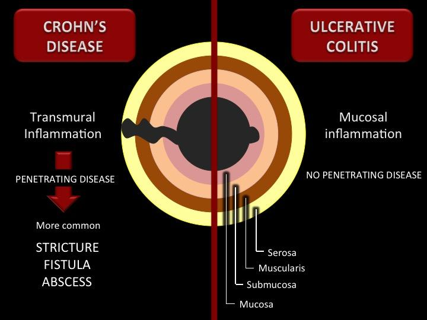 | **Crohn's Disease vs Ulcerative Colitis Intestinal Wall Involvement Comparison** <code>img_017.jpg</code> *Schematic Diagram* [☁️ GitHub Raw](https://raw.githubusercontent.com/clinomaofficial/clinoma-images/main/curriculum/clinical/internal-medicine/gastroenterology/git_master/img_017.jpg) | [⚡ jsDelivr CDN](https://cdn.jsdelivr.net/gh/clinomaofficial/clinoma-images@main/curriculum/clinical/internal-medicine/gastroenterology/git_master/img_017.jpg) | This schematic diagram illustrates the differing depths of gastrointestinal wall inflammation between Crohn's disease and ulcerative colitis. Crohn's disease characteristically features transmural inflammation leading to penetrating disease complications such as strictures, fistulas, and abscesses. Conversely, ulcerative colitis is typically limited to mucosal inflammation without penetrating disease.  *الرسم التوضيحي ده بيقارن بين مرضي الكرونز والقولون التقرحي في عمق الإصابة بجدار الأمعاء. الكرونز بيتميز بإن الالتهاب بياخد الجدار كله (Transmural) وبيعمل مضاعفات زي الناسور والضيق، بينما القולون التقرحي بيقتصر على الغشاء المخاطي (Mucosa) بس.* |
|  | **Severe Conjunctival Injection and Vascular Engorgement in Acute Conjunctivitis** <code>img_015.jpg</code> *Clinical Photo* [☁️ GitHub Raw](https://raw.githubusercontent.com/clinomaofficial/clinoma-images/main/curriculum/clinical/internal-medicine/gastroenterology/git_master/img_015.jpg) | [⚡ jsDelivr CDN](https://cdn.jsdelivr.net/gh/clinomaofficial/clinoma-images@main/curriculum/clinical/internal-medicine/gastroenterology/git_master/img_015.jpg) | This clinical photograph demonstrates pronounced hyperemia and dilation of the conjunctival blood vessels, characteristic of acute inflammatory conditions such as viral, bacterial, or allergic conjunctivitis. The intense localized redness primarily affects the bulbar conjunctiva while sparing the deeper episcleral vessels, a key differentiating sign from scleritis.  *الصورة بتوضح احتقان شديد واكتظاظ في الأوعية الدموية للكونجังتايفا (الملتحمة)، ودي علامة أساسية في التهابات العين الحادة زي الالتهاب البكتيري أو الفيروسي. خد بالك يا دكتورنا إن الاحتقان بيكون أطرافي وواضح أكتر في الملتحمة السطحية، وبيساعدنا نفرق بينه وبين التهابات صلبة العين الأعمق (scleritis).* |
|  | **Mechanism of Action of JAK Inhibitors in the JAK-STAT Signaling Pathway** <code>img_014.jpg</code> *Schematic Diagram* [☁️ GitHub Raw](https://raw.githubusercontent.com/clinomaofficial/clinoma-images/main/curriculum/clinical/internal-medicine/gastroenterology/git_master/img_014.jpg) | [⚡ jsDelivr CDN](https://cdn.jsdelivr.net/gh/clinomaofficial/clinoma-images@main/curriculum/clinical/internal-medicine/gastroenterology/git_master/img_014.jpg) | This schematic illustrates the inhibition of the Janus kinase/signal transducer and activator of transcription (JAK-STAT) signaling pathway. JAK inhibitors block the enzymatic activity of Janus kinases associated with cytokine receptors, thereby preventing the phosphorylation and downstream activation of STAT proteins and subsequent transcription of inflammation-related genes.  *خد بالك يا دكتورنا، أدوية الـ JAK Inhibitors بتشتغل عن طريق إنها بتقفل إنزيمات الـ JAK اللي تحت مستقبلات السيتوكين، فبتمنع خطوة الـ Phosphorylation وتنشيط الـ STAT، وده بيوقف التعبير الجيني للالتهابات من جذوره.* |
| 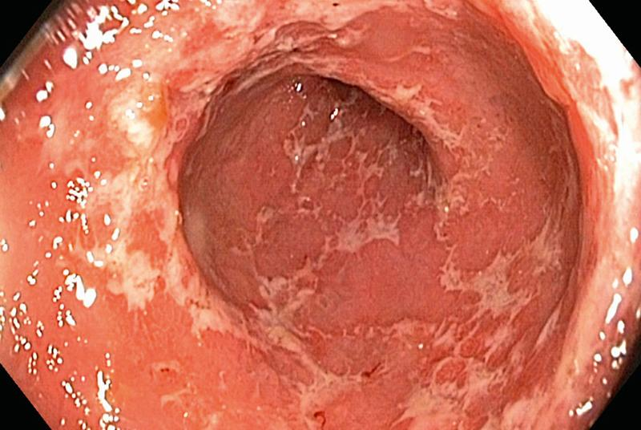 | **Severe Corrosive Gastritis with Extensive Mucosal Sloughing and Ulceration on Endoscopy** <code>img_026.jpg</code> *Endoscopy / Laparoscopy* [☁️ GitHub Raw](https://raw.githubusercontent.com/clinomaofficial/clinoma-images/main/curriculum/clinical/internal-medicine/gastroenterology/git_master/img_026.jpg) | [⚡ jsDelivr CDN](https://cdn.jsdelivr.net/gh/clinomaofficial/clinoma-images@main/curriculum/clinical/internal-medicine/gastroenterology/git_master/img_026.jpg) | Endoscopic visualization reveals severe caustic injury to the gastric mucosa characterized by widespread necrosis, thick white exudative sloughing, and deep patchy ulceration following acute toxic ingestion. This acute mucosal destruction requires urgent conservative management, serial imaging, and intensive monitoring for delayed complications such as perforation and stricture formation.  *خد بالك يا دكتورنا، المنظار ده بيبين التهاب معدة كاوٍ شديد (Corrosive Gastritis) نتيجة بلع مادة سامة أو حارقة، وفي تهتك واسع في الغشاء المخاطي وتقرحات عميقة وبيضاويّة الشكل، والحالات دي بتستوجب متابعة دقيقة جداً عشان خطر الثقب أو الانقباضات المتأخرة.* |
|  | **Mesalamine Rectal Suppositories 1000 mg Packaging and Units** <code>img_029.jpg</code> *Pharmacological Pathway* [☁️ GitHub Raw](https://raw.githubusercontent.com/clinomaofficial/clinoma-images/main/curriculum/clinical/internal-medicine/gastroenterology/git_master/img_029.jpg) | [⚡ jsDelivr CDN](https://cdn.jsdelivr.net/gh/clinomaofficial/clinoma-images@main/curriculum/clinical/internal-medicine/gastroenterology/git_master/img_029.jpg) | Mesalamine 1000 mg rectal suppositories are a topical anti-inflammatory formulation indicated for the treatment of active distal ulcerative colitis, proctosigmoiditis, or proctitis. The drug acts locally on the inflamed colonic mucosa primarily by inhibiting cyclooxygenase and lipoxygenase, thereby reducing the production of inflammatory prostaglandins and leukotrienes.  *تحاميل الميزالامين (Mesalamine) بتركيز ١٠٠٠ ملجم تُستخدم موضعياً لعلاج التهاب القولون التقرحي في الجزء السفلي والتهاب المستقيم النشط. الشغل الشاغل هنا هو التأثير الموضعي المضاد للالتهاب في الغشاء المخاطي للقولون عن طريق تثبيط إنزيمات السيكلوأكسيجيناز والليبواكسيجيناز لتقليل تكون البروستاجلاندين والليوكوترين.* |
| 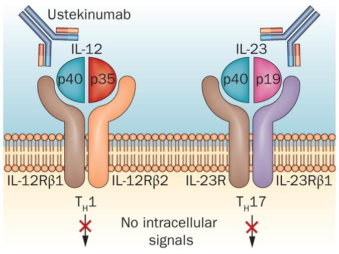 | **Pharmacological Mechanism of Ustekinumab Targeting the IL-12/23 p40 Subunit** <code>img_035.jpg</code> *Pharmacological Pathway* [☁️ GitHub Raw](https://raw.githubusercontent.com/clinomaofficial/clinoma-images/main/curriculum/clinical/internal-medicine/gastroenterology/git_master/img_035.jpg) | [⚡ jsDelivr CDN](https://cdn.jsdelivr.net/gh/clinomaofficial/clinoma-images@main/curriculum/clinical/internal-medicine/gastroenterology/git_master/img_035.jpg) | Ustekinumab is a humanized monoclonal antibody that selectively binds to the shared p40 protein subunit of interleukin-12 (IL-12) and interleukin-23 (IL-23). This binding prevents these pro-inflammatory cytokines from interacting with the IL-12Rβ1 receptor subunit, thereby inhibiting the downstream signaling pathways that lead to Th1 and Th17 cell differentiation and activation, which are key drivers of chronic inflammation in conditions like Crohn's disease and ulcerative colitis.  *خلي بالك يا دكتور، الـ Ustekinumab بيشتغل عن طريق قفل الـ p40 subunit المشتركة بين IL-12 و IL-23، وده بيوقف مسارات الـ Th1 والـ Th17 المسؤولة عن الالتهاب المزمن. ميزة الدواء ده إنه بيستهدف خطوة محورية في العملية الالتهابية، وعشان كده هو خيار ممتاز في حالات الـ Crohn's disease والـ Ulcerative Colitis اللي مش بتستجيب للـ anti-TNF التقليدي.* |
|  | **Treatment Algorithm for Acute Flare of Crohn's Disease** <code>img_036.jpg</code> *Schematic Diagram* [☁️ GitHub Raw](https://raw.githubusercontent.com/clinomaofficial/clinoma-images/main/curriculum/clinical/internal-medicine/gastroenterology/git_master/img_036.jpg) | [⚡ jsDelivr CDN](https://cdn.jsdelivr.net/gh/clinomaofficial/clinoma-images@main/curriculum/clinical/internal-medicine/gastroenterology/git_master/img_036.jpg) | This diagnostic and therapeutic flowchart outlines the management strategies for acute Crohn's disease flares based on anatomical location and disease severity. It details the escalation steps from corticosteroids and budesonide to immunomodulators and targeted biologic therapies such as anti-TNF, anti-IL-23, and anti-integrin agents, guiding decisions for both induction and maintenance of remission.  *خد بالك يا دكتورنا إن خوارزمية علاج الشدة الحادة لمريض كوهين بتعتمد بشكل أساسي على مكان الإصابة (سواء فوق أو تحت) ودرجة نشاط المرض. في الحالات الخفيفة بنبدأ بـ Budesonide، لكن الحالات العنيفة أو الممتدة بتحتاج ستيرويدز نظامية مع تصعيد سريع للعلاجات البيولوجية أو المثبطة للمناعة لو حصلت مقاومة للكورتيزون.* |
| 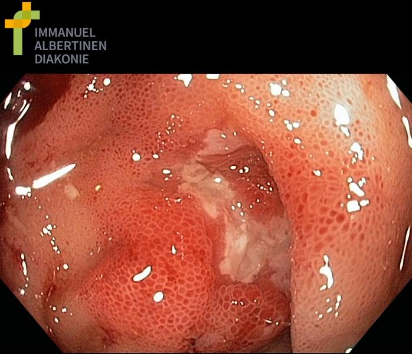 | **Gastric Ulcer with Granulation Tissue and Fibrin Exudate on Upper Endoscopy** <code>img_045.jpg</code> *Endoscopy / Laparoscopy* [☁️ GitHub Raw](https://raw.githubusercontent.com/clinomaofficial/clinoma-images/main/curriculum/clinical/internal-medicine/gastroenterology/git_master/img_045.jpg) | [⚡ jsDelivr CDN](https://cdn.jsdelivr.net/gh/clinomaofficial/clinoma-images@main/curriculum/clinical/internal-medicine/gastroenterology/git_master/img_045.jpg) | Upper endoscopy demonstrates a well-demarcated gastric mucosal ulceration covered by a white-yellowish fibrin exudate, surrounded by prominent hyperemic folds. Such findings typically correlate with peptic ulcer disease, requiring targeted biopsies to rule out malignancy and testing for Helicobacter pylori infection.  *خد بالك يا دكتورنا، القرحة المعدية دي واضحة جداً وفيها غشاء فيبريني أبيض في القاع مع تورم والتهاب في الغشاء المخاطي حواليها، ولازم دايماً ناخد عينات (Biopsies) من حواف القرحة عشان نستبعد الأورام الخبيثة ونطمن لنفي وجود جرثومة المعدة.* |
| 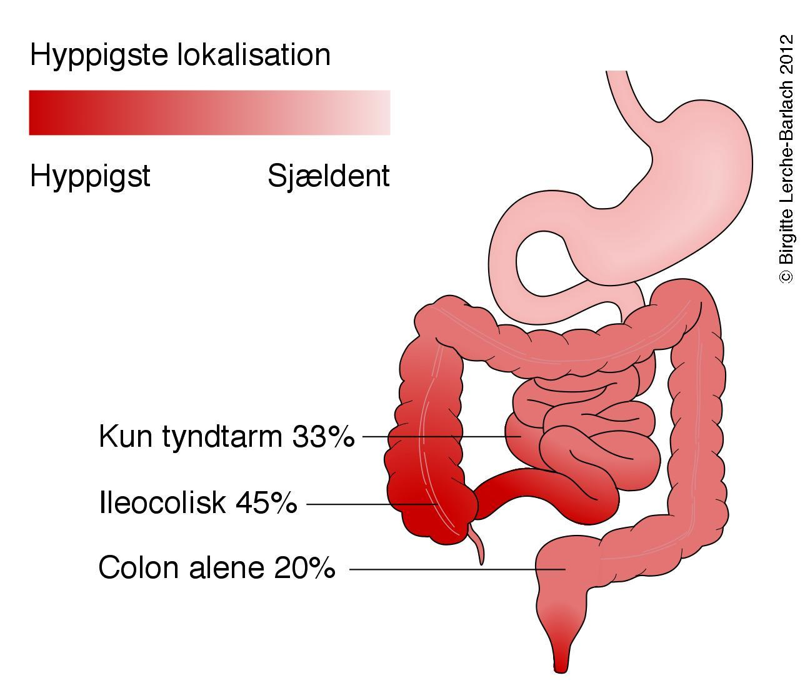 | **Anatomical Localization and Frequency Distribution of Crohn's Disease** <code>img_041.jpg</code> *Schematic Diagram* [☁️ GitHub Raw](https://raw.githubusercontent.com/clinomaofficial/clinoma-images/main/curriculum/clinical/internal-medicine/gastroenterology/git_master/img_041.jpg) | [⚡ jsDelivr CDN](https://cdn.jsdelivr.net/gh/clinomaofficial/clinoma-images@main/curriculum/clinical/internal-medicine/gastroenterology/git_master/img_041.jpg) | This schematic illustration demonstrates the characteristic anatomical distribution patterns of Crohn's disease involvement across the gastrointestinal tract. The most common site of involvement is the ileocolic region (45%), followed by isolated small bowel disease (33%) and isolated colonic involvement (20%).  *الرسم التوضيحي بيبين أماكن الإصابة بمرض كرونز في الجهاز الهضمي ونسبتها، وأكثر مكان بيحصل فيه الإصابة هو منطقة اتصال الأمعاء الدقيقة بالغليظة (Ileocolic) بنسبة 45%. خد بالك يا دكتورنا إن معرفة الأماكن دي بتساعدنا في توجيه الفحوصات والتشخيص المبكر بدقة.* |
| 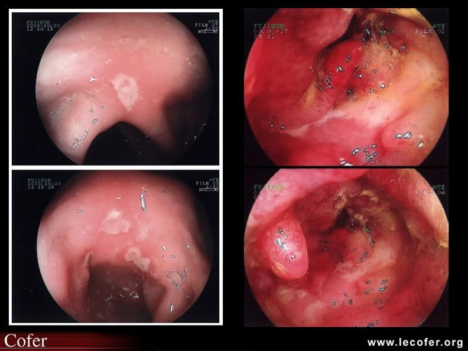 | **Endoscopic View of Esophageal Candidiasis and Ulceration** <code>img_044.jpg</code> *Endoscopy / Laparoscopy* [☁️ GitHub Raw](https://raw.githubusercontent.com/clinomaofficial/clinoma-images/main/curriculum/clinical/internal-medicine/gastroenterology/git_master/img_044.jpg) | [⚡ jsDelivr CDN](https://cdn.jsdelivr.net/gh/clinomaofficial/clinoma-images@main/curriculum/clinical/internal-medicine/gastroenterology/git_master/img_044.jpg) | Endoscopic evaluation of the esophagus revealing characteristic white plaques consistent with candidiasis alongside prominent deep mucosal ulcerations. These findings indicate severe infectious esophagitis, frequently seen in immunocompromised patients or following prolonged broad-spectrum antibiotic therapy.  *خد بالك يا دكتورنا، المنظار هنا بيكشف لقطات واضحة لعدوى فطرية في المريء (Candidasis) مع تقرحات عميقة في الغشاء المخاطي. الحالات دي بتظهر أكتر في المرضى اللي مناعتهم ضعيفة أو اللي ماشيين على مضادات حيوية لفترات طويلة، وبتتطلب تشخيص وعلاج سريع عشان تفادي المضاعفات.* |
|  | **Esophageal Varices and Mucosal Alterations on Upper Gastrointestinal Endoscopy** <code>img_049.jpg</code> *Endoscopy / Laparoscopy* [☁️ GitHub Raw](https://raw.githubusercontent.com/clinomaofficial/clinoma-images/main/curriculum/clinical/internal-medicine/gastroenterology/git_master/img_049.jpg) | [⚡ jsDelivr CDN](https://cdn.jsdelivr.net/gh/clinomaofficial/clinoma-images@main/curriculum/clinical/internal-medicine/gastroenterology/git_master/img_049.jpg) | Endoscopic view of the esophagus demonstrating prominent tortuous varices encircled with dashed highlights, accompanied by overlying mucosal congestion and active bleeding spots. These findings reflect severe portal hypertension, commonly secondary to liver cirrhosis, carrying a high risk of life-threatening upper gastrointestinal hemorrhage.  *خد بالك يا دكتورنا، المنظر ده بيوضح دوali مريء واضحة جداً وملفوفة مع احتقان شديد في الغشاء المخاطي ونقاط نزفية. الحالة دي انعكاس مباشر لارتفاع ضغط الوريد البابى (Portal Hypertension) ولازم نتعامل معاها بحذر شديد لتجنب خطر النزيف الكبير.* |
|  | **Gastrointestinal Tract Manifestations and Pathological Features of Crohn's Disease** <code>img_052.jpg</code> *Schematic Diagram* [☁️ GitHub Raw](https://raw.githubusercontent.com/clinomaofficial/clinoma-images/main/curriculum/clinical/internal-medicine/gastroenterology/git_master/img_052.jpg) | [⚡ jsDelivr CDN](https://cdn.jsdelivr.net/gh/clinomaofficial/clinoma-images@main/curriculum/clinical/internal-medicine/gastroenterology/git_master/img_052.jpg) | Schematic representation of the gastrointestinal tract illustrating characteristic features of Crohn's disease, including transmural inflammation, skip lesions, strictures, and fistulizing disease affecting the ascending colon and small intestine.  *خد بالك يا دكتورنا إن الكرونز ديزيز (Crohn's disease) بيتميز بوجود Skip lesions و Strictures و Fistulas، وبيقدر يصيب أي جزء من الـ GI tract من أول البوق لحد الشرج بس أكتر مكان مشهور هو الـ terminal ileum والـ ascending colon، وبتعمل transmural inflammation مش مجرد mucosal زي الـ UC.* |
|  | **Chronic Colitis with Cryptitis and Basal Plasmacytosis Histological Micrograph** <code>img_050.jpg</code> *Histological Micrograph* [☁️ GitHub Raw](https://raw.githubusercontent.com/clinomaofficial/clinoma-images/main/curriculum/clinical/internal-medicine/gastroenterology/git_master/img_050.jpg) | [⚡ jsDelivr CDN](https://cdn.jsdelivr.net/gh/clinomaofficial/clinoma-images@main/curriculum/clinical/internal-medicine/gastroenterology/git_master/img_050.jpg) | This H&E stained colonic mucosal biopsy demonstrates chronic active colitis characterized by architectural distortion of crypts, intensive lamina propria mononuclear infiltrate, and cryptitis. These findings are cardinal histopathologic features supporting inflammatory bowel disease such as ulcerative colitis or Crohn's disease.  *خد بالك يا دكتورنا، العينة هنا بتوضح التهاب قولون مزمن نشط مع تشوهات في الغدد (Crypts) وارتشاح التهابي خلوى واضح في اللامينا بروبريا. المنظر ده بيوجهنا بقوة نحو تشخيص الأمراض الالتهابية المزمنة للأمعاء (IBD) زي الـ Ulcerative Colitis.* |
|  | **Colonoscopic View of Erythematous and Edematous Colonic Mucosa in Active Ulcerative Colitis** <code>img_054.jpg</code> *Endoscopy / Laparoscopy* [☁️ GitHub Raw](https://raw.githubusercontent.com/clinomaofficial/clinoma-images/main/curriculum/clinical/internal-medicine/gastroenterology/git_master/img_054.jpg) | [⚡ jsDelivr CDN](https://cdn.jsdelivr.net/gh/clinomaofficial/clinoma-images@main/curriculum/clinical/internal-medicine/gastroenterology/git_master/img_054.jpg) | This colonoscopic image demonstrates diffuse mucosal erythema, loss of the normal vascular pattern, and friability characteristic of active inflammation in inflammatory bowel disease, specifically ulcerative colitis. Early identification of these endoscopic features is crucial for grading disease severity, guiding targeted immunosuppressive or biologic therapy, and preventing long-term complications.  *خد بالك يا دكتورنا، المنظار ده بيبين غشاء القولون محتقن وملتهب وفي فقدان للرسمة الوعائية الطبيعية، ودي علامات أساسية لالتهاب القولون التقرحي النشط. التشخيص السريع والمظبوط هنا بيفرق جداً في تحديد خطة العلاج ومنع المضاعفات المزمنة.* |
|  | **Crohn's Disease Intestinal Pathology and Cobblestoning Schematic** <code>img_053.jpg</code> *Schematic Diagram* [☁️ GitHub Raw](https://raw.githubusercontent.com/clinomaofficial/clinoma-images/main/curriculum/clinical/internal-medicine/gastroenterology/git_master/img_053.jpg) | [⚡ jsDelivr CDN](https://cdn.jsdelivr.net/gh/clinomaofficial/clinoma-images@main/curriculum/clinical/internal-medicine/gastroenterology/git_master/img_053.jpg) | This diagram illustrates the classical transmural pathology of Crohn's disease, featuring deep linear ulcerations creating a cobblestone mucosal appearance, stricture formation leading to a narrowed lumen, and a markedly thickened bowel wall with associated abscesses. These structural changes reflect chronic inflammation characteristic of inflammatory bowel disease.  *خد بالك يا دكتورنا، الرسمة دي بتلخص أهم علامات مرض كرونز (Crohn's disease) زي الـ Cobblestoning بسبب القرح الطولية، والـ Wall thickening اللي بيعمل Narrowed lumen وبيسبب انسداد معوي. ركز برضه في وجود الـ Abscess والأجزاء المتأثرة وسط أجزاء سليمة (Skip lesions).* |
| 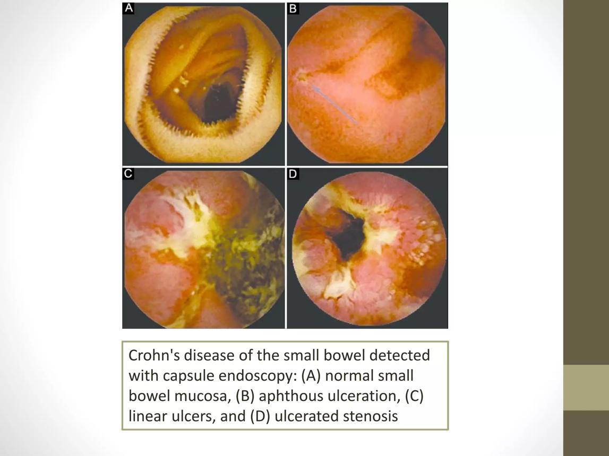 | **Crohn's Disease of the Small Bowel Capsule Endoscopy** <code>img_047.jpg</code> *Endoscopy / Laparoscopy* [☁️ GitHub Raw](https://raw.githubusercontent.com/clinomaofficial/clinoma-images/main/curriculum/clinical/internal-medicine/gastroenterology/git_master/img_047.jpg) | [⚡ jsDelivr CDN](https://cdn.jsdelivr.net/gh/clinomaofficial/clinoma-images@main/curriculum/clinical/internal-medicine/gastroenterology/git_master/img_047.jpg) | Capsule endoscopy images demonstrating progressive small bowel involvement in Crohn's disease, transitioning from normal mucosa to aphthous ulcerations, deep linear ulcers, and ulcerated stenosis. These findings illustrate the hallmark transmural inflammatory changes and stricture formation characteristic of complicated small bowel Crohn's disease.  *خد بالك يا دكتورنا، منظار الكبسولة ده بيوريك تطور آصابات كرونز في الأمعاء الدقيقة من الغشاء المخاطي السليم لحد التقرحات الخيطية والتضيق التقرحي الخطير. الفحص ده مفيد جداً لتقييم الأمعاء الدقيقة لما المنظار التقليدي ما يجيبش آخره.* |
| 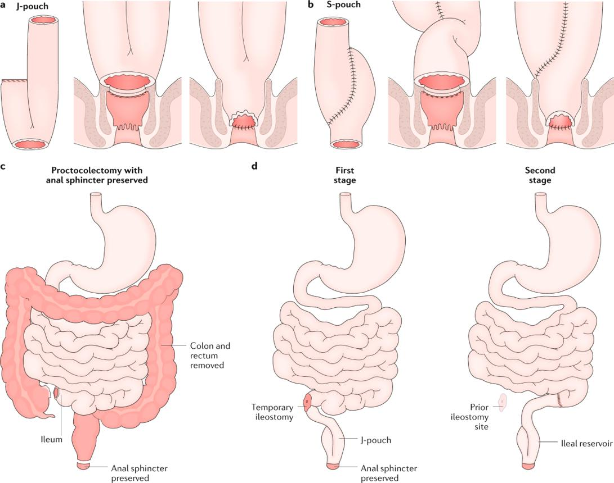 | **Surgical Construction of Ileal Pouch-Anal Anastomosis (J-pouch and S-pouch)** <code>img_006.jpg</code> *Schematic Diagram* [☁️ GitHub Raw](https://raw.githubusercontent.com/clinomaofficial/clinoma-images/main/curriculum/clinical/internal-medicine/gastroenterology/git_master/img_006.jpg) | [⚡ jsDelivr CDN](https://cdn.jsdelivr.net/gh/clinomaofficial/clinoma-images@main/curriculum/clinical/internal-medicine/gastroenterology/git_master/img_006.jpg) | Schematic representation of restorative proctocolectomy procedures utilizing J-pouch and S-pouch designs following colectomy. These techniques preserve the anal sphincter mechanism and restore gastrointestinal continuity via ileoanal anastomosis, commonly performed in patients with ulcerative colitis or familial adenomatous polyposis.  *خد بالك يا دكتورنا، الرسمات دي بتوضح خطوات جراحات الـ Restorative Proctocolectomy وتكوين الـ J-pouch أو S-pouch عشان نحافظ على الـ Anal sphincter ونمنع الحاجة لـ Permanent ileostomy للمريض.* |
| 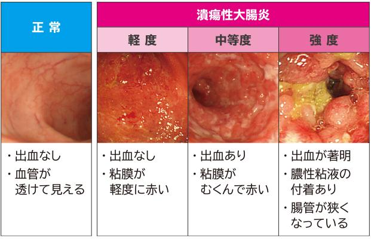 | **Endoscopic Severity Classification of Ulcerative Colitis: Normal vs Mild, Moderate, and Severe Inflammation** <code>img_009.jpg</code> *Endoscopy / Laparoscopy* [☁️ GitHub Raw](https://raw.githubusercontent.com/clinomaofficial/clinoma-images/main/curriculum/clinical/internal-medicine/gastroenterology/git_master/img_009.jpg) | [⚡ jsDelivr CDN](https://cdn.jsdelivr.net/gh/clinomaofficial/clinoma-images@main/curriculum/clinical/internal-medicine/gastroenterology/git_master/img_009.jpg) | This comparative endoscopic series demonstrates the progressive mucosal changes in ulcerative colitis, ranging from normal vascular visibility to severe inflammation characterized by marked hemorrhage, purulent exudate, and structural narrowing. Accurate endoscopic grading is essential for assessing disease activity, monitoring therapeutic response, and guiding clinical management.  *خد بالك يا دكتورنا، تقييم شدة الالتهاب القولوني التقرحي بالمنظار بيعتمد على درجة الاحمرار، وجود الوخز أو النزيف، والتقرحات والصديد. في الحالات الطبيعية بنشوف الأوعية الدموية بوضوح، لكن كل ما المرض بيشد (من خفيف لشديد)، بتبان الأغشية المخاطية بورم ونزيف وبتفقد الأوعية تماماً.* |
| 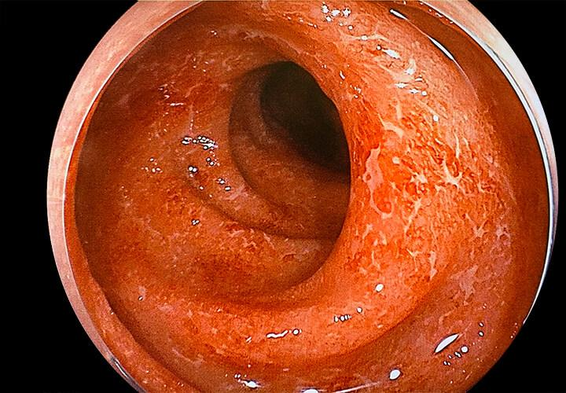 | **Colonoscopic View of Erythematous and Edematous Colonic Mucosa in Ulcerative Colitis** <code>img_010.jpg</code> *Endoscopy / Laparoscopy* [☁️ GitHub Raw](https://raw.githubusercontent.com/clinomaofficial/clinoma-images/main/curriculum/clinical/internal-medicine/gastroenterology/git_master/img_010.jpg) | [⚡ jsDelivr CDN](https://cdn.jsdelivr.net/gh/clinomaofficial/clinoma-images@main/curriculum/clinical/internal-medicine/gastroenterology/git_master/img_010.jpg) | This colonoscopic image demonstrates diffuse mucosal erythema, loss of distinct vascular markings, and granular friability characteristic of active ulcerative colitis. These endoscopic findings reflect chronic mucosal inflammation and are critical for assessing disease severity and guiding targeted immunomodulatory therapy.  *خد بالك يا دكتورنا، المنظر ده بيبين غشاء القولون المحتقن وفيه فقدان للرسمة الوعائية الطبيعية مع خشونة ورشح واضح ودي علامات أساسية لالتهاب القولون التقرحي النشط. التقييم السليم ده بيساعدنا نحدد شدة الالتهاب ونظبط خطة العلاج المناعية بدقة.* |
|  | **Peripheral Intravenous Access Placement for Clinical Infusion Therapy** <code>img_001.jpg</code> *Clinical Photo* [☁️ GitHub Raw](https://raw.githubusercontent.com/clinomaofficial/clinoma-images/main/curriculum/clinical/internal-medicine/gastroenterology/git_master/img_001.jpg) | [⚡ jsDelivr CDN](https://cdn.jsdelivr.net/gh/clinomaofficial/clinoma-images@main/curriculum/clinical/internal-medicine/gastroenterology/git_master/img_001.jpg) | Demonstration of peripheral intravenous cannulation in a patient receiving outpatient infusion therapy. Proper technique ensures reliable vascular access while minimizing local complications such as phlebitis, extravasation, or accidental dislodgement.  *خد بالك يا دكتورنا إن تثبيت الكانيولا في الوريد السطحي للساعد محتاج تعقيم دقيق واختيار مقاس مناسب للوريد عشان نتجنب الـ Extravasation والـ Phlebitis، ونتأكد إن المحلول شغال بسلاسة قبل ما نسيب المريض.* |
| 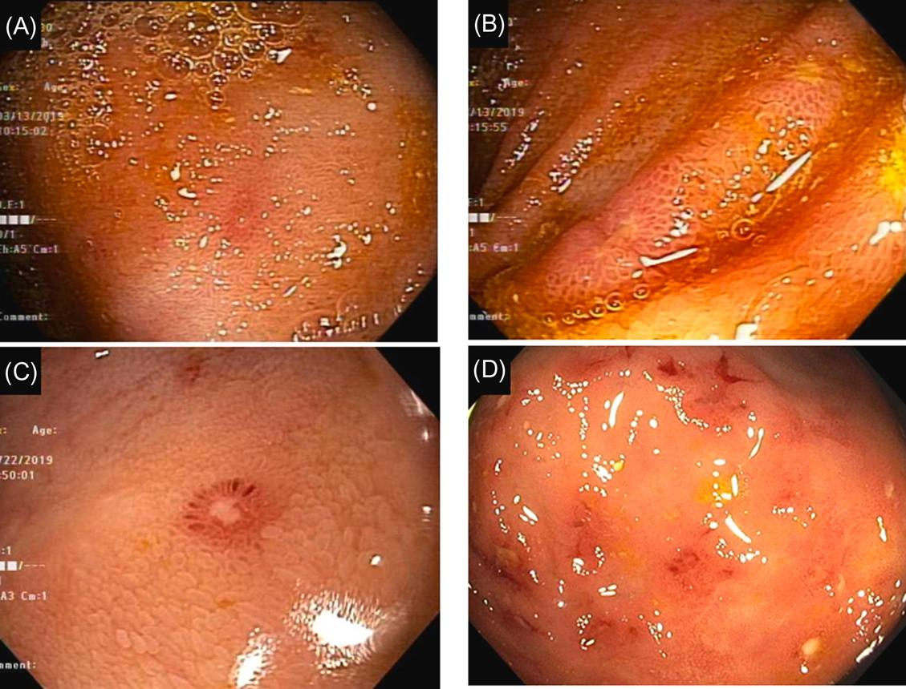 | **Capsule Endoscopy Findings of Small Bowel Mucosal Lesions** <code>img_007.jpg</code> *Endoscopy / Laparoscopy* [☁️ GitHub Raw](https://raw.githubusercontent.com/clinomaofficial/clinoma-images/main/curriculum/clinical/internal-medicine/gastroenterology/git_master/img_007.jpg) | [⚡ jsDelivr CDN](https://cdn.jsdelivr.net/gh/clinomaofficial/clinoma-images@main/curriculum/clinical/internal-medicine/gastroenterology/git_master/img_007.jpg) | Capsule endoscopy images demonstrating various small bowel mucosal abnormalities, including patchy erythema, edema, and localized erosive ulcerations. These findings are crucial for diagnosing occult gastrointestinal bleeding, Crohn's disease, or NSAID-induced enteropathy.  *الصور بتوريني منظار الكبسولة للغشاء المخاطي للأمعاء الدقيقة، وفيه التهابات وتقرحات صغيرة واضحة. الحاجة دي مهمة جداً لما نيجي ندور على سبب نزيف الجهاز الهضمي غير المبرر أو تشخيص أمراض الأمعاء الالتهابية.* |
| 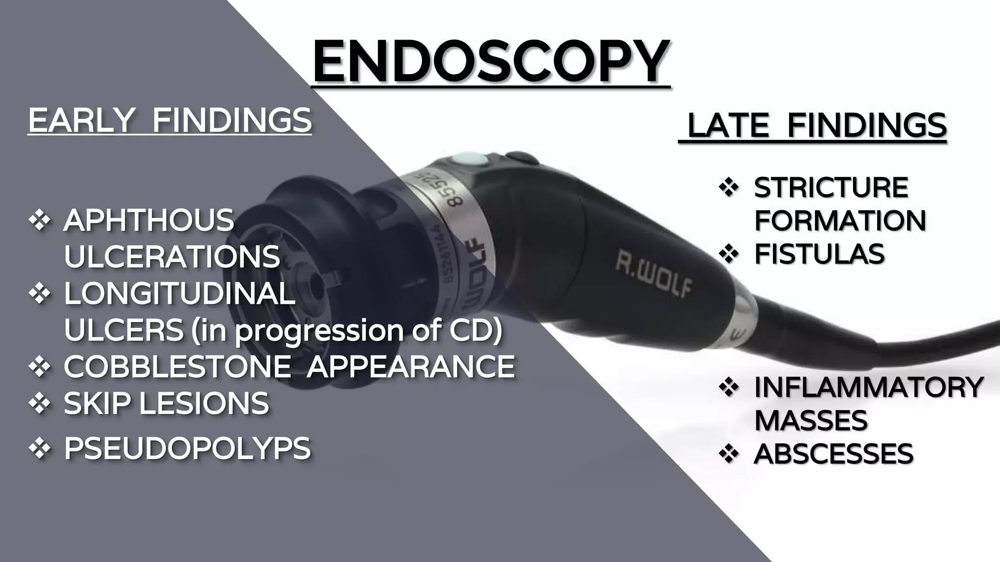 | **Endoscopic Findings in Crohn's Disease: Early vs Late Manifestations** <code>img_011.jpg</code> *Endoscopy / Laparoscopy* [☁️ GitHub Raw](https://raw.githubusercontent.com/clinomaofficial/clinoma-images/main/curriculum/clinical/internal-medicine/gastroenterology/git_master/img_011.jpg) | [⚡ jsDelivr CDN](https://cdn.jsdelivr.net/gh/clinomaofficial/clinoma-images@main/curriculum/clinical/internal-medicine/gastroenterology/git_master/img_011.jpg) | This educational diagram compares the early endoscopic manifestations of Crohn's disease, such as aphthous and longitudinal ulcers with skip lesions, against advanced structural complications like strictures, fistulas, and abscess formation. Recognizing these endoscopic patterns is vital for staging transmural inflammation, evaluating disease progression, and guiding targeted biologic therapy.  *خد بالك يا دكتورنا، المنظار في مرض كرونز بيفرق جداً بين التغيرات الأولية زي الـ Aphthous ulcers و الـ Skip lesions وبين المضاعفات المتقدمة الخطيرة زي الـ Strictures و الـ Fistulas اللي بتدل على التهاب جداري عميق.* |
|  | **Gastric Antral Vascular Ectasia (GAVE) Endoscopic Presentation** <code>img_021.jpg</code> *Endoscopy / Laparoscopy* [☁️ GitHub Raw](https://raw.githubusercontent.com/clinomaofficial/clinoma-images/main/curriculum/clinical/internal-medicine/gastroenterology/git_master/img_021.jpg) | [⚡ jsDelivr CDN](https://cdn.jsdelivr.net/gh/clinomaofficial/clinoma-images@main/curriculum/clinical/internal-medicine/gastroenterology/git_master/img_021.jpg) | Endoscopic view of the gastric antrum showing longitudinal red stripes radiating from the pylorus to the antrum, characteristic of gastric antral vascular ectasia (watermelon stomach). These vascular lesions are a significant cause of chronic upper gastrointestinal bleeding and iron deficiency anemia.  *منظار علوي بيبين التخطيط الأحمر المميز في غار المعدة (Antrum) اللي بنسميه Watermelon stomach أو الـ GAVE، وده بيعمل نزيف بطيء ومزمن يسبب أنيميا نقص الحديد وبيحتاج كوي بالـ Argon plasma coagulation.* |
|  | **Anatomical Comparison of Normal Colon and Ulcerative Colitis with Mucosal Inflammation** <code>img_013.jpg</code> *Schematic Diagram* [☁️ GitHub Raw](https://raw.githubusercontent.com/clinomaofficial/clinoma-images/main/curriculum/clinical/internal-medicine/gastroenterology/git_master/img_013.jpg) | [⚡ jsDelivr CDN](https://cdn.jsdelivr.net/gh/clinomaofficial/clinoma-images@main/curriculum/clinical/internal-medicine/gastroenterology/git_master/img_013.jpg) | This schematic diagram illustrates the macroscopic and microscopic differences between a normal colon and one affected by ulcerative colitis. Key pathological features include continuous mucosal inflammation starting from the rectum and extending proximally, loss of normal vascular pattern, and the formation of superficial ulcerative surfaces along the colon wall.  *يا دكتورنا، خد بالك إن القولون التقرحي بيمتاز بالـ Continuous inflammation اللي بتبدأ من المستقيم وبتطلع لفوق بشكل متصل، مش متقطع زي داء كرون. ركز في التشريح المقارن بين اللومن السليم والتقرحات السطحية عشان التشخيص الإكلينيكي.* |
| 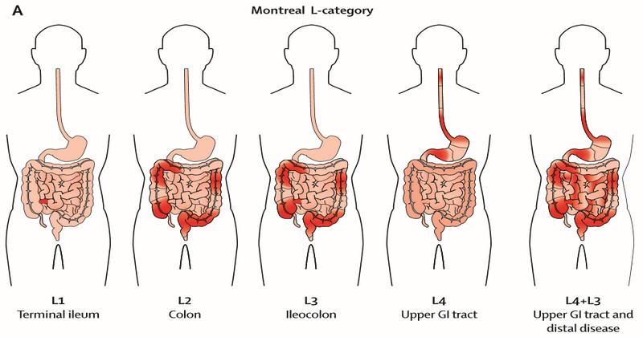 | **Montreal Classification for Crohn's Disease Location Categories (L1 to L4+L3)** <code>img_022.jpg</code> *Schematic Diagram* [☁️ GitHub Raw](https://raw.githubusercontent.com/clinomaofficial/clinoma-images/main/curriculum/clinical/internal-medicine/gastroenterology/git_master/img_022.jpg) | [⚡ jsDelivr CDN](https://cdn.jsdelivr.net/gh/clinomaofficial/clinoma-images@main/curriculum/clinical/internal-medicine/gastroenterology/git_master/img_022.jpg) | The Montreal classification categorizes Crohn's disease by anatomical location into L1 (terminal ileum), L2 (colon), L3 (ileocolon), and L4 (upper GI tract involvement proximal to the ligament of Treitz, which can be combined with L3). This phenotypic categorization is essential for guiding therapeutic strategies, predicting surgical intervention risks, and assessing disease progression patterns.  *خد بالك يا دكتورنا إن تصنيف مونتريال لمكان الإصابة في مرض كرونز بيفرق جداً في تحديد خطة العلاج والتنبؤ بالتدخل الجراحي. التركيز هنا بيكون على تحديد هل المرض محصور في اللفائفي الطرفي (L1) ولا القولون (L2) ولا الاتنين معاً (L3) أو معاه الجزء العلوي من الجهاز الهضمي (L4)، عشان تختار البيولوجي أو العلاج المناسب للمريض.* |
|  | **Mesalamine Delayed-Release Tablets 1.2 Gram Pharmaceutical Packaging** <code>img_023.jpg</code> *Clinical Photo* [☁️ GitHub Raw](https://raw.githubusercontent.com/clinomaofficial/clinoma-images/main/curriculum/clinical/internal-medicine/gastroenterology/git_master/img_023.jpg) | [⚡ jsDelivr CDN](https://cdn.jsdelivr.net/gh/clinomaofficial/clinoma-images@main/curriculum/clinical/internal-medicine/gastroenterology/git_master/img_023.jpg) | Mesalamine is an aminosalicylate anti-inflammatory drug commonly prescribed for the induction and maintenance of remission in ulcerative colitis. The delayed-release formulation ensures targeted delivery of the active moiety to the terminal ileum and colon, minimizing systemic absorption.  *خد بالك يا دكتورنا، مسالازين هو حجر الأساس في علاج التهاب القولون التقرحي، وصيغة الـ delayed-release دي بتضمن إن الدواء يوصل للقولون والileum من غير ما يمتص بدري في المعدة عشان يدي أعلى تاثير موضعي.* |
|  | **Capsule Endoscopy Findings of Small Bowel Mucosal Lesions** <code>img_005.jpg</code> *Endoscopy / Laparoscopy* [☁️ GitHub Raw](https://raw.githubusercontent.com/clinomaofficial/clinoma-images/main/curriculum/clinical/internal-medicine/gastroenterology/git_master/img_005.jpg) | [⚡ jsDelivr CDN](https://cdn.jsdelivr.net/gh/clinomaofficial/clinoma-images@main/curriculum/clinical/internal-medicine/gastroenterology/git_master/img_005.jpg) | Capsule endoscopy views showing various small bowel mucosal abnormalities including localized erythema, small ulcerations, and vascular lesions. These findings are critical in diagnosing obscure gastrointestinal bleeding, Crohn's disease, or small bowel enteropathies.  *صور بالكبسولة المنظارية بتوضح آفات والتهابات وقرح وقائية في غشاء الأمعاء الدقيقة. الفحص ده أساسي في تشخيص حالات النزيف المبهم من الجهاز الهضمي أو أمراض الأمعاء الالتهابية زي كرونز.* |
| 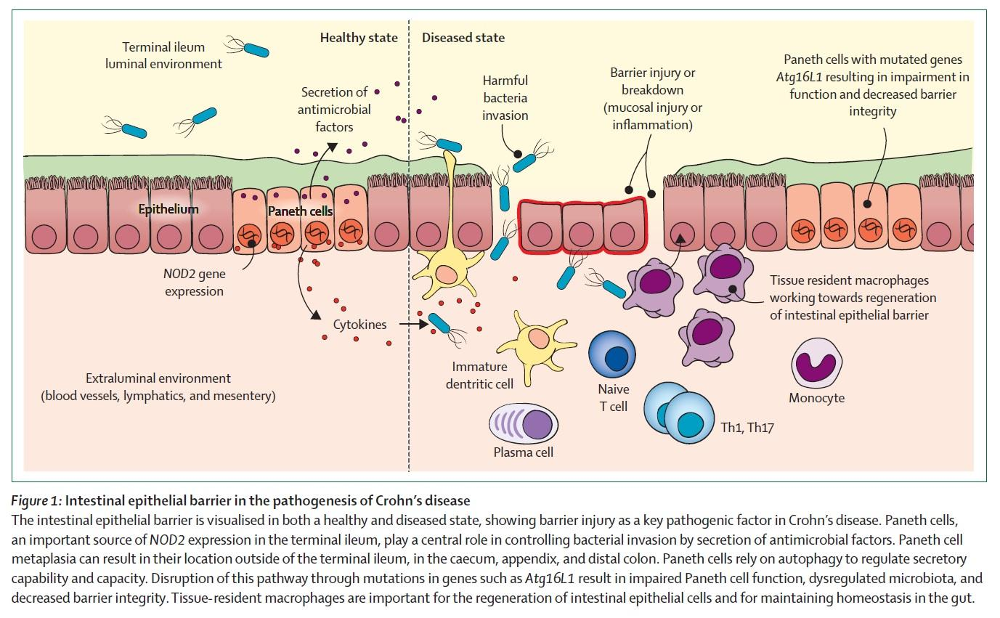 | **Intestinal Epithelial Barrier and Pathogenesis of Crohn's Disease Schematic Diagram** <code>img_016.jpg</code> *Schematic Diagram* [☁️ GitHub Raw](https://raw.githubusercontent.com/clinomaofficial/clinoma-images/main/curriculum/clinical/internal-medicine/gastroenterology/git_master/img_016.jpg) | [⚡ jsDelivr CDN](https://cdn.jsdelivr.net/gh/clinomaofficial/clinoma-images@main/curriculum/clinical/internal-medicine/gastroenterology/git_master/img_016.jpg) | This schematic diagram illustrates the intestinal epithelial barrier in healthy and diseased states, highlighting barrier injury and mucosal inflammation in Crohn's disease. It depicts normal antimicrobial secretion by Paneth cells expressing NOD2, compared to pathogenic bacterial invasion and impaired barrier integrity resulting from mutations such as Atg16L1.  *خد بالك يا دكتورنا إن الرسمة دي بتوضح إزاي العائق المعوي بيتدمر في مرض كرونز (Crohn's disease) نتيجة عيوب في خلايا Paneth ومشاكل جينية زي جين Atg16L1. الفهم ده بيساعدنا نعرف إزاي البكتيريا بتخترق الجدار وبتنشط الاستجابة المناعية وتسبب الالتهابات المزمنة.* |
|  | **Extraintestinal Manifestations of Crohn's Disease Schematic Diagram** <code>img_025.jpg</code> *Schematic Diagram* [☁️ GitHub Raw](https://raw.githubusercontent.com/clinomaofficial/clinoma-images/main/curriculum/clinical/internal-medicine/gastroenterology/git_master/img_025.jpg) | [⚡ jsDelivr CDN](https://cdn.jsdelivr.net/gh/clinomaofficial/clinoma-images@main/curriculum/clinical/internal-medicine/gastroenterology/git_master/img_025.jpg) | Crohn's disease is a systemic inflammatory condition that frequently presents with various extraintestinal manifestations beyond the gastrointestinal tract. These systemic complications can affect multiple organ systems, including the musculoskeletal system, hematologic profile, oral cavity, skin, hepatobiliary system, and renal system due to chronic systemic inflammation and altered nutrient absorption.  *مرض كرونز مش مجرد مرض في الجهاز الهضمي وبس، ده مرض مناعي بيأثر على الجسم كله (Systemic). خد بالك يا دكتورنا إن العيان ممكن يشتكي من آلام في المفاصل، قرح في الفم، مشاكل في الجلد زي Erythema nodosum، أو حتى حصوات في الكلى والمرارة، ودي كلها علامات خارجية بتساعدنا في التشخيص المبكر والمتابعة.* |
| 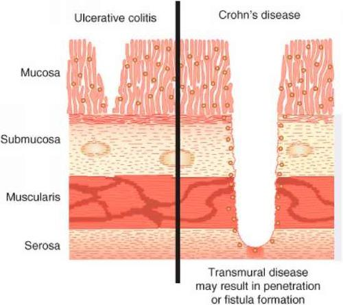 | **Comparison of Histopathological Layers Affected in Ulcerative Colitis vs. Crohn's Disease** <code>img_030.jpg</code> *Schematic Diagram* [☁️ GitHub Raw](https://raw.githubusercontent.com/clinomaofficial/clinoma-images/main/curriculum/clinical/internal-medicine/gastroenterology/git_master/img_030.jpg) | [⚡ jsDelivr CDN](https://cdn.jsdelivr.net/gh/clinomaofficial/clinoma-images@main/curriculum/clinical/internal-medicine/gastroenterology/git_master/img_030.jpg) | This diagram contrasts the mucosal inflammation limited to the superficial layers in ulcerative colitis with the transmural inflammation extending through all bowel wall layers in Crohn's disease, which can lead to deep ulcerations, fistulas, and penetrations.  *خد بالك يا دكتورنا، الفرق الجوهري في الالتهاب إن القولون التقرحي (Ulcerative Colitis) بياخد الطبقات السطحية بس (Mucosa/Submucosa)، بينما مرض كرون (Crohn's Disease) بيبقى Transmural (يعني بيخترق كل جدار الأمعاء لحد السيروزا)، وده اللي بيخليه يعمل ناسور (Fistula) وشرخ عميق.* |
| 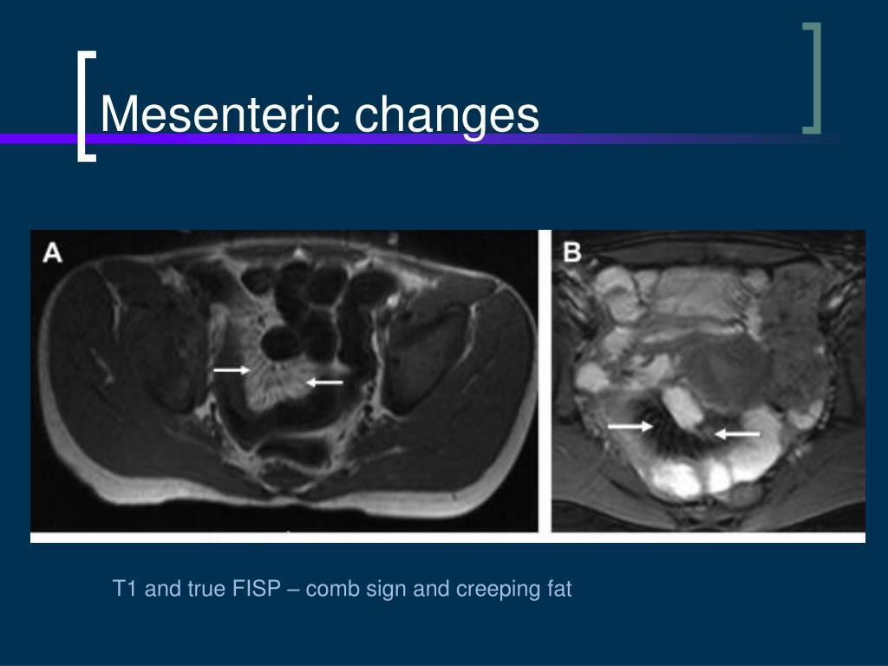 | **Mesenteric Changes in Crohn's Disease: Comb Sign and Creeping Fat on T1 and True FISP MRI** <code>img_031.jpg</code> *Radiological Imaging* [☁️ GitHub Raw](https://raw.githubusercontent.com/clinomaofficial/clinoma-images/main/curriculum/clinical/internal-medicine/gastroenterology/git_master/img_031.jpg) | [⚡ jsDelivr CDN](https://cdn.jsdelivr.net/gh/clinomaofficial/clinoma-images@main/curriculum/clinical/internal-medicine/gastroenterology/git_master/img_031.jpg) | Magnetic resonance imaging demonstrating characteristic mesenteric changes of active Crohn's disease, including the comb sign representing hypervascularity of prominent vasa recta and fibrofatty proliferation known as creeping fat. These imaging features reflect chronic transmural inflammation and are critical for assessing disease activity and severity.  *خد بالك يا دكتورنا، المنظر ده هنا بيوريك الـ Comb sign والـ Creeping fat في حالات الـ Crohn's disease، ودي علامات مميزة جداً على الـ MRI وبتعكس شدة الالتهاب المزمن وتمدد الأوعية الدموية المساريقية في الغشاء المعوي.* |
|  | **Sandimmun (Cyclosporine) Intravenous Injection Ampoule** <code>img_012.jpg</code> *Clinical Photo* [☁️ GitHub Raw](https://raw.githubusercontent.com/clinomaofficial/clinoma-images/main/curriculum/clinical/internal-medicine/gastroenterology/git_master/img_012.jpg) | [⚡ jsDelivr CDN](https://cdn.jsdelivr.net/gh/clinomaofficial/clinoma-images@main/curriculum/clinical/internal-medicine/gastroenterology/git_master/img_012.jpg) | This clinical photograph depicts an ampoule of Sandimmun (Cyclosporine Concentrate for Injection U.S.P., 50 mg/mL). Cyclosporine is a potent calcineurin inhibitor and immunosuppressant primarily utilized in transplantation medicine to prevent organ rejection and in the management of severe autoimmune disorders.  *الصورة بتوضح أمبول سانديمون (سايكلوسبورن) للحقن الوريدي بتركيز 50 ملجم/مل، وهو دواء مثبط للمناعة قوي من مجموعة مثبطات الكالسينورين، بيُستخدم أساساً لمنع رفض الأعضاء المزروعة وعلاج أمراض المناعة الذاتية الخطيرة. خد بالك يا دكتورنا إن الدواء ده بيتخفف كويس جداً قبل الاستخدام ومحتاج متابعة دقيقة لوظائف الكلى ومستوياته في الدم.* |
|  | **Colonic Diverticular Disease with Mucosal Inflammation on Colonoscopy** <code>img_032.jpg</code> *Endoscopy / Laparoscopy* [☁️ GitHub Raw](https://raw.githubusercontent.com/clinomaofficial/clinoma-images/main/curriculum/clinical/internal-medicine/gastroenterology/git_master/img_032.jpg) | [⚡ jsDelivr CDN](https://cdn.jsdelivr.net/gh/clinomaofficial/clinoma-images@main/curriculum/clinical/internal-medicine/gastroenterology/git_master/img_032.jpg) | Colonoscopic view demonstrating multiple colonic diverticula with surrounding mucosal hyperemia and thickened folds. This finding typically represents diverticular disease, which can range from asymptomatic incidental diverticulosis to symptomatic uncomplicated diverticular disease or segmental colitis associated with diverticulosis (SCAD).  *خد بالك يا دكتورنا، المناظير دي بتظهر أكياس القولون أو الدايفرتيکولا (Diverticula) بوضوح مع التهاب وإحمرار في الغشاء المخاطي المحيط. الحالات دي ممكن تعمل نزيف بسيط أو آلام متكررة في البطن، ولما بتيجي مع التهاب قطعي بتبان الالتهابات واضحة حوالين الفتحات.* |
|  | **Severe Pseudopolyposis in Chronic Ulcerative Colitis on Colonoscopy** <code>img_028.jpg</code> *Endoscopy / Laparoscopy* [☁️ GitHub Raw](https://raw.githubusercontent.com/clinomaofficial/clinoma-images/main/curriculum/clinical/internal-medicine/gastroenterology/git_master/img_028.jpg) | [⚡ jsDelivr CDN](https://cdn.jsdelivr.net/gh/clinomaofficial/clinoma-images@main/curriculum/clinical/internal-medicine/gastroenterology/git_master/img_028.jpg) | This colonoscopic image demonstrates extensive pseudopolyposis characterized by numerous protruding mucosal projections resulting from repeated cycles of severe inflammation and mucosal regeneration in long-standing ulcerative colitis. This finding indicates chronic, severe disease activity and warrants careful surveillance due to the increased risk of dysplasia and associated colorectal carcinoma.  *خد بالك يا دكتورنا، المنظر ده بيوريك الـ Pseudopolyposis الواضحة في عيان عنده Chronic Ulcerative Colitis لفترة طويلة. البوليبات الكاذبة دي نتجت عن دورات متكررة من الالتهاب والالتئام، ودي علامة مهمة على خطورة المرض وبتستدعي متابعة دقيقة عشان خطر تحولها لـ Dysplasia أو ورام خبيث.* |
|  | **Endoscopic Findings of Crohn's Disease: Recurrent Ileal Disease and Colonic Ulceration** <code>img_034.jpg</code> *Endoscopy / Laparoscopy* [☁️ GitHub Raw](https://raw.githubusercontent.com/clinomaofficial/clinoma-images/main/curriculum/clinical/internal-medicine/gastroenterology/git_master/img_034.jpg) | [⚡ jsDelivr CDN](https://cdn.jsdelivr.net/gh/clinomaofficial/clinoma-images@main/curriculum/clinical/internal-medicine/gastroenterology/git_master/img_034.jpg) | Endoscopic views demonstrating Crohn's disease pathology: (a) disease recurrence in the neoterminal ileum following ileocaecal resection showing erythematous, swollen mucosa with a prominent longitudinal ulcer; (b) Crohn's colitis with multiple jagged, deep ulcers (karrensporen) and loss of normal haustration due to severe mucosal edema.  *خد بالك يا دكتورنا، المناظير دي بتوريك شكل مرض كرونز (Crohn's disease) بوضوح؛ الصورة الشمال (a) بتوريك رجوع المرض في الأمعاء الدقيقة (neoterminal ileum) بعد الجراحة مع قرحة طولية واضحة، والصورة اليمين (b) بتوريك التهاب القولون المتقرح مع قرح عميقة ومتعرجة وغياب الـ haustration الطبيعية بسبب التورم الشديد.* |
|  | **Large Granulating Ulcer with Perilesional Erythema on Lower Extremity** <code>img_027.jpg</code> *Clinical Photo* [☁️ GitHub Raw](https://raw.githubusercontent.com/clinomaofficial/clinoma-images/main/curriculum/clinical/internal-medicine/gastroenterology/git_master/img_027.jpg) | [⚡ jsDelivr CDN](https://cdn.jsdelivr.net/gh/clinomaofficial/clinoma-images@main/curriculum/clinical/internal-medicine/gastroenterology/git_master/img_027.jpg) | Clinical photograph displaying a large, well-demarcated cutaneous ulcer on the lower extremity featuring a highly vascular, red granulating base and surrounding inflammatory erythema. Such chronic wounds require thorough evaluation for underlying etiology, including venous insufficiency, arterial compromise, pressure injury, or systemic vasculitis, coupled with proper debridement and infection surveillance.  *يا دكتورنا، القرحة دي في الساق واضحة جداً إنها بتميزها قاع حبيبي (granulating bed) محمر مع التهاب واحمرار حوالين الأطراف (erythema). لازم نقيم السبب الرئيسي كويس قوي، سواء كان قصور وريدي مزمن، نقص تروية، أو قرح فراش، ونتابع علامات العدوى ونعمل تنظيف جُرح (debridement) صح عشان نضمن التئام السليم.* |
|  | **Mesalamine Delayed-Release Tablets 1.2 Gram Pharmaceutical Packaging** <code>img_038.jpg</code> *Clinical Photo* [☁️ GitHub Raw](https://raw.githubusercontent.com/clinomaofficial/clinoma-images/main/curriculum/clinical/internal-medicine/gastroenterology/git_master/img_038.jpg) | [⚡ jsDelivr CDN](https://cdn.jsdelivr.net/gh/clinomaofficial/clinoma-images@main/curriculum/clinical/internal-medicine/gastroenterology/git_master/img_038.jpg) | Mesalamine is an aminosalicylate anti-inflammatory drug widely utilized for the induction and maintenance of remission in mild-to-moderate ulcerative colitis. The delayed-release formulation ensures targeted delivery of the active moiety to the terminal ileum and colon, minimizing systemic absorption.  *خد بالك يا دكتورنا إن أدوية الميزاالامين بتعتمد على الـ delayed-release عشان توصل الـ terminal ileum والـ colon وتشتغل محلياً، فمهم جداً ننبه العيان يبلع القرص كامل من غير ما يكسره أو يطحنه عشان ميفقدش خاصية الـ targeting.* |
| 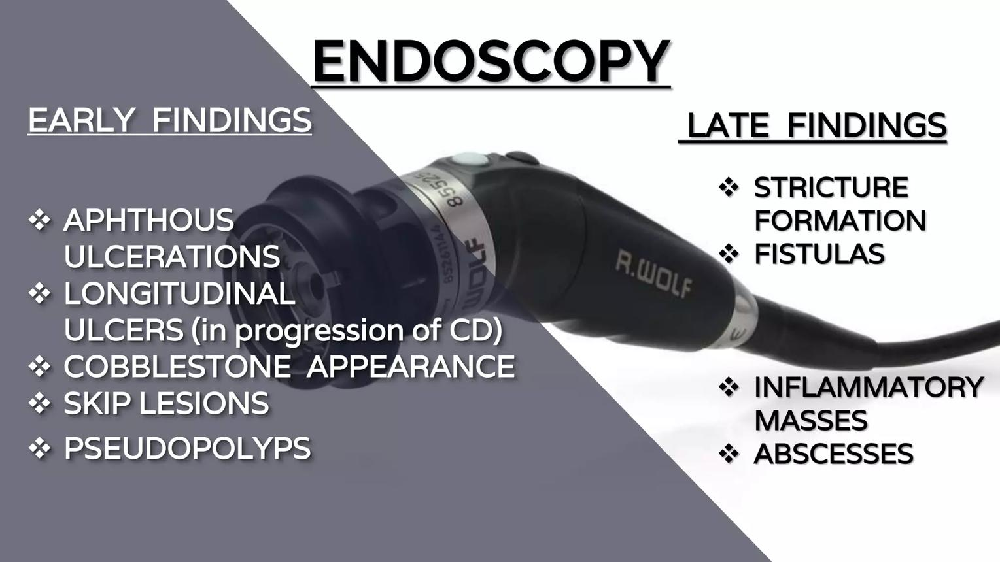 | **Endoscopic Findings in Crohn's Disease: Early vs. Late Manifestations** <code>img_039.jpg</code> *Endoscopy / Laparoscopy* [☁️ GitHub Raw](https://raw.githubusercontent.com/clinomaofficial/clinoma-images/main/curriculum/clinical/internal-medicine/gastroenterology/git_master/img_039.jpg) | [⚡ jsDelivr CDN](https://cdn.jsdelivr.net/gh/clinomaofficial/clinoma-images@main/curriculum/clinical/internal-medicine/gastroenterology/git_master/img_039.jpg) | This comparative endoscopy infographic outlines the classic endoscopic progression of Crohn's disease. Early findings feature mucosal disruptions such as aphthous and longitudinal ulcers, progressing to skip lesions and cobblestone appearance, whereas late complications involve structural damage including strictures, fistulas, and abscess formation.  *خد بالك يا دكتورنا، منظار القولون في مرض كرونز بيفرق جداً بين المراحل المبكرة والمتأخرة. في الأول بنشوف قرح سطحية وطولية مع مظهر الأحجار المرصوفة (cobblestone) وقرح متفرقة (skip lesions)، لكن في المراحل المتأخرة بندخل في مضاعفات خطيرة زي الضيق (strictures)، والناسور (fistulas)، والخراجات اللي بتحتاج تقييم دقيق وتدخل جراحي أو بيولوجي.* |
|  | **Mesalazine 1000 mg Rectal Suppositories Packaging and Dosage Form** <code>img_042.jpg</code> *Pharmacological Pathway* [☁️ GitHub Raw](https://raw.githubusercontent.com/clinomaofficial/clinoma-images/main/curriculum/clinical/internal-medicine/gastroenterology/git_master/img_042.jpg) | [⚡ jsDelivr CDN](https://cdn.jsdelivr.net/gh/clinomaofficial/clinoma-images@main/curriculum/clinical/internal-medicine/gastroenterology/git_master/img_042.jpg) | Mesalazine (5-aminosalicylic acid) 1000 mg rectal suppositories are indicated for the treatment of active ulcerative proctitis. Topical 5-ASA preparations provide high local anti-inflammatory drug concentrations in the rectosigmoid mucosa while minimizing systemic absorption and associated adverse effects.  *خد بالك يا دكتورنا إن تحاميل الميزالازين موضعية الاستخدام تعتبر الخط الأول في علاج التهاب المستقيم التقرحي (Ulcerative Proctitis)، وبتدّي تركيز عالي جداً للمادة الفعالة في الغشاء المخاطي للقولون مع أقل امتصاص في الدم عشان نتجنب الأعراض الجانبية.* |
| 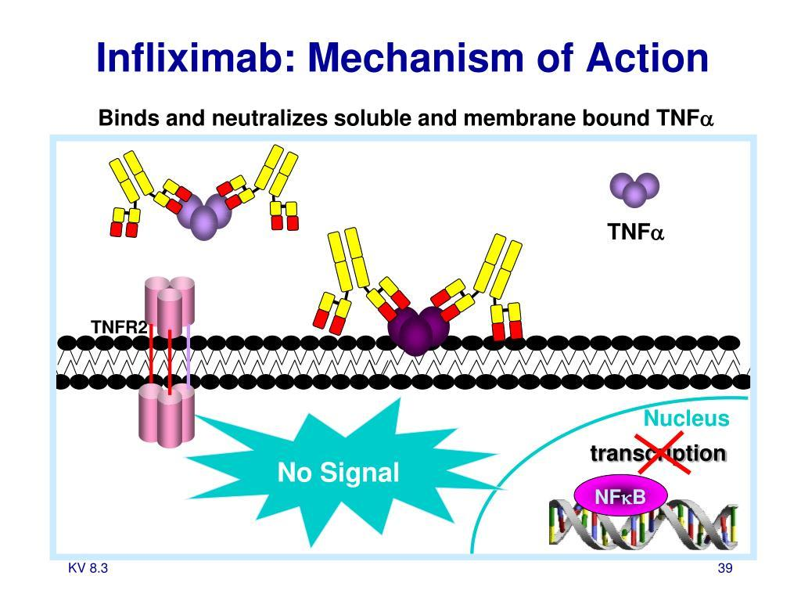 | **Infliximab Mechanism of Action on TNF-alpha and Membrane Receptors** <code>img_048.jpg</code> *Pharmacological Pathway* [☁️ GitHub Raw](https://raw.githubusercontent.com/clinomaofficial/clinoma-images/main/curriculum/clinical/internal-medicine/gastroenterology/git_master/img_048.jpg) | [⚡ jsDelivr CDN](https://cdn.jsdelivr.net/gh/clinomaofficial/clinoma-images@main/curriculum/clinical/internal-medicine/gastroenterology/git_master/img_048.jpg) | This schematic illustrates the mechanism of action of Infliximab, a chimeric monoclonal antibody that specifically binds and neutralizes both soluble and membrane-bound tumor necrosis factor-alpha (TNF-alpha). By preventing TNF-alpha from interacting with its cellular receptors (such as TNFR2), Infliximab blocks downstream signaling cascades like NFkB-mediated transcription, halting inflammatory gene expression.  *خد بالك يا دكتورنا إن إينفليكسيماب (Infliximab) بيشتغل كجسم مضاد بيقفل الـ TNF-alpha سواء كان دايب في الدم أو ماسك في الغشاء الخلوي. ده بيمنع الإشارة العصبية أو الكيميائية اللي بتوصل للنواة عشان تنشط الـ NFkB، وبالتالي بيوقف الالتهاب من جذوره في أمراض المناعة الذاتية.* |
|  | **Endoscopic Progression of Crohn's Disease and Mucosal Ulceration** <code>img_055.jpg</code> *Endoscopy / Laparoscopy* [☁️ GitHub Raw](https://raw.githubusercontent.com/clinomaofficial/clinoma-images/main/curriculum/clinical/internal-medicine/gastroenterology/git_master/img_055.jpg) | [⚡ jsDelivr CDN](https://cdn.jsdelivr.net/gh/clinomaofficial/clinoma-images@main/curriculum/clinical/internal-medicine/gastroenterology/git_master/img_055.jpg) | Endoscopic imaging illustrating the progression of Crohn's disease from early mucosal changes such as patchy erythema and aphthoid ulcers to advanced linear and deep serpiginous ulcerations. These characteristic findings demonstrate discontinuous or skip lesions typical of transmural inflammatory bowel disease.  *خد بالك يا دكتورنا إن التطور المنظاري لمرض كرونز بيبدأ بـ Patchy erythema و Aphthoid ulcers في مراحله المبكرة، وبيتطور بعد كدة لـ Linear و Serpiginous ulcers عميقة. التشخيص المبكر بيساعدنا نفرق بينه وبين الالتهابات التانية وبيوضح علامات Skip lesions الشهيرة.* |
|  | **Montreal Classification of Ulcerative Colitis Extent (E1, E2, E3)** <code>img_024.jpg</code> *Schematic Diagram* [☁️ GitHub Raw](https://raw.githubusercontent.com/clinomaofficial/clinoma-images/main/curriculum/clinical/internal-medicine/gastroenterology/git_master/img_024.jpg) | [⚡ jsDelivr CDN](https://cdn.jsdelivr.net/gh/clinomaofficial/clinoma-images@main/curriculum/clinical/internal-medicine/gastroenterology/git_master/img_024.jpg) | This diagram illustrates the Montreal classification for the extent of ulcerative colitis: E1 represents proctitis (involvement limited to the rectum), E2 represents left-sided colitis (extending up to the splenic flexure), and E3 represents extensive colitis (involvement extending proximal to the splenic flexure). Accurate anatomical staging guides therapeutic decision-making and surveillance colonoscopy protocols.  *خد بالك يا دكتورنا إن تقسيم الـ Montreal للـ Ulcerative Colitis مهم جداً في تحديد خطة العلاج والمتابعة: E1 بيمثل الـ Proctitis والاصابة محصورة في المستقيم، E2 بيمثل الـ Left-sided colitis لحد الـ Splenic flexure، و E3 بيمثل الـ Extensive colitis لما الإصابة تعدي الناحية الشمال وتطلع فوق.* |
|  | **Surgical Construction of Ileal J-pouch and S-pouch Reservoirs with Proctocolectomy** <code>img_043.jpg</code> *Schematic Diagram* [☁️ GitHub Raw](https://raw.githubusercontent.com/clinomaofficial/clinoma-images/main/curriculum/clinical/internal-medicine/gastroenterology/git_master/img_043.jpg) | [⚡ jsDelivr CDN](https://cdn.jsdelivr.net/gh/clinomaofficial/clinoma-images@main/curriculum/clinical/internal-medicine/gastroenterology/git_master/img_043.jpg) | Schematic illustration demonstrating restorative proctocolectomy techniques with creation of ileal J-pouch and S-pouch reservoirs for ulcerative colitis or familial adenomatous polyposis. The procedure involves total removal of the diseased colon and rectum while preserving the anal sphincter mechanism, followed by pouch-anal anastomosis and temporary protective ileostomy.  *الرسم التوضيحي ده بيشرح جراحة استئصال القولون والمستقيم مع المحافظة على العضلة العاصرة للشرج، وعمل جيب لفائفي (J-pouch أو S-pouch) كمستودع بديل للبراز. خد بالك يا دكتورنا إن الخطوات دي بتتعمل على مراحل وغالباً بتحتاج تحويل مؤقت بفتحة براز خارجية (ileostomy) لحد ما التوصيلة تخف تماماً.* |
|  | **Erythema Nodosum Bilateral Lower Extremity Subcutaneous Nodules** <code>img_033.jpg</code> *Clinical Photo* [☁️ GitHub Raw](https://raw.githubusercontent.com/clinomaofficial/clinoma-images/main/curriculum/clinical/internal-medicine/gastroenterology/git_master/img_033.jpg) | [⚡ jsDelivr CDN](https://cdn.jsdelivr.net/gh/clinomaofficial/clinoma-images@main/curriculum/clinical/internal-medicine/gastroenterology/git_master/img_033.jpg) | Clinical presentation of erythema nodosum, characterized by tender, erythematous, subcutaneous nodules typically located on the anterior shins. This represents a delayed-type hypersensitivity reaction (panniculitis) associated with various systemic conditions, including infections, sarcoidosis, inflammatory bowel disease, and drug reactions.  *خد بالك يا دكتورنا، العقد الحمراء دي على الساقين (Erythema nodosum) بتمثل نوع من التهاب الدهون تحت الجلد (Panniculitis) وبتكون حساسة جداً للألم. لازم تدور وراها كويس وتفحص المريض هل عنده عرض لعدوى (زي السل أو العدوى العقدية)، أو مرض مناعي زي الساركويد أو الالتهاب المعوي المزمن (IBD)، لأنها غالباً عرض لمشكلة سيستميك أعمق.* |
|  | **Montreal Classification for Crohn's Disease Location (L1-L4 Categories)** <code>img_058.jpg</code> *Schematic Diagram* [☁️ GitHub Raw](https://raw.githubusercontent.com/clinomaofficial/clinoma-images/main/curriculum/clinical/internal-medicine/gastroenterology/git_master/img_058.jpg) | [⚡ jsDelivr CDN](https://cdn.jsdelivr.net/gh/clinomaofficial/clinoma-images@main/curriculum/clinical/internal-medicine/gastroenterology/git_master/img_058.jpg) | The Montreal classification categorizes Crohn's disease based on anatomical location at diagnosis into terminal ileal (L1), colonic (L2), ileocolonic (L3), and isolated upper disease (L4), with combinations like L4+L3 denoting concurrent upper and distal involvement. Precise localization dictates therapeutic escalation strategies, surgical planning, and long-term risk stratification for stricturing or penetrating complications.  *خد بالك يا دكتورنا، تقسيم مونتريال لمكان الإصابة في الـ Crohn's disease بيفرق جداً في خطة العلاج والقرار الجراحي؛ لو الإصابة في الـ Terminal ileum لوحدها (L1) غير لو فيه Ileocolon (L3) أو Upper GI (L4). التركيز في الـ Endoscopy و Imaging على مكان الودج بيحدد هل العيان هيدخل في Complications زي Strictures ولا لأ.* |
| 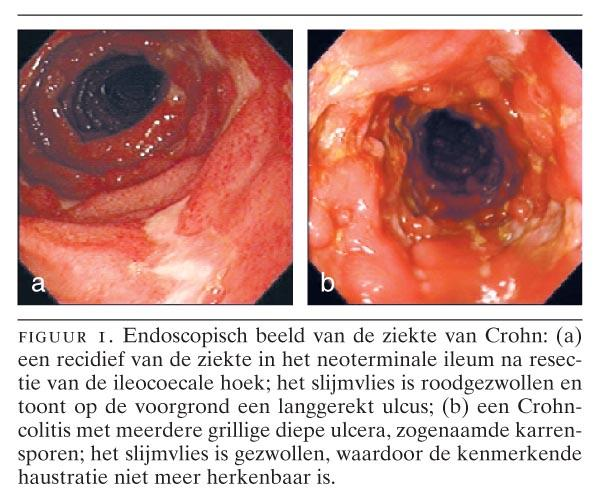 | **Endoscopic Findings of Crohn's Disease: Recurrent Ileal Disease and Colonic Deep Ulcerations** <code>img_037.jpg</code> *Endoscopy / Laparoscopy* [☁️ GitHub Raw](https://raw.githubusercontent.com/clinomaofficial/clinoma-images/main/curriculum/clinical/internal-medicine/gastroenterology/git_master/img_037.jpg) | [⚡ jsDelivr CDN](https://cdn.jsdelivr.net/gh/clinomaofficial/clinoma-images@main/curriculum/clinical/internal-medicine/gastroenterology/git_master/img_037.jpg) | Endoscopic views demonstrating Crohn's disease features: (a) disease recurrence in the neoterminal ileum following ileocecal resection, showing erythematous edematous mucosa with a prominent longitudinal ulcer; (b) Crohn's colitis with multiple jagged, deep ulcers resembling track rails ('karrensporen') and loss of haustration due to mucosal swelling.  *خد بالك يا دكتورنا إن المناظير دي بتوضح لنا شكل مرض كرونز (Crohn's Disease)، الصورة الأولى (a) بتبين ارتجاع المرض في اللفائفي بعد الجراحة مع وجود قرحة طولية واضحة، والصورة التانية (b) بتبين التهاب القولون التقرحي بمرض كرونز مع قرح عميقة متعرجة وغياب التعرجات الطبيعية بسبب التورم الشديد في الغشاء المخاطي.* |
|  | **Crohn's Disease Small Bowel Findings on Capsule Endoscopy** <code>img_051.jpg</code> *Endoscopy / Laparoscopy* [☁️ GitHub Raw](https://raw.githubusercontent.com/clinomaofficial/clinoma-images/main/curriculum/clinical/internal-medicine/gastroenterology/git_master/img_051.jpg) | [⚡ jsDelivr CDN](https://cdn.jsdelivr.net/gh/clinomaofficial/clinoma-images@main/curriculum/clinical/internal-medicine/gastroenterology/git_master/img_051.jpg) | Capsule endoscopy images demonstrating various mucosal manifestations of small bowel Crohn's disease, ranging from normal mucosa to aphthous ulcerations, linear ulcers, and ulcerated stenosis. These findings highlight the classic transmural inflammatory pattern and progressive fibrotic complications characteristic of small bowel involvement.  *خد بالك يا دكتورنا إن كبسولة المنظار بتوضح التدرج المرضي في كوهين الأمعاء الدقيقة (Crohn's)، من غشاء مخاطي طبيعي لقرح صغيرة (aphthous)، وقرح طولية، لحد ما نوصل لتليف وتضيق مصحوب بقرح (ulcerated stenosis)، وده بيفسر لينا سبب المغص والانسداد المتكرر.* |
| 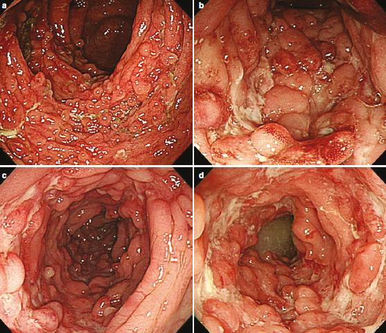 | **Endoscopic Findings of Severe Duodenal Nodularity and Ulceration** <code>img_059.jpg</code> *Endoscopy / Laparoscopy* [☁️ GitHub Raw](https://raw.githubusercontent.com/clinomaofficial/clinoma-images/main/curriculum/clinical/internal-medicine/gastroenterology/git_master/img_059.jpg) | [⚡ jsDelivr CDN](https://cdn.jsdelivr.net/gh/clinomaofficial/clinoma-images@main/curriculum/clinical/internal-medicine/gastroenterology/git_master/img_059.jpg) | Upper gastrointestinal endoscopy images revealing diffuse, prominent mucosal nodularity, erythema, and erosive changes within the duodenal bulb and second portion of the duodenum. These endoscopic features are frequently associated with infectious etiologies, celiac disease, autoimmune enteropathy, or severe peptic duodenitis requiring histopathological confirmation.  *خد بالك يا دكتورنا، المنظر ده في المنظار بيوريك تكلسات وحبيبات وتورم واضح في الغشاء المخاطي للثنا عشر مع التهابات وتقرحات. الحالات دي بتوجّهنا نفكر في أسباب مناعية زي حساسية القمح (Celiac disease) أو عدوى مزمنة، ولازم أخذ عينات (Biopsies) للتأكيد.* |
| 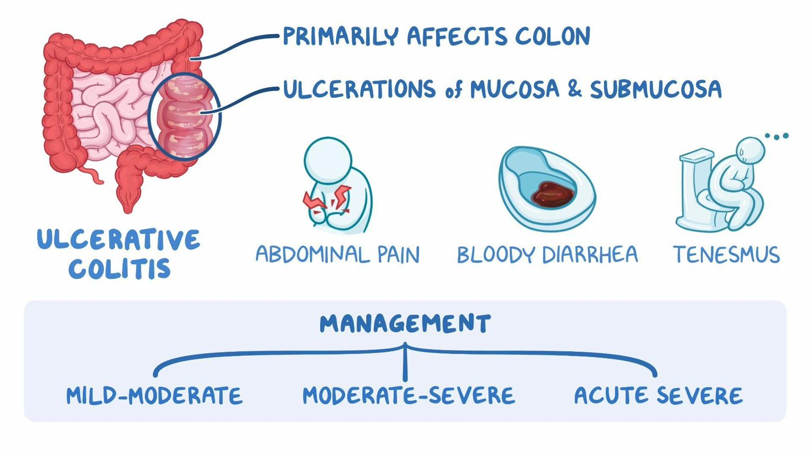 | **Ulcerative Colitis Pathophysiology, Clinical Manifestations, and Management Framework** <code>img_061.jpg</code> *Schematic Diagram* [☁️ GitHub Raw](https://raw.githubusercontent.com/clinomaofficial/clinoma-images/main/curriculum/clinical/internal-medicine/gastroenterology/git_master/img_061.jpg) | [⚡ jsDelivr CDN](https://cdn.jsdelivr.net/gh/clinomaofficial/clinoma-images@main/curriculum/clinical/internal-medicine/gastroenterology/git_master/img_061.jpg) | This diagram illustrates the pathophysiology and clinical presentation of ulcerative colitis, a chronic inflammatory bowel disease primarily affecting the colonic mucosa and submucosa. Key clinical features include abdominal pain, bloody diarrhea, and tenesmus, categorized into mild-moderate, moderate-severe, and acute severe stages for therapeutic management.  *خد بالك يا دكتورنا إن القولون التقرحي بياخد الميكوزا والسب ميكوزا ويتميز بدم في البراز ومغص وإحساس دايم بالرغبة في دخول الحمام (tenesmus)، والتقييم السريري بيتقسم لدرجات عشان نحدد خطة العلاج المناسبة.* |
|  | **Severe Esophagitis Endoscopic View** <code>img_046.jpg</code> *Endoscopy / Laparoscopy* [☁️ GitHub Raw](https://raw.githubusercontent.com/clinomaofficial/clinoma-images/main/curriculum/clinical/internal-medicine/gastroenterology/git_master/img_046.jpg) | [⚡ jsDelivr CDN](https://cdn.jsdelivr.net/gh/clinomaofficial/clinoma-images@main/curriculum/clinical/internal-medicine/gastroenterology/git_master/img_046.jpg) | Endoscopic view of the distal esophagus demonstrating severe mucosal inflammation characterized by confluent friable plaques and linear erosions. These findings are consistent with severe reflux esophagitis or infectious esophagitis, which requires prompt histological confirmation and tailored medical therapy.  *خد بالك يا دكتورنا، المنظر ده بيبين التهاب حاد في المريء مع تقرحات وإفرازات واضحة، وغالباً بيكون سببه ارتجاع مريئي شديد أو التهاب فطرى، ولازم نعمل منظار مع أخذ عينات للتأكد من التشخيص وبدء العلاج المناسب فوراً.* |
| 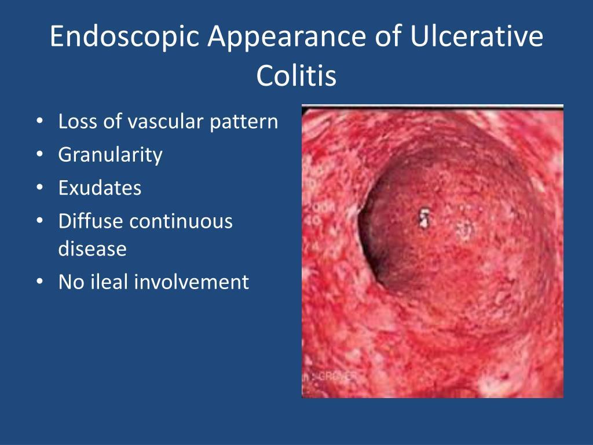 | **Endoscopic Appearance of Ulcerative Colitis Showing Loss of Vascular Pattern and Granularity** <code>img_062.jpg</code> *Endoscopy / Laparoscopy* [☁️ GitHub Raw](https://raw.githubusercontent.com/clinomaofficial/clinoma-images/main/curriculum/clinical/internal-medicine/gastroenterology/git_master/img_062.jpg) | [⚡ jsDelivr CDN](https://cdn.jsdelivr.net/gh/clinomaofficial/clinoma-images@main/curriculum/clinical/internal-medicine/gastroenterology/git_master/img_062.jpg) | Colonoscopic visualization of active ulcerative colitis demonstrates characteristic mucosal alterations including diffuse erythema, loss of the normal vascular pattern, granular texture, and adherent exudates. The disease typically displays a continuous, symmetric pattern of involvement extending proximally from the rectum without skip lesions.  *خد بالك يا دكتورنا، المنظار هنا بيبين القولون التَقَرُّحي بصورة نموذجية فيها فقدان الـ vascular pattern ووجود granular surface واضحة مع exudates، ودي علامات أساسية بتأكد الـ continuous inflammation في الـ UC.* |
|  | **Ustekinumab Mechanism of Action on IL-12 and IL-23 Pathways** <code>img_063.jpg</code> *Pharmacological Pathway* [☁️ GitHub Raw](https://raw.githubusercontent.com/clinomaofficial/clinoma-images/main/curriculum/clinical/internal-medicine/gastroenterology/git_master/img_063.jpg) | [⚡ jsDelivr CDN](https://cdn.jsdelivr.net/gh/clinomaofficial/clinoma-images@main/curriculum/clinical/internal-medicine/gastroenterology/git_master/img_063.jpg) | Ustekinumab is a human monoclonal antibody that targets the shared p40 subunit of interleukin-12 (IL-12) and interleukin-23 (IL-23). By binding to p40, it prevents these cytokines from interacting with their respective cell surface receptors (IL-12R and IL-23R), thereby blocking TH1 and TH17 cell-mediated intracellular signaling pathways implicated in autoimmune conditions like psoriasis and inflammatory bowel disease.  *عقار الأستيكينوماب (Ustekinumab) عبارة عن جسم مضاد بيولوجي بيقفل وحدة الـ p40 المشتركة بين إنترلوكين 12 و23، وده بيمنعهم يمسكوا في مستقبلاتهم على خلايا TH1 وTH17 ويوقف الإشارات الالتهابية تماماً، وهو علاج أساسي في الصدفية والتهاب القولون التقرحي.* |
|  | **Ulcerative Colitis Endoscopic Severity Classification** <code>img_064.jpg</code> *Endoscopy / Laparoscopy* [☁️ GitHub Raw](https://raw.githubusercontent.com/clinomaofficial/clinoma-images/main/curriculum/clinical/internal-medicine/gastroenterology/git_master/img_064.jpg) | [⚡ jsDelivr CDN](https://cdn.jsdelivr.net/gh/clinomaofficial/clinoma-images@main/curriculum/clinical/internal-medicine/gastroenterology/git_master/img_064.jpg) | This comparative endoscopic progression illustrates the mucosal staging of ulcerative colitis from normal vascular pattern to severe inflammation characterized by spontaneous hemorrhage, purulent exudates, and luminal narrowing. Accurate endoscopic grading is essential for monitoring disease activity, directing anti-inflammatory or biologic therapies, and assessing long-term mucosal healing.  *خد بالك يا دكتورنا، التقييم بالمنظار لمرضى التهاب القولون التقرحي بيبدأ من غياب الأوعية الدموية ووجود احمرار خفيف لحد النزيف التلقائي والإفرازات القيحية في الحالات الشديدة، وده بيساعدنا نعرف درجة النشاط الحقيقي للمرض ونحدد خطة العلاج المناسبة.* |
| 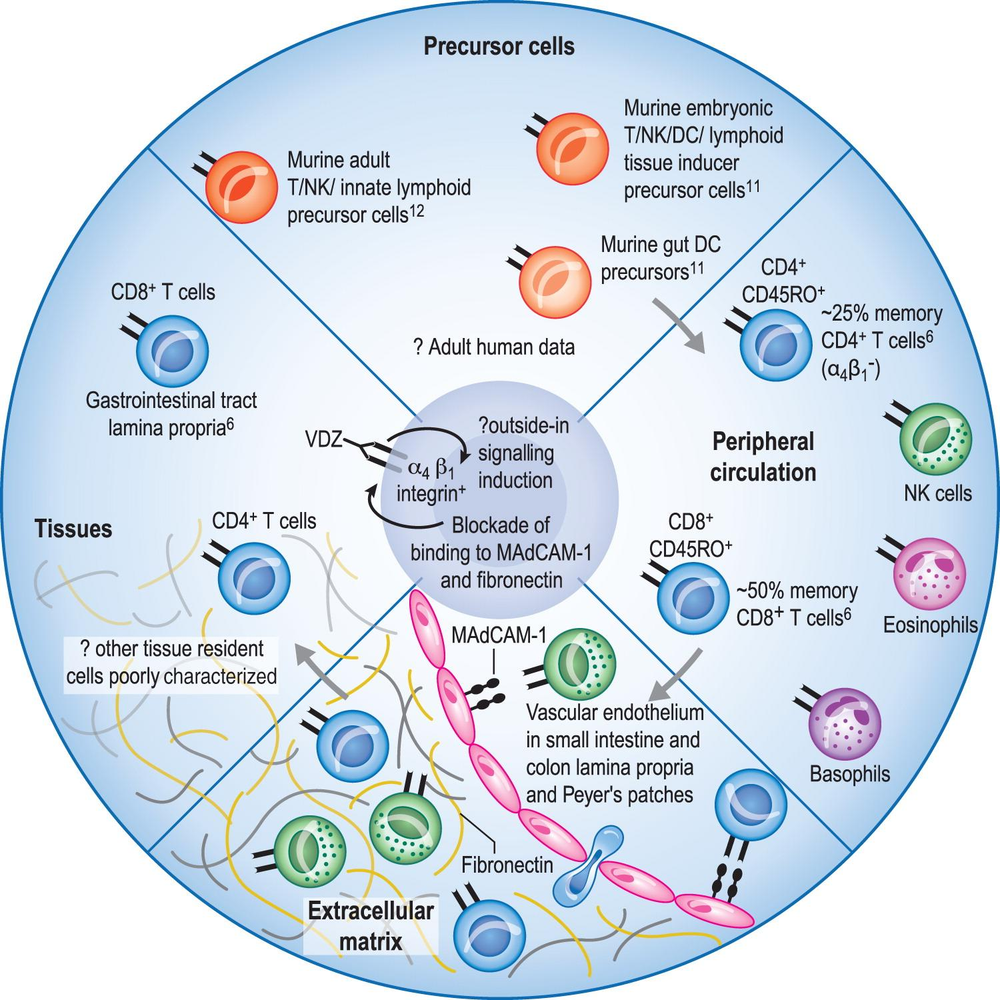 | **Mechanisms of Action of Vedolizumab Targeting a4b1 Integrin and MAdCAM-1 in Gastrointestinal Immunity** <code>img_065.jpg</code> *Pharmacological Pathway* [☁️ GitHub Raw](https://raw.githubusercontent.com/clinomaofficial/clinoma-images/main/curriculum/clinical/internal-medicine/gastroenterology/git_master/img_065.jpg) | [⚡ jsDelivr CDN](https://cdn.jsdelivr.net/gh/clinomaofficial/clinoma-images@main/curriculum/clinical/internal-medicine/gastroenterology/git_master/img_065.jpg) | This schematic illustrates the mechanism of action of Vedolizumab (VDZ), which specifically blocks the binding of alpha4beta1 integrin to MAdCAM-1 and fibronectin on the vascular endothelium. This inhibition prevents the homing and migration of lymphocytes into the gastrointestinal tract lamina propria, offering targeted anti-inflammatory therapy in inflammatory bowel disease.  *يا دكتورنا، الصورة دي بتبين ميكانيزم عمل الفيدوليزوماب (Vedolizumab) كعلاج بيولوجي بيقفل الإنتجرين عشان يمنع دخول الخلايا المناعية للغشاء المخاطي للأمعاء، وده أساسي في علاج الالتهابات المناعية المزمنة زي الكرونز والقولون التقرحي.* |
|  | **Alpha-4 Beta-1 and Alpha-4 Beta-7 Integrin-Mediated Leukocyte Trafficking and Vedolizumab Mechanism of Action** <code>img_057.jpg</code> *Pharmacological Pathway* [☁️ GitHub Raw](https://raw.githubusercontent.com/clinomaofficial/clinoma-images/main/curriculum/clinical/internal-medicine/gastroenterology/git_master/img_057.jpg) | [⚡ jsDelivr CDN](https://cdn.jsdelivr.net/gh/clinomaofficial/clinoma-images@main/curriculum/clinical/internal-medicine/gastroenterology/git_master/img_057.jpg) | This schematic diagram illustrates the mechanism of leukocyte homing and trafficking mediated by integrins such as alpha-4 beta-1 and alpha-4 beta-7 binding to MAdCAM-1 and fibronectin on the vascular endothelium. Vedolizumab (VDZ) acts as a selective monoclonal antibody blocker that inhibits this adhesion cascade, preventing immune cell migration into the gastrointestinal tract lamina propria, which is the cornerstone of its therapeutic efficacy in inflammatory bowel disease.  *الرسم التوضيحي ده بيشرح ميكانيزم حركة الخلايا المناعية ودخولها للأمعاء عن طريق ارتباط الـ Integrins بالـ MAdCAM-1 على الأوعية الدموية. دواء الـ Vedolizumab بيشتغل كـ Monoclonal antibody بيعمل Block للعملية دي عشان يمنع دخول الخلايا المناعية المسببة للالتهاب لأنسجة القولون والأمعاء في مرضى الـ IBD.* |
|  | **Cobblestoning and Nodular Mucosal Changes in Severe Gastrointestinal Crohn's Disease on Endoscopy** <code>img_040.jpg</code> *Endoscopy / Laparoscopy* [☁️ GitHub Raw](https://raw.githubusercontent.com/clinomaofficial/clinoma-images/main/curriculum/clinical/internal-medicine/gastroenterology/git_master/img_040.jpg) | [⚡ jsDelivr CDN](https://cdn.jsdelivr.net/gh/clinomaofficial/clinoma-images@main/curriculum/clinical/internal-medicine/gastroenterology/git_master/img_040.jpg) | Endoscopic views demonstrating severe transmural inflammation characteristic of Crohn's disease, marked by prominent mucosal cobblestoning, edematous nodules, and deep ulcerations. These findings reflect chronic granulomatous inflammation leading to architectural distortion and potential stricture formation within the gastrointestinal tract.  *خد بالك يا دكتورنا، المنظر ده مميز جداً للـ Crohn's Disease وفيه بنشوف مظهر الـ Cobblestoning والتقرحات العميقة اللي بتأكد وجود التهاب مزمن Transmural في الأمعاء، وده بيعرض العيان لمضاعفات زي الـ Strictures والانسداد المعوي.* |
|  | **Extraintestinal Manifestations of Inflammatory Bowel Disease** <code>img_068.jpg</code> *Schematic Diagram* [☁️ GitHub Raw](https://raw.githubusercontent.com/clinomaofficial/clinoma-images/main/curriculum/clinical/internal-medicine/gastroenterology/git_master/img_068.jpg) | [⚡ jsDelivr CDN](https://cdn.jsdelivr.net/gh/clinomaofficial/clinoma-images@main/curriculum/clinical/internal-medicine/gastroenterology/git_master/img_068.jpg) | This schematic diagram outlines the diverse extraintestinal manifestations associated with inflammatory bowel disease (IBD), involving multiple organ systems including dermatological, ocular, vascular, respiratory, arthropathic, hepatobiliary, and inflammatory conditions. Recognizing these systemic associations is vital for comprehensive clinical management and early multidisciplinary intervention.  *خد بالك يا دكتورنا إن مرض التهاب الأمعاء المزمن (IBD) مش بس بيصيب القولون، ده ليه مظاهر جهازية كتيرة في الجلد، العين، المفاصل، والكبد زي الـ Primary sclerosing cholangitis. التشخيص المبكر للمضاعفات دي بيفرق جداً في خطة العلاج وبيمنع تدهور الحالة.* |
|  | **Endoscopic Appearance of Ulcerative Colitis Showing Loss of Vascular Pattern and Granularity** <code>img_066.jpg</code> *Endoscopy / Laparoscopy* [☁️ GitHub Raw](https://raw.githubusercontent.com/clinomaofficial/clinoma-images/main/curriculum/clinical/internal-medicine/gastroenterology/git_master/img_066.jpg) | [⚡ jsDelivr CDN](https://cdn.jsdelivr.net/gh/clinomaofficial/clinoma-images@main/curriculum/clinical/internal-medicine/gastroenterology/git_master/img_066.jpg) | This endoscopic image demonstrates hallmark features of ulcerative colitis, including diffuse continuous inflammation, loss of the normal vascular pattern, granular friable mucosa, and mucopurulent exudates. The disease is characterized by superficial mucosal inflammation characteristically limited to the colon without terminal ileal involvement.  *خد بالك يا دكتورنا، المنظر ده بيمثل الـ Ulcerative Colitis بالمنظار، وفيه بنشوف الـ Loss of vascular pattern واضحة جداً مع الـ Granularity والـ Exudates. المميز هنا إن الإصابة بتبقى Diffuse وContinuous وفي القولون بس من غير ما تقرب للـ Ileum.* |
| 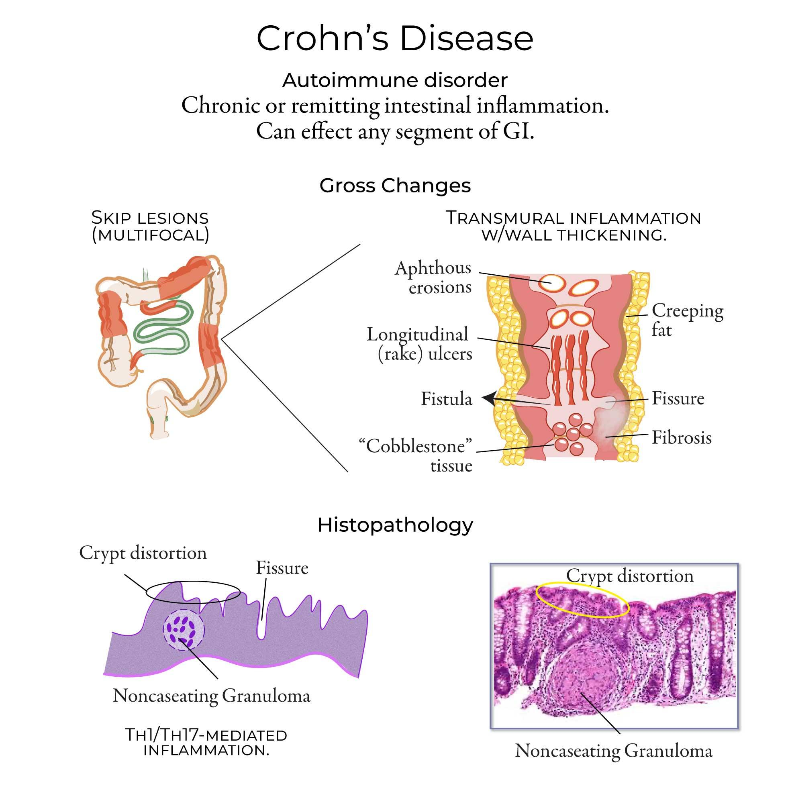 | **Crohn's Disease Gross and Histopathological Features** <code>img_070.jpg</code> *Schematic Diagram* [☁️ GitHub Raw](https://raw.githubusercontent.com/clinomaofficial/clinoma-images/main/curriculum/clinical/internal-medicine/gastroenterology/git_master/img_070.jpg) | [⚡ jsDelivr CDN](https://cdn.jsdelivr.net/gh/clinomaofficial/clinoma-images@main/curriculum/clinical/internal-medicine/gastroenterology/git_master/img_070.jpg) | Crohn's disease is characterized by chronic transmural inflammation of the gastrointestinal tract, featuring skip lesions, cobblestone appearance, deep longitudinal ulcers, and noncaseating granulomas on histopathology. This transmural process often leads to complications such as strictures, fistulae, and creeping fat surrounding the affected bowel wall.  *خد بالك يا دكتورنا إن الكرونز ديزيز بيتميز بوجود Transmural inflammation يعني الالتهاب واخد كل جدار الأمعاء مش الميوكوزا بس، وده بيعمل Skip lesions و Cobblestone appearance وممكن يعمل Fissures و Fistulas، وعلى مستوى الهيستولوجي بتشوف Noncaseating granulomas واضحة جداً.* |
| 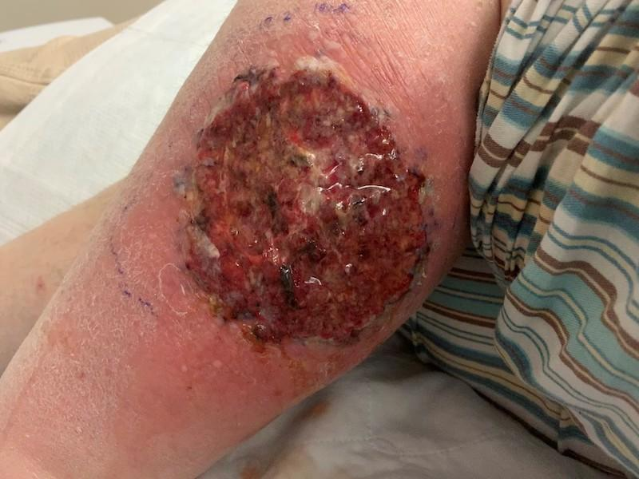 | **Large Granulating Ulceration with Perilesional Erythema and Exudate** <code>img_060.jpg</code> *Clinical Photo* [☁️ GitHub Raw](https://raw.githubusercontent.com/clinomaofficial/clinoma-images/main/curriculum/clinical/internal-medicine/gastroenterology/git_master/img_060.jpg) | [⚡ jsDelivr CDN](https://cdn.jsdelivr.net/gh/clinomaofficial/clinoma-images@main/curriculum/clinical/internal-medicine/gastroenterology/git_master/img_060.jpg) | The image demonstrates a large, well-demarcated wound bed covered with red, vascularized granulation tissue and localized exudate on an extremity. The perilesional skin exhibits erythema, edema, and scaling, suggestive of an inflammatory or chronic venous insufficiency process, requiring culture and targeted antimicrobial or moisture-balancing wound management.  *خد بالك يا دكتورنا إن دي قرحة كبيرة ليها قاعدة مليانة حبيبات حمراء واضحة (granulation tissue) وحواليها التهاب واحمرار جلدي؛ ده بيستدعي تقييم كامل للدورة الدموية واستبعاد أي عدوى بكتيرية ثانوية أو مشاكل مزمنة.* |
| 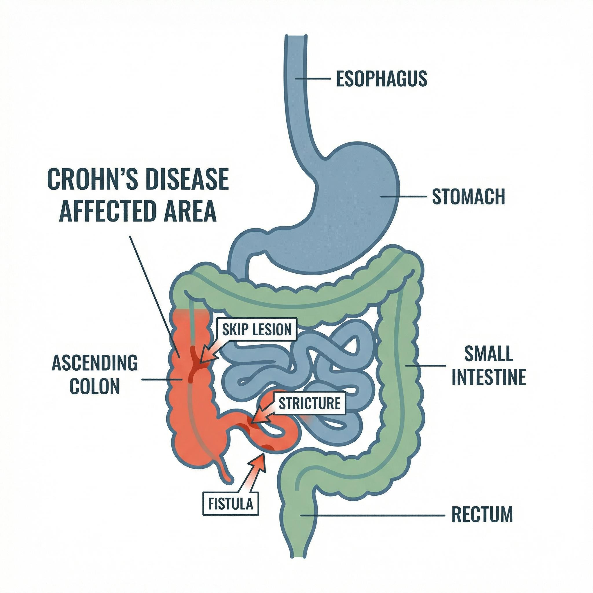 | **Schematic Representation of Crohn's Disease Pathological Features and Segmental Involvement** <code>img_069.jpg</code> *Schematic Diagram* [☁️ GitHub Raw](https://raw.githubusercontent.com/clinomaofficial/clinoma-images/main/curriculum/clinical/internal-medicine/gastroenterology/git_master/img_069.jpg) | [⚡ jsDelivr CDN](https://cdn.jsdelivr.net/gh/clinomaofficial/clinoma-images@main/curriculum/clinical/internal-medicine/gastroenterology/git_master/img_069.jpg) | Schematic illustration of the gastrointestinal tract depicting characteristic manifestations of Crohn's disease, including transmural inflammation, skip lesions, strictures, fistulae, and focal involvement of the ascending colon. Crohn's disease can affect any part of the GI tract from mouth to anus, typically presenting with discontinuous patches of ulceration and wall thickening.  *خد بالك يا دكتورنا إن الكرونز ديزيز بيتميز بالـ skip lesions والـ transmural inflammation، يعني الإصابة بتكون نطاطة ومش مستمرة، وممكن تعمل strictures أو fistulae في أي حتة من أول الفم لحد الشرج.* |
| 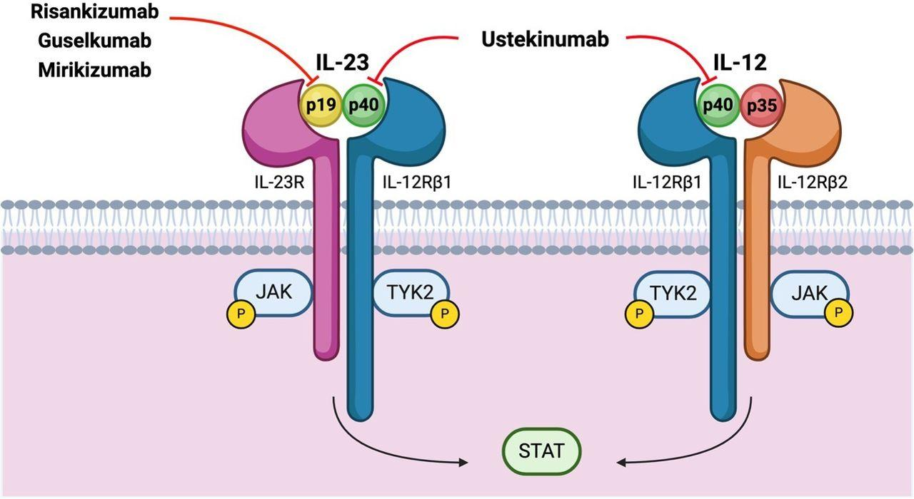 | **IL-12 and IL-23 Signaling Pathways and Monoclonal Antibody Targets** <code>img_056.jpg</code> *Pharmacological Pathway* [☁️ GitHub Raw](https://raw.githubusercontent.com/clinomaofficial/clinoma-images/main/curriculum/clinical/internal-medicine/gastroenterology/git_master/img_056.jpg) | [⚡ jsDelivr CDN](https://cdn.jsdelivr.net/gh/clinomaofficial/clinoma-images@main/curriculum/clinical/internal-medicine/gastroenterology/git_master/img_056.jpg) | Schematic diagram depicting the structural components of IL-12 and IL-23 cytokines, their corresponding cell surface receptors (IL-23R, IL-12Rβ1, IL-12Rβ2), intracellular JAK/TYK2-STAT signaling pathways, and the specific binding targets of biologic monoclonal antibodies including Risankizumab, Guselkumab, Mirikizumab, and Ustekinumab.  *الرسم التوضيحي بيبين أجزاء بروتينات الـ IL-12 والـ IL-23 وإزاي الأدوية البيولوجية زي Ustekinumab و Guselkumab بتقفلهم عشان توقف الإشارات اللي بتنشط الالتهاب المناعي في أمراض زي الصدفية والقولون التقرحي.* |
| 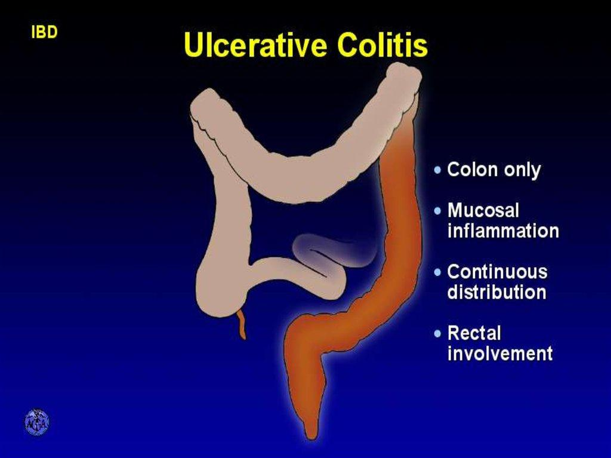 | **Ulcerative Colitis Anatomical Distribution and Mucosal Inflammation Diagram** <code>img_073.jpg</code> *Schematic Diagram* [☁️ GitHub Raw](https://raw.githubusercontent.com/clinomaofficial/clinoma-images/main/curriculum/clinical/internal-medicine/gastroenterology/git_master/img_073.jpg) | [⚡ jsDelivr CDN](https://cdn.jsdelivr.net/gh/clinomaofficial/clinoma-images@main/curriculum/clinical/internal-medicine/gastroenterology/git_master/img_073.jpg) | This schematic diagram illustrates the characteristic anatomical involvement of ulcerative colitis, highlighting its restriction to the colon, continuous mucosal inflammation, and universal rectal involvement. The inflammatory process typically begins in the rectum and extends proximally in an uninterrupted pattern.  *خد بالك يا دكتورنا إن التقرحي بيتميز إنه بيصيب القولون والمستقيم بس، وبتكون الإصابة متصلة Continuous ومن أول المستقيم طالعة لفوق، ده غير إن الالتهاب بيكون في الغشاء المخاطي Mucosa بس.* |
|  | **Crohn's Disease vs Ulcerative Colitis Intestinal Wall Involvement Schematic Diagram** <code>img_074.jpg</code> *Schematic Diagram* [☁️ GitHub Raw](https://raw.githubusercontent.com/clinomaofficial/clinoma-images/main/curriculum/clinical/internal-medicine/gastroenterology/git_master/img_074.jpg) | [⚡ jsDelivr CDN](https://cdn.jsdelivr.net/gh/clinomaofficial/clinoma-images@main/curriculum/clinical/internal-medicine/gastroenterology/git_master/img_074.jpg) | This comparative diagram highlights the key pathological differences between Crohn's disease and ulcerative colitis. Crohn's disease exhibits transmural inflammation leading to penetrating complications such as strictures, fistulas, and abscesses, whereas ulcerative colitis is characterized by superficial mucosal inflammation without penetrating disease.  *خد بالك يا دكتورنا إن الكرونز (Crohn's) بتعمل Transmural inflammation يعني بتخترق جدار القولون كله وبتعمل Fistula و Abscess، إنما الـ Ulcerative Colitis بيكون الالتهاب Superficial في الـ Mucosa بس ومن غير Penetrating disease.* |
|  | **Intravenous Cannulation and Peripheral Vascular Access in Clinical Practice** <code>img_072.jpg</code> *Clinical Photo* [☁️ GitHub Raw](https://raw.githubusercontent.com/clinomaofficial/clinoma-images/main/curriculum/clinical/internal-medicine/gastroenterology/git_master/img_072.jpg) | [⚡ jsDelivr CDN](https://cdn.jsdelivr.net/gh/clinomaofficial/clinoma-images@main/curriculum/clinical/internal-medicine/gastroenterology/git_master/img_072.jpg) | Peripheral intravenous cannulation is a standard clinical procedure utilized for fluid administration, blood sampling, and drug delivery. Proper aseptic technique and anatomical landmark identification are essential to minimize complications such as phlebitis, extravasation, and infection.  *تركيب الكانيولا الوريدية هو مهارة أساسية في الممارسة السريرية لإعطاء المحاليل والأدوية وسحب العينات. خد بالك يا دكتورنا من ضرورة الالتزام بالقواعد المعقمة واختيار الوريد المناسب لتجنب الالتهابات الوريدية وتسرّب السوائل تحت الجلد.* |
|  | **Anatomical Distribution of Crohn's Disease Localization Probabilities** <code>img_075.jpg</code> *Schematic Diagram* [☁️ GitHub Raw](https://raw.githubusercontent.com/clinomaofficial/clinoma-images/main/curriculum/clinical/internal-medicine/gastroenterology/git_master/img_075.jpg) | [⚡ jsDelivr CDN](https://cdn.jsdelivr.net/gh/clinomaofficial/clinoma-images@main/curriculum/clinical/internal-medicine/gastroenterology/git_master/img_075.jpg) | This schematic illustrates the frequency of anatomical localization in Crohn's disease, showing that 45% present with ileocolic involvement, 33% with isolated small bowel disease, and 20% with isolated colonic disease. Understanding these distribution patterns is critical for planning endoscopic surveillance, radiological imaging, and targeted therapeutic interventions.  *الرسم التوضيحي ده بيوضح أماكن الإصابة الأكثر شيوعاً بمرض كرونز، بحيث إن 45% من الحالات بيكون فيها إصابة مشتركة بين اللفائفي والقولون (Ileocolic)، بينما 33% في الأمعاء الدقيقة لوحدها و20% في القولون لوحده. خد بالك يا دكتورنا إن التوزيع ده بيفرق جداً في تحديد خطة المنظار والأشعة والتقييم السريري للمريض.* |
|  | **Endoscopic Findings of Esophageal Candidiasis and Ulceration** <code>img_076.jpg</code> *Endoscopy / Laparoscopy* [☁️ GitHub Raw](https://raw.githubusercontent.com/clinomaofficial/clinoma-images/main/curriculum/clinical/internal-medicine/gastroenterology/git_master/img_076.jpg) | [⚡ jsDelivr CDN](https://cdn.jsdelivr.net/gh/clinomaofficial/clinoma-images@main/curriculum/clinical/internal-medicine/gastroenterology/git_master/img_076.jpg) | These endoscopic views demonstrate features of severe esophagitis, characterized by whitish plaques typical of fungal infection combined with deep inflammatory mucosal ulcerations. This presentation is frequently encountered in immunocompromised hosts, such as patients with advanced HIV/AIDS or those undergoing immunosuppressive therapy.  *خد بالك يا دكتورنا، المنظار ده بيبين أشعة لإلتهابات مرئ شديدة (Esophagitis) ومعاها قرح وتراcصات فطرية (Candidiasis). الحالات دي بتظهر كتير في المناعة المضروبة زي مرضى نقص المناعة المكتسبة (HIV) أو الناس اللي ماشية على علاج مثبط للمناعة، ودايماً لازم نعمل تقييم شامل لحالة المريض المناعية.* |
|  | **Crohn Disease Histopathology Showing Non-Caseating Granulomas and Deep Fissures** <code>img_078.jpg</code> *Schematic Diagram* [☁️ GitHub Raw](https://raw.githubusercontent.com/clinomaofficial/clinoma-images/main/curriculum/clinical/internal-medicine/gastroenterology/git_master/img_078.jpg) | [⚡ jsDelivr CDN](https://cdn.jsdelivr.net/gh/clinomaofficial/clinoma-images@main/curriculum/clinical/internal-medicine/gastroenterology/git_master/img_078.jpg) | This histological schematic illustrates the hallmark transmural inflammation of Crohn disease, characterized by deep mucosal fissures, submucosal oedema, and pathognomonic non-caseating granulomas. The extensive infiltration of mononuclear cells leads to deep ulceration and full-thickness wall involvement.  *خد بالك يا دكتورنا، الرسمة دي بتوضح الفارق الأساسي في الكرونز (Crohn's disease) وهو إن الالتهاب بيكون Transmural (ماخد جدار الأمعاء كله)، وبتشوف فيه الـ Non-caseating granulomas الشهيرة جداً مع الـ Deep fissures اللي ممكن تعمل fistule.* |
| 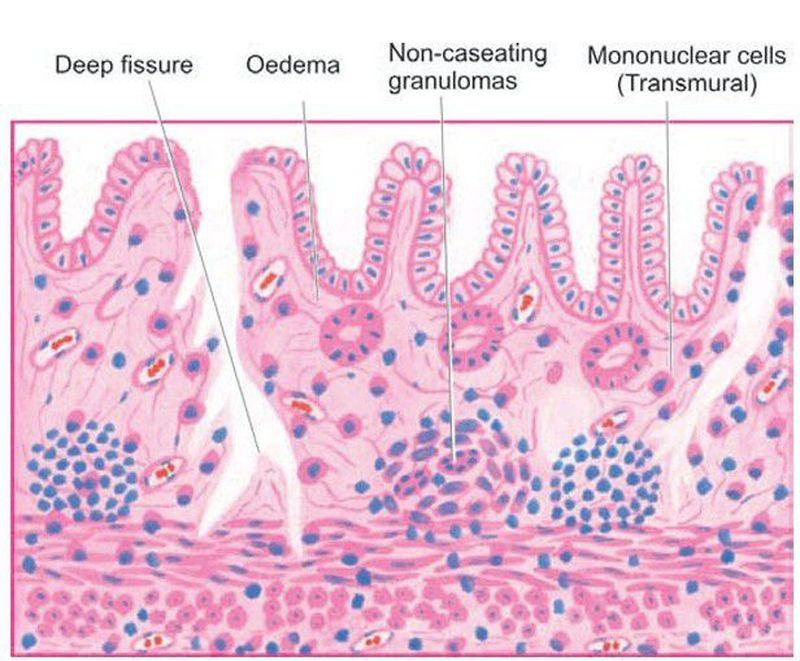 | **Crohn Disease Transmural Histopathology Showing Non-Caseating Granulomas and Deep Fissures** <code>img_079.jpg</code> *Schematic Diagram* [☁️ GitHub Raw](https://raw.githubusercontent.com/clinomaofficial/clinoma-images/main/curriculum/clinical/internal-medicine/gastroenterology/git_master/img_079.jpg) | [⚡ jsDelivr CDN](https://cdn.jsdelivr.net/gh/clinomaofficial/clinoma-images@main/curriculum/clinical/internal-medicine/gastroenterology/git_master/img_079.jpg) | This histological diagram illustrates hallmark features of Crohn disease, including transmural inflammation mediated by mononuclear cells, mucosal oedema, characteristic non-caseating granulomas, and deep knife-like fissures extending through the bowel wall. These features distinguish Crohn disease from ulcerative colitis by affecting all layers of the intestinal wall.  *خد بالك يا دكتورنا، الرسم ده بيمثل مرض كرونز (Crohn's disease) وبيوضح العلامات الأساسية بتاعته زي الالتهاب العابر لجدار الأمعاء كله (Transmural) والشقوق العميقة (Deep fissures) والحبيبات اللي مش متجبنة (Non-caseating granulomas). الفرق الجوهري هنا إن الإصابة بتمتد في كل طبقات الجدار مش الغشاء المخاطي بس.* |
| 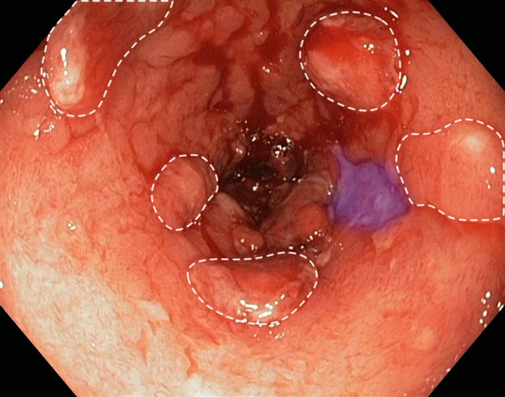 | **Esophageal Candidiasis with Pseudomembrane Formation on Endoscopy** <code>img_071.jpg</code> *Endoscopy / Laparoscopy* [☁️ GitHub Raw](https://raw.githubusercontent.com/clinomaofficial/clinoma-images/main/curriculum/clinical/internal-medicine/gastroenterology/git_master/img_071.jpg) | [⚡ jsDelivr CDN](https://cdn.jsdelivr.net/gh/clinomaofficial/clinoma-images@main/curriculum/clinical/internal-medicine/gastroenterology/git_master/img_071.jpg) | Endoscopic view of the esophagus demonstrating characteristic white, plaque-like exudates adherent to an erythematous and friable mucosa, typical of severe Candida esophagitis. This condition commonly occurs in immunocompromised patients, such as those with advanced HIV/AIDS or undergoing immunosuppressive therapy, presenting clinically with odynophagia and dysphagia.  *خد بالك يا دكتورنا، المنظر ده بيوريك الأغشية البيضاء الملتصقة بغشاء المريء مع احمرار والتهاب شديد، ودي علامة مميزة لالتهاب المريء الفطري (كانديدا) في المرضى اللي مناعتهم ضعيفة. العيان ده غالباً بيشتكي من صعوبة وألم شديد مع البلع (odynophagia)، ومهم جداً تشخيصها بدقة وبدء العلاج المضاد للفطريات فوراً.* |
| 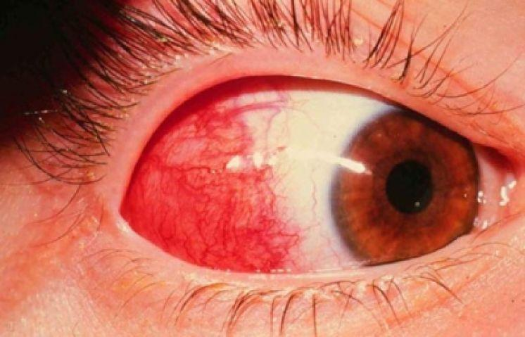 | **Acute Conjunctivitis Showing Marked Bulbar Conjunctival Hyperemia** <code>img_082.jpg</code> *Clinical Photo* [☁️ GitHub Raw](https://raw.githubusercontent.com/clinomaofficial/clinoma-images/main/curriculum/clinical/internal-medicine/gastroenterology/git_master/img_082.jpg) | [⚡ jsDelivr CDN](https://cdn.jsdelivr.net/gh/clinomaofficial/clinoma-images@main/curriculum/clinical/internal-medicine/gastroenterology/git_master/img_082.jpg) | This clinical photograph demonstrates pronounced hyperemia and dilation of the conjunctival blood vessels, indicative of acute conjunctivitis. The inflammation can be secondary to infectious agents (viral or bacterial) or allergic triggers, leading to localized redness and discomfort.  *الصورة بتوضح احتقان واضح في الأوعية الدموية للكونجنجتيفا (الملتحمة) نتيجة التهاب حاد. لما تلاقي العين حمرا بالشكل ده في الكشف، لازم تفرق بين الاحتقان الڤيروسي، البكتيري، أو الحساسية عشان تختار العلاج المضبوط.* |
| 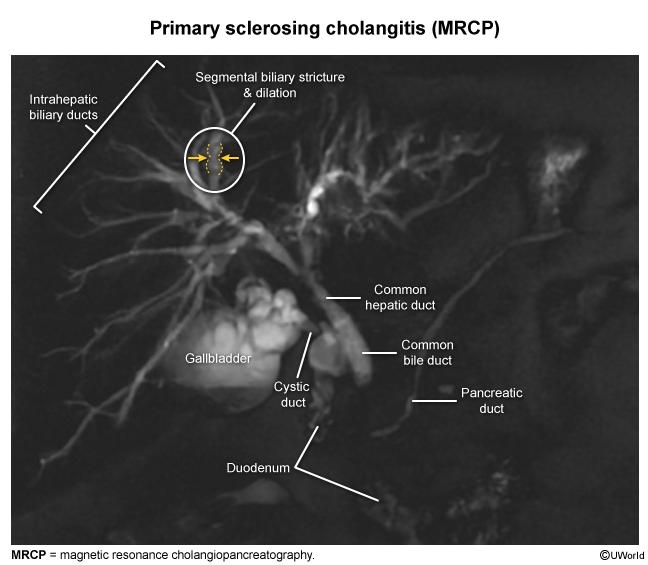 | **Primary Sclerosing Cholangitis on Magnetic Resonance Cholangiopancreatography (MRCP)** <code>img_077.jpg</code> *Radiological Imaging* [☁️ GitHub Raw](https://raw.githubusercontent.com/clinomaofficial/clinoma-images/main/curriculum/clinical/internal-medicine/gastroenterology/git_master/img_077.jpg) | [⚡ jsDelivr CDN](https://cdn.jsdelivr.net/gh/clinomaofficial/clinoma-images@main/curriculum/clinical/internal-medicine/gastroenterology/git_master/img_077.jpg) | Magnetic resonance cholangiopancreatography (MRCP) demonstrating characteristic 'beading' appearance with alternating segmental strictures and dilations of the intrahepatic and extrahepatic biliary ducts. This finding is pathognomonic for primary sclerosing cholangitis (PSC), often strongly associated with inflammatory bowel disease, particularly ulcerative colitis.  *خد بالك يا دكتورنا، الصورة دي بتبين المنظر الكلاسيكي لمرض الـ Primary Sclerosing Cholangitis على الـ MRCP، واللي بيتميز بالـ 'Beading appearance' (يعني تضيق وتوسع متبادل في القنوات المرارية زي السبحة). الحالة دي دايماً تفتكر معاها الـ Ulcerative Colitis لأن فيه ارتباط قوي بينهم.* |
|  | **Intestinal Epithelial Barrier in the Pathogenesis of Crohn's Disease** <code>img_084.jpg</code> *Schematic Diagram* [☁️ GitHub Raw](https://raw.githubusercontent.com/clinomaofficial/clinoma-images/main/curriculum/clinical/internal-medicine/gastroenterology/git_master/img_084.jpg) | [⚡ jsDelivr CDN](https://cdn.jsdelivr.net/gh/clinomaofficial/clinoma-images@main/curriculum/clinical/internal-medicine/gastroenterology/git_master/img_084.jpg) | This diagram contrasts the healthy intestinal epithelial barrier with the diseased state seen in Crohn's disease, highlighting how barrier injury, impaired Paneth cell function due to Atg16L1 mutations, and bacterial invasion drive mucosal inflammation. Key immunological mediators such as dendritic cells, T cells, and macrophages interact dynamically within the lamina propria during disease pathogenesis.  *خد بالك يا دكتورنا إن الباثولوجيا المناعية لمرض كرونز (Crohn's disease) بتبدأ بخلل في الحاجز المعوي وكسر في وظيفة خلايا Paneth بسبب طفرات جينية زي Atg16L1. ده بيسمح للبكتيريا تخترق الغشاء المخاطي وتنشط الاستجابة المناعية عن طريق الـ T cells والـ macrophages، وده اللي بيسبب الالتهاب المزمن المزمن وتدمير الأنسجة.* |
|  | **Ulcerative Colitis Anatomic Distribution and Mucosal Inflammation Schematic** <code>img_086.jpg</code> *Schematic Diagram* [☁️ GitHub Raw](https://raw.githubusercontent.com/clinomaofficial/clinoma-images/main/curriculum/clinical/internal-medicine/gastroenterology/git_master/img_086.jpg) | [⚡ jsDelivr CDN](https://cdn.jsdelivr.net/gh/clinomaofficial/clinoma-images@main/curriculum/clinical/internal-medicine/gastroenterology/git_master/img_086.jpg) | This schematic illustrates the characteristic features of ulcerative colitis, highlighting its restriction to the colon with continuous mucosal involvement starting uniformly from the rectum and extending proximally. The process is marked by superficial mucosal and submucosal inflammation without transmural involvement or skip lesions.  *خد بالك يا دكتورنا إن القولون التقرحي بيمتاز بإن الإصابة مستمرة (Continuous) وتبدأ دائماً من المستقيم وتطلع لفوق من غير قطع (No skip lesions)، وبتكون محصورة في الغشاء المخاطي بس.* |
| 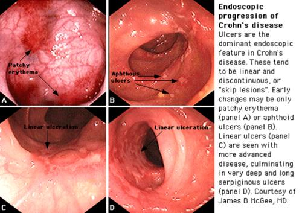 | **Endoscopic Progression and Mucosal Ulceration Patterns in Crohn's Disease** <code>img_087.jpg</code> *Endoscopy / Laparoscopy* [☁️ GitHub Raw](https://raw.githubusercontent.com/clinomaofficial/clinoma-images/main/curriculum/clinical/internal-medicine/gastroenterology/git_master/img_087.jpg) | [⚡ jsDelivr CDN](https://cdn.jsdelivr.net/gh/clinomaofficial/clinoma-images@main/curriculum/clinical/internal-medicine/gastroenterology/git_master/img_087.jpg) | Endoscopic evaluation of Crohn's disease demonstrating the characteristic progression from early mucosal changes such as patchy erythema and aphthous ulcers to advanced linear and deep serpiginous ulcerations. These discontinuous skip lesions are hallmark features of transmural gastrointestinal inflammation.  *خد بالك يا دكتورنا إن التشخيص المنظاري لمرض كرونز بيعتمد على رؤية الـ skip lesions والتقرحات الطولية والـ aphthous ulcers المنفصلة عن بعضها. المراحل الأولى بتبان كاحمرار متفرق، وتتطور لتقرحات عميقة وثعبانية في الحالات المتقدمة.* |
| 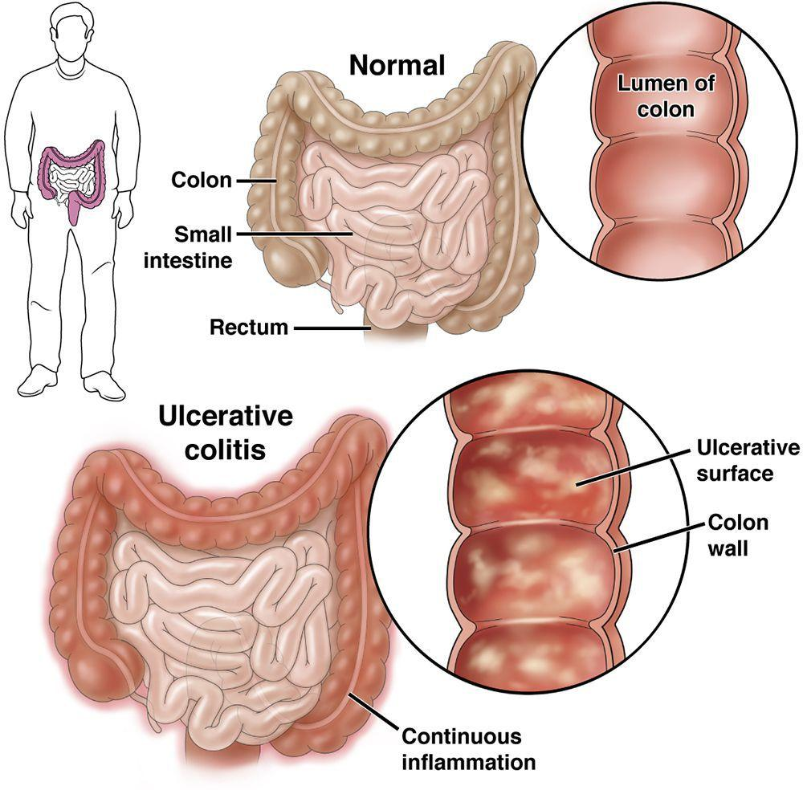 | **Anatomical Comparison of Normal Colon versus Ulcerative Colitis Showing Continuous Inflammation and Ulcerative Surface** <code>img_080.jpg</code> *Schematic Diagram* [☁️ GitHub Raw](https://raw.githubusercontent.com/clinomaofficial/clinoma-images/main/curriculum/clinical/internal-medicine/gastroenterology/git_master/img_080.jpg) | [⚡ jsDelivr CDN](https://cdn.jsdelivr.net/gh/clinomaofficial/clinoma-images@main/curriculum/clinical/internal-medicine/gastroenterology/git_master/img_080.jpg) | This schematic diagram illustrates the macroscopic differences between a normal colon and a colon affected by ulcerative colitis. Key pathological features include continuous mucosal inflammation starting from the rectum and extending proximally, accompanied by friable mucosa and multiple ulcerative surfaces within the colonic lumen.  *خد بالك يا دكتورنا إن التقرحات في الـ Ulcerative Colitis بتبدأ دايماً من الـ Rectum وتطلع لفوق بشكل مستمر (Continuous inflammation) من غير أي مناطق سليمة في النص، ودي علامة تشخيصية مهمة جداً بتفرّقها عن الـ Crohn's disease.* |
| 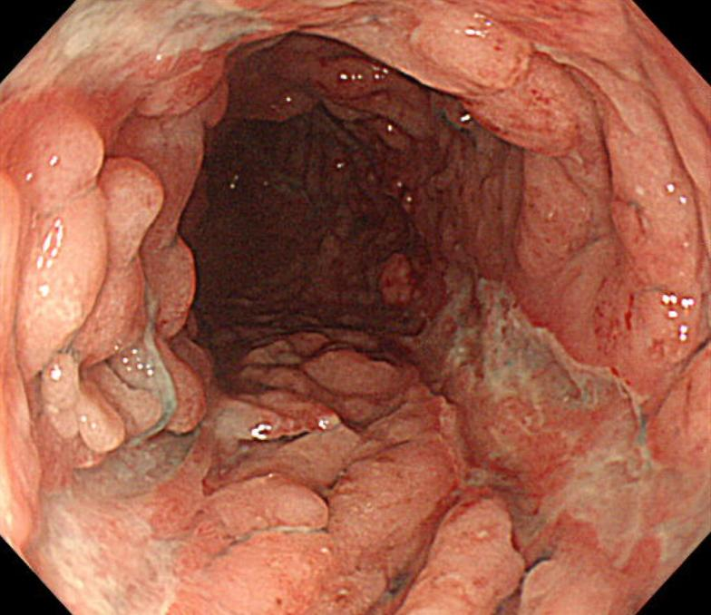 | **Severe Chronic Ulcerative Colitis Endoscopic Appearance with Pseudopolyps** <code>img_092.jpg</code> *Endoscopy / Laparoscopy* [☁️ GitHub Raw](https://raw.githubusercontent.com/clinomaofficial/clinoma-images/main/curriculum/clinical/internal-medicine/gastroenterology/git_master/img_092.jpg) | [⚡ jsDelivr CDN](https://cdn.jsdelivr.net/gh/clinomaofficial/clinoma-images@main/curriculum/clinical/internal-medicine/gastroenterology/git_master/img_092.jpg) | This endoscopic image demonstrates severe chronic ulcerative colitis characterized by extensive mucosal inflammation, loss of normal vascular pattern, deep ulcerations, and numerous protruding inflammatory pseudopolyps. These findings reflect the chronic relapsing-remitting nature of inflammatory bowel disease, carrying an increased long-term risk of dysplasia and colorectal carcinoma.  *خد بالك يا دكتورنا، المنظار ده بيبين التهاب القولون التقرحي المزمن في مرحلة شديدة جداً مع وجود لحميات كاذبة (Pseudopolyps) وقرح عميقة في الغشاء المخاطي. الحالات دي بتحتاج متابعة دقيقة ومستمرة بالمنظار عشان خطر التحور الخبيث على المدى الطويل.* |
|  | **Duodenal Ulcer with Fibrinous Exudate on Upper Gastrointestinal Endoscopy** <code>img_083.jpg</code> *Endoscopy / Laparoscopy* [☁️ GitHub Raw](https://raw.githubusercontent.com/clinomaofficial/clinoma-images/main/curriculum/clinical/internal-medicine/gastroenterology/git_master/img_083.jpg) | [⚡ jsDelivr CDN](https://cdn.jsdelivr.net/gh/clinomaofficial/clinoma-images@main/curriculum/clinical/internal-medicine/gastroenterology/git_master/img_083.jpg) | Upper gastrointestinal endoscopy demonstrating a sharply demarcated duodenal ulcer covered by a whitish fibrinous exudate, surrounded by hyperemic and edematous mucosa. This finding is commonly associated with peptic ulcer disease often secondary to Helicobacter pylori infection or NSAID use.  *يا دكتورنا، القرحة الاثنا عشرية دي واضحة جداً وقاعدتها مغطاة بطبقة فيبرينية بيضا (Fibrinous exudate) وحواليها أغشية مخاطية ملتهبة وورمة (Hyperemic and edematous mucosa). دي غالباً بسبب بكتيريا المعدة الحلزونية (H. pylori) أو مسكنات الأدوية (NSAIDs)، وخلي بالك دايماً من احتمالية النزيف الهضمي.* |
| 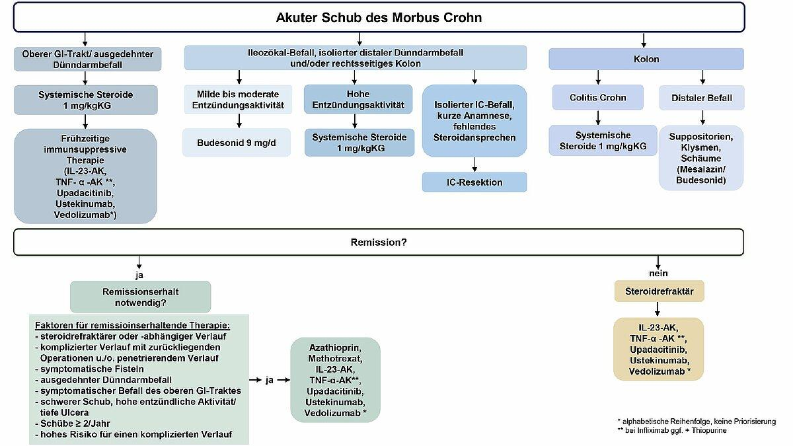 | **Treatment Algorithm for Acute Flare of Crohn's Disease** <code>img_081.jpg</code> *Schematic Diagram* [☁️ GitHub Raw](https://raw.githubusercontent.com/clinomaofficial/clinoma-images/main/curriculum/clinical/internal-medicine/gastroenterology/git_master/img_081.jpg) | [⚡ jsDelivr CDN](https://cdn.jsdelivr.net/gh/clinomaofficial/clinoma-images@main/curriculum/clinical/internal-medicine/gastroenterology/git_master/img_081.jpg) | This management algorithm outlines the therapeutic approach for acute flares of Crohn's disease based on anatomical location and inflammatory severity. Initial treatment ranges from topical agents and budesonide for mild-to-moderate ileocolonic disease to systemic corticosteroids and early immunosuppressive or biologic therapies for severe or extensive involvement.  *الخريطة دي بتوضح خطة علاج الهجمة الحادة لمرض كرونز (Crohn's Disease) بناءً على مكان الإصابة ودرجة الالتهاب. البدء بيعتمد على الكورتيزون الموضعي أو النظامي، ومع الحالات اللي مش بتستجيب أو فيها عوامل خطورة بندخل بالعلاجات البيولوجية والمثبطات المناعية زي ما هو موضح.* |
| 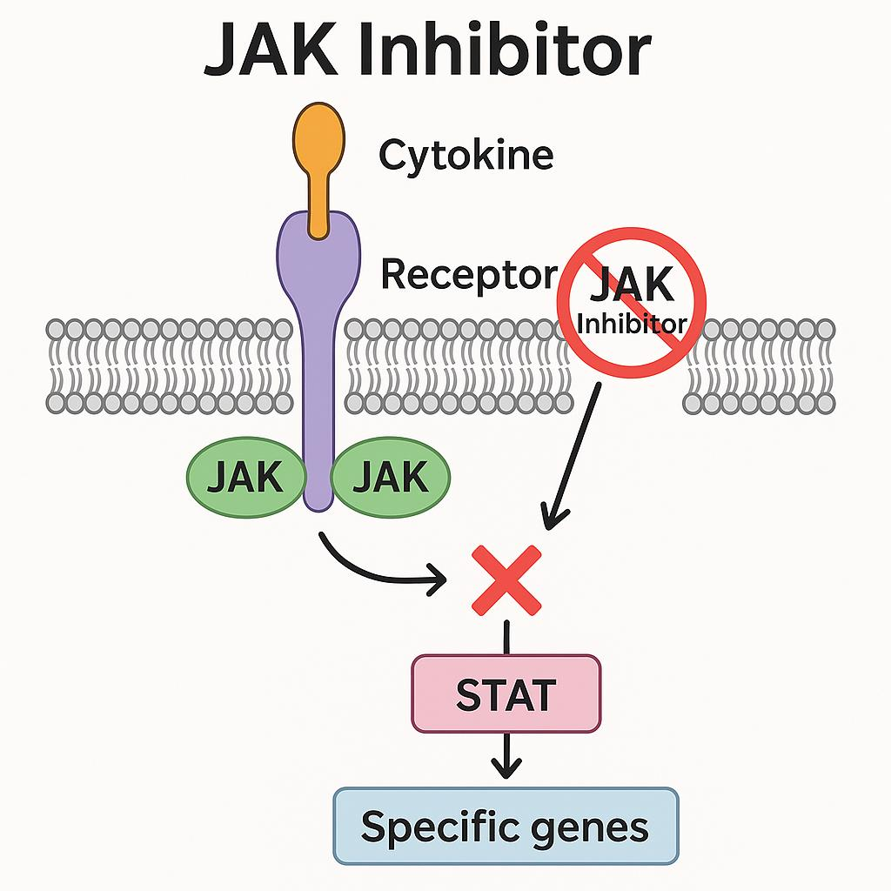 | **Mechanism of Action of JAK Inhibitors in Cytokine Signaling** <code>img_091.jpg</code> *Schematic Diagram* [☁️ GitHub Raw](https://raw.githubusercontent.com/clinomaofficial/clinoma-images/main/curriculum/clinical/internal-medicine/gastroenterology/git_master/img_091.jpg) | [⚡ jsDelivr CDN](https://cdn.jsdelivr.net/gh/clinomaofficial/clinoma-images@main/curriculum/clinical/internal-medicine/gastroenterology/git_master/img_091.jpg) | This schematic diagram illustrates the JAK-STAT signaling pathway and the mechanism of action of Janus kinase (JAK) inhibitors. Binding of a cytokine to its cell-surface receptor typically activates associated JAK proteins, which subsequently phosphorylate and activate downstream STAT proteins to regulate specific gene transcription. JAK inhibitors block this enzymatic activity, thereby interrupting inflammatory signaling cascades utilized in various autoimmune and inflammatory conditions.  *خد بالك يا دكتورنا، مسار الـ JAK-STAT هو المسؤول الأساسي عن إشارات الالتهاب في أمراض المناعة الذاتية، ولما بندي JAK Inhibitor إحنا بنقفل الخط ده من أساسه ونمنع تنشيط الـ STAT وبالتالي نوقف الجينات الالتهابية.* |
|  | **Primary Sclerosing Cholangitis MRCP Demonstrating Biliary Strictures and Dilatations** <code>img_090.jpg</code> *Radiological Imaging* [☁️ GitHub Raw](https://raw.githubusercontent.com/clinomaofficial/clinoma-images/main/curriculum/clinical/internal-medicine/gastroenterology/git_master/img_090.jpg) | [⚡ jsDelivr CDN](https://cdn.jsdelivr.net/gh/clinomaofficial/clinoma-images@main/curriculum/clinical/internal-medicine/gastroenterology/git_master/img_090.jpg) | Magnetic resonance cholangiopancreatography (MRCP) showing characteristic 'beading' appearance with alternating areas of biliary ductal stricture and dilation in primary sclerosing cholangitis. This chronic cholestatic liver disease is strongly associated with inflammatory bowel disease and carries a high risk of progression to secondary biliary cirrhosis and cholangiocarcinoma.  *خد بالك يا دكتورنا، أشعة الـ MRCP دي بتوريك الشكل الكلاسيكي للـ Primary Sclerosing Cholangitis اللي بيعمل 'beading' أو تقطيعات وتبديل بين ضيق وتوسع في القنوات المرارية. الحالة دي مرتبطة جداً بالقولون التقرحي، ودايماً لازم تحط في بالِك خطر تحولها لـ Cholangiocarcinoma على المدى الطويل.* |
| 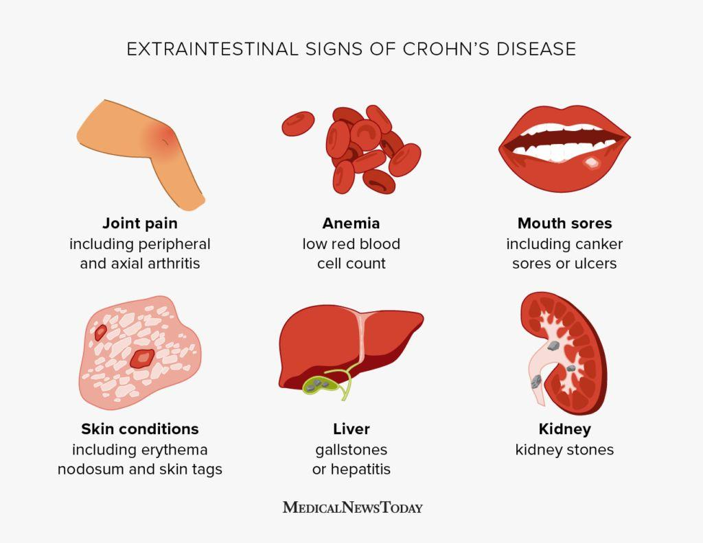 | **Extraintestinal Manifestations of Crohn's Disease Schematic Diagram** <code>img_085.jpg</code> *Schematic Diagram* [☁️ GitHub Raw](https://raw.githubusercontent.com/clinomaofficial/clinoma-images/main/curriculum/clinical/internal-medicine/gastroenterology/git_master/img_085.jpg) | [⚡ jsDelivr CDN](https://cdn.jsdelivr.net/gh/clinomaofficial/clinoma-images@main/curriculum/clinical/internal-medicine/gastroenterology/git_master/img_085.jpg) | This schematic diagram illustrates the diverse extraintestinal systemic manifestations associated with Crohn's disease, affecting multiple organ systems including joints, skin, oral mucosa, hematologic, hepatobiliary, and renal systems. These complications often reflect systemic immune-mediated pathways or secondary metabolic alterations driven by chronic gastrointestinal inflammation and malabsorption.  *الرسم التوضيحي بيوريك المضاعفات والمظاهر اللي بره الجهاز الهضمي المرتبطة بمرض كرونز، زي التهابات المفاصل، قرح الفم، المشاكل الجلدية، الأنيميا، ومشاكل الكبد والكلى. خد بالك يا دكتورنا إن المريض ممكن يشتكي بأعراض بعيدة تماماً عن البطن، وده بيطلب نظرة شاملة وتشخيص متكامل للمرض.* |
| 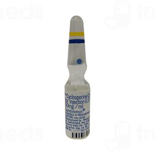 | **Cyclosporine Intravenous Ampoule (Sandimmun) 50 mg/mL** <code>img_093.jpg</code> *Clinical Photo* [☁️ GitHub Raw](https://raw.githubusercontent.com/clinomaofficial/clinoma-images/main/curriculum/clinical/internal-medicine/gastroenterology/git_master/img_093.jpg) | [⚡ jsDelivr CDN](https://cdn.jsdelivr.net/gh/clinomaofficial/clinoma-images@main/curriculum/clinical/internal-medicine/gastroenterology/git_master/img_093.jpg) | Cyclosporine is a potent calcineurin inhibitor used primarily as an immunosuppressive agent in organ transplantation to prevent rejection. The intravenous formulation requires careful therapeutic drug monitoring to balance efficacy with nephrotoxicity and other systemic adverse effects.  *خد بالك يا دكتورنا إن أمبولات السيكلوسبورين للحقن الوريدي بتحتاج متابعة دقيقة لمستوى الدواء في الدم وظيفة الكلى؛ لأنها مرتبطة بنسمية كلوية عالية وارتفاع ضغط الدم.* |
|  | **Pathophysiology and Clinical Manifestations of Ulcerative Colitis** <code>img_096.jpg</code> *Schematic Diagram* [☁️ GitHub Raw](https://raw.githubusercontent.com/clinomaofficial/clinoma-images/main/curriculum/clinical/internal-medicine/gastroenterology/git_master/img_096.jpg) | [⚡ jsDelivr CDN](https://cdn.jsdelivr.net/gh/clinomaofficial/clinoma-images@main/curriculum/clinical/internal-medicine/gastroenterology/git_master/img_096.jpg) | Ulcerative colitis is an inflammatory bowel disease that primarily affects the colon, characterized by continuous mucosal and submucosal inflammation and ulceration. Common clinical presentations include abdominal pain, bloody diarrhea, and tenesmus, with management stratified by disease severity.  *خد بالك يا دكتورنا، القولون التقرحي بيتميز إنه بيصيب القولون بطريقة متصلة وبياخد الغشاء المخاطي والتحت مخاطي بس (Mucosa & Submucosa)، والعينة الإكلينيكية بتبان في صورة مغص وإسهال مدمم مع إلحاح مستمر (Tenesmus).* |
|  | **Crohn's Disease Gross Pathology and Histopathology Features** <code>img_097.jpg</code> *Schematic Diagram* [☁️ GitHub Raw](https://raw.githubusercontent.com/clinomaofficial/clinoma-images/main/curriculum/clinical/internal-medicine/gastroenterology/git_master/img_097.jpg) | [⚡ jsDelivr CDN](https://cdn.jsdelivr.net/gh/clinomaofficial/clinoma-images@main/curriculum/clinical/internal-medicine/gastroenterology/git_master/img_097.jpg) | Crohn's disease is a chronic transmural autoimmune inflammatory bowel disorder that can affect any segment of the gastrointestinal tract, classically characterized by skip lesions, creeping fat, and cobblestone appearance. Histologically, it presents with crypt distortion, deep fissures, and diagnostic noncaseating granulomas mediated by Th1/Th17 pathways.  *مرض كرونز بيتميز بالتهاب مزمن بيصيب جدار الأمعاء بالكامل (Transmural) من الفم لغاية الشرج، وغالباً بيعمل Skip lesions و Cobblestone appearance. في الفحص المجهري بتلاقي Noncaseating granulomas مع Fissures و Crypt distortion، وده بيفرقه عن الـ Ulcerative Colitis.* |
| 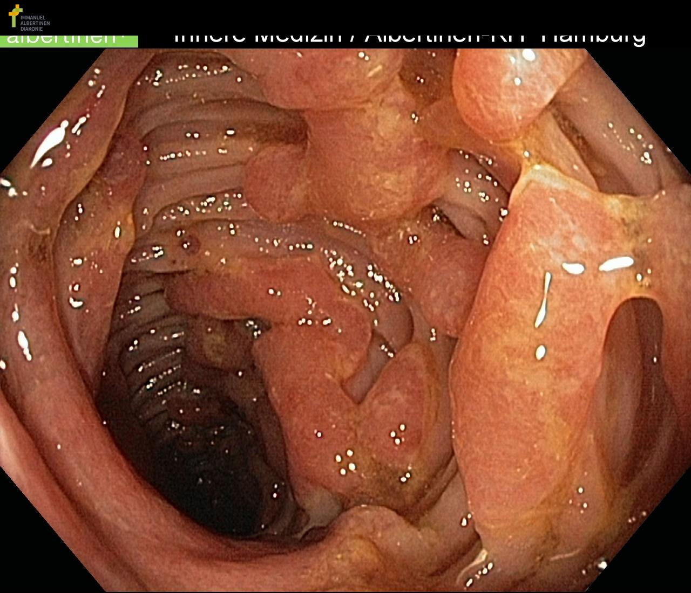 | **Duodenal Adenomatous Polyps / Polyposis on Endoscopy** <code>img_088.jpg</code> *Endoscopy / Laparoscopy* [☁️ GitHub Raw](https://raw.githubusercontent.com/clinomaofficial/clinoma-images/main/curriculum/clinical/internal-medicine/gastroenterology/git_master/img_088.jpg) | [⚡ jsDelivr CDN](https://cdn.jsdelivr.net/gh/clinomaofficial/clinoma-images@main/curriculum/clinical/internal-medicine/gastroenterology/git_master/img_088.jpg) | This endoscopic view demonstrates multiple sessile and pedunculated polyps carpeting the duodenal mucosa, typical of duodenal adenomatosis or familial adenomatous polyposis (FAP). Timely biopsy and surveillance are critical to assess for malignant transformation and guide prophylactic resection.  *خد بالك يا دكتورنا، المنظر ده بيوريك زوائد لحمية (Polyps) متعددة جوه الإثنا عشر، ودي علامة مهمة جداً ممكن تكون مرتبطة بمتلازمات وراثية زي الـ FAP. أخذ العينات والمنظار الاستقصائي بانتظام ضروريين جداً عشان نلحق أي تحول سرطاني بدري.* |
|  | **Infliximab Mechanism of Action on TNF-alpha Blockade** <code>img_089.jpg</code> *Pharmacological Pathway* [☁️ GitHub Raw](https://raw.githubusercontent.com/clinomaofficial/clinoma-images/main/curriculum/clinical/internal-medicine/gastroenterology/git_master/img_089.jpg) | [⚡ jsDelivr CDN](https://cdn.jsdelivr.net/gh/clinomaofficial/clinoma-images@main/curriculum/clinical/internal-medicine/gastroenterology/git_master/img_089.jpg) | Infliximab is a chimeric monoclonal antibody that specifically binds and neutralizes both soluble and membrane-bound TNF-alpha. This blockade prevents TNF-alpha from interacting with its receptors (such as TNFR2), thereby inhibiting downstream intracellular signaling, NF-kB activation, and subsequent inflammatory gene transcription.  *خد بالك يا دكتورنا، الإنفليكسيماب ده بيشتغل كـ Monoclonal antibody يمسك في الـ TNF-alpha سواء كان دايب في الدم أو ماسك في جدار الخلية. الحركة دي بتمنع الشغل كله من أوله وتقفل السكة على الـ NF-kB عشان ما يحصلش التهاب.* |
| 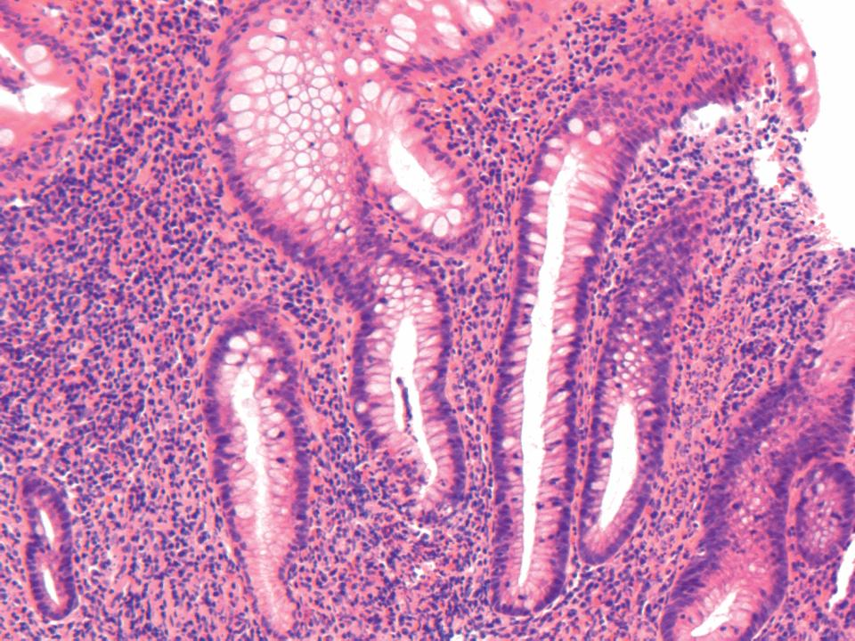 | **Chronic Colitis with Cryptitis and Basal Plasmacytosis on Colon Biopsy** <code>img_099.jpg</code> *Histological Micrograph* [☁️ GitHub Raw](https://raw.githubusercontent.com/clinomaofficial/clinoma-images/main/curriculum/clinical/internal-medicine/gastroenterology/git_master/img_099.jpg) | [⚡ jsDelivr CDN](https://cdn.jsdelivr.net/gh/clinomaofficial/clinoma-images@main/curriculum/clinical/internal-medicine/gastroenterology/git_master/img_099.jpg) | This histological micrograph of the colon demonstrates features of chronic colitis, characterized by architectural distortion of the crypts, dense lamina propria lymphoplasmacytic infiltrate, and basal plasmacytosis. These findings are highly sensitive and specific for chronic inflammatory bowel disease, aiding in the differential diagnosis between ulcerative colitis and Crohn's disease.  *خد بالك يا دكتورنا، العينة دي واضحة جداً وفيها تشوه في شكل الغدد المعوية (Crypt architectural distortion) مع تجمع بلازما سيلز في قاعدة الغشاء المخاطي (Basal plasmacytosis)، ودي علامات أساسية بتفرق لنا بين الالتهاب المزمن للقولون (IBD) والأسباب الحادة الثانية.* |
| 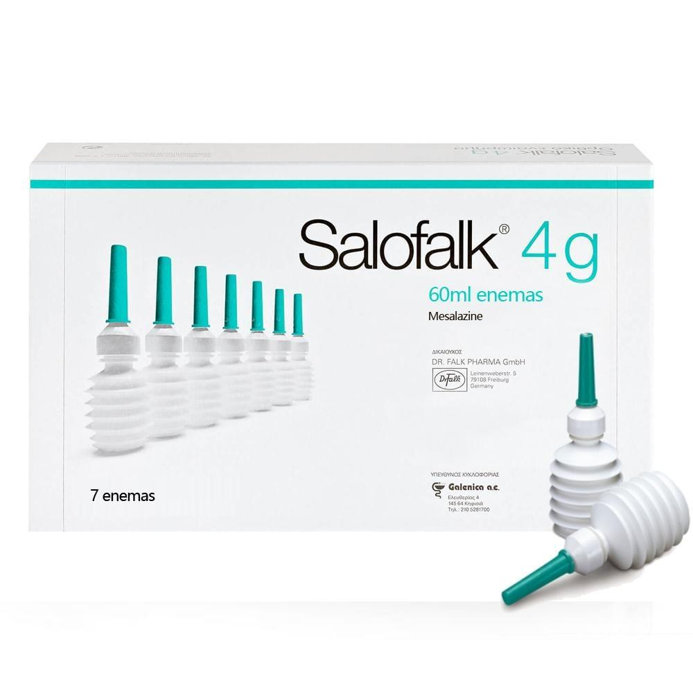 | **Salofalk 4g Mesalazine Enemas Pharmaceutical Presentation** <code>img_095.jpg</code> *Clinical Photo* [☁️ GitHub Raw](https://raw.githubusercontent.com/clinomaofficial/clinoma-images/main/curriculum/clinical/internal-medicine/gastroenterology/git_master/img_095.jpg) | [⚡ jsDelivr CDN](https://cdn.jsdelivr.net/gh/clinomaofficial/clinoma-images@main/curriculum/clinical/internal-medicine/gastroenterology/git_master/img_095.jpg) | Salofalk contains mesalazine, an aminosalicylate anti-inflammatory agent used rectally for the induction of remission in active ulcerative colitis confined to the rectum and sigmoid colon. The enema formulation allows for targeted local delivery of the active pharmaceutical ingredient to the distal intestinal mucosa.  *حقن سالوفالك (ميزالازين) الشرجية بتعتبر خط علاج أساسي وموضعي لالتهاب القولون التقرحي النشط في الجزء الأخير من القولون والمستقيم. خد بالك يا دكتورنا إن التوصيل الموضعي بيقلل الأعراض الجانبية الجهازية مع التركيز على تقليل الالتهاب المخاطي بكفاءة عالية.* |
| 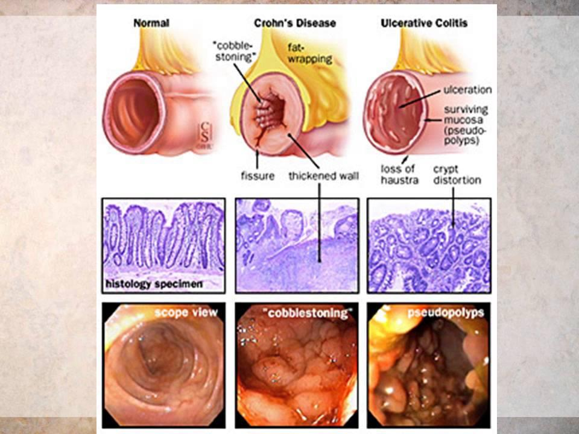 | **Comparative Pathology and Endoscopy of Crohn's Disease versus Ulcerative Colitis** <code>img_094.jpg</code> *Endoscopy / Laparoscopy* [☁️ GitHub Raw](https://raw.githubusercontent.com/clinomaofficial/clinoma-images/main/curriculum/clinical/internal-medicine/gastroenterology/git_master/img_094.jpg) | [⚡ jsDelivr CDN](https://cdn.jsdelivr.net/gh/clinomaofficial/clinoma-images@main/curriculum/clinical/internal-medicine/gastroenterology/git_master/img_094.jpg) | This comparative educational figure contrasts normal intestinal morphology with Crohn's disease and ulcerative colitis, highlighting key structural features like transmural inflammation, cobblestoning, fat wrapping, and fissures in Crohn's, versus mucosal ulceration, loss of haustra, crypt distortion, and pseudopolyps in ulcerative colitis.  *خد بالك يا دكتورنا، الفرق الجوهري بين الكرونز (Crohn's) والقولون التقرحي (Ulcerative Colitis) بيبان في المنظار والعينة؛ الكرونز بيعمل التهاب جداري كامل (Transmural) وبيعمل منظر Cobblestoning وFissures، لكن القولون التقرحي بياخد الغشاء المخاطي بس وبيتميز بالـ Pseudopolyps وضياع الـ Haustra.* |
| 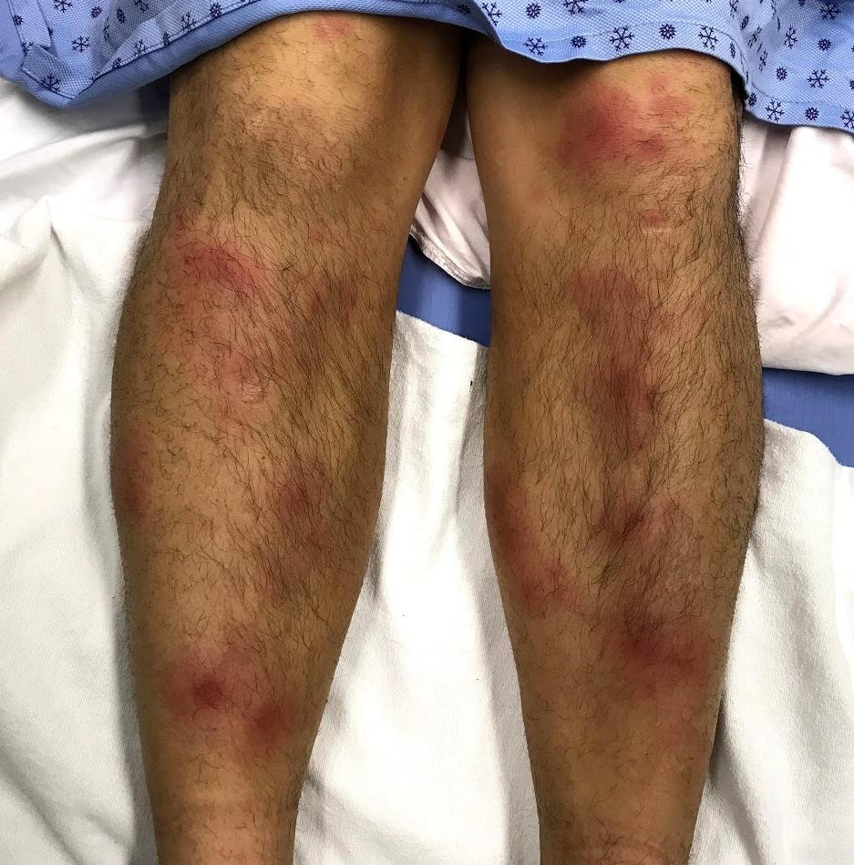 | **Erythema Nodosum Bilateral Lower Extremity Subcutaneous Nodules** <code>img_101.jpg</code> *Clinical Photo* [☁️ GitHub Raw](https://raw.githubusercontent.com/clinomaofficial/clinoma-images/main/curriculum/clinical/internal-medicine/gastroenterology/git_master/img_101.jpg) | [⚡ jsDelivr CDN](https://cdn.jsdelivr.net/gh/clinomaofficial/clinoma-images@main/curriculum/clinical/internal-medicine/gastroenterology/git_master/img_101.jpg) | Bilateral clinical photograph demonstrating tender, erythematous, subcutaneous nodules located predominantly on the pretibial surfaces, characteristic of erythema nodosum. This condition represents a delayed-type hypersensitivity reaction (panniculitis) most frequently triggered by infections, inflammatory bowel disease, sarcoidosis, or medications.  *خد بالك يا دكتورنا، دي كدمات أو عقد حمراء مؤلمة تحت الجلد في الساقين (Erythema Nodosum) ودي علامة تهيج مناعي نوعي (Panniculitis). دايماً افتكر تدور وراها على أسباب زي العدوى، الدرن، الساركويد، أو الأدوية اللي المريض باخدها.* |
|  | **Crohn's Disease Pathological Intestinal Manifestations Schematic** <code>img_098.jpg</code> *Schematic Diagram* [☁️ GitHub Raw](https://raw.githubusercontent.com/clinomaofficial/clinoma-images/main/curriculum/clinical/internal-medicine/gastroenterology/git_master/img_098.jpg) | [⚡ jsDelivr CDN](https://cdn.jsdelivr.net/gh/clinomaofficial/clinoma-images@main/curriculum/clinical/internal-medicine/gastroenterology/git_master/img_098.jpg) | Schematic illustration demonstrating hallmark pathological features of Crohn's disease, including patchy transmural inflammation, strictures, focal skip lesions, non-caseating granulomas, fistulization, and perianal disease, characteristically sparing the rectum in typical colonic involvement.  *الرسم التوضيحي ده بيلخص العلامات المرضية لمرض كرونز (Crohn's disease)، زي الالتهابات المتقطعة (Skip lesions) والانسدادات (Strictures) والفيسولا. خد بالك إن المستقيم (Rectum) عادة بيطلع سليم ومش مصاب، وده بيساعدنا نفرقه عن الالتهاب القولوني التقرحي (Ulcerative Colitis) أثناء التشخيص.* |
| 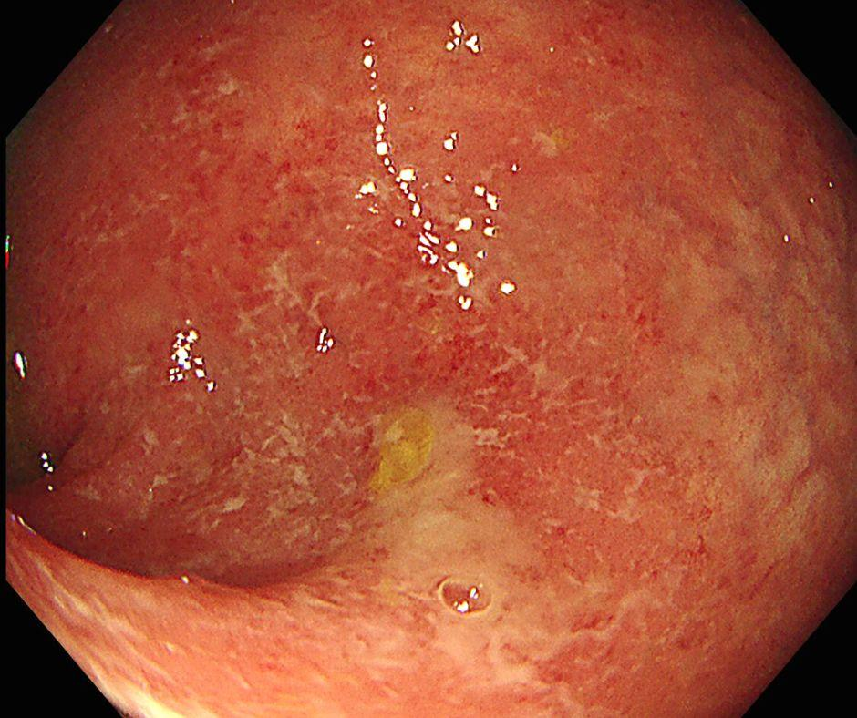 | **Gastric Antral Vascular Ectasia (GAVE) Watermelon Stomach Endoscopic Appearance** <code>img_100.jpg</code> *Endoscopy / Laparoscopy* [☁️ GitHub Raw](https://raw.githubusercontent.com/clinomaofficial/clinoma-images/main/curriculum/clinical/internal-medicine/gastroenterology/git_master/img_100.jpg) | [⚡ jsDelivr CDN](https://cdn.jsdelivr.net/gh/clinomaofficial/clinoma-images@main/curriculum/clinical/internal-medicine/gastroenterology/git_master/img_100.jpg) | Endoscopic view of the gastric antrum demonstrating characteristic longitudinal stripes of erythematous vascular ectasia radiating from the pylorus, classically known as 'watermelon stomach'. This vascular abnormality is a significant cause of chronic upper gastrointestinal bleeding and iron-deficiency anemia, often managed with endoscopic thermal ablation or argon plasma coagulation.  *خد بالك يا دكتورنا، المنظر ده بيمثل الـ GAVE أو ما يعرف بـ Watermelon stomach في الغشاء المخاطي للأنتروم بالمعدة، وبتظهر على هيئة خطوط حمراء طولية متوازية بتفكرنا بالبطيخ. الحالات دي بتعمل نزيف مزمن وأنيميا نقص حديد ملهاش تفسير واضح غير لما تبص بالمنظار كويس.* |
|  | **Histopathological Comparison of Ulcerative Colitis and Crohn's Disease Wall Involvement** <code>img_067.jpg</code> *Schematic Diagram* [☁️ GitHub Raw](https://raw.githubusercontent.com/clinomaofficial/clinoma-images/main/curriculum/clinical/internal-medicine/gastroenterology/git_master/img_067.jpg) | [⚡ jsDelivr CDN](https://cdn.jsdelivr.net/gh/clinomaofficial/clinoma-images@main/curriculum/clinical/internal-medicine/gastroenterology/git_master/img_067.jpg) | This diagram illustrates the comparative depth of tissue inflammation and wall involvement between ulcerative colitis and Crohn's disease. Ulcerative colitis typically presents as continuous superficial mucosal and submucosal inflammation, whereas Crohn's disease is characterized by transmural inflammation extending through all layers of the intestinal wall, often leading to deep fissuring ulcers, penetration, and fistula formation.  *خد بالك يا دكتورنا، القولون التقرحي بياخد الطبقات السطحية (Mucosa & Submucosa) وبيكون continuous، لكن مرض كرونز بيمتد لكل طبقات الجدار (Transmural) وبيعمل فيستولا وأعماق خطيرة.* |
