# Clinoma Visual Atlas: Inflammatory Bowel Disease

**Discipline / Module:** `curriculum/clinical/internal-medicine/gastroenterology/inflammatory_bowel_disease`  
**Total Figures:** **30** Authentic Clinical & Pathological Images

| Figure | Clinical Identification | Academic & Bedside Description |
| :---: | :--- | :--- |
| 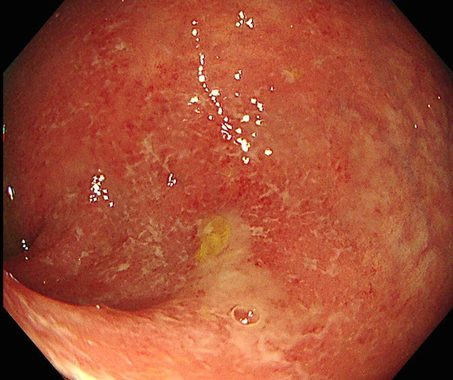 | **Colonic Mucosal Erythema and Loss of Vascular Pattern in Ulcerative Colitis** `img_16_JAK_Inhibitor.jpg` *Endoscopy / Laparoscopy* | Endoscopic view showing diffuse mucosal erythema, granular appearance, and complete loss of the normal vascular pattern in active ulcerative colitis. These findings reflect ongoing chronic mucosal inflammation and are characteristic of Mayo Endoscopic Subscore 1 or 2 disease activity.  *خد بالك يا دكتورنا، المنظر ده بيبين غياب الـ vascular pattern تماماً مع احمرار وgranular appearance في الغشاء المخاطي للقولون، ودي علامات أساسية بتأكد وجود Active Ulcerative Colitis وتقييم درجة نشاط الالتهاب بالمنظار.* |
| 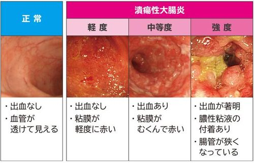 | **Ulcerative Colitis Endoscopic Severity Classification (Normal, Mild, Moderate, Severe)** `img_09_Pyoderma_Gangrenosum.jpg` *Endoscopy / Laparoscopy* | This comparative endoscopic progression illustrates the mucosal spectrum of ulcerative colitis from normal tissue showing visible vascular patterns to severe disease characterized by marked hemorrhage, purulent exudate, and stricture formation. Endoscopic grading correlates directly with clinical severity and guides therapeutic interventions in inflammatory bowel disease.  *خد بالك يا دكتورنا إن تقييم منظار القولون التقرحي بيبدأ من اختفاء الأوعية الدموية وظهور الاحمرار البسيط (Mild)، مروراً بالارتشاح والنزيف الواضح (Moderate)، لحد ما نوصل للتقرحات العميقة والنزيف الغزير والانسداد (Severe)، وده اللي بيحدد خطة العلاج فوراً.* |
| 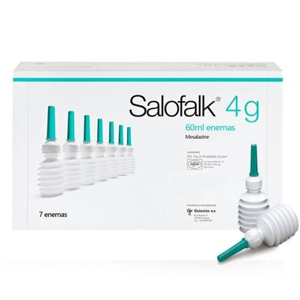 | **Salofalk (Mesalazine) 4g Enemas Box for Distal Ulcerative Colitis** `img_14_Anti-Integrin.jpg` *Clinical Photo* | Salofalk enemas contain mesalazine (5-aminosalicylic acid), utilized as first-line topical therapy for left-sided ulcerative colitis and proctosigmoiditis. Topical formulations deliver high anti-inflammatory concentrations directly to the distal colonic mucosa to induce and maintain remission.  *خد بالك يا دكتورنا إن حقن سالوفالك الشرجية دي هي السلاح الأساسي في علاج الـ Distal Ulcerative Colitis والـ Proctosigmoiditis. المادة الفعالة (Mesalazine) بتشتغل Topical anti-inflammatory مباشرة على الغشاء المخاطي للقولون المتهتك عشان تلم الجروح وتقلل الـ inflammation بفاعلية عالية من غير Systemic side effects.* |
| 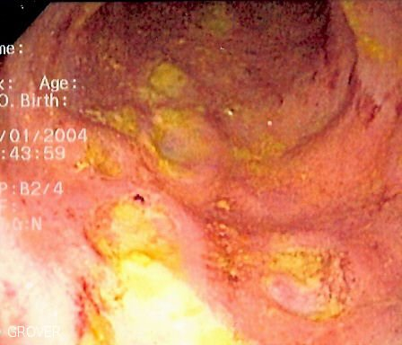 | **Colonoscopic View of Aphthoid Ulcers in Crohn's Disease** `img_11_Serpiginous_Ulcer.jpg` *Endoscopy / Laparoscopy* | This endoscopic image demonstrates characteristic early mucosal findings of Crohn's disease, marked by discrete aphthoid ulcerations surrounded by erythematous halos on an inflamed colonic background. These lesions represent focal inflammation of lymphoid follicles within the mucosa and submucosa, serving as an early diagnostic marker for inflammatory bowel disease.  *خد بالك يا دكتورنا، القرح الصغيرة دي (Aphthoid ulcers) اللي حواليها احمرار هي من أقدم علامات مرض كرونز (Crohn's disease) في المنظار. الفحص الدقيق للمخاطية ده بيساعد في التفريق المبكر بينه وبين التهاب القولون التقرحي.* |
| 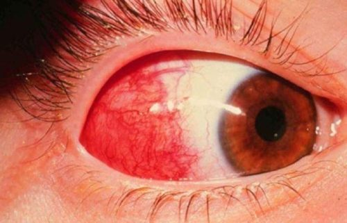 | **Episcleritis Associated with Inflammatory Bowel Disease on Clinical Examination** `img_12_Comb_Sign_MRE.jpg` *Clinical Photo* | This clinical photograph demonstrates episcleritis characterized by localized hyperaemia and engorgement of the deep episcleral vascular plexus. Episcleritis is a well-documented extra-intestinal manifestation of inflammatory bowel disease (Crohn's disease and ulcerative colitis), often correlating with disease activity and requiring prompt ophthalmological and systemic evaluation.  *خد بالك يا دكتورنا، التهاب الصلبة العينية (Episcleritis) ده عرض خارج الأمعاء مهم جداً لمراض الأمعاء الالتهابية (IBD)، وبيبان في الكشف الإكلينيكي على شكل احمرار موضعي في أوعية العين العميقة. العلاج الأساسي بيكون علاج المرض الأساسي في البطن بالتزامن مع قطرات الكورتيزون الموضعية للعين.* |
| 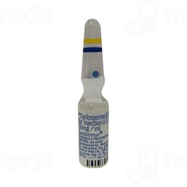 | **Cyclosporine Intravenous Ampoule Formulation for Refractory Inflammatory Bowel Disease** `img_10_Aphthous_Ulcer.jpg` *Clinical Photo* | Intravenous cyclosporine is a potent calcineurin inhibitor used as rescue therapy for severe, steroid-refractory ulcerative colitis to avert emergent colectomy. It acts by calcineurin inhibition, suppressing IL-2 transcription and T-cell mediated mucosal inflammation.  *خد بالك يا دكتورنا، السيكلوسبورين الوريدي بيستخدم كعلاج إنقاذي (Rescue therapy) للحالات الشديدة من الالتهاب القولوني التقرحي (Ulcerative Colitis) اللي مابتستجيبش للكورتيزون، عشان نمنع الاستئصال الجراحي العاجل للقولون. لازم نتابع كويس مستواه في الدم ووظائف الكلى.* |
|  | **Small Bowel Endoscopic Findings in Crohn's Disease** `img_05_Cytokine_Cascade.jpg` *Endoscopy / Laparoscopy* | Endoscopic views of the small intestine in a patient with Crohn's disease demonstrating characteristic features of inflammatory bowel disease including patchy erythema, aphthous ulcerations, and superficial mucosal erosions. These findings reflect chronic transmural inflammation of the gastrointestinal tract, crucial for establishing diagnosis, assessing disease activity, and guiding therapeutic interventions.  *خد بالك يا دكتورنا، الصور دي بتوضح المنظر بالمنظار للأمعاء الدقيقة في حالات الـ Crohn's disease، وفيه بنشوف تقرحات صغيرة (Aphthous ulcers) واحمرار والتهابات في الغشاء المخاطي. الحتت دي بتعكس الالتهاب المزمن اللي بيصيب جدار الأمعاء كله (Transmural inflammation)، ودي علامات أساسية للتشخيص وتحديد نشاط المرض.* |
| 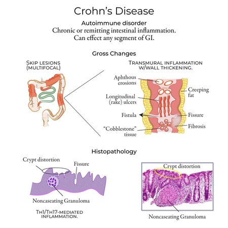 | **Crohn's Disease Gross and Histopathological Features** `img_02_Pathology_Layers.jpg` *Schematic Diagram* | Crohn's disease is characterized by chronic transmural inflammation that can affect any segment of the gastrointestinal tract, classically showing skip lesions, cobblestone appearance, creeping fat, and noncaseating granulomas on histopathology. Complications frequently include strictures, fistulas, and deep fissures resulting from transmural involvement mediated by Th1/Th17 pathways.  *خد بالك يا دكتورنا إن الكرونز ديزيز بيتميز بالـ Transmural inflammation اللي بتأثر على جدار الأمعاء كله، وبتعمل الـ Skip lesions والـ Cobblestone appearance المشهورين جداً في الإندوسكوبي. وعشان الـ Inflammation دي عميقة، بتعمل فايبروسس وفسيولاة، وطبعا الـ Non-caseating granuloma هي البصمة الـ Pathognomonic في الباثولوجي.* |
| 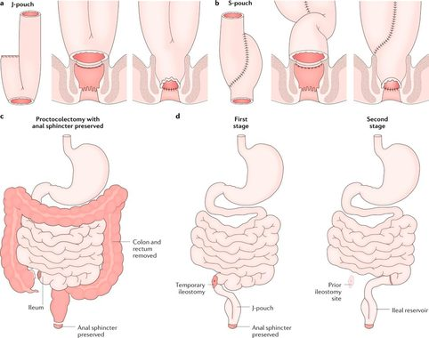 | **Surgical Construction of Ileal J-pouch and S-pouch Reservoirs in Proctocolectomy** `img_06_Montreal_CD.jpg` *Schematic Diagram* | Schematic illustration demonstrating restorative proctocolectomy procedures with ileal pouch-anal anastomosis (IPAA) for inflammatory bowel disease, specifically ulcerative colitis. Panel (a) and (b) detail the creation of J-pouch and S-pouch configurations, while panels (c) and (d) outline the surgical stages involving total proctocolectomy, preservation of the anal sphincter, and temporary diverting ileostomy.  *خد بالك يا دكتورنا إن جراحات الـ IPAA في الـ Ulcerative Colitis بتعتمد على حفظ الـ Anal sphincter وتكوين J-pouch أو S-pouch عشان نمنع الـ Permanent ileostomy. الـ Temporary ileostomy في المرحلة الأولى بتدي فرصة للوصلات الجراحية عشان تلتم بأمان قبل ما نقفلها في المرحلة التانية.* |
| 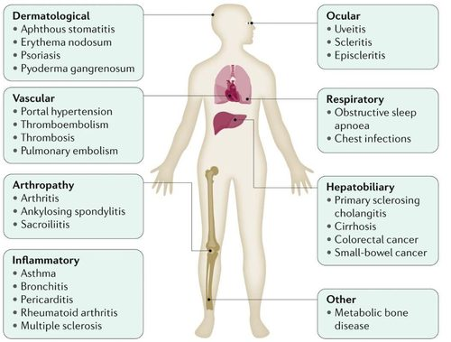 | **Extraintestinal Manifestations of Inflammatory Bowel Disease (IBD)** `img_01_Crohn_Skip_Map.jpg` *Schematic Diagram* | This schematic diagram illustrates the diverse systemic and extraintestinal manifestations associated with inflammatory bowel disease, affecting multiple organ systems including dermatological, ocular, vascular, respiratory, musculoskeletal, and hepatobiliary systems. Recognizing these manifestations is crucial for comprehensive multidisciplinary management and early identification of systemic complications in IBD patients.  *خد بالك يا دكتورنا إن مرض التهاب الأمعاء المزمن (IBD) مش بس بيصيب القولون، ده ليه مظاهر جهازية خارج الأمعاء (Extraintestinal manifestations) ممكن تظهر في الجلد، العيون، المفاصل، والكبد. التقييم الشامل للمريض ده بيحمينا من مضاعفات خطيرة ويضمن تشخيص مبكر ودقيق.* |
| 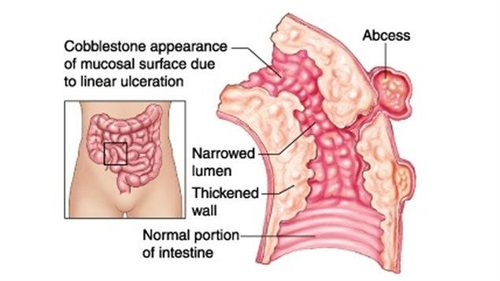 | **Crohn Disease Intestinal Pathologic Features Showing Cobblestoning and Strictures** `img_08_Erythema_Nodosum.jpg` *Schematic Diagram* | This diagram illustrates hallmark features of Crohn's disease, including transmural inflammation leading to a thickened bowel wall, narrowed lumen with strictures, linear ulcers creating a cobblestone mucosal appearance, and associated complications like abscesses. These structural alterations explain clinical presentations such as obstructive symptoms, abdominal pain, and fistulizing disease.  *خد بالك يا دكتورنا، الشكل ده بيمثل مرض كرونز (Crohn's disease) وبيبقى مميز جداً بالـ Cobblestoning والـ Transmural inflammation يعني الالتهاب بياخد كل طبقات الجدار مش الغشاء المخاطي بس. هتلاقي الجدار تخين أوي (Thickened wall) واللومن ضيق (Narrowed lumen) وعامل strictures، ودي حاجات بتعمل أعراض انسدادية وممكن تلاقيه عامل abscess كمان.* |
| 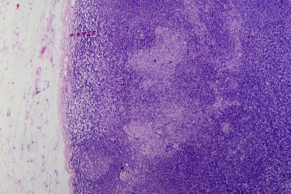 | **Lymph Node Histopathology Showing Non-Caseating Granulomas in Crohn's Disease** `img_04_Granuloma.jpg` *Histological Micrograph* | Histopathological examination of a mesenteric lymph node from a patient with Crohn's disease demonstrating well-formed non-caseating granulomas. These granulomas are a characteristic feature of transmural inflammation seen in inflammatory bowel disease, aiding in the differentiation between Crohn's disease and ulcerative colitis.  *خد بالك يا دكتورنا إن وجود جرانيلوما من غير تكسير (Non-caseating granulomas) في الغدد الليمفاوية للمساريقا يعتبر علامة مميزة جداً لمرض كرونز وبيفرق معانا أكيد عن الالتهاب القولوني التقرحي.* |
| 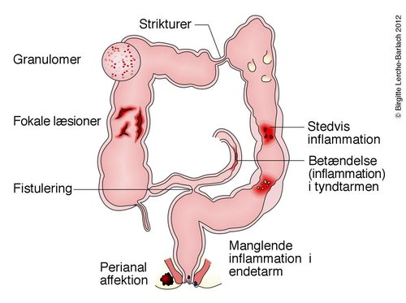 | **Anatomical Distribution of Crohn's Disease Features** `img_03_Cobblestone.jpg` *Schematic Diagram* | Schematic diagram illustrating the classic pathological distribution and features of Crohn's disease, including transmural inflammation, skip lesions (stedvis inflammation), strictures, fistulae, granulomas, and relative rectal sparing.  *الرسم التوضيحي بيمثل الخصائص الباثولوجية لمرض كرونز، زي الالتهاب المتقطع أو ما يسمى بـ skip lesions، والتقرحات البؤرية، والناسور، والستريكتشرز (الضيقات)، مع ملاحظة حفظ المستقيم (rectal sparing) كعلامة فارقة مقارنة بالتهاب القولون التقرحي.* |
| 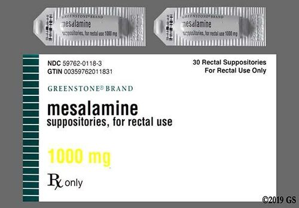 | **Mesalamine 1000 mg Rectal Suppositories Packaging and Formulations** `img_18_Crypt_Abscess.jpg` *Clinical Photo* | Mesalamine rectal suppositories are a mainstay first-line topical aminosalicylate therapy for distal ulcerative colitis and proctitis. The local anti-inflammatory effect is mediated primarily through inhibition of the arachidonic acid cascade in the colonic mucosa, minimizing systemic adverse effects.  *خد بالك يا دكتورنا إن تحاميل الميزالامين هي العلاج الموضعي الأساسي لالتهاب القولون التقرحي أو الالتهاب المستقيم (Proctitis)، وبتشتغل بشكل موضعي لتثبيط الالتهاب من غير تأثيرات جانبية جهازية تذكر، ولازم تنصح العيان يستخدمها قبل النوم عشان تثبت فترة أطول.* |
|  | **Intravenous Infusion Administration for Inflammatory Bowel Disease Biologic Therapy** `img_17_UC_Continuous_Map.jpg` *Clinical Photo* | Patients with moderate-to-severe inflammatory bowel disease frequently require intravenous biologic therapies, such as infliximab, administered in outpatient infusion centers to induce and maintain clinical remission. Peripheral venous access is established to deliver targeted monoclonal antibody therapy against inflammatory cytokines like TNF-alpha.  *خد بالك يا دكتورنا، المحاليل البايولوجية زي Infliximab بتنزل حصرياً في مركز المحاليل تحت إشراف طبي دقيق لمتابعة أي تفاعلات تحسسية فورية. تقييم الوريد واختيار مكان الكانيولا كويس بيمنع حدوث Extravasation ويضمن وصول الجرعة كاملة للمريض.* |
| 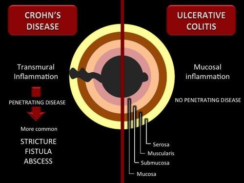 | **Crohn's Disease vs Ulcerative Colitis Intestinal Wall Involvement Schematic** `img_13_Anti-TNF.jpg` *Schematic Diagram* | This schematic illustrates the contrasting pathological features of Crohn's disease and ulcerative colitis. Crohn's disease is characterized by transmural inflammation that can lead to penetrating disease, strictures, fistulas, and abscesses, whereas ulcerative colitis involves superficial mucosal inflammation without penetrating disease.  *خد بالك يا دكتورنا إن الكرونز (Crohn's) بيضرب جدار الأمعاء كله (Transmural) فبيعمل Fistula و Stricture، لكن الـ Ulcerative Colitis آخره الـ Mucosa بس ومن غير Penetration.* |
| 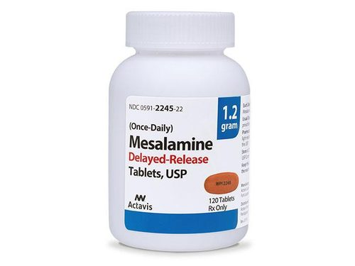 | **Mesalamine Delayed-Release Tablets 1.2 Gram Pharmaceutical Presentation** `img_19_Montreal_UC.jpg` *Clinical Photo* | Mesalamine is a standard first-line anti-inflammatory agent used for the induction and maintenance of remission in mild-to-moderate ulcerative colitis. The delayed-release formulation ensures targeted delivery of the active moiety to the distal ileum and colon, minimizing systemic absorption and upper gastrointestinal side effects.  *خد بالك يا دكتورنا، الميزاالامين (Mesalamine) هو حجر الأساس في علاج التهاب القولون التقرحي البسيط والمتوسط. التركيبة ذات الإطلاق المتأخر (Delayed-Release) بتضمن إن الدواء يوصل للقولون والأنبساط النهائي من غير ما يمتص بدري في المعدة عشان يدي أفضل نتيجة علاجية بأقل أعراض جانبية.* |
| 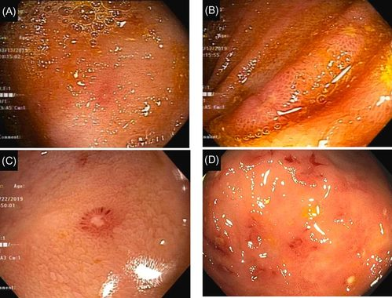 | **Endoscopic Findings of Small Bowel Lesions in Inflammatory Bowel Disease** `img_07_Perianal_Fistula.jpg` *Endoscopy / Laparoscopy* | Capsule endoscopy or enteroscopy views of the small intestine demonstrating mucosal inflammation, erythema, and discrete aphthous or erosive ulcerations characteristic of small bowel involvement in inflammatory bowel disease. Such findings are critical for differentiating Crohn's disease from ulcerative colitis and assessing small bowel mucosal healing.  *خد بالك يا دكتورنا إن الفحص بالكبسولة أو المنظار التلسكوبي للأمعاء الدقيقة بيظهر لنا تقرحات فطرية (aphthous ulcers) والتهاب في الغشاء المخاطي، ودي علامات أساسية بتفرق لنا بين داء كرون (Crohn's disease) والتهاب القولون التقرحي، وبتساعدنا نقيم مدى الاستجابة للعلاج.* |
| 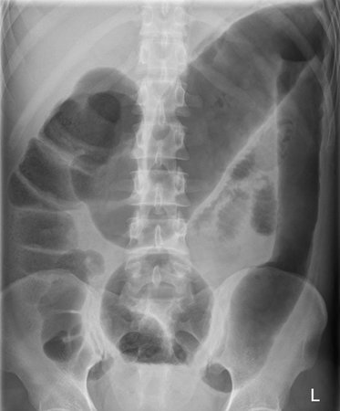 | **Severe Toxic Megacolon Secondary to Inflammatory Bowel Disease on Abdominal Radiograph** `img_22_Toxic_Megacolon.jpg` *Radiological Imaging* | Plain abdominal radiograph demonstrating marked colonic dilatation exceeding 6 cm in diameter, particularly involving the transverse colon, consistent with toxic megacolon. This life-threatening complication of inflammatory bowel disease requires urgent medical intervention to prevent transmural perforation and peritonitis.  *خد بالك يا دكتورنا، الأشعة دي بتوريني تضخم مرعب في القولون المستعرض (Toxic megacolon) ككومبليكايشن خطيرة لـ Inflammatory Bowel Disease. القولون هنا أوسع من 6 سم وده بيعرض المريض لخطر الانفجار والـ Peritonitis، فلازم التدخل السريع والعنيف طبياً أو جراحياً.* |
| 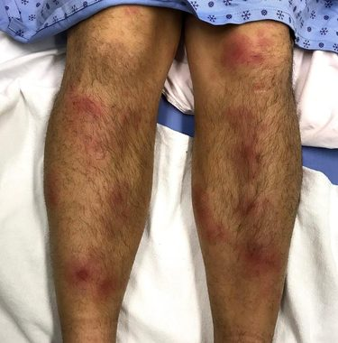 | **Erythema Nodosum on Shins in Inflammatory Bowel Disease** `img_27_Infliximab_Infusion.jpg` *Clinical Photo* | Bilateral clinical photograph of the lower extremities displaying tender, erythematous subcutaneous nodules over the shins, characteristic of erythema nodosum. This is one of the most common cutaneous extraintestinal manifestations associated with inflammatory bowel disease, particularly Crohn's disease and ulcerative colitis.  *خد بالك يا دكتورنا، العقد الحمراء دي على الشين (Erythema Nodosum) من أشهر المانيبيستاشنز برة الجي آي تي في الـ IBD خصوصاً الكرونز. الـ lesions دي بتبقى بولات مؤلمة وبتخف من غير ما تسيب أتروفى، ولازم تتفحص كويس مع الكورس بتاع المرض.* |
| 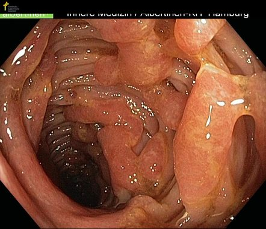 | **Inflammatory Bowel Disease Endoscopy Showing Mucosal Pseudopolyps** `img_26_Enema.jpg` *Endoscopy / Laparoscopy* | This colonoscopic image demonstrates extensive mucosal remodeling characterized by inflammatory pseudopolyps and bridging folds in a patient with chronic inflammatory bowel disease, typically seen in severe long-standing ulcerative colitis. These formations arise from repeated cycles of mucosal ulceration followed by regeneration of the residual inflamed mucosa.  *خد بالك يا دكتورنا، المنظر ده بيوريك الـ Pseudopolyps (البوليبات الكاذبة) اللي بتحصل نتيجة التدمير والالتئام المستمر في غشاء القولون في حالات الـ IBD المتقدمة (زي الـ Ulcerative Colitis)، ودي علامة واضحة على الالتهاب المزمن ومهمة جداً في التشخيص والفريق الطبي بيميزها عن البوليبات الحقيقية.* |
| 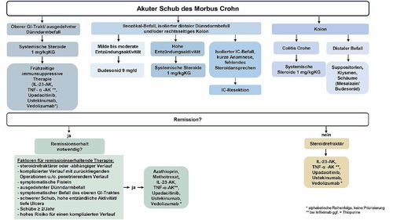 | **Clinical Management Algorithm for Acute Flare-up of Crohn's Disease** `img_30_Crohn_Colitis.jpg` *Schematic Diagram* | This schematic algorithm outlines the standardized therapeutic approach for managing an acute flare of Crohn's disease, stratified by anatomical involvement and disease severity. It details the escalation from corticosteroids to biological agents—such as IL-23 inhibitors, TNF-alpha blockers, and JAK inhibitors—while defining criteria for long-term maintenance therapy and management of steroid-refractory cases.  *الخوارزمية دي بتوضح بروتوكول التعامل مع الهجمات النشطة لمرض كرون (Morbus Crohn) بناءً على مكان الإصابة وشدتها. خد بالك يا دكتورنا إن تحديد مكان المرض، سواء في الجزء العلوي من الجهاز الهضمي أو منطقة الـ ileocecal أو القولون، هو اللي بيحدد نبدأ بـ Budesonide ولا كورتيزون جهازي، وإمتى نلجأ فوراً للعلاجات البيولوجية زي مضادات TNF أو IL-23 في الحالات المعقدة أو اللي مش بتستجيب للكورتيزون.* |
| 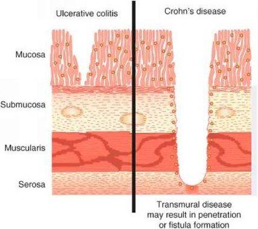 | **Comparative Depth of Inflammation in Ulcerative Colitis and Crohn's Disease** `img_25_Suppository.jpg` *Schematic Diagram* | This diagram contrasts the depth of tissue involvement in inflammatory bowel diseases (IBD). Ulcerative colitis typically presents with superficial inflammation confined to the mucosa and submucosa, while Crohn's disease is characterized by transmural inflammation involving all layers of the intestinal wall. This transmural nature in Crohn's disease leads to significant complications such as deep fissures, penetrations, and fistula formation.  *خد بالك يا دكتورنا، الفارق الجوهري هنا هو عمق الإصابة؛ في الـ Ulcerative Colitis الالتهاب سطحي ومقتصر غالباً على الـ mucosa، لكن في الـ Crohn's الالتهاب بياخد جدار الأمعاء كله (transmural). وده اللي بيخلي مريض الكرونز عرضه أكتر لتكون نواسير (fistulas) وشرخ عميق ومضاعفات جراحية أكتر بكتير من مريض القولون التقرحي.* |
| 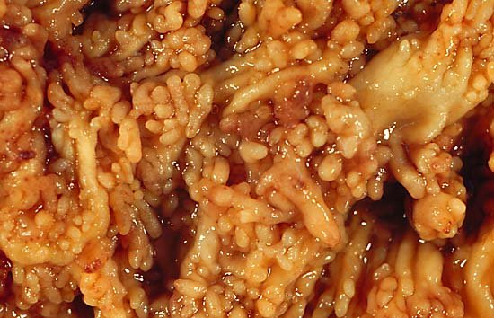 | **Diffuse Pseudopolyposis in Chronic Ulcerative Colitis** `img_21_Pseudopolyps.jpg` *Gross Pathology* | The image demonstrates diffuse pseudopolyposis, a hallmark of chronic Ulcerative Colitis. These are non-neoplastic, regenerative islands of mucosa that project from the lumen following extensive ulceration and denudation of the surrounding tissue. Their presence indicates repeated cycles of severe inflammation and healing within the bowel wall.  *خد بالك يا دكتورنا، المنظر ده هو الـ pseudopolyps اللي بنشوفها في حالات الـ Ulcerative Colitis المزمنة. دي عبارة عن جزر من الغشاء المخاطي (Mucosa) بتحاول تجدد نفسها وسط القرح الشديدة اللي دمرت البطانة. مهم جداً نفرق بينها وبين الزوائد السرطانية بالمنظار والعينات، لأن وجودها علامة على إن الالتهاب بقاله فترة طويلة وعنيف.* |
| 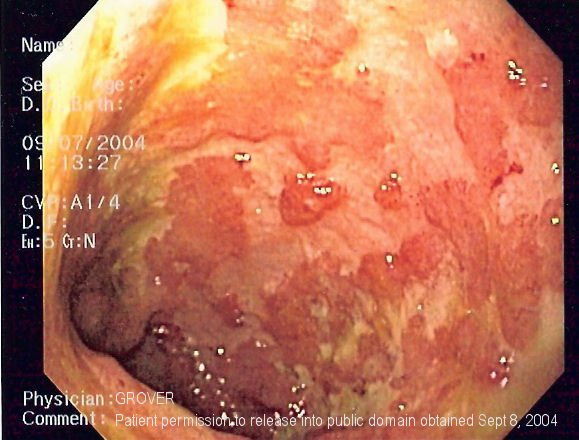 | **Endoscopic View of Active Ulcerative Colitis with Diffuse Mucosal Erythema** `img_20_UC_Friability.jpg` *Endoscopy / Laparoscopy* | Endoscopic visualization of the colon revealing diffuse mucosal inflammation, loss of normal vascular markings, and friability consistent with active ulcerative colitis. These findings represent continuous inflammation involving the rectum and extending proximally, leading to symptomatic bloody stools and abdominal urgency.  *الصورة دي بتوضح حالة التهاب قولون تقرحي (Ulcerative Colitis) نشطة، شايفين فيها احمرار منتشر (erythema) مع اختفاء الرسمة الطبيعية للأوعية الدموية وهشاشة في الغشاء المخاطي. خد بالك يا دكتورنا، العلامات دي هي اللي بتفسر ليه المريض بيعاني من إسهال مدمم وتقلصات مستمرة، والتشخيص الدقيق هنا أساسي لتحديد خطة العلاج بالمثبطات المناعية.* |
| 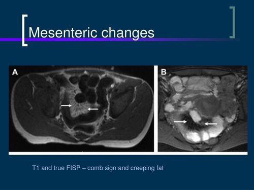 | **Mesenteric Comb Sign and Creeping Fat in Crohn's Disease on Magnetic Resonance Enterography (MRE)** `img_24_Mesalamine_Oral.jpg` *Radiological Imaging* | Axial MRI images (T1-weighted and true FISP) demonstrate classic mesenteric manifestations of active Crohn's disease. The 'comb sign' (arrows) indicates hypervascularity and engorgement of the vasa recta, while 'creeping fat' represents fibro-fatty proliferation that encapsulates the inflamed bowel wall, reflecting chronic transmural inflammation.  *الصور دي بتبين الـ 'comb sign' والـ 'creeping fat' ودول من أهم علامات نشاط مرض كرونز (Crohn's disease) في الرنين المغناطيسي. الـ 'comb sign' بيظهر كخطوط متوازية زي أسنان المشط بسبب تضخم الأوعية الدموية (vasa recta)، والـ 'creeping fat' هو تجمع الدهون حول جدار الأمعاء الملتهب، ودول بيدلوا على وجود التهاب حاد ومزمن واصل لكل طبقات الجدار.* |
| 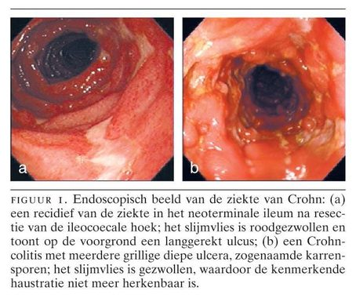 | **Endoscopic Features of Crohn's Disease in the Ileum and Colon** `img_31_Comparison_Matrix.jpg` *Endoscopy / Laparoscopy* | Endoscopic assessment showing Crohn's disease recurrence in the neoterminal ileum with a prominent longitudinal ulcer (a) and active Crohn's colitis with deep, irregular serpiginous ulcerations (b). The underlying transmural inflammation causes significant mucosal edema and loss of normal anatomical landmarks such as colonic haustration, characteristic of severe flare-ups.  *بص يا دكتور، الصور دي بتشرح مظاهر داء كرونز (Crohn's disease) في المنظار؛ الصورة (أ) بتوريك ارتجاع للمرض بعد عملية استئصال في نهاية الأمعاء الدقيقة مع وجود قرحة طولية واضحة، والصورة (ب) بتوضح التهاب في القولون بتقرحات عميقة وغير منتظمة بتشبه 'خربشة المخلب' أو سكة المحراث. الالتهاب ده بيخلي جدار الأمعاء مورم جداً وبيضيّع التقسيمات الطبيعية للقولون (haustrations)، وده بيأكد طبيعة المرض الالتهابية العنيفة اللي بتصيب كل طبقات الجدار.* |
| 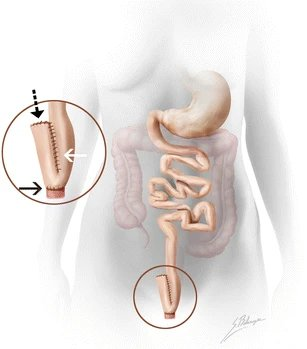 | **Schematic Diagram of Ileoanal Pouch (J-Pouch) Construction in Ulcerative Colitis** `img_28_IPAA_J-Pouch.jpg` *Schematic Diagram* | This schematic illustration demonstrates the surgical creation of an ileoanal pouch (J-pouch), commonly performed in patients with refractory ulcerative colitis or familial adenomatous polyposis following proctocolectomy. The procedure restores intestinal continuity and allows for a pelvic reservoir, preserving the route of defecation.  *الرسم التوضيحي بيوضح جراحة عمل الـ J-pouch للمرضى اللي عندهم التهاب القولون التقرحي (Ulcerative Colitis) غير المستجيب للعلاج الدوائي بعد استئصال القولون. خد بالك يا دكتورنا إن البناء ده بيحافظ على الإخراج الطبيعي وبيحسن جداً من جودة حياة المريض مقارنة بترك فغر الفائم الدائم.* |
| 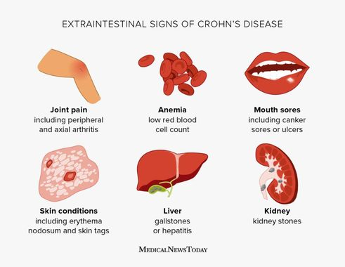 | **Extra-Intestinal Manifestations of Crohn's Disease Schematic Diagram** `img_23_PSC_MRCP.jpg` *Schematic Diagram* | Crohn's disease extends beyond the gastrointestinal tract, frequently presenting with immune-mediated and systemic extra-intestinal manifestations affecting joints, skin, oral mucosa, liver, and the urinary system. Recognizing these systemic signs is critical for comprehensive diagnosis, interdisciplinary management, and timely modification of immunosuppressive or biologic therapy.  *خد بالك يا دكتورنا إن مرض كرونز مش بس بيصيب القناة الهضمية، ده ممكن يظهر بمظاهر برة الأمعاء زي التهاب المفاصل، وتقرحات الفم، ومشاكل الجلد زي الحمرة المكتنزة، وحصوات الكلى والمرارة. الفحص الإكلينيكي الشامل لكل الأجهزة دي بيساعد في التشخيص المبكر ومنع المضاعفات النظامية للمرض.* |
| 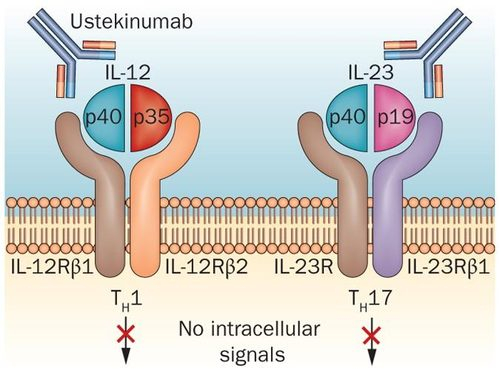 | **Mechanism of Action of Ustekinumab on IL-12 and IL-23 Pathways** `img_29_J-Pouch_Reservoir.jpg` *Pharmacological Pathway* | Ustekinumab is a human monoclonal antibody that targets the shared p40 subunit of interleukin-12 (IL-12) and interleukin-23 (IL-23). By neutralizing these cytokines, it prevents their binding to IL-12R and IL-23R receptors on TH1 and TH17 cells respectively, thereby inhibiting downstream intracellular signaling and mucosal inflammation in Crohn's disease and ulcerative colitis.  *خد بالك يا دكتورنا، اليستيكينوماب (Ustekinumab) عبارة عن مونوجلونال أنتيبيودى بيمسك فى الجزء المشترك p40 الموجود فى الـ IL-12 والـ IL-23. الخطوة دى بتمنع ارتباطهم بمستقبلاتهم على خلايا TH1 و TH17 وبالتالي بتقفل الإشارات الداخلية وبتوقف الالتهاب المناعى فى الأمعاء، وده بيخليه علاج فعال جداً فى حالات الالتهاب المزمن زى الكرونز.* |