# Clinoma Visual Atlas: 02 Viral And Non Viral Hepatitis

**Discipline / Module:** `curriculum/clinical/internal-medicine/hepatology/02_viral_and_non_viral_hepatitis`  
**Total Figures:** **19** Authentic Clinical & Pathological Images  
**Repository Remote:** [`clinomaofficial/clinoma-images`](https://github.com/clinomaofficial/clinoma-images)  

| Figure | Clinical Identification & Repository Links | Academic & Bedside Description |
| :---: | :--- | :--- |
| 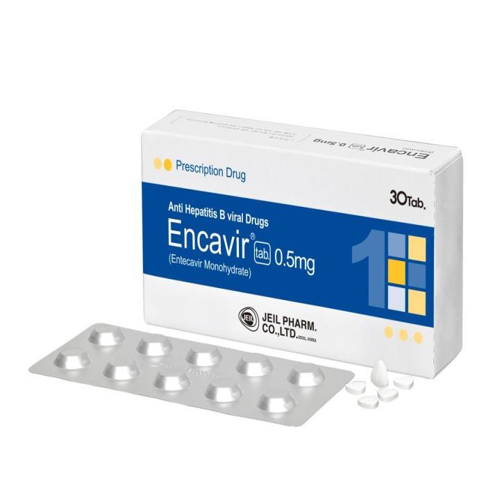 | **Encavir (Entecavir) 0.5 mg Antiviral Medication Box and Blister Pack for Hepatitis B** <code>entecavir_tenofovir_drugs.png</code> *Pharmacological Pathway* [☁️ GitHub Raw](https://raw.githubusercontent.com/clinomaofficial/clinoma-images/main/curriculum/clinical/internal-medicine/hepatology/02_viral_and_non_viral_hepatitis/entecavir_tenofovir_drugs.png) | [⚡ jsDelivr CDN](https://cdn.jsdelivr.net/gh/clinomaofficial/clinoma-images@main/curriculum/clinical/internal-medicine/hepatology/02_viral_and_non_viral_hepatitis/entecavir_tenofovir_drugs.png) | Entecavir is a potent nucleoside analog used as a first-line treatment for chronic hepatitis B virus (HBV) infection. It selectively inhibits HBV polymerase, effectively suppressing viral replication and reducing hepatic inflammation and fibrosis progression.  *خد بالك يا دكتورنا إن إنتاكافير (Entecavir) من أقوى وأفضل الأدوية المستخدمة كخط علاج أول لالتهاب الكبد الوبائي بي المزمن (Chronic Hepatitis B)، لأنه بيوقف تكاثر الفيروس بفاعلية وبيحمي الكبد من التليف.* |
| 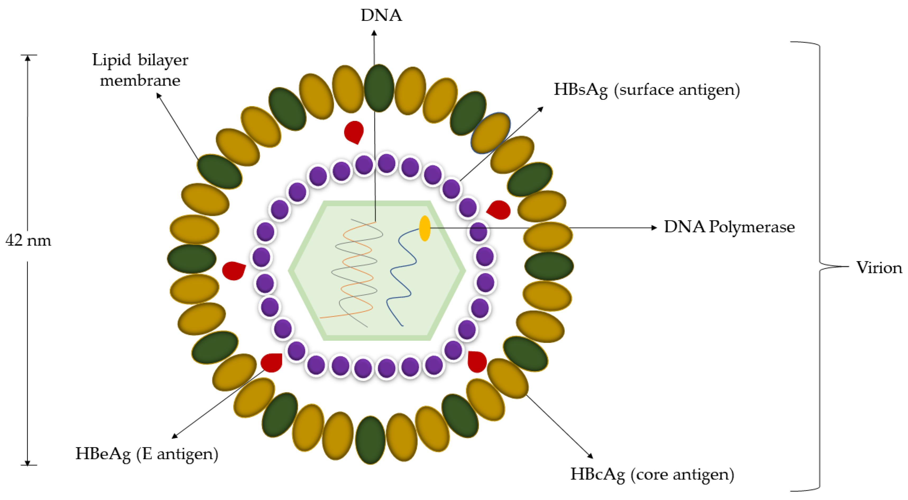 | **Hepatitis B Virus (HBV) Virion Structure and Antigens Schematic Diagram** <code>hbv_serology_window_period.png</code> *Schematic Diagram* [☁️ GitHub Raw](https://raw.githubusercontent.com/clinomaofficial/clinoma-images/main/curriculum/clinical/internal-medicine/hepatology/02_viral_and_non_viral_hepatitis/hbv_serology_window_period.png) | [⚡ jsDelivr CDN](https://cdn.jsdelivr.net/gh/clinomaofficial/clinoma-images@main/curriculum/clinical/internal-medicine/hepatology/02_viral_and_non_viral_hepatitis/hbv_serology_window_period.png) | Schematic representation of the 42 nm Hepatitis B virion (Dane particle), detailing its outer lipid envelope embedded with surface antigens (HBsAg), the inner nucleocapsid core antigen (HBcAg), partially double-stranded circular DNA genome, and associated DNA polymerase.  *خد بالك يا دكتورنا، رسمة الـ Dane particle دي بتبين مكونات فيروس الكبد الوبائي ب (HBV)، بداية من الـ HBsAg في الغلاف الخارجي اللي بنستخدمه في التشخيص والتطعيم، لحد الـ HBcAg والـ HBeAg اللي بيدلوا على نشاط الفيروس وتكاثره جوه الكبد.* |
| 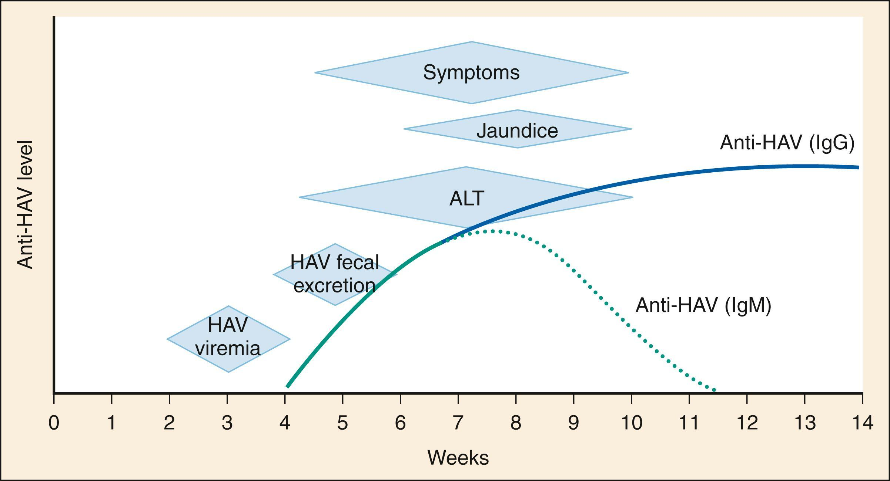 | **Hepatitis A Virus Infection Course and Serological Markers Over Time** <code>hbv_virion_structure.png</code> *Schematic Diagram* [☁️ GitHub Raw](https://raw.githubusercontent.com/clinomaofficial/clinoma-images/main/curriculum/clinical/internal-medicine/hepatology/02_viral_and_non_viral_hepatitis/hbv_virion_structure.png) | [⚡ jsDelivr CDN](https://cdn.jsdelivr.net/gh/clinomaofficial/clinoma-images@main/curriculum/clinical/internal-medicine/hepatology/02_viral_and_non_viral_hepatitis/hbv_virion_structure.png) | This schematic illustrates the temporal sequence of clinical symptoms, liver enzyme elevations (ALT), and serological markers during acute Hepatitis A virus (HAV) infection. Viral shedding in feces and viremia precede symptom onset and jaundice, while Anti-HAV IgM confirms acute infection and Anti-HAV IgG provides lifelong immunity following recovery.  *خد بالك يا دكتورنا، فيروس آي بيبدأ يظهر في البراز والدم (viremia) قبل ما الأعراض والصفراء تظهر بأسابيع، وأول ما تلاقي Anti-HAV IgM إيجابي اعرف إن دي إصابة حادة (Acute)، بينما الـ IgG بيطول وبيفضل موجود مدى الحياة عشان يمنع العدوى التانية.* |
| 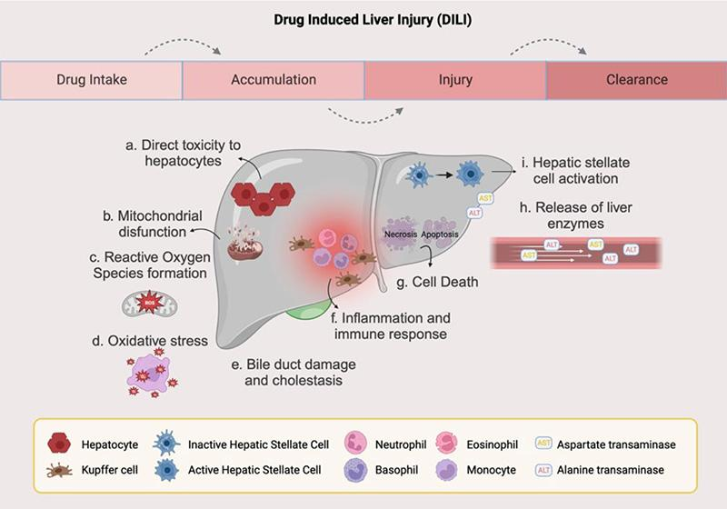 | **Drug-Induced Liver Injury (DILI) Pathophysiological Mechanisms and Cellular Cascade** <code>dili_drug_liver_injury.png</code> *Schematic Diagram* [☁️ GitHub Raw](https://raw.githubusercontent.com/clinomaofficial/clinoma-images/main/curriculum/clinical/internal-medicine/hepatology/02_viral_and_non_viral_hepatitis/dili_drug_liver_injury.png) | [⚡ jsDelivr CDN](https://cdn.jsdelivr.net/gh/clinomaofficial/clinoma-images@main/curriculum/clinical/internal-medicine/hepatology/02_viral_and_non_viral_hepatitis/dili_drug_liver_injury.png) | This schematic diagram illustrates the multi-step pathogenesis of Drug-Induced Liver Injury (DILI), starting from drug intake and accumulation to hepatocyte toxicity, mitochondrial dysfunction, oxidative stress, and subsequent inflammation. Progression of injury leads to cell necrosis and apoptosis, release of liver enzymes into the circulation, and activation of hepatic stellate cells.  *يا دكتورنا، الرسمة دي بتلخص رحلة التسمم الكبدي الناتج عن الأدوية (DILI) من أول الابتلاع وتراكم السموم لحد ما يحصل إجهاد تأكسدي وموت للخلايا (Necrosis). خد بالك إن خروج enzimas زي الـ ALT والـ AST للدم وتنشيط الـ Hepatic Stellate Cells هما الدليل الإكلينيكي الواضح على الـ Liver Injury.* |
| 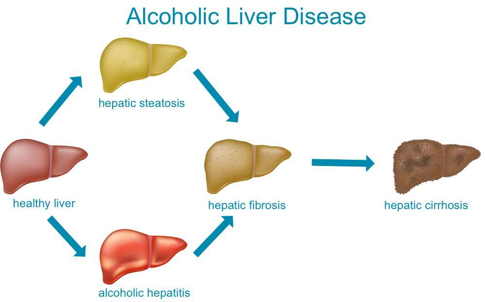 | **Alcoholic Liver Disease Progression Schematic** <code>alcoholic_hepatitis_steatosis.png</code> *Schematic Diagram* [☁️ GitHub Raw](https://raw.githubusercontent.com/clinomaofficial/clinoma-images/main/curriculum/clinical/internal-medicine/hepatology/02_viral_and_non_viral_hepatitis/alcoholic_hepatitis_steatosis.png) | [⚡ jsDelivr CDN](https://cdn.jsdelivr.net/gh/clinomaofficial/clinoma-images@main/curriculum/clinical/internal-medicine/hepatology/02_viral_and_non_viral_hepatitis/alcoholic_hepatitis_steatosis.png) | This schematic illustrates the progressive spectrum of alcoholic liver disease, starting from a healthy liver to hepatic steatosis and alcoholic hepatitis, which both can advance to hepatic fibrosis and ultimately irreversible hepatic cirrhosis.  *خد بالك يا دكتورنا إن أمراض الكبد الكحولية بتبدأ بمجرد دهون على الكبد (steatosis) أو التهاب (hepatitis)، ولو العيان مستمر في الشرب ببتطور لتليف (fibrosis) وتنتهي بتليف كبدي كامل (cirrhosis) يفقد فيه الكبد وظيفته.* |
| 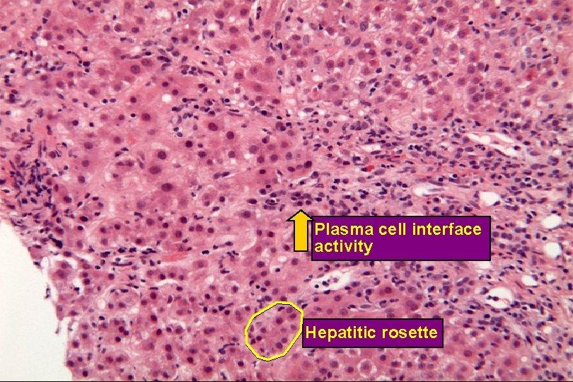 | **Autoimmune Hepatitis Histology Demonstrating Plasma Cell Interface Activity and Hepatitic Rosettes** <code>autoimmune_hepatitis_interface.png</code> *Histological Micrograph* [☁️ GitHub Raw](https://raw.githubusercontent.com/clinomaofficial/clinoma-images/main/curriculum/clinical/internal-medicine/hepatology/02_viral_and_non_viral_hepatitis/autoimmune_hepatitis_interface.png) | [⚡ jsDelivr CDN](https://cdn.jsdelivr.net/gh/clinomaofficial/clinoma-images@main/curriculum/clinical/internal-medicine/hepatology/02_viral_and_non_viral_hepatitis/autoimmune_hepatitis_interface.png) | Histopathological examination of liver tissue showing hallmark features of autoimmune hepatitis, including dense lymphoplasmacytic portal infiltrate spilling into the lobule (interface activity) and regenerating clusters of hepatocytes forming rosettes. These findings reflect active immune-mediated hepatocyte destruction and are key to establishing diagnosis and initiating immunosuppressive therapy.  *خد بالك يا دكتورنا، الصورة دي بتبين عينة كبد لحالة التهاب كبد مناعي (Autoimmune Hepatitis)، وظاهرة بوضوح الخلايا البلازمية عند حدود الفصوص الكبدية (Plasma cell interface activity) مع تكوين الروستات الكبدية (Hepatitic rosettes). العلامات دي بتدل على نشاط المرض العنيف وبتحتاج بدء العلاج المثبط للمناعة فوراً.* |
| 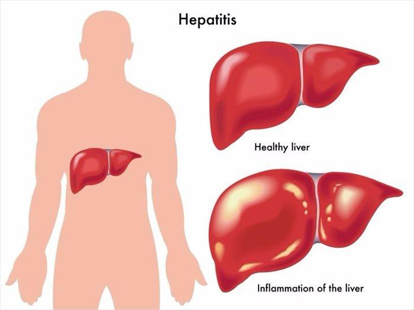 | **Hepatitis: Comparison of Healthy Liver and Inflammation of the Liver** <code>hepatitis_overview_symptoms.png</code> *Schematic Diagram* [☁️ GitHub Raw](https://raw.githubusercontent.com/clinomaofficial/clinoma-images/main/curriculum/clinical/internal-medicine/hepatology/02_viral_and_non_viral_hepatitis/hepatitis_overview_symptoms.png) | [⚡ jsDelivr CDN](https://cdn.jsdelivr.net/gh/clinomaofficial/clinoma-images@main/curriculum/clinical/internal-medicine/hepatology/02_viral_and_non_viral_hepatitis/hepatitis_overview_symptoms.png) | This schematic diagram illustrates the gross anatomical changes associated with hepatitis, contrasting a normal healthy liver with an enlarged, inflamed liver. Hepatic inflammation leads to cellular edema, swelling, and potential architectural distortion due to viral, toxic, or immune-mediated injury.  *خد بالك يا دكتورنا إن الالتهاب الكبدي الحاد أو المزمن بيعمل تضخم واهتزاز في حجم الكبد نتيجة التورم الخلوي وتجمع الخلايا الالتهابية، وده بيبان في الفحص الإكلينيكي على شكل كبد متضخم ومؤلم مع ارتفاع في إنزيمات الكبد.* |
| 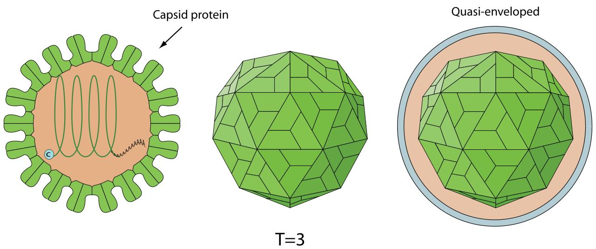 | **Hepatitis E Virus Structure and Quasi-Enveloped Virion Schematic** <code>hev_structure_virion.png</code> *Schematic Diagram* [☁️ GitHub Raw](https://raw.githubusercontent.com/clinomaofficial/clinoma-images/main/curriculum/clinical/internal-medicine/hepatology/02_viral_and_non_viral_hepatitis/hev_structure_virion.png) | [⚡ jsDelivr CDN](https://cdn.jsdelivr.net/gh/clinomaofficial/clinoma-images@main/curriculum/clinical/internal-medicine/hepatology/02_viral_and_non_viral_hepatitis/hev_structure_virion.png) | This schematic illustrates the structural organization of the Hepatitis E virus (HEV), featuring a T=3 icosahedral capsid containing the viral RNA genome, as well as the unique quasi-enveloped form found in circulation in the blood. The quasi-enveloped virion is surrounded by a host-derived membrane lacking viral glycoproteins, which facilitates non-lytic release and immune evasion.  *خد بالك يا دكتورنا، فيروس التهاب الكبد الوبائي (إي) بيمتاز بإن ليه شكلين؛ شكل في المطروس أو العلبة بيبقى محاط بغشاء من خلايا المريض نفسه بيحميه من الأجسام المضادة. الفهم الدقيق لتركيب الفيروس بيساعد في تفسير طريقة انتشاره والهرب من الجهاز المناعي.* |
| 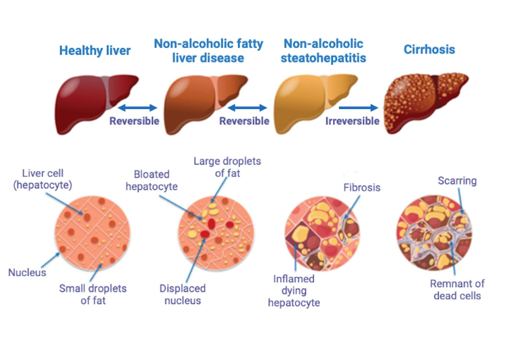 | **Stages of Non-Alcoholic Fatty Liver Disease (NAFLD) to Cirrhosis Progression and Histopathology** <code>masld_mash_fatty_liver.png</code> *Schematic Diagram* [☁️ GitHub Raw](https://raw.githubusercontent.com/clinomaofficial/clinoma-images/main/curriculum/clinical/internal-medicine/hepatology/02_viral_and_non_viral_hepatitis/masld_mash_fatty_liver.png) | [⚡ jsDelivr CDN](https://cdn.jsdelivr.net/gh/clinomaofficial/clinoma-images@main/curriculum/clinical/internal-medicine/hepatology/02_viral_and_non_viral_hepatitis/masld_mash_fatty_liver.png) | This diagram illustrates the progressive spectrum of non-alcoholic fatty liver disease, transitioning from simple steatosis (NAFLD) through non-alcoholic steatohepatitis (NASH) with inflammation and ballooning, to irreversible cirrhosis characterized by extensive fibrosis, scarring, and nodular regeneration.  *خد بالك يا دكتورنا، التحول من مجرد دهون عادية على الكبد (NAFLD) لالتهاب كبدي دهني (NASH) ممكن يكون قابل للرجوع، لكن بمجرد ما نوصل لمرحلة التليف الكامل وتكوين عقيدات تليفية (Cirrhosis)، بيبقى التغيير غير رجعي وعشان كده التشخيص المبكر حياة.* |
| 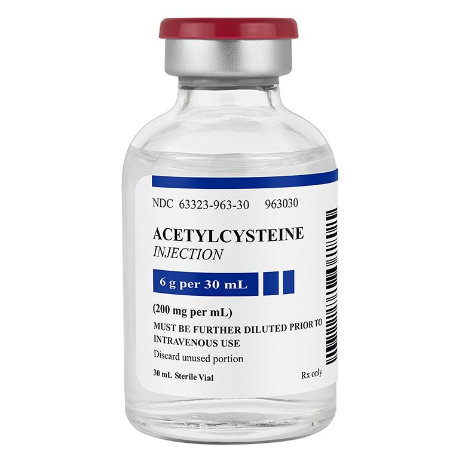 | **Acetylcysteine 6 g per 30 mL Intravenous Injection Vial** <code>n_acetylcysteine_antidote.png</code> *Pharmacological Pathway* [☁️ GitHub Raw](https://raw.githubusercontent.com/clinomaofficial/clinoma-images/main/curriculum/clinical/internal-medicine/hepatology/02_viral_and_non_viral_hepatitis/n_acetylcysteine_antidote.png) | [⚡ jsDelivr CDN](https://cdn.jsdelivr.net/gh/clinomaofficial/clinoma-images@main/curriculum/clinical/internal-medicine/hepatology/02_viral_and_non_viral_hepatitis/n_acetylcysteine_antidote.png) | Intravenous formulation of acetylcysteine used as an antidote for acetaminophen (paracetamol) overdose to prevent fulminant hepatic failure. It acts by restoring hepatic glutathione stores and scavenging toxic metabolites.  *خد بالك يا دكتورنا إن حقن الأسيتيل سيستاين دي هي خط الدفاع الأول في تسمم الباراسيتامول عشان تحمي الكبد من الفشل الحاد وتعوض مخزون الجلوتاثيون.* |
| 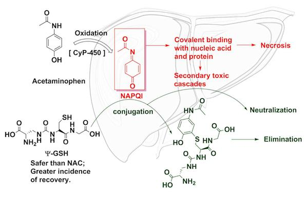 | **Acetaminophen-Induced Hepatotoxicity and Detoxification Pathway via Glutathione Conjugation** <code>paracetamol_toxicity_napqi.png</code> *Pharmacological Pathway* [☁️ GitHub Raw](https://raw.githubusercontent.com/clinomaofficial/clinoma-images/main/curriculum/clinical/internal-medicine/hepatology/02_viral_and_non_viral_hepatitis/paracetamol_toxicity_napqi.png) | [⚡ jsDelivr CDN](https://cdn.jsdelivr.net/gh/clinomaofficial/clinoma-images@main/curriculum/clinical/internal-medicine/hepatology/02_viral_and_non_viral_hepatitis/paracetamol_toxicity_napqi.png) | Acetaminophen is metabolized in the liver by cytochrome P-450 enzymes into the toxic intermediate NAPQI, which can lead to hepatic necrosis through covalent binding to cellular macromolecules. Depletion of hepatic glutathione (GSH) reserves exacerbates this injury, whereas adequate GSH or alternative protective agents like Ψ-GSH conjugate with NAPQI to facilitate safe neutralization and elimination.  *خد بالك يا دكتورنا، في حالة تسمم الباراسيتامول (الأسيتامينوفين)، الكبد بيحول الدواء لمادة سامة اسمها NAPQI عن طريق إنزيمات Cytochrome P-450 ودي اللي بتعمل النيكروزيس وتدمر خلايا الكبد لو الجلوتاثيون (GSH) خلص، وعشان كده بنضطر ندي مضادات زي الـ NAC أو البدائل عشان نعوض النقص ونخلص الجسم من السم بأمان.* |
| 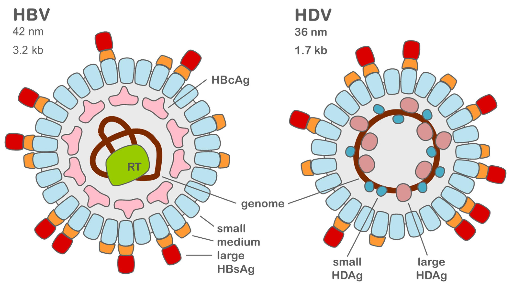 | **Comparative Schematic Structure of Hepatitis B Virus (HBV) and Hepatitis Delta Virus (HDV)** <code>hcv_virion_flavivirus.png</code> *Schematic Diagram* [☁️ GitHub Raw](https://raw.githubusercontent.com/clinomaofficial/clinoma-images/main/curriculum/clinical/internal-medicine/hepatology/02_viral_and_non_viral_hepatitis/hcv_virion_flavivirus.png) | [⚡ jsDelivr CDN](https://cdn.jsdelivr.net/gh/clinomaofficial/clinoma-images@main/curriculum/clinical/internal-medicine/hepatology/02_viral_and_non_viral_hepatitis/hcv_virion_flavivirus.png) | This schematic compares the virion structures of Hepatitis B Virus (HBV) and Hepatitis Delta Virus (HDV). HDV is a defective satellite virus that requires the HBV envelope proteins (HBsAg) for transmission and assembly, possessing a smaller genome (1.7 kb ssRNA) and unique hepatitis delta antigens (HDAg).  *خد بالك يا دكتورنا، فيروس دلتا (HDV) ده فيروس ناقص وبيعتمد اعتماد كلي على الغلاف بتاع فيروس بي (HBsAg) عشان يقدر يعدي الخلية، وعشان كده الإصابة المشتركة أو العدوى المزدوجة بينهم بتعمل التهاب كبد حاد ومزمن عنيف جداً.* |
| 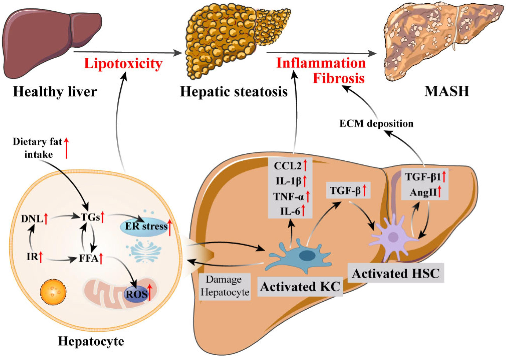 | **Pathophysiological Progression of Non-Alcoholic Steatohepatitis (MASH) from Hepatic Steatosis to Fibrosis** <code>masld_pathogenesis_cascade.png</code> *Schematic Diagram* [☁️ GitHub Raw](https://raw.githubusercontent.com/clinomaofficial/clinoma-images/main/curriculum/clinical/internal-medicine/hepatology/02_viral_and_non_viral_hepatitis/masld_pathogenesis_cascade.png) | [⚡ jsDelivr CDN](https://cdn.jsdelivr.net/gh/clinomaofficial/clinoma-images@main/curriculum/clinical/internal-medicine/hepatology/02_viral_and_non_viral_hepatitis/masld_pathogenesis_cascade.png) | This schematic diagram outlines the pathological progression from a healthy liver through hepatic steatosis to metabolic dysfunction-associated steatohepatitis (MASH). Key mechanisms include dietary fat intake, insulin resistance (IR), de novo lipogenesis (DNL), lipotoxicity mediated by endoplasmic reticulum (ER) stress and reactive oxygen species (ROS), alongside immune cell activation (Kupffer cells and hepatic stellate cells) leading to extracellular matrix (ECM) deposition and fibrosis.  *الرسم التوضيحي بيشرح خطوات تطور الدهون على الكبد من مرحلة الكبد السليم لحد التهاب الكبد الدهني المرتبط بخلل التمثيل الغذائي (MASH). خد بالك يا دكتورنا إن مقاومة الإنسولين، وزيادة تصنيع الدهون (DNL)، والإجهاد التأكسدي (ROS)، وتنشيط الخلايا النجمية (HSCs) هي المحاور الأساسية اللي بتؤدي في الآخر لتليف الكبد.* |
| 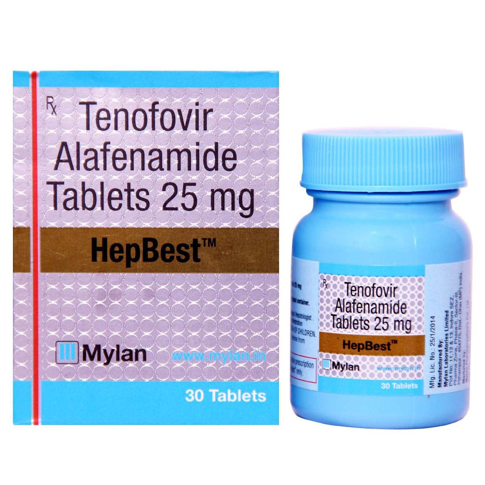 | **Tenofovir Alafenamide (HepBest) 25 mg Oral Formulation for Chronic Hepatitis B** <code>tenofovir_taf_hepbest.png</code> *Clinical Photo* [☁️ GitHub Raw](https://raw.githubusercontent.com/clinomaofficial/clinoma-images/main/curriculum/clinical/internal-medicine/hepatology/02_viral_and_non_viral_hepatitis/tenofovir_taf_hepbest.png) | [⚡ jsDelivr CDN](https://cdn.jsdelivr.net/gh/clinomaofficial/clinoma-images@main/curriculum/clinical/internal-medicine/hepatology/02_viral_and_non_viral_hepatitis/tenofovir_taf_hepbest.png) | Tenofovir alafenamide (TAF) 25 mg is a targeted prodrug of tenofovir used in the long-term management of chronic hepatitis B virus (HBV) infection. TAF demonstrates high antiviral efficacy with improved renal and bone safety profiles compared to older nucleotide analogues due to its stable plasma kinetics and targeted intracellular delivery to hepatocytes.  *علاج التينوفوفير ألافيناميد (HepBest) بيعتبر من أهم الأدوية الحديثة في علاج الفيروس الكبدي الوبائي بي (HBsAg chronic). TAF بيتميز إنه بيوصل بكفاءة عالية للخلايا الكبدية بأمان أكبر على الكلى والعظام مقارنة بالجيل القديم (TDF)، وده بيخليه الخيار الأول للمرضى اللي عندهم مشاكل في وظائف الكلى أو هشاشة عظام.* |
| 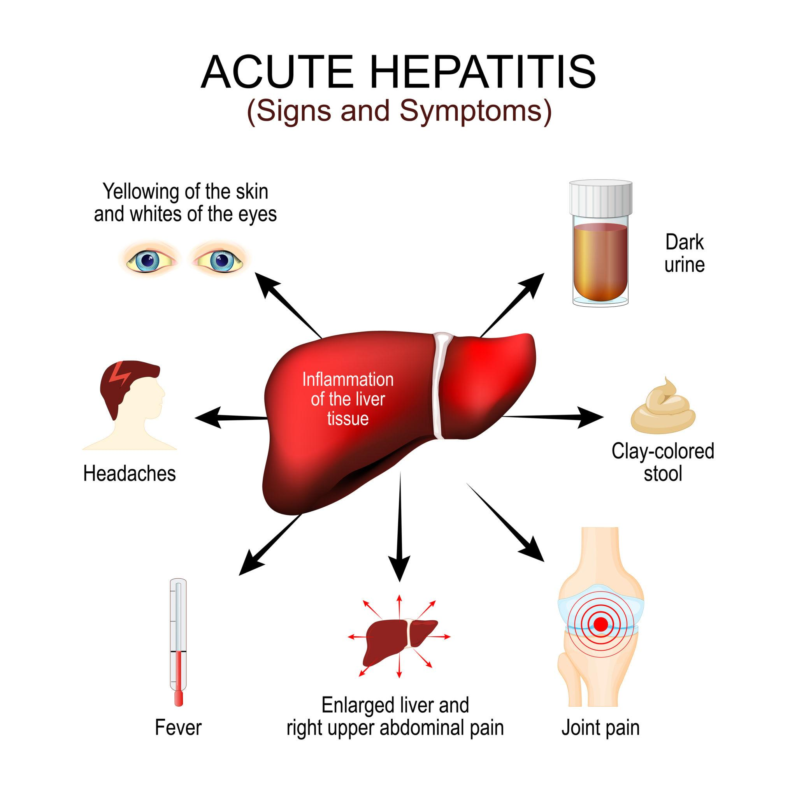 | **Acute Hepatitis Signs and Symptoms Pathophysiology Diagram** <code>prodromal_icteric_phases.png</code> *Schematic Diagram* [☁️ GitHub Raw](https://raw.githubusercontent.com/clinomaofficial/clinoma-images/main/curriculum/clinical/internal-medicine/hepatology/02_viral_and_non_viral_hepatitis/prodromal_icteric_phases.png) | [⚡ jsDelivr CDN](https://cdn.jsdelivr.net/gh/clinomaofficial/clinoma-images@main/curriculum/clinical/internal-medicine/hepatology/02_viral_and_non_viral_hepatitis/prodromal_icteric_phases.png) | This diagram illustrates the classic systemic signs and symptoms of acute viral and non-viral hepatitis resulting from acute hepatocellular inflammation and necrosis. Hallmark features include conjugated hyperbilirubinemia leading to jaundice, dark urine, and acholic clay-colored stools, alongside systemic manifestations such as fever, arthralgia, and right upper quadrant discomfort due to hepatomegaly.  *خد بالك يا دكتورنا، الأعراض دي بتمثل اللوحة الإكلينيكية الكاملة لالتهاب الكبد الحاد؛ تجميعة الصفراء والبول الغامق مع البراز الفاتح بتعكس انسداد القنوات البيليروبينية المبدئي، متنساش تسأل العيان عن آلام المفاصل والوجع في الجنب اليمين فوق.* |
| 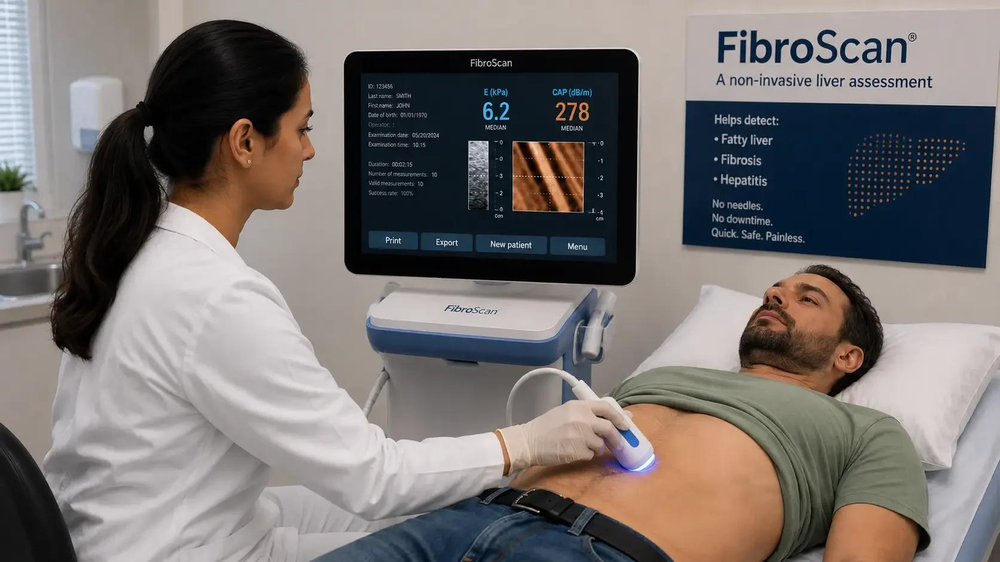 | **FibroScan Transient Elastography for Non-Invasive Liver Assessment** <code>fibroscan_vcte_elastography.png</code> *Clinical Photo* [☁️ GitHub Raw](https://raw.githubusercontent.com/clinomaofficial/clinoma-images/main/curriculum/clinical/internal-medicine/hepatology/02_viral_and_non_viral_hepatitis/fibroscan_vcte_elastography.png) | [⚡ jsDelivr CDN](https://cdn.jsdelivr.net/gh/clinomaofficial/clinoma-images@main/curriculum/clinical/internal-medicine/hepatology/02_viral_and_non_viral_hepatitis/fibroscan_vcte_elastography.png) | FibroScan transient elastography is a non-invasive imaging modality that quantifies liver stiffness (E, measured in kPa) to assess fibrosis and Controlled Attenuation Parameter (CAP, measured in dB/m) to evaluate hepatic steatosis. This bedside modality offers rapid results, aiding in the diagnosis and monitoring of viral and non-viral hepatitis without the procedural risks of a liver biopsy.  *الفايبروسكان من الفحوصات المهمة جداً لتقييم تليف الكبد والدهون بدون الحاجة لعينة كبدية جراحية. المؤشرات اللي قدامك دي بتوضح درجة الصلابة (E) عشان نعرف مرحلة التليف، ودرجة الـ CAP عشان نقيس الدهون الكبدية بدقة وسرعة.* |
| 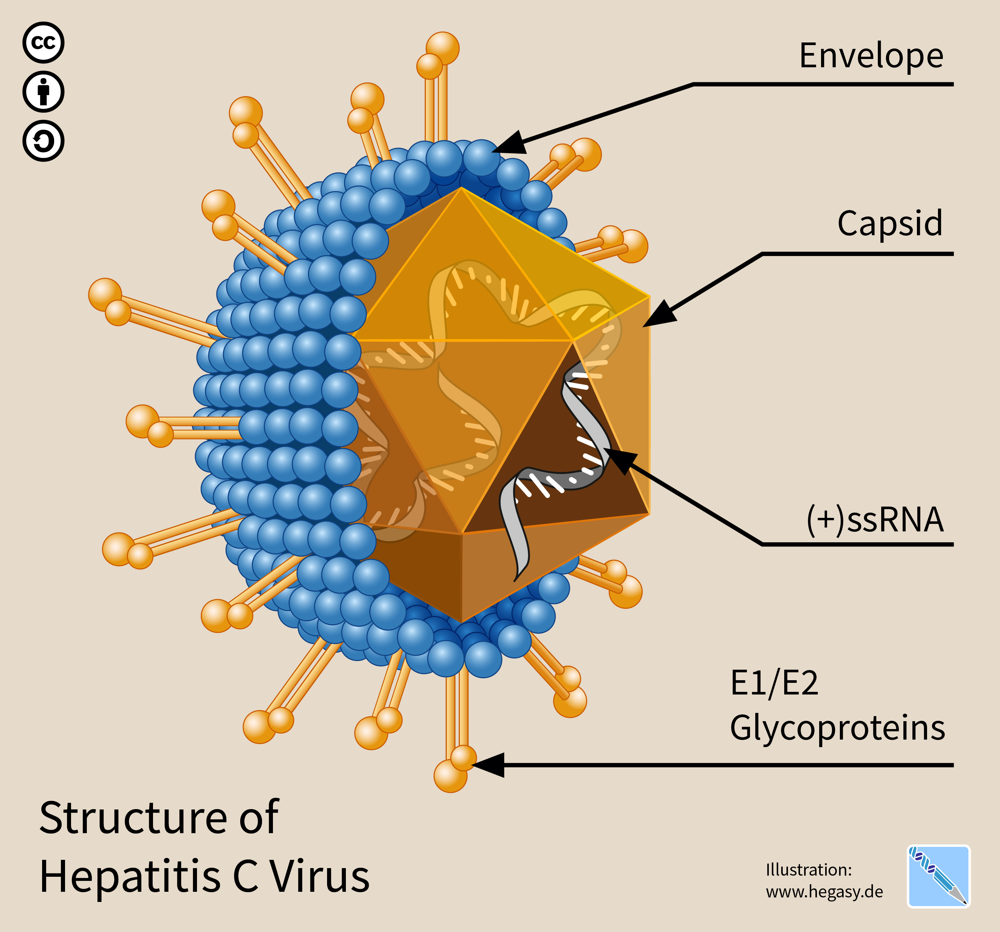 | **Structure of Hepatitis C Virus** <code>hcv_virion_hegasy.png</code> *Schematic Diagram* [☁️ GitHub Raw](https://raw.githubusercontent.com/clinomaofficial/clinoma-images/main/curriculum/clinical/internal-medicine/hepatology/02_viral_and_non_viral_hepatitis/hcv_virion_hegasy.png) | [⚡ jsDelivr CDN](https://cdn.jsdelivr.net/gh/clinomaofficial/clinoma-images@main/curriculum/clinical/internal-medicine/hepatology/02_viral_and_non_viral_hepatitis/hcv_virion_hegasy.png) | The hepatitis C virus (HCV) is a small, enveloped, single-stranded positive-sense RNA virus belonging to the Flaviviridae family. It consists of a core nucleocapsid enclosing the viral genome, surrounded by a lipid membrane embedded with E1 and E2 envelope glycoproteins crucial for host cell entry and immune evasion.  *خد بالك يا دكتورنا إن فيروس سي بيمتلك جينوم من الـ (+)ssRNA وجلاف دهني جواه كابسيد، والبروتينات السطحية E1 و E2 هما اللي بيمسكوا في خلايا الكبد ويخلوا الفيروس يهرب من المناعة. الفهم الدقيق لتركيبه بيساعدنا نفهم إزاي الأدوية الجديدة بتوقف تضاعفه.* |
| 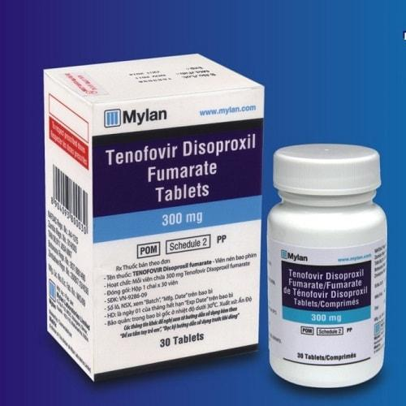 | **Tenofovir Disoproxil Fumarate 300 mg Tablets Packaging** <code>tenofovir_tdf_bottle.png</code> *Pharmacological Pathway* [☁️ GitHub Raw](https://raw.githubusercontent.com/clinomaofficial/clinoma-images/main/curriculum/clinical/internal-medicine/hepatology/02_viral_and_non_viral_hepatitis/tenofovir_tdf_bottle.png) | [⚡ jsDelivr CDN](https://cdn.jsdelivr.net/gh/clinomaofficial/clinoma-images@main/curriculum/clinical/internal-medicine/hepatology/02_viral_and_non_viral_hepatitis/tenofovir_tdf_bottle.png) | Tenofovir disoproxil fumarate is a nucleotide reverse transcriptase inhibitor (NRTI) widely utilized in the treatment of chronic hepatitis B virus (HBV) infection. It effectively suppresses viral replication by inhibiting HBV polymerase, reducing hepatic inflammation and the risk of cirrhosis or hepatocellular carcinoma.  *عقار تينوفوفير ديسوبروكسيل فيومارات (Tenofovir) من أهم مضادات الفيروسات المستخدمة في علاج التهاب الكبد الوبائي بي (Hepatitis B). الدواء بيشتغل عن طريق تثبيط إنزيم بوليميراز الفيروسي، وده بيقلل تضاعف الفيروس وبيحمي الكبد من التليف أو الأورام.* |
| 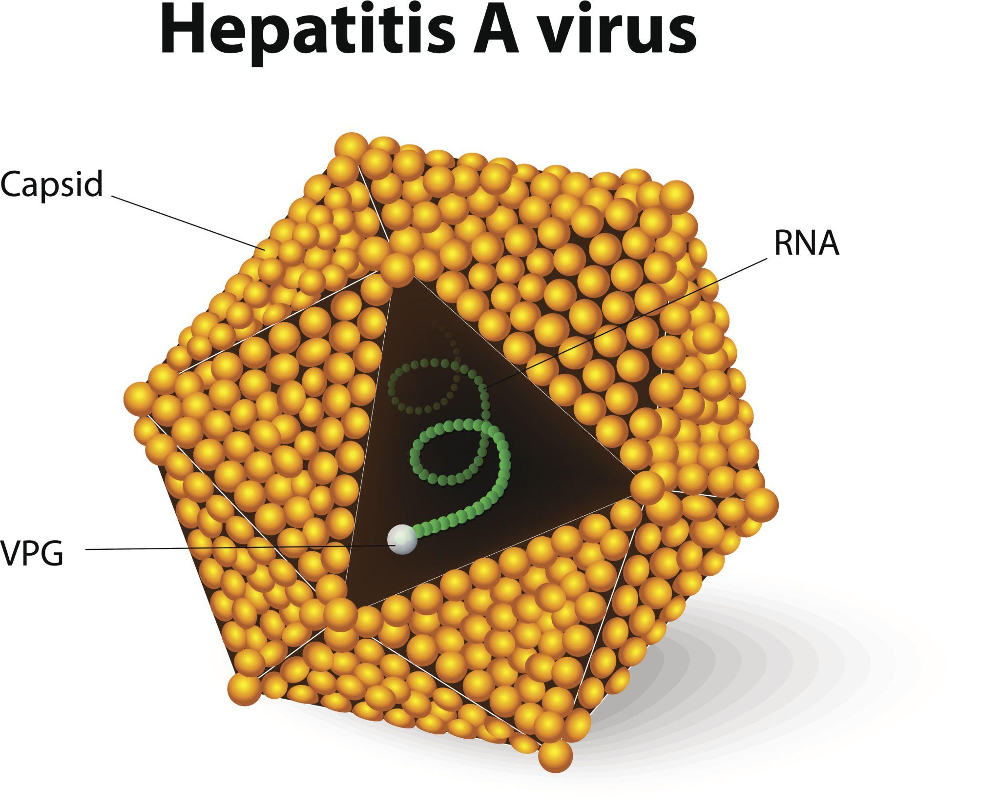 | **Hepatitis A Virus Structure and Genome Organization** <code>hav_structure_transmission.png</code> *Schematic Diagram* [☁️ GitHub Raw](https://raw.githubusercontent.com/clinomaofficial/clinoma-images/main/curriculum/clinical/internal-medicine/hepatology/02_viral_and_non_viral_hepatitis/hav_structure_transmission.png) | [⚡ jsDelivr CDN](https://cdn.jsdelivr.net/gh/clinomaofficial/clinoma-images@main/curriculum/clinical/internal-medicine/hepatology/02_viral_and_non_viral_hepatitis/hav_structure_transmission.png) | The Hepatitis A virus is a non-enveloped, positive-sense single-stranded RNA virus belonging to the Picornaviridae family. The genomic RNA is encapsidated within an icosahedral protein shell (capsid) and covalently linked at its 5' end to the viral protein VPg.  *خد بالك يا دكتورنا إن فيروس الكبد الوبائي أ (Hepatitis A) هو فيروس RNA موجب الشريط ومحيط بغلاف بروتيني (Capsid) على شكل إيكوساهيدرال وبدونه غلاف دهني (Non-enveloped)، وده بيفسر مقاومته للظروف البيئية وانتقاله بالعدوى البرازية الفموية.* |
