# Clinoma Visual Atlas: 03 Liver Tumors

**Discipline / Module:** `curriculum/clinical/internal-medicine/hepatology/03_liver_tumors`  
**Total Figures:** **20** Authentic Clinical & Pathological Images

| Figure | Clinical Identification | Academic & Bedside Description |
| :---: | :--- | :--- |
| 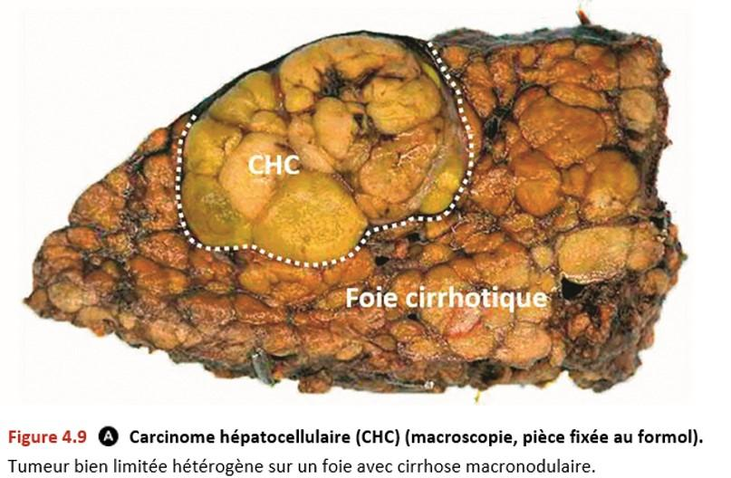 | **Hepatocellular Carcinoma (HCC) on Macronodular Cirrhotic Liver Gross Specimen** `liver_tumor_04_Socit_Franaise_de_Pathologie_-_II-a_Pathologie_digestive_Foi.jpg` *Gross Pathology* | Gross pathology of a fixed liver specimen displaying a well-circumscribed, heterogeneous hepatocellular carcinoma (HCC) arising within a macronodular cirrhotic liver. The tumor appears as a large nodular mass with varying color tones indicative of necrosis, hemorrhage, and fatty change. HCC commonly develops in patients with chronic liver disease and cirrhosis, requiring careful macroscopic and microscopic margin assessment.  *خد بالك يا دكتورنا، العينة دي بتوضح كارسينوما الخلايا الكبدية (HCC) بحجم كبير وواضح الحدود ناشئة على كبد متليف تليف عقدي كبير (Macronodular cirrhosis). الأورام دي غالباً بتظهر في مرضى التليف المزمن، وبتبان واضحة وماسكة نفسها لكنها غير متجانسة بسبب التغيرات النخرية والنزيف داخل الورم.* |
| 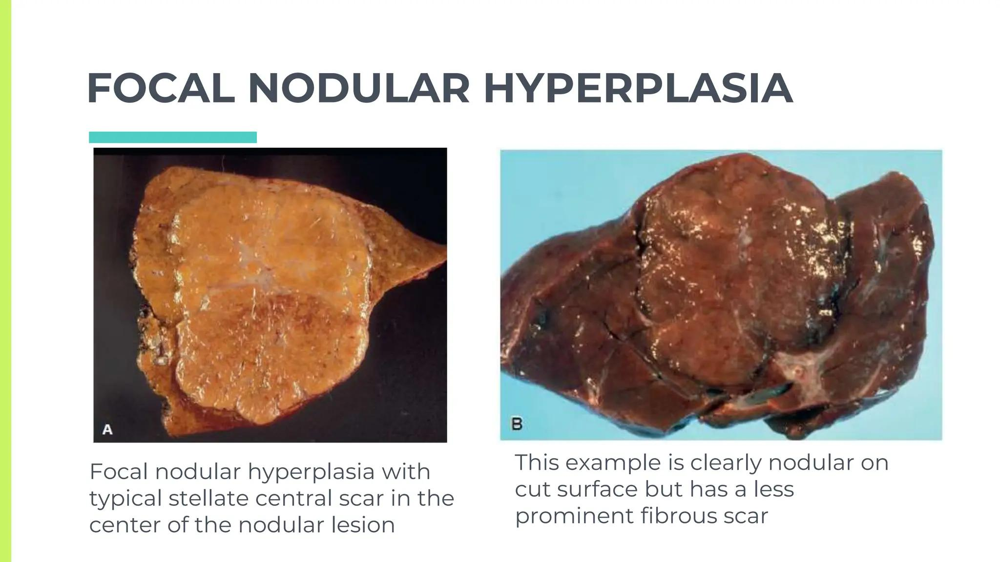 | **Focal Nodular Hyperplasia Gross Pathology with Stellate Central Scar** `liver_tumor_03_LIVER_pathology_tumor_and_tumorlike_conditions_PPTX.jpg` *Gross Pathology* | Gross specimens of focal nodular hyperplasia (FNH) demonstrating a well-circumscribed, benign liver lesion characterized by a classic pale stellate central fibrous scar radiating fibrous septa to the periphery, dividing the parenchyma into distinct nodules.  *خد بالك يا دكتورنا إن الـ Focal Nodular Hyperplasia دي أورام حميدة في الكبد وعادة بتتميز بوجود الـ Central Stellate Scar المشهور أوي في النصف اللي بيقسمها لفصوص ونودلز، ومهم نفرقها عن الآدينوما عشان دي ملهاش خطورة علي النزيف.* |
| 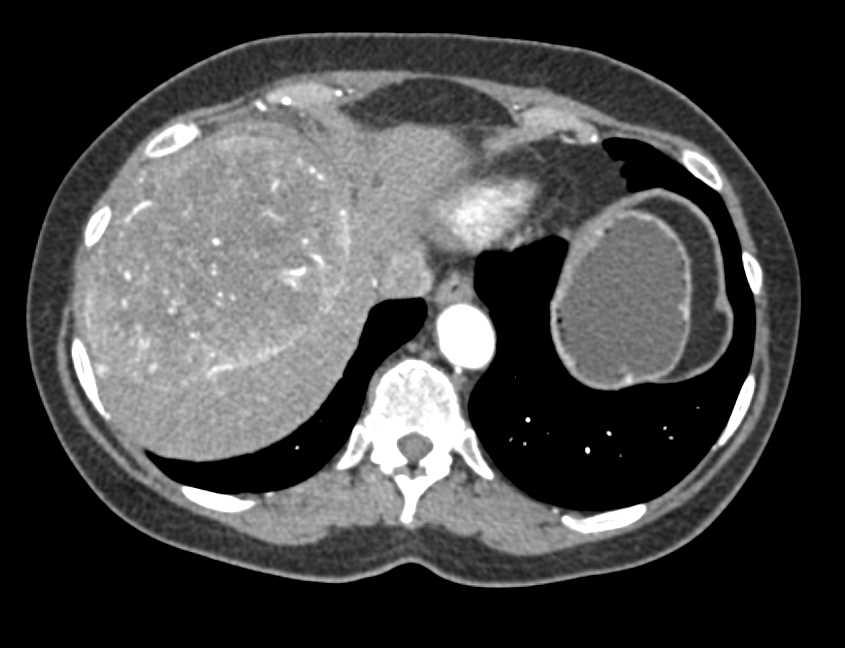 | **Axial Contrast-Enhanced CT Scan Showing a Large Hepatic Hemangioma with Peripheral Nodular Enhancement** `liver_tumor_08_Hepatocellular_Carcinoma_Hepatoma_with_Pseudocapsule_and_Neo.jpg` *Radiological Imaging* | This axial contrast-enhanced CT scan demonstrates a large well-defined hepatic mass exhibiting characteristic peripheral nodular enhancement, typical of a cavernous hemangioma. Hepatic hemangiomas are the most common benign liver tumors and are often incidentally detected during cross-sectional imaging.  *يا دكتورنا، الأشعة دي موضحة ورم كبدي حميدي (Hemangioma) كبير باين في المقطع المحوري مع الـ Peripheral nodular enhancement المشهورة بتاعته. دي من أكثر الأورام الحميدة شيوعاً في الكبد، وغالباً بنكتشفها بالصدفة في الأشاعات المقطعية.* |
| 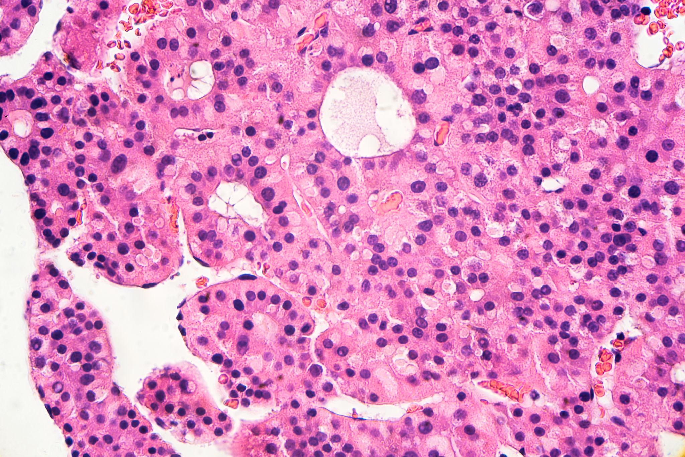 | **Hepatic Adenoma Histological Micrograph** `liver_tumor_06_Liver_Cancer_Hepatocellular_Carcinoma.jpg` *Histological Micrograph* | High-power histological micrograph of a hepatic adenoma demonstrating cords of benign hepatocytes with abundant eosinophilic cytoplasm and uniform nuclei, characteristic of this benign liver neoplasm lacking portal tracts and bile ducts. This finding is commonly associated with oral contraceptive use or metabolic disorders and carries a risk of hemorrhage or malignant transformation.  *خد بالك يا دكتورنا، في صبغة الهيماتوكسيلين والإيوسين لأورام الكبد الحميدة (Hepatic Adenoma)، بتشوف خلايا كبدية شبه طبيعية لكنها خالية تماماً من القنوات المرارية والأوردة البوابة (Portal tracts). العيان غالباً بيكون ماشي على أدوية هرمونية أو موانع حمل، وأهم كومبليكايشن تخاف منها هي النزيف المفاجئ.* |
| 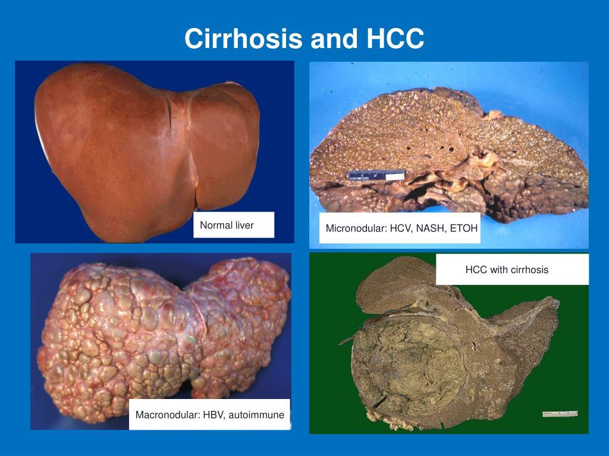 | **Gross Pathology Comparison of Normal Liver, Micronodular Cirrhosis, Macronodular Cirrhosis, and Hepatocellular Carcinoma (HCC)** `liver_tumor_07_PPT_-_Hepatocellular_Carcinoma_PowerPoint_Presentation_free.jpg` *Gross Pathology* | This gross pathology panel illustrates the spectrum of hepatic parenchymal changes, transitioning from a smooth normal liver to micronodular cirrhosis (frequently associated with HCV, NASH, and ETOH) and macronodular cirrhosis (associated with HBV and autoimmune hepatitis). The lower right image demonstrates a large, well-circumscribed hepatocellular carcinoma (HCC) arising within a cirrhotic liver, highlighting the critical malignant transformation risk in chronic liver disease.  *الصورة بتوضح التدرج المرضي من كبد طبيعي لأشكال التليف الكبدي المختلفة (الميكرونودولار والماكرونودولار) لحد ما نوصل لتورم الكبد السرطاني (HCC) اللي نشأ على خلفية تليف كبدي. خد بالك يا دكتورنا إن التليف الكبدي بأنواعه المختلفة بيعتبر أرض خصبة ومؤهبة جداً لحدوث الـ HCC، وعشان كده المتابعة الدورية بالموجات فوق الصوتية وألفا فيتو بروتين للعيانين دول حاجة مقدسة.* |
|  | **Quadphasic CT Scan of Large Hepatocellular Carcinoma (HCC)** `liver_tumor_05_Triphasic_CT_of_the_Abdomen_Key_Clinical_Applications_and_Di.jpg` *Radiological Imaging* | Quadphasic CT images of a large hepatocellular carcinoma (HCC) showing the hallmark diagnostic features: marked heterogeneous arterial phase hyperenhancement followed by rapid washout in the portal venous and delayed phases.  *خد بالك يا دكتورنا، أشعة المقطعيات الرباعية المرحلية هي المعيار الذهبي لتشخيص أورام الكبد السرطانية الأولية (HCC)؛ لازم تدور على الـ Arterial enhancement وبعدين الـ Washout في الـ Portal والـ Delayed phases.* |
| 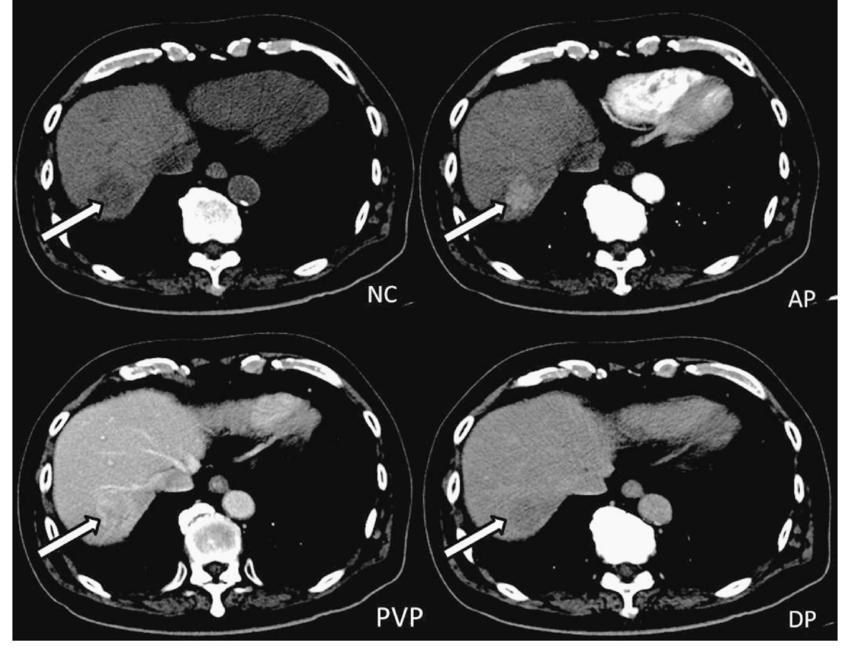 | **Multiphasic Contrast-Enhanced CT of the Liver Demonstrating Hepatic Hemangioma** `liver_tumor_12_Quadriphasic_images_of_the_enhancement_features_in_a_typical.jpg` *Radiological Imaging* | Multiphasic computed tomography of the liver demonstrates a well-defined hypodense lesion on non-contrast scan (NC) with characteristic peripheral globular enhancement during the arterial phase (AP), progressive centripetal fill-in on portal venous phase (PVP), and complete iso-attenuation with blood pool on delayed phase (DP), pathognomonic for hepatic hemangioma.  *خد بالك يا دكتورنا، الأشعة المقطعية متعددة المراحل دي بتبين ورم وعائي كبدي (Hepatic Hemangioma) بيتميز بظهور صبغة في الأطراف (Peripheral globular enhancement) في مرحلة الشرايين وتمتد تدريجيًا للداخل (Centripetal fill-in) في المراحل المتأخرة، ودي علامة تشخيصية مميزة جداً تفرقها عن الأورام الخبيثة.* |
| 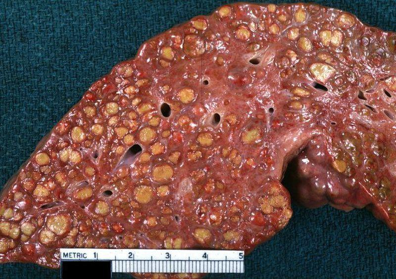 | **Nodular Regenerative Hyperplasia of the Liver with Diffuse Micronodules** `liver_tumor_11_Macronodular_Liver_Cirrhosis_-_MEDizzy.jpg` *Gross Pathology* | Gross pathology specimen of a liver cross-section demonstrating extensive micronodular transformation throughout the parenchyma. This appearance is characteristic of nodular regenerative hyperplasia or severe micronodular cirrhosis, driven by chronic parenchymal extinction and localized regeneration without significant fibrous septation.  *خد بالك يا دكتورنا، العينة دي بتوضح تليف الكبد العقيدي أو التضخم التجددي العقيدي (Nodular Regenerative Hyperplasia)، وهتشوف فيها الكبد متحول لعقيدات صغيرة ومتجانسة بحجم الميكرون، واللي بتميز الحالات اللي بيحصل فيها تجدد موضعي للخلايا نتيجة نقص تروية بوابية.* |
| 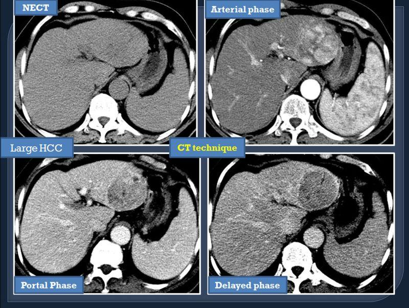 | **Quadphasic CT Scan of Large Hepatocellular Carcinoma (HCC)** `liver_tumor_15_Triphasic_CT_of_the_Abdomen_Key_Clinical_Applications_and_Di.jpg` *Radiological Imaging* | This quadphasic contrast-enhanced CT scan demonstrates a large hepatocellular carcinoma (HCC). It exhibits the classic enhancement pattern: marked hyperenhancement in the arterial phase due to neoangiogenesis, followed by rapid washout of contrast resulting in hypoattenuation relative to the surrounding liver parenchyma in the portal venous and delayed phases.  *خد بالك يا دكتورنا، الأشعة الثلاثية أو الرباعية للمرحلة الشريانية بتوضح ورم كبدي (HCC) كبير بيحصل فيه Hyperenhancement واضح جداً في الأول (Arterial phase)، وبعدين بيحصل له Rapid washout في مراحل الـ Portal والـ Delayed، ودي العلامة المميزة للتشخيص بالأشعة المقطعية.* |
| 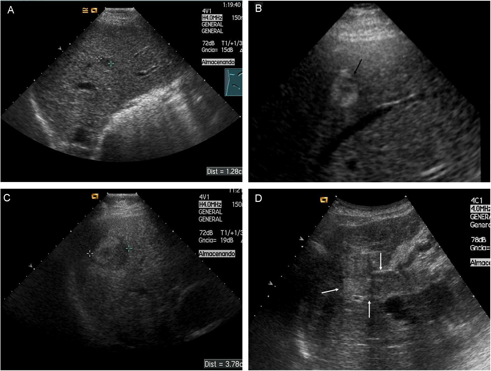 | **Liver Ultrasound Findings in Hepatic Tumors** `liver_tumor_16_Carcinoma_hepatocelular_diagnstico_estadificacin_y_estrategi.jpg` *Radiological Imaging* | Abdominal ultrasonography panels (A-D) demonstrating hepatic focal lesions with varied echogenicity and associated vascular landmarks. Ultrasonography remains the primary screening modality for detecting liver tumors, assessing lesion size, and evaluating vascular invasion.  *يا دكتورنا الصور دي بتوضح أشعة سونار على الكبد فيها كتل وأورام بؤرية ظاهرة بأحجام مختلفة وقياساتها، ولازم نخلي بالنا من الفحص الدقيق للشرايين والأوردة البوابية عشان تقييم أي تمدد أو غزو وعائي.* |
| 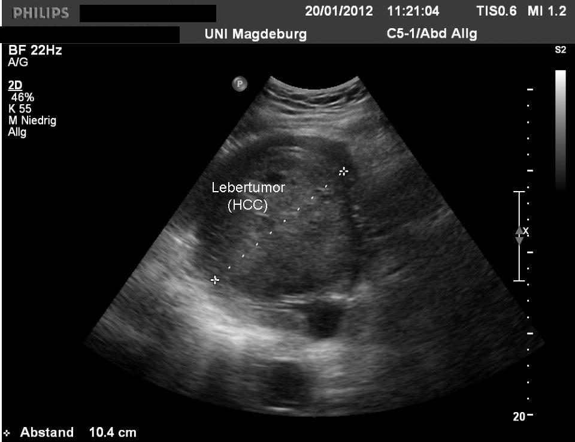 | **Abdominal Ultrasound Demonstrating Large Hepatocellular Carcinoma (HCC)** `liver_tumor_13_Universittsklinik_fr_Gastroenterologie_Hepatologie_und_Infek.jpg` *Radiological Imaging* | Abdominal ultrasound revealing a large, well-circumscribed hepatic mass measuring approximately 10.4 cm, labeled as 'Lebertumor (HCC)'. Hepatocellular carcinoma typically presents as a hypoechoic or heterogeneous liver lesion with a hypoechoic halo, commonly associated with chronic liver disease and cirrhosis.  *خد بالك يا دكتورنا، الصورة بتوضح سونار على البطن وفيه ورم كبير في الكبد (HCC) قطره حوالي 10.4 سم مع حدود واضحة. الأورام الكبدية الأساسية زي الهباتوكيللر كارسينوما بتظهر غالباً في المرضى اللي عندهم تليف كبدي، وضروري نعمل الفحوصات المتقدمة زي الـ Triphasic CT أو المريء لتأكيد التشخيص بدقة.* |
| 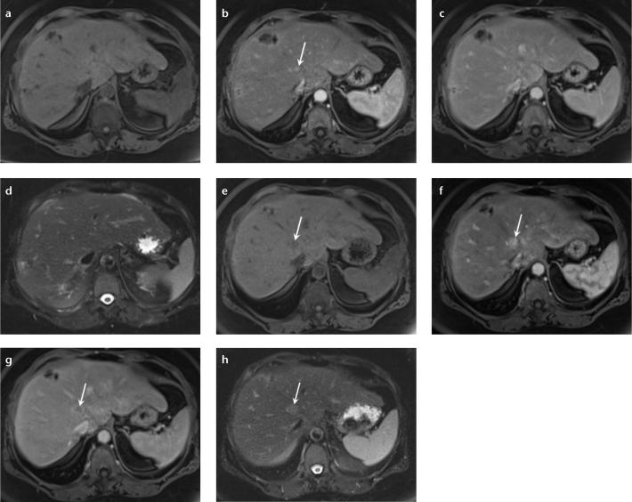 | **Dynamic Contrast-Enhanced MRI of Hepatocellular Carcinoma Showing Arterial Phase Hyperenhancement and Washout** `liver_tumor_14_MRI_of_hepatocellular_carcinoma_an_update_of_current_practic.jpg` *Radiological Imaging* | Multi-phase contrast-enhanced magnetic resonance imaging demonstrating a hepatic lesion with characteristic arterial phase hyperenhancement and subsequent portal venous/delayed phase washout (indicated by arrows), typical of hepatocellular carcinoma in cirrhotic liver. These dynamic enhancement features are hallmark diagnostic criteria utilized in LI-RADS classification for non-invasive confirmation of HCC.  *خد بالك يا دكتورنا، العيانين دول بيبان عندهم في الـ MRI تباين مميز جداً في مرحلة الـ arterial phase مع وش-أوت (washout) واضح في الـ portal venous phase، ودي علامة ذهبية لتشخيص الـ HCC من غير ما نحتاج عينة في حالات الـ cirrhosis.* |
| 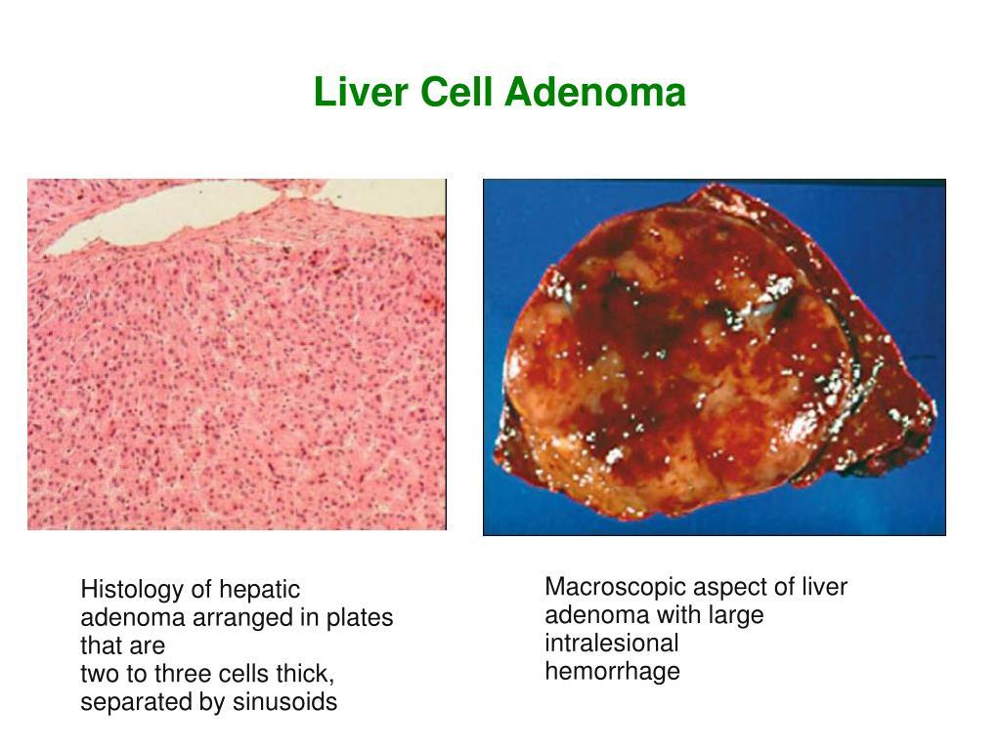 | **Liver Cell Adenoma Histology and Gross Pathology** `liver_tumor_02_PPT_-_SURGICAL_TREATMENT_OF_FOCAL_LIVER_MASSES_PowerPoint_Pr.jpg` *Gross Pathology* | Liver cell adenoma is a benign monoclonal hepatocellular neoplasm strongly associated with oral contraceptive use, glycogen storage disease, and metabolic syndrome. Grossly, it typically presents as a well-circumscribed solitary mass with prominent intralesional hemorrhage or necrosis. Histologically, it is characterized by sheets of hepatocytes arranged in plates that are two to three cells thick, separated by sinusoids, completely lacking portal tracts.  *خد بالك يا دكتورنا إن الهيباتيك أديجوما دي ورم حميد في الكبد، وغالباً بنشوفه في الستات اللي بيخدوا حبوب منع الحمل. في العينة الميكروسكوبية الخلايا بتبقى مرتبة في صفوف سميكة من غير بورتال تراكتس، وبالعين المجردة بيظهر بورم محاط بغلاف وفيه نزيف داخلي كبير ممكن ينفجر ويعمل بطن جراحي طارئ.* |
| 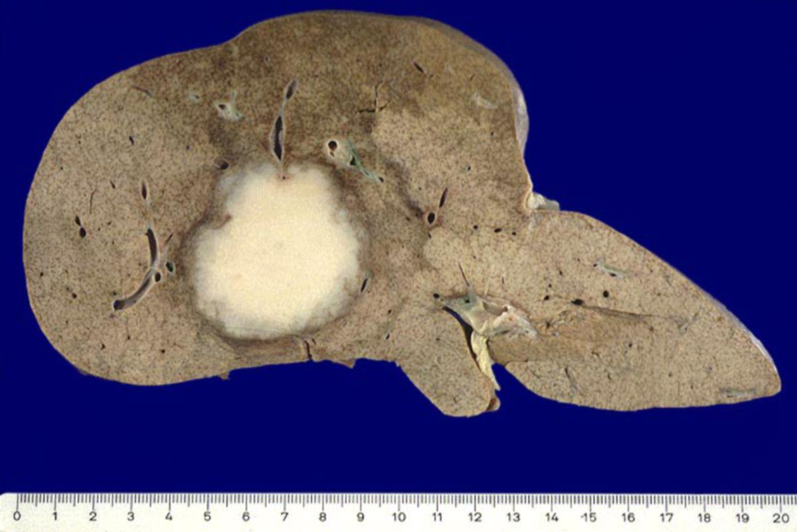 | **Gross Pathology of Intrahepatic Cholangiocarcinoma with Central Fibrotic Mass** `liver_tumor_19_Gallengangskarzinom_-_DocCheck_Flexikon.jpg` *Gross Pathology* | Gross pathology specimen showing a well-circumscribed, firm, whitish-grey intrahepatic cholangiocarcinoma tumor mass within the liver parenchyma. The central portion exhibits characteristic dense fibrous stroma, often associated with bile duct occlusion, localized ductal dilation, and invasion of adjacent hepatic architecture.  *خد بالك يا دكتورنا إن ورم القنوات الصفراوية داخل الكبد (Intrahepatic Cholangiocarcinoma) بيبان في العينة بوضوح ككتورة بيضاء صلبة غالباً وسطها تليف مركزي (Fibrous stroma)، وبيبقى مرتبط بانسداد القنوات المرارية والتهاب مزمن، والتشخيص المبكر بيفرق جداً في الجراحة.* |
| 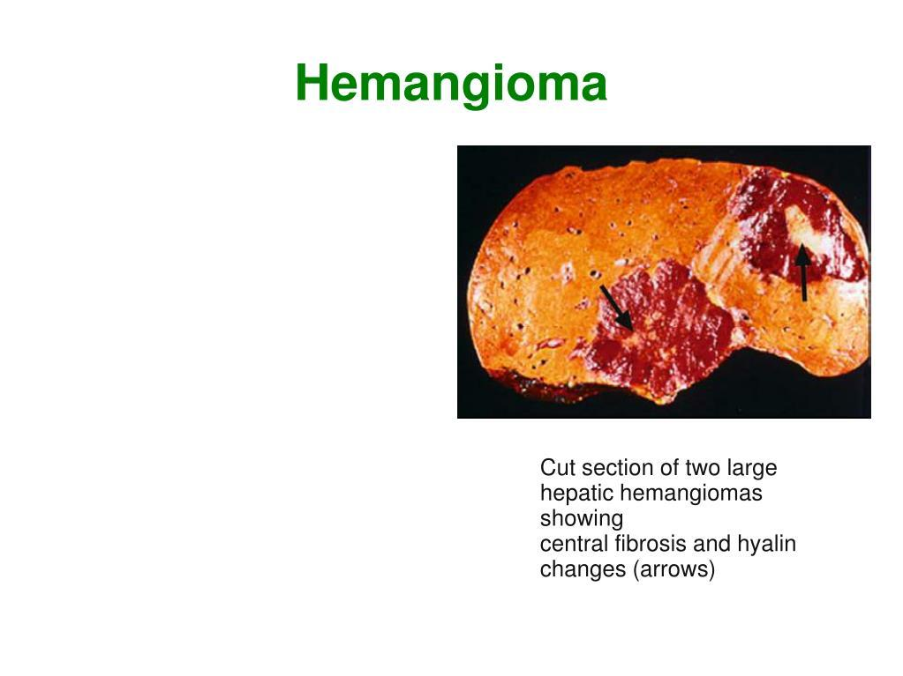 | **Gross Pathology of Hepatic Hemangiomas with Central Fibrosis** `liver_tumor_01_PPT_-_SURGICAL_TREATMENT_OF_FOCAL_LIVER_MASSES_PowerPoint_Pr.jpg` *Gross Pathology* | Gross section of the liver demonstrating two large, well-circumscribed cavernous hemangiomas with characteristic dark red, spongy appearance and focal central areas of fibrosis and hyalin change indicated by the arrows. Hepatic hemangiomas are the most common benign liver tumors, typically asymptomatic and discovered incidentally on imaging.  *خد بالك يا دكتورنا، العينة دي بتوريني ورم كبدي حميد (Cavernous Hemangioma) وغالباً بيتششف بالصدفة في الأشعة ومش بيعمل أعراض، لكن لو كبير ممكن يعمل وجع في البطن أو نزيف وبيبقى مميز باللون الأحمر الغامق مع تليف في النص.* |
| 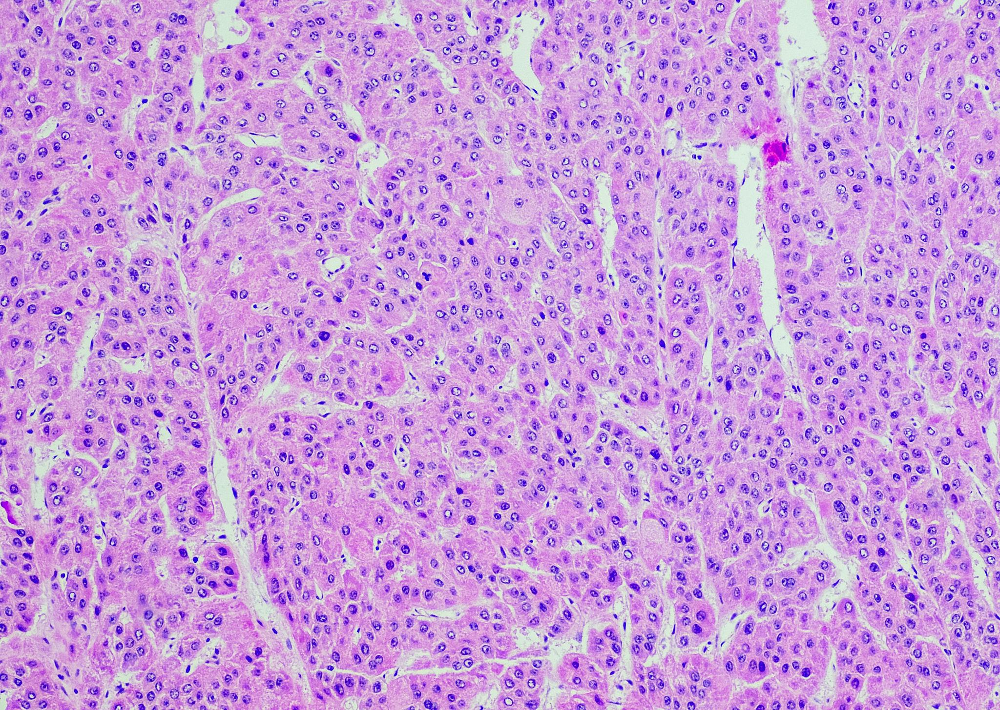 | **Hepatocellular Adenoma Histological Micrograph** `liver_tumor_09_Hepatocellular_carcinoma.jpg` *Histological Micrograph* | Histological examination of a hepatocellular adenoma shows sheets of benign hepatocytes with abundant eosinophilic cytoplasm and central nuclei, lacking normal portal triads and well-defined bile duct structures. Sinusoidal dilatation and occasional unpaired arteries may be appreciated within the tumor parenchyma.  *خد بالك يا دكتورنا، الصورة دي بتبين هيكل الهيباتوسيللار أدينوما (Hepatocellular Adenoma)؛ الخلايا الكبدية هنا شكلها سليم وعندها سيتوبلازم واسع وافر، بس مفيش خالص بورتال تراكتس (Portal tracts) أو قنوات مرارية منظمة زي الكبد الطبيعي، وده بيميزها عن الأورام الخبيثة أو التغيرات التكوينية.* |
| 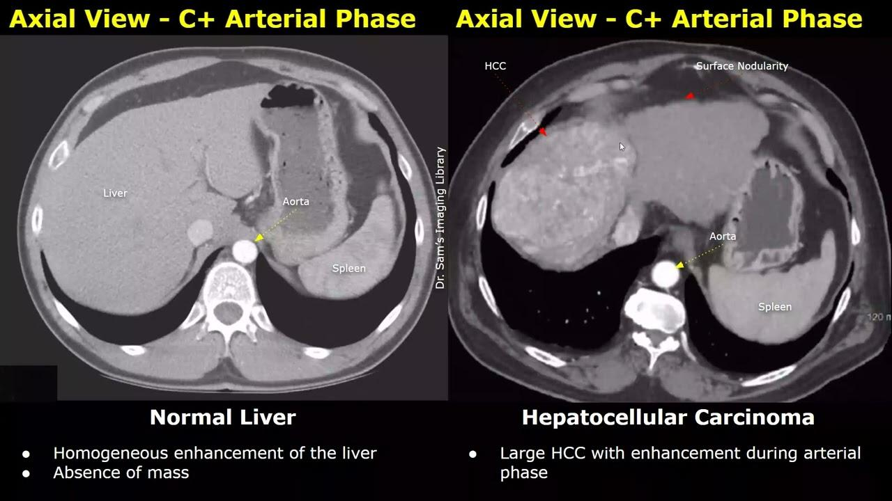 | **Axial Contrast-Enhanced CT Arterial Phase Comparing Normal Liver and Hepatocellular Carcinoma** `liver_tumor_10_-_YouTube.jpg` *Radiological Imaging* | Comparative axial C+ arterial phase CT images demonstrate a normal homogeneous liver on the left and a large hepatocellular carcinoma (HCC) on the right showing marked arterial phase hyperenhancement and surface nodularity characteristic of cirrhosis. Arterial phase hyperenhancement is a hallmark radiological feature in the diagnosis of HCC within a cirrhotic liver.  *خد بالك يا دكتورنا إن الأشعة المقطعية بالصبغة في الشرياني بتبين الفرق الواضح بين الكبد السليم والخلايا الكبدية السرطانية (HCC) اللي بتظهر بوضوح مع الـ Hyperenhancement أو الـ Wash-in في المرحلة الشريانية، وغالباً بتبقى مصحوبة بـ Surface nodularity نتيجة التليف الكبدي.* |
| 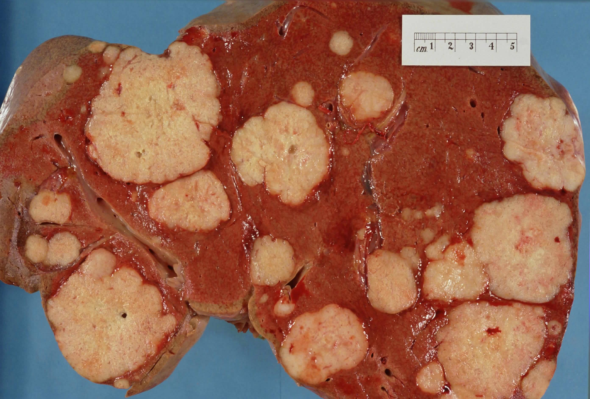 | **Metastatic Carcinoma of the Liver (Gross Pathology)** `liver_tumor_20_Tumor_heptico_Wikipdia_a_enciclopdia_livre.jpg` *Gross Pathology* | Cross-section of a human liver displaying multiple well-demarcated, pale, tan-white metastatic tumor nodules scattered throughout the parenchyma, characteristic of hematogenous spread from a primary malignancy. Several larger nodules show central umbilication due to necrosis and fibrosis, a hallmark feature commonly seen in metastatic adenocarcinoma from gastrointestinal or other primary sites.  *خد بالك يا دكتورنا، العقد السرطانية دي لما بتكبر بيحصل فيها نخر مركزي (central necrosis) فتعمل الشكل المميز للـ umbilication (تراجع المركز للجوّه). دايماً فكّر في الـ metastatic liver disease لما تلاقي كذا نودل بالشكل ده وبأحجام مختلفة.* |
| 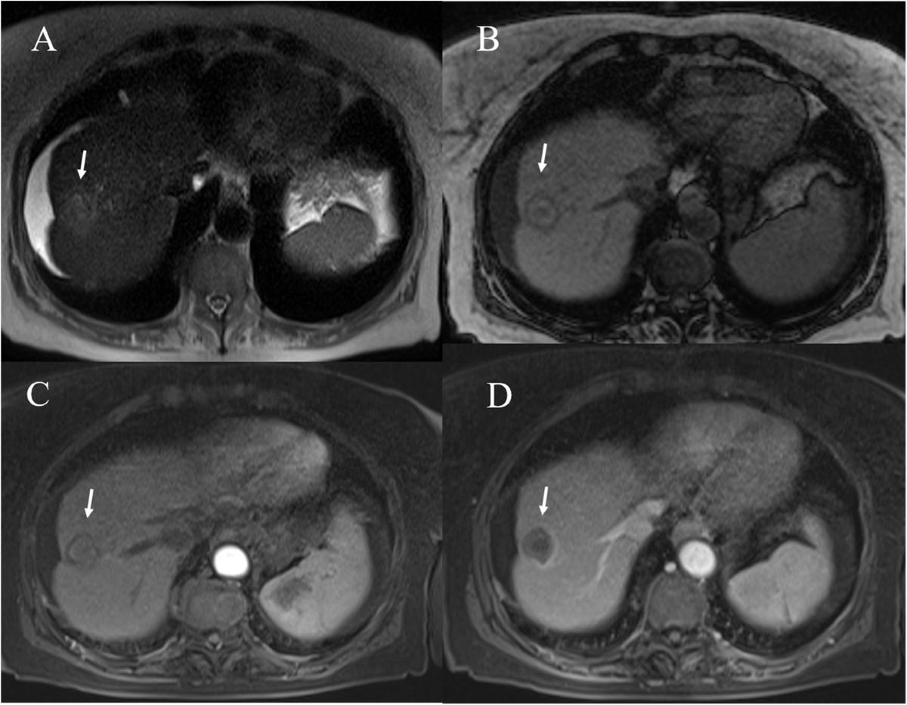 | **Liver Abscess or Metastatic Liver Tumor MRI Appearance** `liver_tumor_17_Diagnostic_evaluation_and_ablation_treatments_assessment_in.jpg` *Radiological Imaging* | Axial MRI of the liver demonstrating a focal lesion (white arrows) with ring-like enhancement on T1 and T2 weighted imaging, typical of a necrotic liver tumor or abscess formation requiring further diagnostic workup.  *خد بالك يا دكتورنا، الأشعة المغناطيسية للبطن هنا بتبين بؤرة كبدية واضحة (بالسهم) مع التباين الحلقي اللي ممكن يلخبطنا بين ورم كبدي متورم أو خراج كبدي، فلازم نعمل ربط بين الأعراض الإكلينيكية وصور الأشعة كويس جداً.* |
| 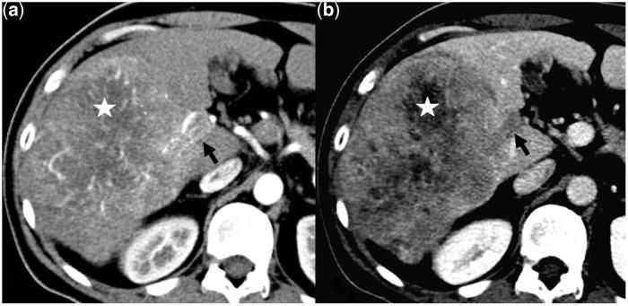 | **Dynamic Contrast-Enhanced CT of Hepatocellular Carcinoma Showing Arterial Enhancement and Venous Washout** `liver_tumor_18_Imaging_of_hepatocellular_carcinoma_diagnosis_staging_and_tr.jpg` *Radiological Imaging* | Computed tomography (CT) scans demonstrate a large hepatic mass (white star) with characteristic arterial phase hyperenhancement and subsequent portal venous/delayed phase washout, alongside portal vein thrombosis (black arrow), indicative of hepatocellular carcinoma.  *خد بالك يا دكتورنا، الأشعة دي بتوضح ورم خبيث في الكبد (Hepatocellular Carcinoma) بيظهر فيه الـ Arterial enhancement الواضح مع الـ Washout في الـ Portal venous phase، ومعاها كمان تجلط في الوريد البابي (Portal vein thrombosis) اللي متعلم عليه بالسهم الأسود ودي علامات تشخيصية أساسية.* |