# Clinoma Visual Atlas: 05 Liver Transplantation

**Discipline / Module:** `curriculum/clinical/internal-medicine/hepatology/05_liver_transplantation`  
**Total Figures:** **13** Authentic Clinical & Pathological Images

| Figure | Clinical Identification | Academic & Bedside Description |
| :---: | :--- | :--- |
| 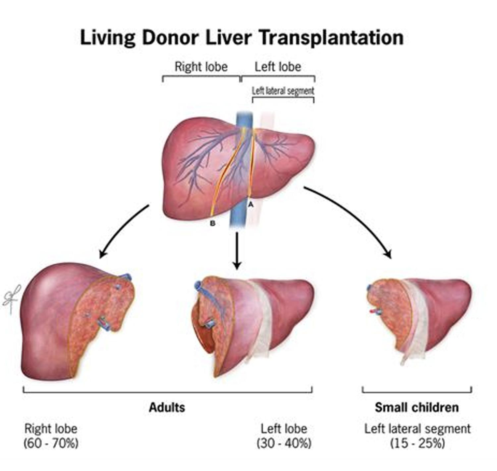 | **Living Donor Liver Transplantation Anatomical Lobes and Segments** `transplant_06_Canl_Vericiden_Karacier_Nakli_-_Dr_mit_ZELK.jpg` *Schematic Diagram* | Schematic representation of living donor liver transplantation illustrating the anatomical division into the right lobe (60-70%), left lobe (30-40%), and left lateral segment (15-25%). These volume divisions guide graft selection tailored to the recipient's metabolic and anatomical requirements.  *خد بالك يا دكتورنا، تقسيم الكبد في الـ Living Donor بيعتمد على حجم المتلقي؛ فالبالغين بيحتاجوا Right lobe أو Left lobe، بينما الأطفال الصغار يكفيهم Left lateral segment عشان يكفي احتياجاتهم بدون ما نعرض المتبرع لخطر.* |
| 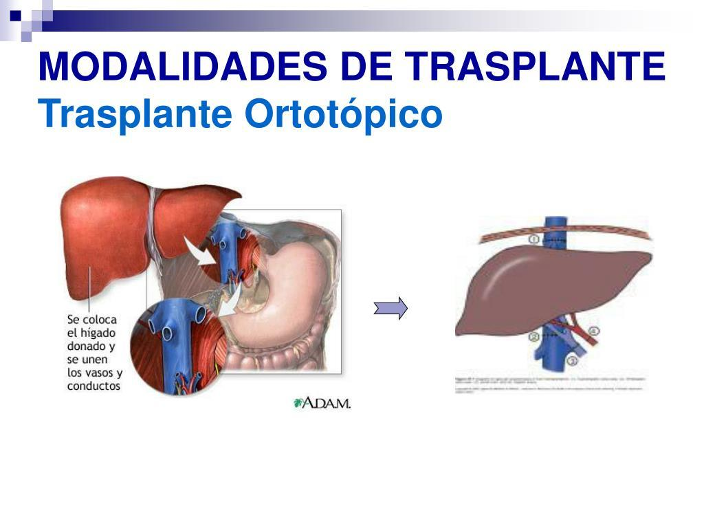 | **Orthotopic Liver Transplantation Anatomical Schematic** `transplant_07_PPT_-_TRASPLANTE_HEPTICO_PowerPoint_Presentation_free_downlo.jpg` *Schematic Diagram* | This schematic diagram illustrates an orthotopic liver transplantation, where the recipient's diseased liver is removed and replaced with a donor liver in the normal anatomical position. Vascular and biliary anastomoses are performed to restore physiological blood flow and biliary drainage.  *خد بالك يا دكتورنا إن زراعة الكبد الأرتوتوبيك (Orthotopic) بتعني استئصال الكبد التالف تماماً ووضع الكبد الجديد في مكانه الطبيعي تماماً، مع توصيل الأوعية الدموية والقنوات المرارية بدقة لضمان رجوع الوظائف الحيوية للجسم.* |
| 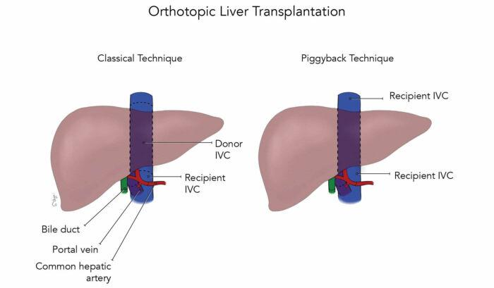 | **Orthotopic Liver Transplantation: Classical Technique vs. Piggyback Technique** `transplant_02_Adult_Liver_Transplantation_Surgical_Considerations_-_OpenAn.jpg` *Schematic Diagram* | This schematic illustrates the two primary techniques of orthotopic liver transplantation. The classical technique involves complete resection of the retrohepatic inferior vena cava along with the recipient liver, whereas the piggyback technique preserves the recipient's inferior vena cava, anastomosing the donor's hepatic veins to the recipient's confluence, which minimizes hemodynamic instability during the anhepatic phase.  *خد بالك يا دكتورنا إن تقنية البيج باك (Piggyback) بقت المفضلة حالياً عشان بتحافظ على الوريد الأجوف السفلي (IVC) للمستقبل وتقلل الهبوط في الضغط ومشاكل الدورة الدموية أثناء زرع الكبد مقارنة بالطريقة الكلاسيكية.* |
| 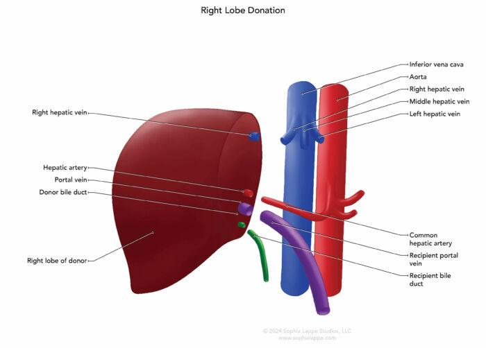 | **Right Lobe Donor Liver Anatomical Structures and Vascular Relations** `transplant_03_Living_Donor_Liver_Transplantation_-_OpenAnesthesia.jpg` *Schematic Diagram* | This schematic diagram illustrates the anatomical landmarks and vascular pedicles of a right lobe living donor liver graft. Key structures displayed include the right hepatic vein, donor portal vein, hepatic artery, and bile duct, highlighting the specific surgical transection planes required for successful transplantation.  *الرسم التوضيحي بيبين التشريح الجراحي لفصوص الكبد وفروع الأوردة والشرايين والقنوات المرارية المخصصة لعملية زراعة الكبد من متبرع حي. خد بالك يا دكتورنا إن الحفاظ على طول الأوعية الدموية وسلامة القناة المرارية للمتبرع والمستلم يعتبر أساس نجاح الكسب الجراحي وتجنب المضاعفات.* |
| 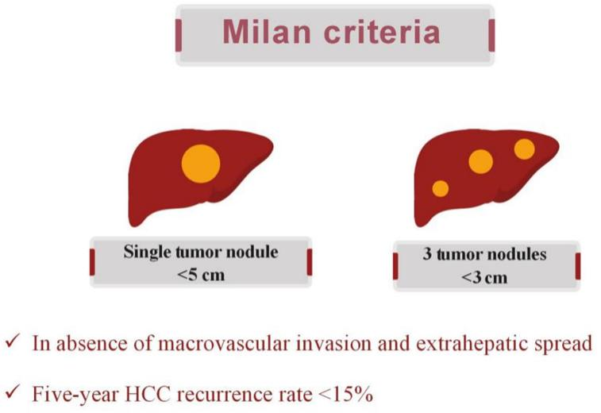 | **Milan Criteria for Liver Transplantation in Hepatocellular Carcinoma** `transplant_10_Hepatocellular_carcinoma_recurrence_Predictors_and_managemen.jpg` *Schematic Diagram* | The Milan criteria define patient selection guidelines for liver transplantation in hepatocellular carcinoma (HCC). They include either a single tumor nodule less than 5 cm or up to three separate nodules each less than 3 cm, with no evidence of macrovascular invasion or extrahepatic spread, yielding excellent five-year survival and recurrence rates under 15%.  *معايير ميلان دي أساسية عشان نحدد المريض اللي ينفع يزرع كبد و عنده سرطان خلايا كبدية (HCC). لازم يكون إما ورم واحد أقل من 5 سم، أو لحد 3 أورام كل واحد أقل من 3 سم، بشرط عدم وجود غزو للأوعية الدموية الكبيرة أو انتشار خارج الكبد عشان نضمن نسبة نجاح عالية ومعدل ارتجاع قليل أقل من 15%.* |
| 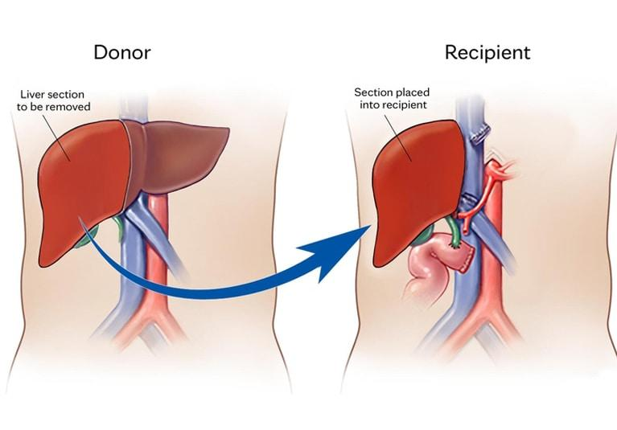 | **Living Donor Liver Transplantation Schematic Diagram** `transplant_01_Trauma_News_-_Medical_Professionals_-_Mayo_Clinic.jpg` *Schematic Diagram* | Schematic illustration demonstrating a living-donor liver transplantation procedure, where a section of the donor's liver is surgically resected and successfully transplanted into the recipient. This technique relies on the remarkable regenerative capacity of the liver, allowing both the donor and recipient organs to grow to normal size over time.  *الرسم التوضيحي بيبين عملية زرع الكبد من متبرع حي، حيث يتم استئصال جزء من كبد المتبرع وزرعه في المريض المستقبل. الكبد عضو فريد عنده قدرة عالية جداً على تجديد خلاياه، فبيكبر الجزء المتبقي عند المتبرع والجزء المزروع عند المريض لحد ما يوصلوا للحجم الطبيعي.* |
| 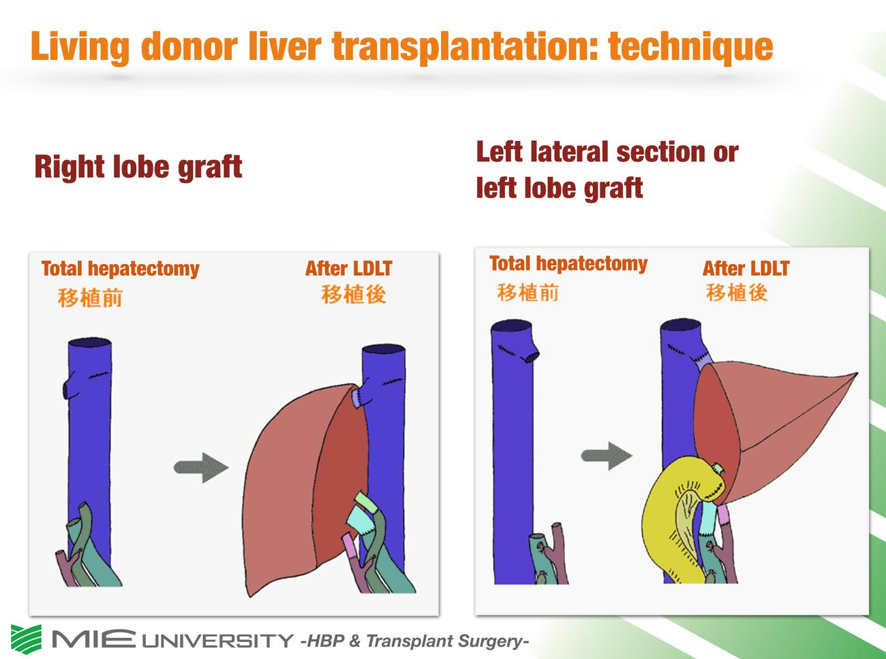 | **Living Donor Liver Transplantation Technique: Right Lobe vs. Left Lateral/Left Lobe Grafts** `transplant_08.jpg` *Schematic Diagram* | Schematic comparison of living donor liver transplantation (LDLT) techniques comparing right lobe grafts versus left lateral section or left lobe grafts, demonstrating total hepatectomy status prior to graft implantation and the post-transplant anatomical configuration.  *الرسم التوضيحي بيقارن بين تقنيات زرع الكبد من متبرع حي (LDLT) سواء بفصوص يمين أو شمال، وبيوضح شكل الوريد الأجوف السفلي بعد استئصال الكبد بالكامل وقبل وبعد توصيل الطعم الكبدي الجديد.* |
| 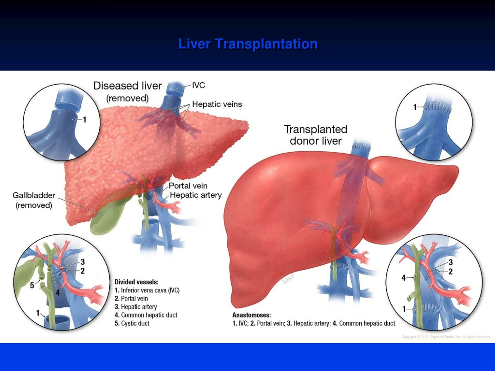 | **Liver Transplantation Anatomical and Vascular Anastomoses Schematic** `transplant_05_PPT_-_Liver_Transplant_Decompensated_Cirrhosis_Impact_on_Sur.jpg` *Schematic Diagram* | This schematic illustration details the anatomical steps and surgical anastomoses involved in orthotopic liver transplantation, comparing the excised diseased liver with the newly implanted donor liver. Key vascular and biliary connections include the inferior vena cava (IVC), portal vein, hepatic artery, and common hepatic duct.  *الرسم التوضيحي بيوضح خطوات عملية زراعة الكبد، والمقارنة بين الكبد التالف اللي تم استئصاله والكبد المتبرع بيه بعد زرعه. التركيز الأساسي بيكون على توصيل الأوعية الدموية الرئيسية زي الوريد الكبدي السفلي (IVC)، والوريد البابى، والشريان الكبدي، بالإضافة لتوصيلة القنوات المرارية.* |
| 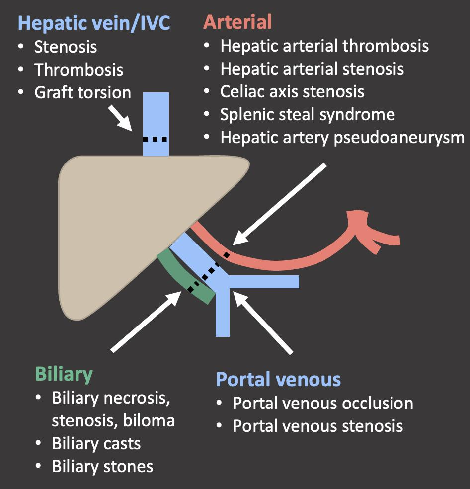 | **Liver Transplantation Vascular and Biliary Complications Schema** `transplant_13_Gastrointestinal_-_Learning_Modules_-_CTisuscom_CT_Scanning.jpg` *Schematic Diagram* | This schematic diagram illustrates the primary vascular and biliary complications following liver transplantation, categorized into hepatic vein/IVC, arterial, portal venous, and biliary pathways. Early recognition of thrombosis, stenosis, or ischemic changes using Doppler ultrasound is vital for graft salvage and preventing ischemic-type biliary lesions.  *خد بالك يا دكتورنا، مضاعفات زرع الكبد زي الجلطات في الشريان الكبدى أو ضيق الوريد البابى والمسارات المرارية بتبان بوضوح في الدوبلر. التشخيص المبكر بيفرق جداً في إنقاذ الكبد المزروع ومنع رفضه أو حدوث تليف مبكر.* |
| 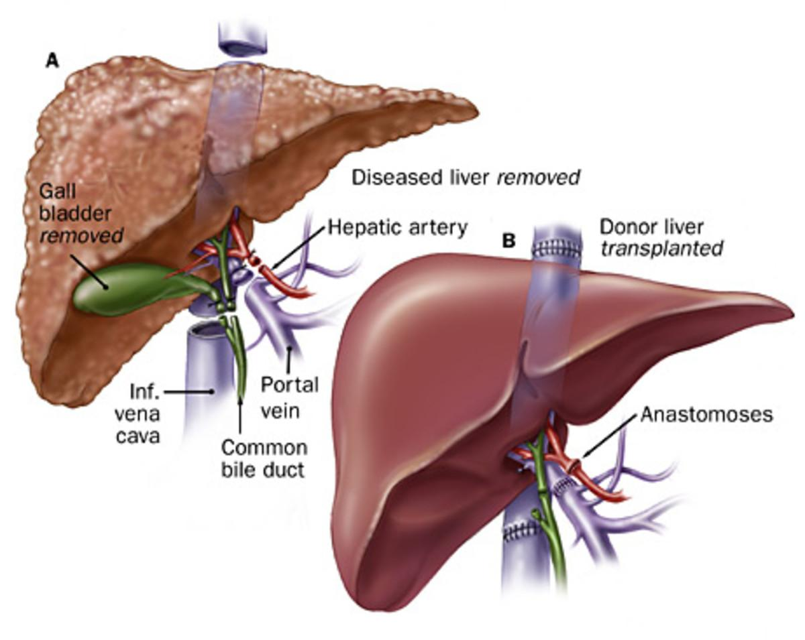 | **Liver Transplantation Surgical Steps: Explantation and Donor Graft Anastomosis** `transplant_11_How_to_Get_Ready_for_a_Liver_Transplant_-_HubPages.jpg` *Schematic Diagram* | This schematic illustrates the two primary phases of orthotopic liver transplantation: panel A shows the excision of the diseased native liver with preservation of key vascular and biliary structures, while panel B depicts the successful engraftment and surgical anastomoses of the donor liver.  *خد بالك يا دكتورنا، الرسمة بتوضح خطوات زراعة الكبد بدقة؛ في الجزء (A) بيتم استئصال الكبد التالف مع الحفاظ على الأوردة والشرايين الرئيسية، وفي الجزء (B) بيظهر كبد المتبرع بعد توصيل الأوعية الدموية والقنوات المرارية (Anastomoses) بنجاح.* |
| 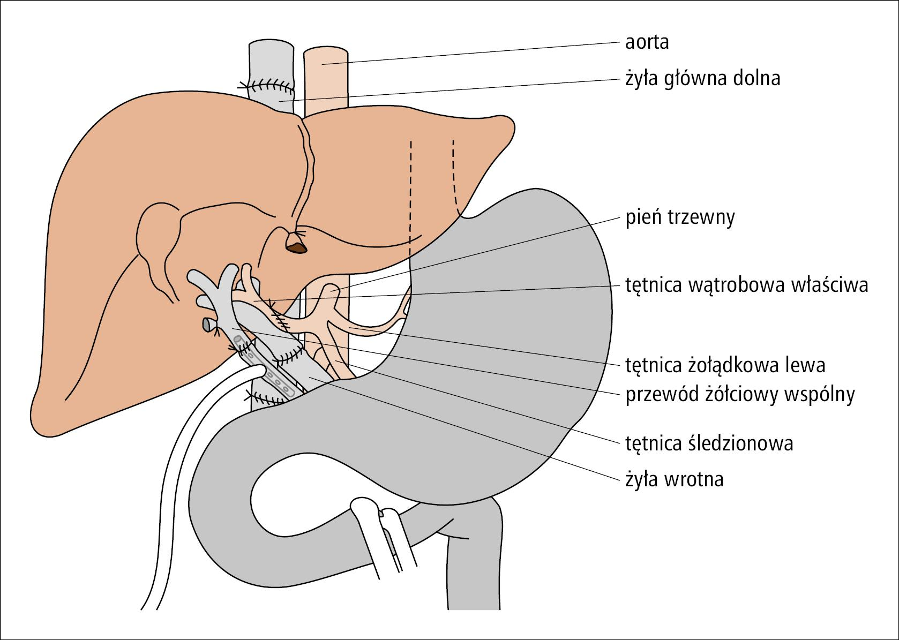 | **Anatomical Schematic of Vascular and Biliary Structures for Liver Transplantation** `transplant_09_Schemat_ortotopowego_przeszczepienia_wtroby_w_przypadku_wyko.jpg` *Schematic Diagram* | This schematic illustrates the complex vascular and biliary anatomy essential for liver transplantation, highlighting the portal triad (hepatic artery, portal vein, and common bile duct) and its relationship to the celiac trunk. Precise identification and anastomosis of these structures are critical to ensuring graft viability and preventing postoperative complications such as hepatic artery thrombosis or biliary leaks.  *خد بالك يا دكتورنا من تشريح المنطقة دي في عمليات زراعة الكبد، الرسمة بتوضح الـ (Portal triad) وفروع الـ (Celiac trunk) زي الشريان الكبدي والوريد البابي والقناة المرارية. الدقة في توصيل الأوعية دي هي مفتاح نجاح العملية وتجنب أي انسداد أو تسريب بعد الجراحة.* |
|  | **Living Donor Liver Transplantation Anatomical Segmentation and Graft Options** `transplant_12_Canl_Vericiden_Karacier_Nakli_-_Dr_mit_ZELK.jpg` *Schematic Diagram* | Schematic representation of living donor liver transplantation illustrating the anatomical resection planes to yield the right lobe (60-70%) or left lobe (30-40%) for adult recipients, and the left lateral segment (15-25%) for small children. Careful volumetric assessment and vascular preservation are critical to prevent small-for-size syndrome in recipients and ensure donor safety.  *خد بالك يا دكتورنا، تقسيم الفصوص في زراعة الكبد من متبرع حي بيعتمد على حساب حجم الفص بدقة مقارنة بوزن جسم المريض (GRWR) عشان نتجنب متلازمة الفص الصغير (Small-for-size syndrome) اللي ممكن تهدد حياة المتلقي.* |
| 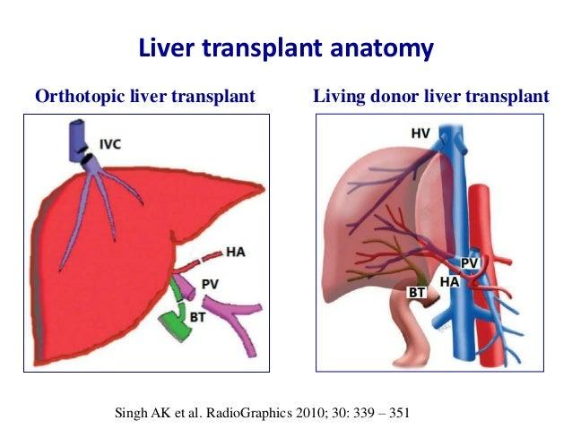 | **Liver Transplant Anatomy: Orthotopic vs. Living Donor Diagrams** `transplant_04_Ultrasound_doppler_ultrasound_in_liver_transplantation_PPTX.jpg` *Schematic Diagram* | This schematic illustrates the anatomical differences between an orthotopic liver transplant (whole liver graft replacing the native organ) and a living donor liver transplant (partial liver graft). It highlights key vascular and biliary anastomoses including the hepatic artery (HA), portal vein (PV), bile duct (BT), and inferior vena cava/hepatic veins (IVC/HV).  *خد بالك يا دكتورنا، الرسم بيوضح الفرق التشريحي المهم جداً بين زراعة الكبد التقليدية (Orthotopic) وزراعة جزء من كبد متبرع حي (Living Donor). التركيز بيكون على دقة توصيل الأوعية الدموية زي الشريان الكبدي (HA) والوريد البابي (PV)، بالإضافة إلى القنوات المرارية (BT)، وده بيحدد نجاح العملية وبيمنع الـ Thrombosis.* |