# Clinoma Visual Atlas: Cirrhosis And Portal Hypertension

**Discipline / Module:** `curriculum/clinical/internal-medicine/hepatology/cirrhosis_and_portal_hypertension`  
**Total Figures:** **42** Authentic Clinical & Pathological Images  
**Repository Remote:** [`clinomaofficial/clinoma-images`](https://github.com/clinomaofficial/clinoma-images)  

| Figure | Clinical Identification & Repository Links | Academic & Bedside Description |
| :---: | :--- | :--- |
| 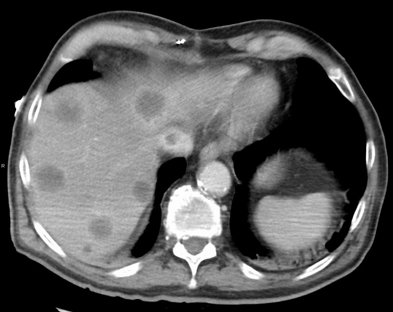 | **Abdominal CT Scan Showing Multiple Hypodense Hepatic Metastases** <code>cirrhosis_budd_chiari_caudate_lobe_ct.jpg</code> *Radiological Imaging* [☁️ GitHub Raw](https://raw.githubusercontent.com/clinomaofficial/clinoma-images/main/curriculum/clinical/internal-medicine/hepatology/cirrhosis_and_portal_hypertension/cirrhosis_budd_chiari_caudate_lobe_ct.jpg) | [⚡ jsDelivr CDN](https://cdn.jsdelivr.net/gh/clinomaofficial/clinoma-images@main/curriculum/clinical/internal-medicine/hepatology/cirrhosis_and_portal_hypertension/cirrhosis_budd_chiari_caudate_lobe_ct.jpg) | Contrast-enhanced axial abdominal CT scan reveals multiple well-defined hypodense lesions disseminated throughout both hepatic lobes, highly characteristic of metastatic liver disease. Identifying these secondary focal liver lesions is critical for staging gastrointestinal malignancies and differentiating malignant nodules from benign pseudolesions or cirrhosis-related nodules.  *يا دكتورنا، الأشعة المقطعية بالصبغة دي بتوضح بوضوح بؤر ثانوية (Metastases) متعددة ومنتشرة في فصوص الكبد، واللي بتبان ككتل منخفضة الكثافة. التفرقة بين البؤر دي وتغيرات التليف الكبدي أو الأورام الأولية زي الهيباتوما (HCC) أساسية جداً عشان نحدد مرحلة الورم والخطة العلاجية الصح للمريض.* |
| 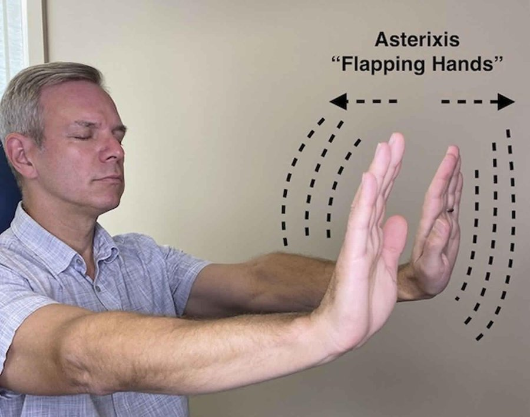 | **Asterixis Flapping Tremor in Hepatic Encephalopathy** <code>cirrhosis_asterixis_flapping_tremor.jpg</code> *Clinical Photo* [☁️ GitHub Raw](https://raw.githubusercontent.com/clinomaofficial/clinoma-images/main/curriculum/clinical/internal-medicine/hepatology/cirrhosis_and_portal_hypertension/cirrhosis_asterixis_flapping_tremor.jpg) | [⚡ jsDelivr CDN](https://cdn.jsdelivr.net/gh/clinomaofficial/clinoma-images@main/curriculum/clinical/internal-medicine/hepatology/cirrhosis_and_portal_hypertension/cirrhosis_asterixis_flapping_tremor.jpg) | Asterixis, commonly known as 'flapping tremor,' is characterized by brief, irregular lapses of posture when maintaining voluntary wrist extension. It is a classic clinical sign of metabolic encephalopathy most frequently associated with severe liver failure and portosystemic shunting due to hyperammonemia.  *خد بالك يا دكتورنا، الـ Asterixis دي علامة مميزة جداً لاعتلال الدماغ الكبدي (Hepatic Encephalopathy) نتيجة ارتفاع نسبة الأمونيا في الدم، وبتظهر لما العيان يمد إيديه لبره ويحصل سقوط مفاجئ في كف الإيد يشبه الرفرفة.* |
| 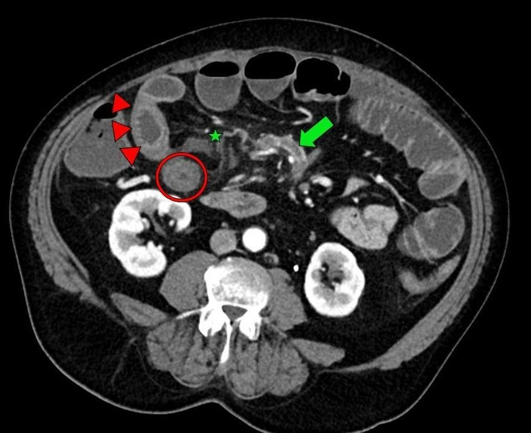 | **Abdominal CT Scan Showing Portal Hypertension Features and Collateral Circulation** <code>cirrhosis_budd_chiari_pathophysiology.jpg</code> *Radiological Imaging* [☁️ GitHub Raw](https://raw.githubusercontent.com/clinomaofficial/clinoma-images/main/curriculum/clinical/internal-medicine/hepatology/cirrhosis_and_portal_hypertension/cirrhosis_budd_chiari_pathophysiology.jpg) | [⚡ jsDelivr CDN](https://cdn.jsdelivr.net/gh/clinomaofficial/clinoma-images@main/curriculum/clinical/internal-medicine/hepatology/cirrhosis_and_portal_hypertension/cirrhosis_budd_chiari_pathophysiology.jpg) | Contrast-enhanced axial abdominal CT scan demonstrating imaging findings associated with portal hypertension and chronic liver disease, including ascites, bowel congestion, and prominent collateral vascular pathways.  *خد بالك يا دكتورنا، الأشعة هنا موضحة علامات البورتال هايبرتشن ووجود استسقاء وأوعية دموية متسعة، ودي علامات أساسية في تشخيص مضاعفات تليف الكبد.* |
| 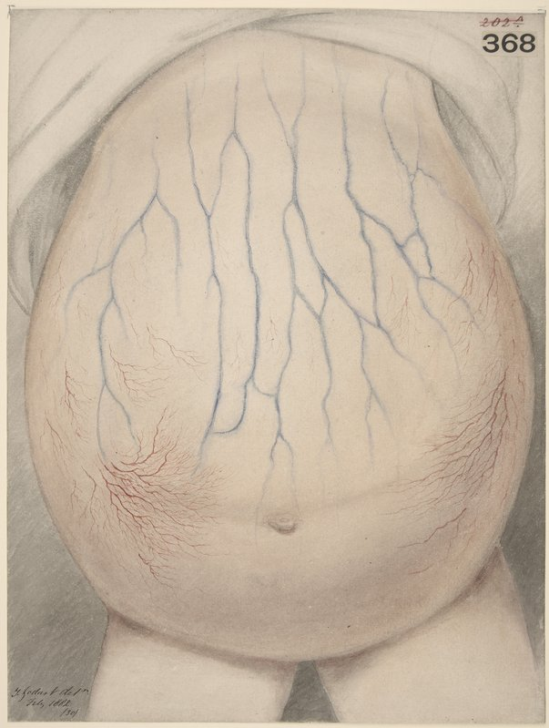 | **Caput Medusae and Prominent Superficial Abdominal Veins in Portal Hypertension** <code>cirrhosis_ascites_paracentesis_fluid.jpg</code> *Clinical Photo* [☁️ GitHub Raw](https://raw.githubusercontent.com/clinomaofficial/clinoma-images/main/curriculum/clinical/internal-medicine/hepatology/cirrhosis_and_portal_hypertension/cirrhosis_ascites_paracentesis_fluid.jpg) | [⚡ jsDelivr CDN](https://cdn.jsdelivr.net/gh/clinomaofficial/clinoma-images@main/curriculum/clinical/internal-medicine/hepatology/cirrhosis_and_portal_hypertension/cirrhosis_ascites_paracentesis_fluid.jpg) | This historical medical illustration demonstrates prominent, tortuous subcutaneous abdominal wall veins radiating from the umbilicus, classically known as caput medusae. This physical sign is a hallmark of severe portal hypertension, typically resulting from liver cirrhosis, which forces blood flow away from the portal system through portosystemic collateral channels.  *خد بالك يا دكتورنا، الرسمة دي بتوضح كابوت ميدوزا (Caput Medusae) الشهير اللي بيكون ناتج عن ارتفاع ضغط الوريد البابى (Portal Hypertension) بسبب تليف الكبد. الورم اللي في البطن مع الأوردة الماركة دي بيحصل لما الدم يلاقي مسارات جانبية للهرب من الكبد المسدود.* |
| 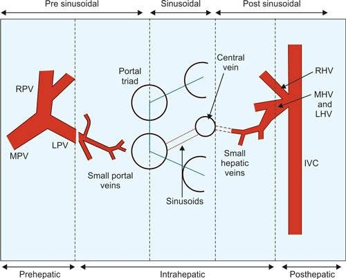 | **Classification of Portal Hypertension by Site of Obstruction (Pre-sinusoidal, Sinusoidal, and Post-sinusoidal)** <code>cirrhosis_acute_pvt_ct_scan.jpg</code> *Schematic Diagram* [☁️ GitHub Raw](https://raw.githubusercontent.com/clinomaofficial/clinoma-images/main/curriculum/clinical/internal-medicine/hepatology/cirrhosis_and_portal_hypertension/cirrhosis_acute_pvt_ct_scan.jpg) | [⚡ jsDelivr CDN](https://cdn.jsdelivr.net/gh/clinomaofficial/clinoma-images@main/curriculum/clinical/internal-medicine/hepatology/cirrhosis_and_portal_hypertension/cirrhosis_acute_pvt_ct_scan.jpg) | This diagram illustrates the anatomical classification of portal hypertension based on the site of vascular resistance relative to the hepatic sinusoid: pre-sinusoidal (e.g., portal vein thrombosis), sinusoidal (e.g., cirrhosis), and post-sinusoidal (e.g., Budd-Chiari syndrome or cardiac failure). Understanding these levels helps localize the etiology of portal hypertension and guides appropriate diagnostic and therapeutic interventions.  *خد بالك يا دكتورنا إن تصسنيف أسباب ضغط الدم البوابي (Portal Hypertension) بيعتمد أساساً على مكان الانسداد: هل هو قبل الجيب الكبدي (Pre-sinusoidal) زي جلطة الوريد البوابي، ولا جواه (Sinusoidal) زي التليف الكبدي المشهور، ولا بعده (Post-sinusoidal) زي متلازمة بود-كياري أو هبوط القلب الأيمن. الفهم ده بيفيدنا جداً في التشخيص وتحديد العلاج المناسب للمريض.* |
| 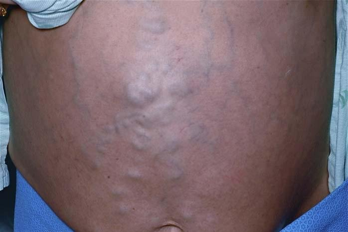 | **Caput Medusae Associated with Severe Portal Hypertension and Cirrhosis** <code>cirrhosis_caput_medusae_clinical.jpg</code> *Clinical Photo* [☁️ GitHub Raw](https://raw.githubusercontent.com/clinomaofficial/clinoma-images/main/curriculum/clinical/internal-medicine/hepatology/cirrhosis_and_portal_hypertension/cirrhosis_caput_medusae_clinical.jpg) | [⚡ jsDelivr CDN](https://cdn.jsdelivr.net/gh/clinomaofficial/clinoma-images@main/curriculum/clinical/internal-medicine/hepatology/cirrhosis_and_portal_hypertension/cirrhosis_caput_medusae_clinical.jpg) | This clinical photograph demonstrates caput medusae, characterized by prominent, engorged subcutaneous abdominal wall veins radiating from the umbilicus. This sign results from portal hypertension causing the recanalization of the umbilical vein and portosystemic shunting between the portal system and systemic epigastric veins in patients with advanced liver cirrhosis.  *خد بالك يا دكتورنا، المنظر ده بيسموه 'رأس ميدوسا' (Caput Medusae)، وبيظهر نتيجة ارتفاع ضغط الوريد البابي (Portal Hypertension) اللي بيفتح الوريد السري المقفل من زمان (Recanalized Umbilical Vein). العلامة دي دليل قاطع على تليف الكبد المتقدم ووجود تحويلات دموية بين الدورة البابية وجدار البطن الأمامي.* |
| 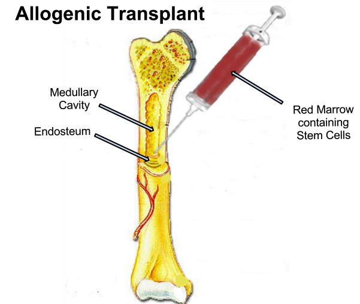 | **Allogeneic Bone Marrow Stem Cell Transplant Schematic** <code>cirrhosis_bone_marrow_transplant_stem_cell.jpg</code> *Schematic Diagram* [☁️ GitHub Raw](https://raw.githubusercontent.com/clinomaofficial/clinoma-images/main/curriculum/clinical/internal-medicine/hepatology/cirrhosis_and_portal_hypertension/cirrhosis_bone_marrow_transplant_stem_cell.jpg) | [⚡ jsDelivr CDN](https://cdn.jsdelivr.net/gh/clinomaofficial/clinoma-images@main/curriculum/clinical/internal-medicine/hepatology/cirrhosis_and_portal_hypertension/cirrhosis_bone_marrow_transplant_stem_cell.jpg) | This schematic diagram illustrates the process of an allogeneic bone marrow transplant, highlighting the injection of donor red marrow containing hematopoietic stem cells into the recipient's medullary cavity. Stem cell transplantation is a key therapeutic intervention in hematological disorders and advanced end-stage conditions requiring marrow reconstitution.  *خد بالك يا دكتورنا، عملية زرع نخاع العظم (Allogeneic Transplant) بتعتمد على حقن خلايا جذعية سليمة جوه التجويف النخاعي للمريض عشان تعوض الخلايا التالفة. النقطة الجوهرية هنا هي التأكد من توافق الأنسجة عشان نتجنب تفاعل المضيف ضد الطعم (GVHD).* |
| 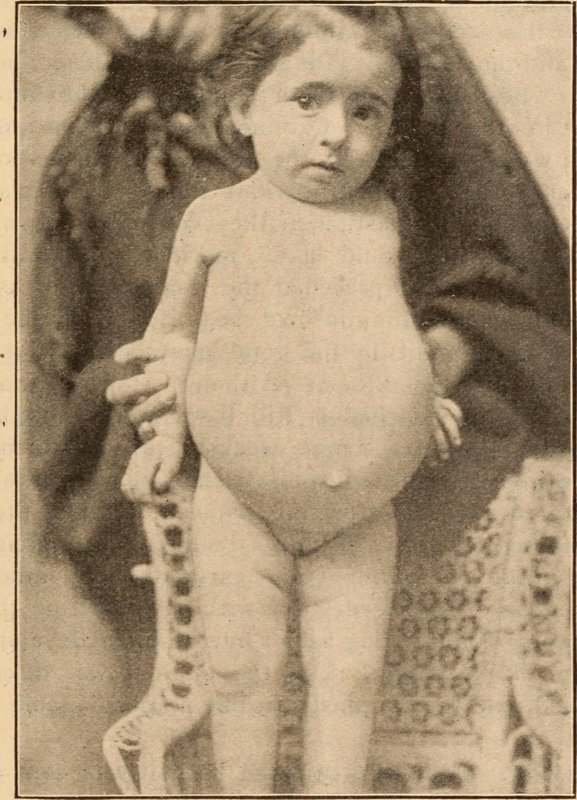 | **Severe Ascites and Hepatosplenomegaly in Pediatric Cirrhosis** <code>cirrhosis_caput_medusae_abdomen.jpg</code> *Clinical Photo* [☁️ GitHub Raw](https://raw.githubusercontent.com/clinomaofficial/clinoma-images/main/curriculum/clinical/internal-medicine/hepatology/cirrhosis_and_portal_hypertension/cirrhosis_caput_medusae_abdomen.jpg) | [⚡ jsDelivr CDN](https://cdn.jsdelivr.net/gh/clinomaofficial/clinoma-images@main/curriculum/clinical/internal-medicine/hepatology/cirrhosis_and_portal_hypertension/cirrhosis_caput_medusae_abdomen.jpg) | Clinical photograph of a young child presenting with gross abdominal distension secondary to massive ascites, characteristic of advanced chronic liver disease and portal hypertension. The fluid accumulation results from sinusoidal hypertension, hypoalbuminemia, and renal sodium retention. Recognition of these clinical signs in a pediatric patient warrants immediate evaluation for congenital hepatic fibrosis, biliary atresia, or metabolic disorders.  *خد بالك يا دكتورنا، الطفل ده ظاهر عليه انتفاخ بطن شديد بسبب 'اسستس' (Ascites) بكميات مرعبة نتيجة تليف كبدي وارتفاع ضغط الباب الوريدي (Portal Hypertension). الحالات دي في الأطفال غالباً بتكون بسبب أسباب خلقية أو أيضية لازمة للتشخيص السريع للإنقاذ.* |
| 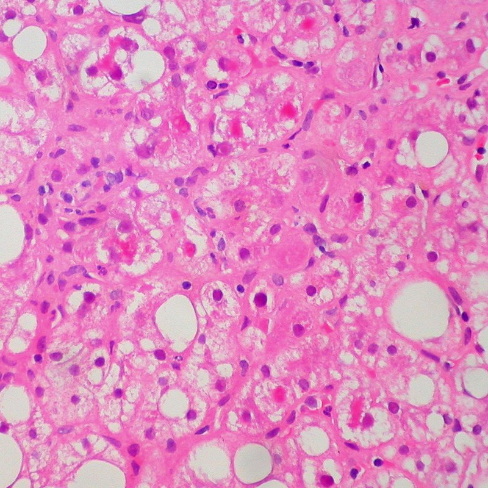 | **Alcoholic Steatohepatitis with Mallory-Denk Bodies and Ballooning Degeneration** <code>cirrhosis_cirrhosis_stellate_cells.jpg</code> *Histological Micrograph* [☁️ GitHub Raw](https://raw.githubusercontent.com/clinomaofficial/clinoma-images/main/curriculum/clinical/internal-medicine/hepatology/cirrhosis_and_portal_hypertension/cirrhosis_cirrhosis_stellate_cells.jpg) | [⚡ jsDelivr CDN](https://cdn.jsdelivr.net/gh/clinomaofficial/clinoma-images@main/curriculum/clinical/internal-medicine/hepatology/cirrhosis_and_portal_hypertension/cirrhosis_cirrhosis_stellate_cells.jpg) | High-power histological view of the liver showing characteristic features of alcoholic steatohepatitis (ASH), including hepatocyte ballooning, Mallory-Denk bodies (eosinophilic intracellular inclusions), and prominent steatosis with surrounding inflammatory infiltrate. These pathological changes precede the development of extensive fibrosis and eventual micronodular cirrhosis.  *خد بالك يا دكتورنا، الصورة دي بتوريك تفاصيل الـ Alcoholic Steatohepatitis بوضوح، زي الـ Ballooning degeneration ونتف الـ Mallory-Denk bodies الحمراء جوه السيتوبلازم، ومعاهم الـ Steatosis وinfiltration بالنيوتروفيلز.. العلامات دي هي البوابة الملكية لتليف الكبد والـ Cirrhosis.* |
| 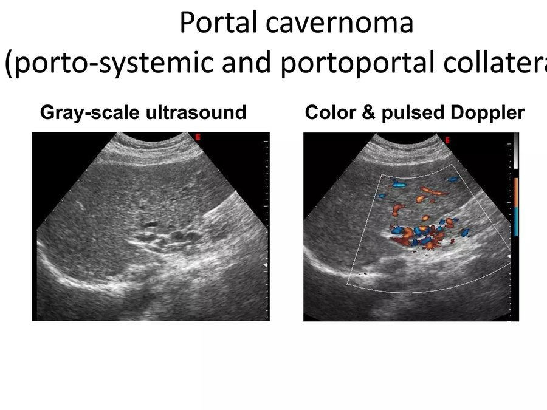 | **Portal Cavernoma with Porto-systemic and Portoportal Collaterals on Ultrasound** <code>cirrhosis_budd_chiari_caudate_ct.jpg</code> *Radiological Imaging* [☁️ GitHub Raw](https://raw.githubusercontent.com/clinomaofficial/clinoma-images/main/curriculum/clinical/internal-medicine/hepatology/cirrhosis_and_portal_hypertension/cirrhosis_budd_chiari_caudate_ct.jpg) | [⚡ jsDelivr CDN](https://cdn.jsdelivr.net/gh/clinomaofficial/clinoma-images@main/curriculum/clinical/internal-medicine/hepatology/cirrhosis_and_portal_hypertension/cirrhosis_budd_chiari_caudate_ct.jpg) | Comparative gray-scale and color Doppler ultrasound images demonstrating a portal cavernoma, characterized by multiple tortuous collateral channels replacing the thrombosed main portal vein. Color Doppler confirms hepatopedal and hepatofugal flow within these vascular spaces, representing a classic adaptation to chronic extrahepatic portal venous obstruction.  *خد بالك يا دكتورنا، المنظر ده بيوريك الـ Portal Cavernoma بوضوح في الـ Gray-scale والـ Color Doppler؛ عبارة عن أوعية دموية متعرجة كتيرة مكان الوريد البابي المتقفل (Thrombosis)، ودي بتمثل Collaterals عشان تعوض الدم اللي مش واصل للكبد.* |
| 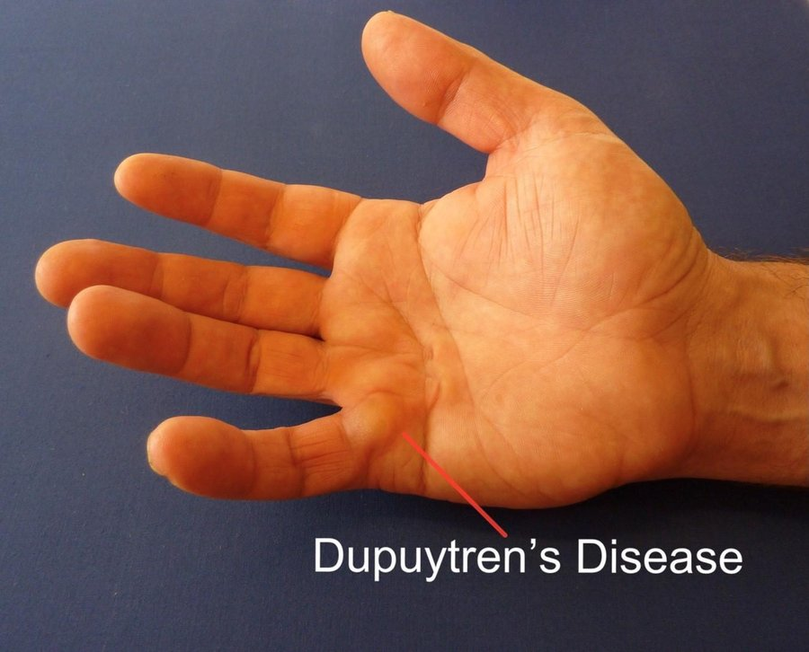 | **Dupuytren's Contracture and Palmar Fascia Thickening in Chronic Liver Disease** <code>cirrhosis_dupuytren_contracture_clinical.jpg</code> *Clinical Photo* [☁️ GitHub Raw](https://raw.githubusercontent.com/clinomaofficial/clinoma-images/main/curriculum/clinical/internal-medicine/hepatology/cirrhosis_and_portal_hypertension/cirrhosis_dupuytren_contracture_clinical.jpg) | [⚡ jsDelivr CDN](https://cdn.jsdelivr.net/gh/clinomaofficial/clinoma-images@main/curriculum/clinical/internal-medicine/hepatology/cirrhosis_and_portal_hypertension/cirrhosis_dupuytren_contracture_clinical.jpg) | Dupuytren's disease involves fibrosis and thickening of the palmar fascia, leading to flexion contractures of the fingers. It is frequently observed alongside other musculoskeletal and cutaneous manifestations of chronic liver disease, such as cirrhosis.  *خد بالك يا دكتورنا، تليف كف اليد (Dupuytren's contracture) وتقلص الأوتار ده ممكن نلاقيه في مرضى تليف الكبد المزمن بجانب علامات تانية زي احمرار الكفوف؛ الفحص الدقيق للإيدين بيفتح عينك على أمراض جهازية خفية.* |
| 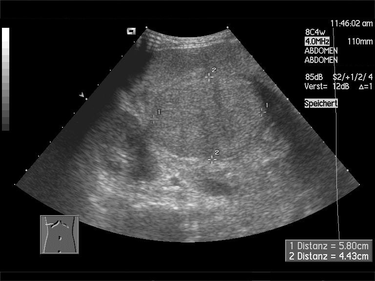 | **Abdominal Ultrasound Showing Hepatic Mass / Hepatocellular Carcinoma in Cirrhosis** <code>cirrhosis_cirrhosis_ultrasound_nodular.jpg</code> *Radiological Imaging* [☁️ GitHub Raw](https://raw.githubusercontent.com/clinomaofficial/clinoma-images/main/curriculum/clinical/internal-medicine/hepatology/cirrhosis_and_portal_hypertension/cirrhosis_cirrhosis_ultrasound_nodular.jpg) | [⚡ jsDelivr CDN](https://cdn.jsdelivr.net/gh/clinomaofficial/clinoma-images@main/curriculum/clinical/internal-medicine/hepatology/cirrhosis_and_portal_hypertension/cirrhosis_cirrhosis_ultrasound_nodular.jpg) | Abdominal ultrasound revealing a well-defined focal hyperechoic hepatic mass within a cirrhotic liver, measured with calibrated cursors showing dimensions of 5.80 cm by 4.43 cm. Such findings in the setting of chronic liver disease raise high suspicion for hepatocellular carcinoma (HCC), necessitating multiphasic cross-sectional imaging or biopsy confirmation.  *خد بالك يا دكتورنا، السونار هنا مبين كتلة بؤرية في الكبد مع علامات تليف واضحة، والمقاسات بالمسطرة محددة حجم الورم (حوالي 5.8 في 4.4 سم). في مريض عنده تليف كبدي، أي كتلة جديدة لازم تشككنا فوراً في Hepatocellular Carcinoma (HCC) وتخلـّينا نعمل أشعة مقطعية بالصبغة أو رنين مغناطيسي للتأكيد.* |
| 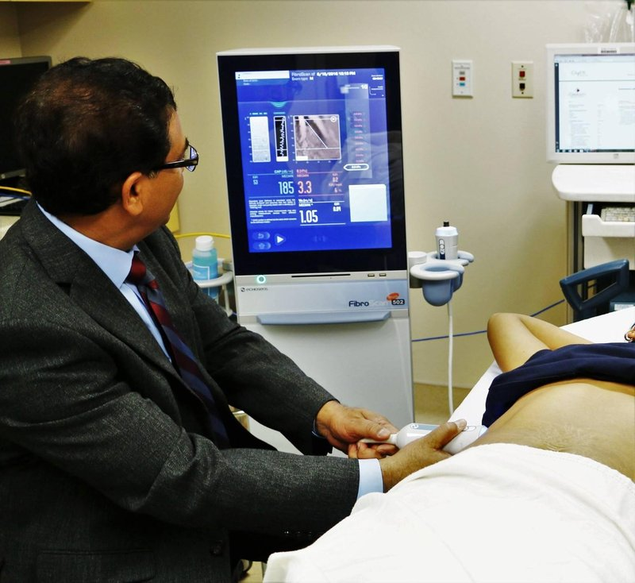 | **Transient Elastography (FibroScan) Examination for Liver Fibrosis Assessment** <code>cirrhosis_fibroscan_probe_vcte.jpg</code> *Clinical Photo* [☁️ GitHub Raw](https://raw.githubusercontent.com/clinomaofficial/clinoma-images/main/curriculum/clinical/internal-medicine/hepatology/cirrhosis_and_portal_hypertension/cirrhosis_fibroscan_probe_vcte.jpg) | [⚡ jsDelivr CDN](https://cdn.jsdelivr.net/gh/clinomaofficial/clinoma-images@main/curriculum/clinical/internal-medicine/hepatology/cirrhosis_and_portal_hypertension/cirrhosis_fibroscan_probe_vcte.jpg) | Transient elastography (FibroScan) is a non-invasive diagnostic modality utilized to quantify liver stiffness and steatosis (controlled attenuation parameter, CAP). It serves as an essential tool in chronic liver disease staging, allowing for the serial evaluation of fibrosis progression and screening for cirrhosis and portal hypertension.  *فحص الفيبروسكان بيعتمد على قياس مرونة الكبد (Liver Stiffness) ودرجة التدهن (CAP)، وهو وسيلة غير جراحية ممتازة لتقييم مراحل التليف الكبدي ومتابعة مرضى تليف الكبد وارتفاع ضغط الباب الكبدي بدقة.* |
| 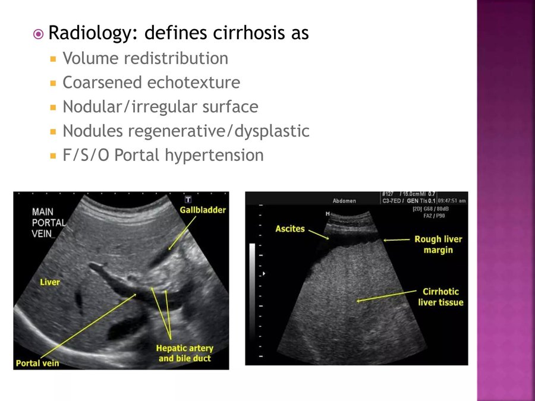 | **Ultrasound Manifestations of Cirrhosis and Portal Hypertension** <code>cirrhosis_cirrhosis_ultrasound_nodular_real.jpg</code> *Radiological Imaging* [☁️ GitHub Raw](https://raw.githubusercontent.com/clinomaofficial/clinoma-images/main/curriculum/clinical/internal-medicine/hepatology/cirrhosis_and_portal_hypertension/cirrhosis_cirrhosis_ultrasound_nodular_real.jpg) | [⚡ jsDelivr CDN](https://cdn.jsdelivr.net/gh/clinomaofficial/clinoma-images@main/curriculum/clinical/internal-medicine/hepatology/cirrhosis_and_portal_hypertension/cirrhosis_cirrhosis_ultrasound_nodular_real.jpg) | Ultrasound evaluation of liver cirrhosis demonstrating characteristic architectural changes including volume redistribution, a nodular and irregular surface margin, coarsened parenchymal echotexture, and secondary signs of portal hypertension such as ascites. These sonographic findings correlate with advanced hepatic fibrosis and elevated portal venous pressure.  *خد بالك يا دكتورنا، السونار هنا مبين علامات التيليف (التليف الكبدي) بوضوح؛ زي السطح المبرغل أو المنعرج (Rough liver margin)، وخشونة أنسجة الكبد، مع وجود استسقاء (Ascites) كدليل أساسي على وجود ضغط عالي في الوريد البابى.* |
| 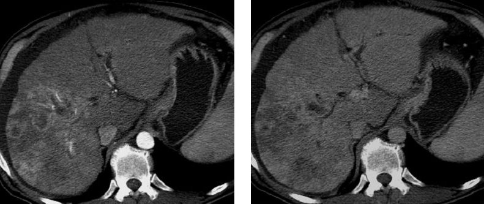 | **Abdominal CT Scan Showing Hepatocellular Carcinoma in Cirrhotic Liver** <code>cirrhosis_hcc_milan_criteria_ct.jpg</code> *Radiological Imaging* [☁️ GitHub Raw](https://raw.githubusercontent.com/clinomaofficial/clinoma-images/main/curriculum/clinical/internal-medicine/hepatology/cirrhosis_and_portal_hypertension/cirrhosis_hcc_milan_criteria_ct.jpg) | [⚡ jsDelivr CDN](https://cdn.jsdelivr.net/gh/clinomaofficial/clinoma-images@main/curriculum/clinical/internal-medicine/hepatology/cirrhosis_and_portal_hypertension/cirrhosis_hcc_milan_criteria_ct.jpg) | Dynamic contrast-enhanced CT scans demonstrate a hypervascular liver lesion with arterial phase enhancement and rapid washout in the portal venous phase, characteristic of hepatocellular carcinoma complicating underlying cirrhosis. Early detection through surveillance imaging in patients with chronic liver disease is critical for improving therapeutic outcomes.  *يا دكتورنا، العيانين اللي عندهم تليف في الكبد (cirrhosis) لازم نعمل لهم أشعة متابعة بانتظام لأنهم عرضة لتكوين أورام كبدية زي الـ HCC اللي ظاهرة هنا بأطوار الصبغة المختلفة (Arterial enhancement and portal washout).* |
| 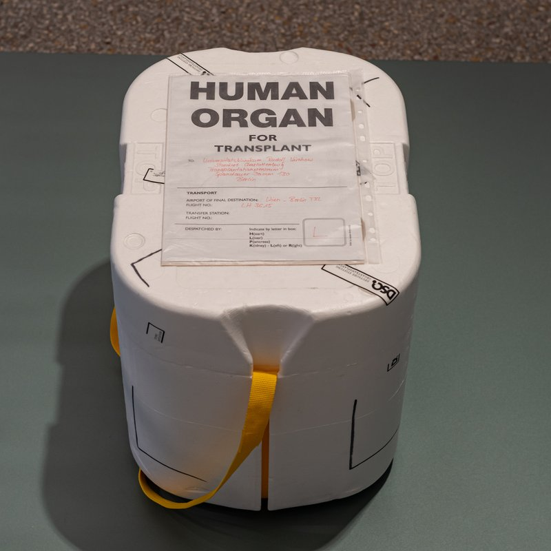 | **Styrofoam Container for Human Organ Transport for Transplantation** <code>cirrhosis_child_pugh_meld_diagram.jpg</code> *Gross Pathology* [☁️ GitHub Raw](https://raw.githubusercontent.com/clinomaofficial/clinoma-images/main/curriculum/clinical/internal-medicine/hepatology/cirrhosis_and_portal_hypertension/cirrhosis_child_pugh_meld_diagram.jpg) | [⚡ jsDelivr CDN](https://cdn.jsdelivr.net/gh/clinomaofficial/clinoma-images@main/curriculum/clinical/internal-medicine/hepatology/cirrhosis_and_portal_hypertension/cirrhosis_child_pugh_meld_diagram.jpg) | This image depicts a specialized insulated container utilized for the safe transport of harvested visceral organs destined for transplantation. In the context of end-stage liver disease and decompensated cirrhosis, orthotopic liver transplantation represents the definitive curative intervention, requiring meticulous cold ischemia time management.  *الصورة بتوضح صندوق عزل حراري مخصص لنقل الأعضاء البشرية لعمليات زرع الأعضاء. في حالات التليف الكبدي المتقدم وفشل الكبد، بتعتبر عملية زرع الكبد الحل النهائي والمنقذ للحياة للمريض.* |
| 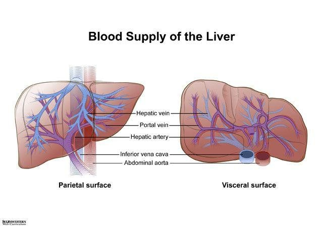 | **Anatomical Schematic of Hepatic Vascular Supply (Parietal and Visceral Surfaces)** <code>cirrhosis_hepatic_dual_blood_supply.jpg</code> *Schematic Diagram* [☁️ GitHub Raw](https://raw.githubusercontent.com/clinomaofficial/clinoma-images/main/curriculum/clinical/internal-medicine/hepatology/cirrhosis_and_portal_hypertension/cirrhosis_hepatic_dual_blood_supply.jpg) | [⚡ jsDelivr CDN](https://cdn.jsdelivr.net/gh/clinomaofficial/clinoma-images@main/curriculum/clinical/internal-medicine/hepatology/cirrhosis_and_portal_hypertension/cirrhosis_hepatic_dual_blood_supply.jpg) | This schematic diagram illustrates the dual blood supply of the liver, highlighting the portal vein and hepatic artery inflow alongside the hepatic venous drainage into the inferior vena cava. Understanding this complex angioarchitecture is fundamental for evaluating portal hypertension, hepatic perfusion deficits, and pre- or post-hepatic vascular shunts.  *الرسم التوضيحي ده بيبين التروية الدموية المزدوجة للكبد، وتوزيع الوريد البابى والشريان الكبدى مقارنة بتصريف الدم عن طريق الأوردة الكبدية للوريد الكافى السفلي. فهم التشريح ده أساسى جداً عشان نقدر نستوعب أسباب ضغط الدم البابى وتأثيرات تليف الكبد على تدفق الدم.* |
| 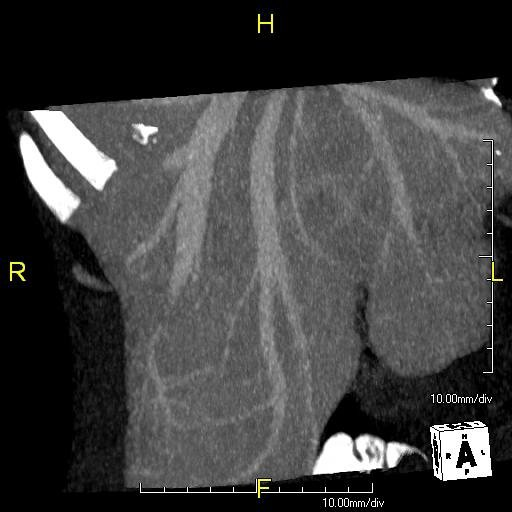 | **Coronal CT Angiography Showing Portal Vein Thrombosis and Cavernous Transformation** <code>cirrhosis_hepatic_vein_doppler_bcs.jpg</code> *Radiological Imaging* [☁️ GitHub Raw](https://raw.githubusercontent.com/clinomaofficial/clinoma-images/main/curriculum/clinical/internal-medicine/hepatology/cirrhosis_and_portal_hypertension/cirrhosis_hepatic_vein_doppler_bcs.jpg) | [⚡ jsDelivr CDN](https://cdn.jsdelivr.net/gh/clinomaofficial/clinoma-images@main/curriculum/clinical/internal-medicine/hepatology/cirrhosis_and_portal_hypertension/cirrhosis_hepatic_vein_doppler_bcs.jpg) | Coronal CT angiogram demonstrating chronic portal vein thrombosis with extensive cavernous transformation, characterized by multiple tortuous collateral vessels in the porta hepatis. This finding is a classic consequence of chronic extrahepatic portal vein obstruction, often associated with advanced cirrhosis or hypercoagulable states, leading to portal hypertension.  *خد بالك يا دكتورنا، الصورة دي بتبين جلطة مزمنة في الوريد البابي (Portal Vein Thrombosis) وتحول كهفي (Cavernous Transformation) وعملت شبكة من الأوعية الدموية البديلة عشان تعوض الانسداد ده، وده بيميز حالات البورتال هايبرتنشن المزمنة.* |
| 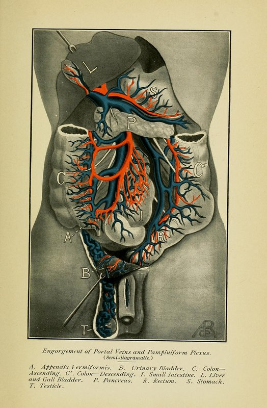 | **Engorgement of Portal Veins and Pampiniform Plexus** <code>cirrhosis_hyperdynamic_circulation.jpg</code> *Schematic Diagram* [☁️ GitHub Raw](https://raw.githubusercontent.com/clinomaofficial/clinoma-images/main/curriculum/clinical/internal-medicine/hepatology/cirrhosis_and_portal_hypertension/cirrhosis_hyperdynamic_circulation.jpg) | [⚡ jsDelivr CDN](https://cdn.jsdelivr.net/gh/clinomaofficial/clinoma-images@main/curriculum/clinical/internal-medicine/hepatology/cirrhosis_and_portal_hypertension/cirrhosis_hyperdynamic_circulation.jpg) | This semi-diagrammatic medical illustration demonstrates the engorgement of portal veins and the pampiniform plexus secondary to portal hypertension. It highlights visceral venous congestion and portosystemic collateral pathways that are classic complications of advanced liver cirrhosis.  *خد بالك يا دكتورنا، الرسمة التوضيحية دي بتوريك تأثير الضغط البابى المرتفع (Portal Hypertension) على الأوردة البطنية وضفيرة الحيوانات المنوية (Pampiniform Plexus)، ودي علامات مهمة جداً في حالات تليف الكبد المتقدم.* |
| 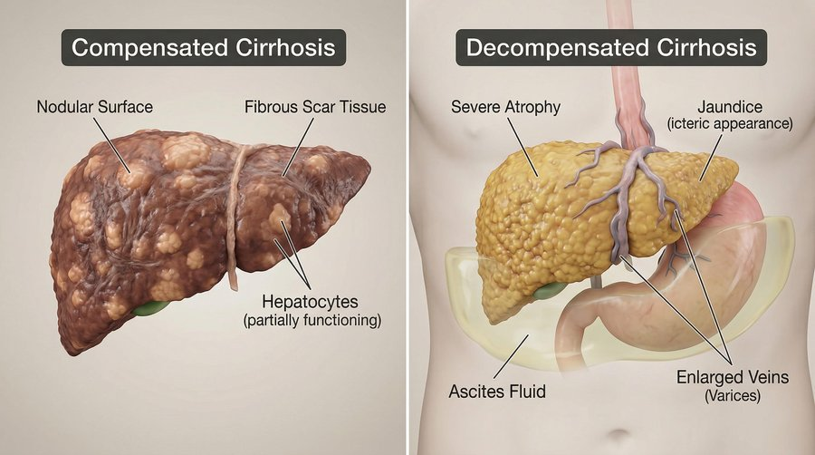 | **Comparative Schematic of Compensated versus Decompensated Cirrhosis** <code>cirrhosis_compensated_vs_decompensated_stages.jpg</code> *Schematic Diagram* [☁️ GitHub Raw](https://raw.githubusercontent.com/clinomaofficial/clinoma-images/main/curriculum/clinical/internal-medicine/hepatology/cirrhosis_and_portal_hypertension/cirrhosis_compensated_vs_decompensated_stages.jpg) | [⚡ jsDelivr CDN](https://cdn.jsdelivr.net/gh/clinomaofficial/clinoma-images@main/curriculum/clinical/internal-medicine/hepatology/cirrhosis_and_portal_hypertension/cirrhosis_compensated_vs_decompensated_stages.jpg) | This comparative schematic illustrates the morphological and clinical progression from compensated cirrhosis, characterized by nodular regeneration and fibrous scarring with partial hepatocyte function, to decompensated cirrhosis marked by severe parenchymal atrophy, jaundice, ascites, and portal hypertension leading to variceal enlargement.  *المخطط ده بيوضح الفرق الجوهري بين التليف المتكافئ (Compensated) والتليف غير المتكافئ (Decompensated). في الحالة الأولى الكبد لسه بيؤدي وظيفته جزئياً مع وجود عقيدات وتليف، لكن في المرحلة التانية بيبدأ العيان يدخل في مضاعفات خطيرة زي الاستسقاء (Ascites)، الدوالي (Varices)، الصفرا (Jaundice)، وانكماش الكبد.* |
| 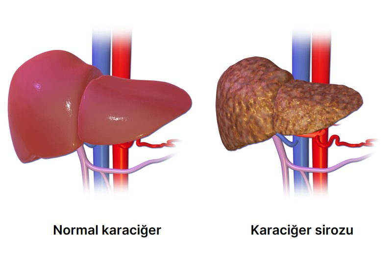 | **Comparison of Normal Liver and Cirrhotic Liver Anatomy** <code>cirrhosis_nodular_cirrhotic_liver_gross.jpg</code> *Schematic Diagram* [☁️ GitHub Raw](https://raw.githubusercontent.com/clinomaofficial/clinoma-images/main/curriculum/clinical/internal-medicine/hepatology/cirrhosis_and_portal_hypertension/cirrhosis_nodular_cirrhotic_liver_gross.jpg) | [⚡ jsDelivr CDN](https://cdn.jsdelivr.net/gh/clinomaofficial/clinoma-images@main/curriculum/clinical/internal-medicine/hepatology/cirrhosis_and_portal_hypertension/cirrhosis_nodular_cirrhotic_liver_gross.jpg) | This comparative schematic diagram illustrates the morphological progression from a healthy, smooth-surfaced normal liver to a shrunken, nodular liver characteristic of end-stage cirrhosis. Chronic hepatic injury leads to extensive fibrosis and regenerative nodule formation, significantly altering intrahepatic vascular architecture and causing portal hypertension.  *خد بالك يا دكتورنا إن المقارنة دي بتوضح الفرق بين كبد سليم أملس وكبد متليف (Cirrhosis) بيظهر عليه التعرجات والعقد التجددية (Nodules) اللي بتعمل المقاومة للدم وترفع ضغط الوريد البابى.* |
| 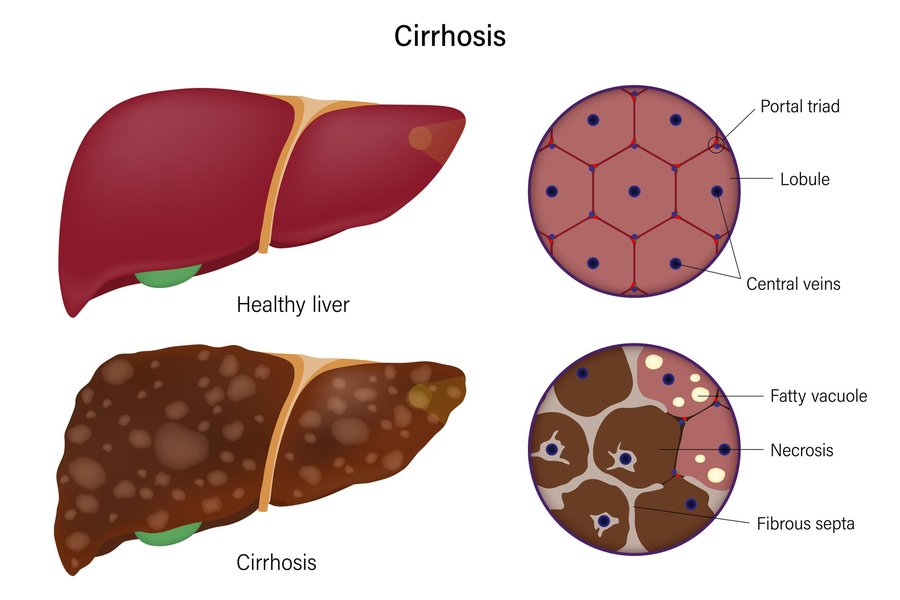 | **Comparative Schematic of Healthy Liver versus Cirrhosis: Gross Morphology and Histopathology** <code>cirrhosis_cirrhosis_histology_nodules.jpg</code> *Schematic Diagram* [☁️ GitHub Raw](https://raw.githubusercontent.com/clinomaofficial/clinoma-images/main/curriculum/clinical/internal-medicine/hepatology/cirrhosis_and_portal_hypertension/cirrhosis_cirrhosis_histology_nodules.jpg) | [⚡ jsDelivr CDN](https://cdn.jsdelivr.net/gh/clinomaofficial/clinoma-images@main/curriculum/clinical/internal-medicine/hepatology/cirrhosis_and_portal_hypertension/cirrhosis_cirrhosis_histology_nodules.jpg) | This schematic contrasts normal hepatic lobular architecture with cirrhotic liver pathology, highlighting the development of fibrous septa, cellular necrosis, and fatty vacuoles that disrupt hepatic microcirculation and function.  *خد بالك يا دكتورنا، تليف الكبد مش مجرد تغيير في شكل الكبد من بره، ده بيؤدي لتغيرات هستولوجية خطيرة زي تكون Fibrous Septa وتدمير الـ Lobules، وده اللي بيسبب في الآخر Portal Hypertension.* |
| 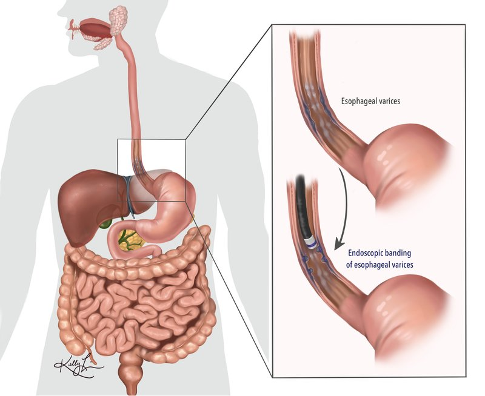 | **Esophageal Varices and Endoscopic Banding in Portal Hypertension** <code>cirrhosis_esophageal_varices_endoscopy.jpg</code> *Schematic Diagram* [☁️ GitHub Raw](https://raw.githubusercontent.com/clinomaofficial/clinoma-images/main/curriculum/clinical/internal-medicine/hepatology/cirrhosis_and_portal_hypertension/cirrhosis_esophageal_varices_endoscopy.jpg) | [⚡ jsDelivr CDN](https://cdn.jsdelivr.net/gh/clinomaofficial/clinoma-images@main/curriculum/clinical/internal-medicine/hepatology/cirrhosis_and_portal_hypertension/cirrhosis_esophageal_varices_endoscopy.jpg) | Portal hypertension secondary to liver cirrhosis causes increased resistance in the portal venous system, leading to portosystemic collateral formation such as esophageal varices. Endoscopic variceal ligation (banding) is a mainstay therapy used to mechanically obliterate these vulnerable blood vessels and prevent life-threatening acute upper gastrointestinal bleeding.  *خد بالك يا دكتورنا إن ارتفاع ضغط الوريد البابي بسبب تليف الكبد بيزود الضغط في الدورة الدموية وبيعمل دوالي في المريء ممكن تنزف بغزارة وتشكل خطورة على حياة العيان. عشان كده الربط بالمنظار (Endoscopic Banding) هو خط دفاع أول أساسي عشان نقفل الدوالي دي ونمنع النزيف قبل ما يحصل كوارث.* |
| 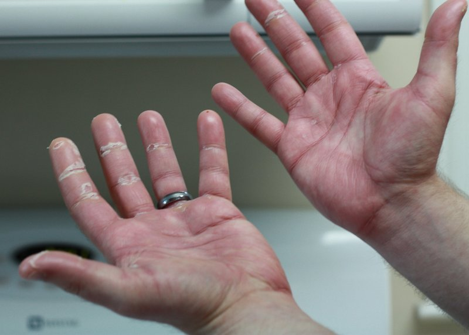 | **Palmar Erythema and Desquamation** <code>cirrhosis_palmar_erythema_hands.jpg</code> *Clinical Photo* [☁️ GitHub Raw](https://raw.githubusercontent.com/clinomaofficial/clinoma-images/main/curriculum/clinical/internal-medicine/hepatology/cirrhosis_and_portal_hypertension/cirrhosis_palmar_erythema_hands.jpg) | [⚡ jsDelivr CDN](https://cdn.jsdelivr.net/gh/clinomaofficial/clinoma-images@main/curriculum/clinical/internal-medicine/hepatology/cirrhosis_and_portal_hypertension/cirrhosis_palmar_erythema_hands.jpg) | Bilateral palmar erythema characterized by prominent reddening of the thenar and hypothenar eminences with associated superficial desquamation. This finding is classically associated with chronic liver disease and cirrhosis due to hyperestrogenemia and altered vascular reactivity.  *احمرار راحتي اليدين الواضح (Palmar Erythema) مع تقشرات سطحية، العلامة الكلاسيكية دي بتظهر غالباً مع أمراض الكبد المزمنة والتليف نتيجة لزيادة هرمون الاستروجين وتغير اتساع الأوعية الدموية.* |
| 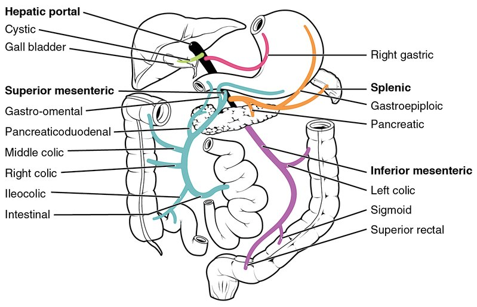 | **Hepatic Portal System and Venous Drainage of the Gastrointestinal Tract** <code>cirrhosis_liver_vascular_anatomy_diagram.jpg</code> *Schematic Diagram* [☁️ GitHub Raw](https://raw.githubusercontent.com/clinomaofficial/clinoma-images/main/curriculum/clinical/internal-medicine/hepatology/cirrhosis_and_portal_hypertension/cirrhosis_liver_vascular_anatomy_diagram.jpg) | [⚡ jsDelivr CDN](https://cdn.jsdelivr.net/gh/clinomaofficial/clinoma-images@main/curriculum/clinical/internal-medicine/hepatology/cirrhosis_and_portal_hypertension/cirrhosis_liver_vascular_anatomy_diagram.jpg) | This diagram illustrates the comprehensive anatomy of the hepatic portal venous system, detailing tributaries such as the superior mesenteric, splenic, and inferior mesenteric veins draining into the hepatic portal vein. Understanding these pathways is crucial for assessing portal hypertension, variceal bleeding risks, and portosystemic shunts in advanced liver cirrhosis.  *الرسم التوضيحي بيوضح تفاصيل الشرايين والأوردة اللي بتصب في الوريد البابي الكبدي (Hepatic Portal Vein). فهم الشابكة دي مهم جداً وأنت بتشخص وتتابع حالات ضغط الدم البابي المرتبط بتليف الكبد وتوقع أماكن الدوالي زي المريء والمستقيم.* |
| 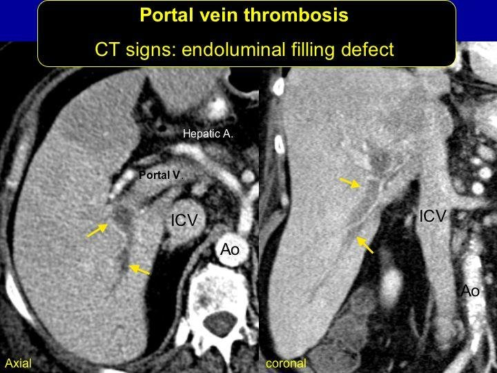 | **Portal Vein Thrombosis CT Signs: Endoluminal Filling Defect** <code>cirrhosis_portal_cavernoma_doppler.jpg</code> *Radiological Imaging* [☁️ GitHub Raw](https://raw.githubusercontent.com/clinomaofficial/clinoma-images/main/curriculum/clinical/internal-medicine/hepatology/cirrhosis_and_portal_hypertension/cirrhosis_portal_cavernoma_doppler.jpg) | [⚡ jsDelivr CDN](https://cdn.jsdelivr.net/gh/clinomaofficial/clinoma-images@main/curriculum/clinical/internal-medicine/hepatology/cirrhosis_and_portal_hypertension/cirrhosis_portal_cavernoma_doppler.jpg) | Contrast-enhanced axial and coronal CT scans demonstrate an endoluminal filling defect within the portal vein branches, diagnostic of portal vein thrombosis. This condition frequently complicates advanced cirrhosis and portal hypertension, necessitating careful anticoagulation or specialized radiological evaluation depending on etiology and chronicity.  *خد بالك يا دكتورنا، الأشعة دي بتوريك أشعة مقطعية بالصبغة موضحة جلطة في الوريد البابى (Portal Vein Thrombosis) على هيئة فراغ ناقص بالامتلاء جوه اللمعة (Endoluminal filling defect). الحالة دي بتصاحب التليف الكبدي المتقدم وارتفاع ضغط الدم البابي، ومهم جداً نلقطها بدري عشان نحدد خطة العلاج بالسيولة المناسبة.* |
| 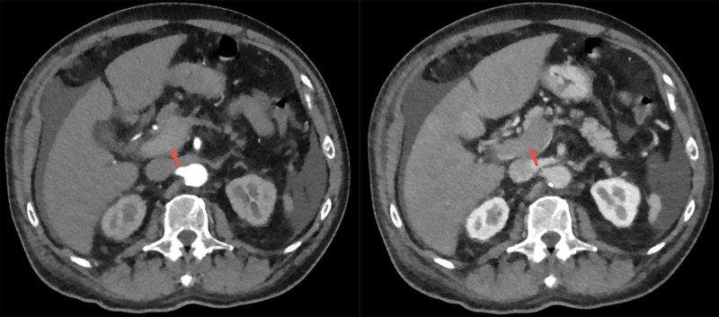 | **Abdominal Contrast-Enhanced CT Demonstrating Portal Vein Thrombosis and Cavernous Transformation in Cirrhosis** <code>cirrhosis_portal_vein_thrombosis_ct.jpg</code> *Radiological Imaging* [☁️ GitHub Raw](https://raw.githubusercontent.com/clinomaofficial/clinoma-images/main/curriculum/clinical/internal-medicine/hepatology/cirrhosis_and_portal_hypertension/cirrhosis_portal_vein_thrombosis_ct.jpg) | [⚡ jsDelivr CDN](https://cdn.jsdelivr.net/gh/clinomaofficial/clinoma-images@main/curriculum/clinical/internal-medicine/hepatology/cirrhosis_and_portal_hypertension/cirrhosis_portal_vein_thrombosis_ct.jpg) | Axial contrast-enhanced abdominal CT images show portal vein thrombosis with subsequent cavernous transformation (indicated by red arrows) in a patient with liver cirrhosis. This finding reflects chronic portal vein occlusion and development of periportal collateral venous channels, commonly seen in advanced portal hypertension.  *خد بالك يا دكتورنا، الأشعة المقطعية دي موضحة جلطة في الوريد البابي الكبدي (Portal Vein Thrombosis) وتحول كهفي حوالين الوريد نتيجة الضغط البابي العالي في مريض تليف الكبد. الحالات دي بتحتاج تقييم دقيق لسيولة الدم وحجم الطحال والدوالي عشان نتجنب المضاعفات الخطيرة.* |
| 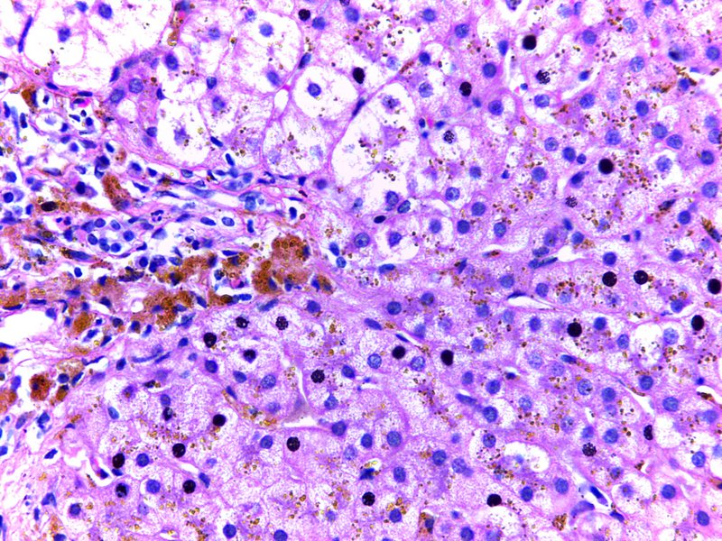 | **Liver Histology Showing Cholestasis and Bile Pigment Deposition in Cirrhosis** <code>cirrhosis_hemochromatosis_iron_prussian_blue.jpg</code> *Histological Micrograph* [☁️ GitHub Raw](https://raw.githubusercontent.com/clinomaofficial/clinoma-images/main/curriculum/clinical/internal-medicine/hepatology/cirrhosis_and_portal_hypertension/cirrhosis_hemochromatosis_iron_prussian_blue.jpg) | [⚡ jsDelivr CDN](https://cdn.jsdelivr.net/gh/clinomaofficial/clinoma-images@main/curriculum/clinical/internal-medicine/hepatology/cirrhosis_and_portal_hypertension/cirrhosis_hemochromatosis_iron_prussian_blue.jpg) | Histological micrograph demonstrating chronic liver parenchymal changes characteristic of advanced cirrhosis, featuring prominent intracellular and canalicular bile stasis (cholestasis) alongside hepatocyte degeneration. This pathology reflects impaired hepatocyte secretory function and altered microcirculation, a central finding in advanced chronic liver disease complicated by portal hypertension and jaundice.  *خد بالك يا دكتورنا، العينة دي بتورّي ترسبات صفراوية واضحة جوه الخلايا الكبدية وفي القنوات البيلارية مع تغيرات سيروزية واضحة (تليف كبدي متقدم)، وده بيفسر لينا حدوث اليرقان (الاصفرار) مع اعراض ضغط الدم البوابي.* |
| 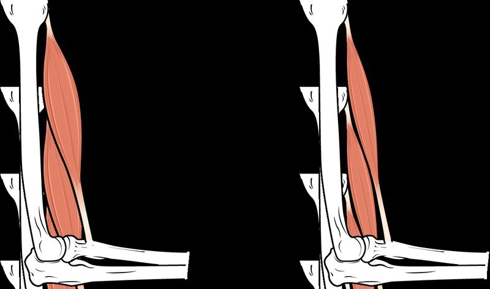 | **Biceps Brachii Muscle Architecture and Tendon Insertion Schematic** <code>cirrhosis_sarcopenia_muscle_wasting_ct.jpg</code> *Schematic Diagram* [☁️ GitHub Raw](https://raw.githubusercontent.com/clinomaofficial/clinoma-images/main/curriculum/clinical/internal-medicine/hepatology/cirrhosis_and_portal_hypertension/cirrhosis_sarcopenia_muscle_wasting_ct.jpg) | [⚡ jsDelivr CDN](https://cdn.jsdelivr.net/gh/clinomaofficial/clinoma-images@main/curriculum/clinical/internal-medicine/hepatology/cirrhosis_and_portal_hypertension/cirrhosis_sarcopenia_muscle_wasting_ct.jpg) | Schematic representation of the biceps brachii muscle illustrating its two heads originating from the scapula and inserting into the radial tuberosity. The diagram highlights muscle fiber orientation and tendon mechanics relevant to upper extremity biomechanics and clinical examination.  *يوضح الرسم التخطيطي تشريح عضلة ذات الرأسين العضدية واتجاه الألياف والوتر المرتبط بعظمة الكعبرة. خد بالك يا دكتورنا أن فهم التشريح العضلي ده مهم جداً في تقييم الفحص السريري وتقييم القوة العضلية.* |
| 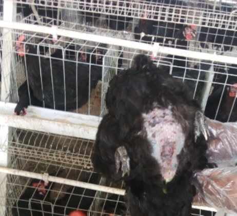 | **Severe Feather Pecking and Vent Cannibalism in Cage-Housed Laying Hen** <code>cirrhosis_high_saag_ascites_algorithm.jpg</code> *Clinical Photo* [☁️ GitHub Raw](https://raw.githubusercontent.com/clinomaofficial/clinoma-images/main/curriculum/clinical/internal-medicine/hepatology/cirrhosis_and_portal_hypertension/cirrhosis_high_saag_ascites_algorithm.jpg) | [⚡ jsDelivr CDN](https://cdn.jsdelivr.net/gh/clinomaofficial/clinoma-images@main/curriculum/clinical/internal-medicine/hepatology/cirrhosis_and_portal_hypertension/cirrhosis_high_saag_ascites_algorithm.jpg) | This photograph depicts severe feather pecking and excoriation of the lower abdomen and vent area in a battery-cage layer hen. Such behavioral stereotypies and self-mutilation highlight welfare challenges and physiological stress in intensive animal farming systems, distinct from human internal medicine entities.  *خد بالك يا دكتورنا، الصورة دي بتوضح حالة استسقاء أو افتراس ريش وظهور تقرحات واضحة في بطن دجاجة محبوسة في بطاريات، ودي مشكلة سلوكية وبيئية في التربية المكثفة ملهاش علاقة بأمراض الباطنة البشرية.* |
| 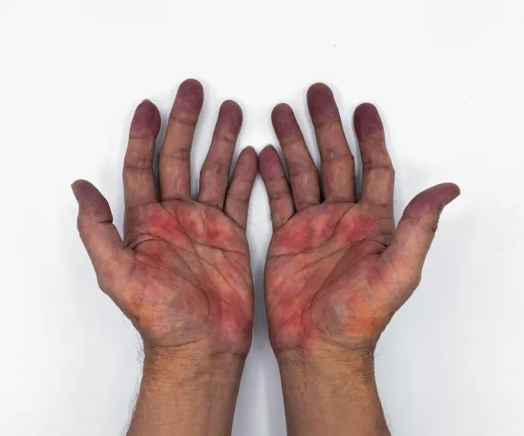 | **Palmar Erythema and Cyanotic Fingertips in Cirrhosis** <code>cirrhosis_palmar_erythema_clinical.jpg</code> *Clinical Photo* [☁️ GitHub Raw](https://raw.githubusercontent.com/clinomaofficial/clinoma-images/main/curriculum/clinical/internal-medicine/hepatology/cirrhosis_and_portal_hypertension/cirrhosis_palmar_erythema_clinical.jpg) | [⚡ jsDelivr CDN](https://cdn.jsdelivr.net/gh/clinomaofficial/clinoma-images@main/curriculum/clinical/internal-medicine/hepatology/cirrhosis_and_portal_hypertension/cirrhosis_palmar_erythema_clinical.jpg) | Bilateral palmar erythema characterized by hyperemic mottling over the thenar and hypothenar eminences, coupled with peripheral cyanosis of the fingertips. These findings reflect hyperdynamic circulation, peripheral vasodilation, and altered sex hormone metabolism characteristic of chronic liver failure and portal hypertension.  *احمرار راحة الإيد (Palmar Erythema) مع ازرقاق أطراف الأصابع بيوروا ان في تليف كبدي متقدم مع ارتفاع ضغط الباب الكبدي. الظاهرة دي بتعكس الدورة الدموية الفرط-ديناميكية وتوسع الأوعية الدموية الناتجة عن خلل هرموني وتراكم الفازوديلاتور في الدم.* |
| 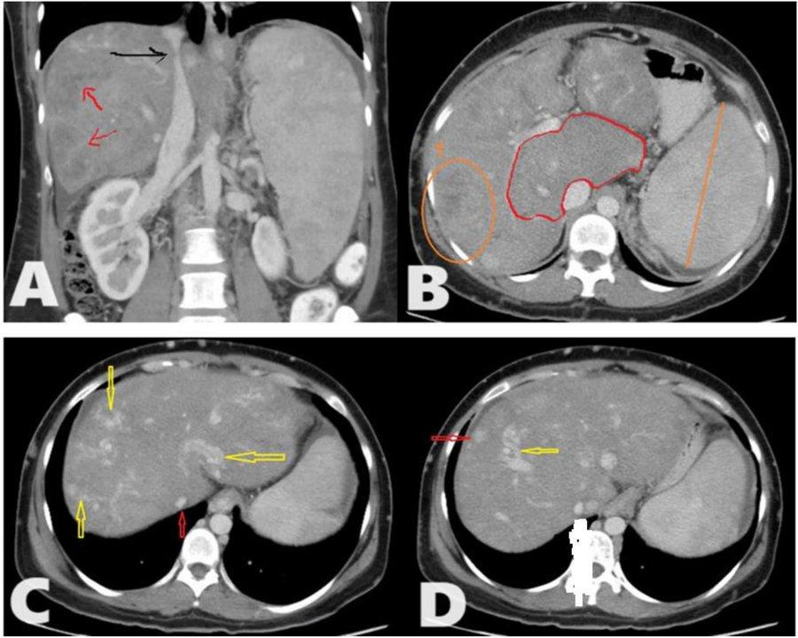 | **Abdominal Contrast-Enhanced CT in Cirrhosis with Portal Hypertension and Cavernous Transformation of the Portal Vein** <code>cirrhosis_painful_hepatomegaly_sign.jpg</code> *Radiological Imaging* [☁️ GitHub Raw](https://raw.githubusercontent.com/clinomaofficial/clinoma-images/main/curriculum/clinical/internal-medicine/hepatology/cirrhosis_and_portal_hypertension/cirrhosis_painful_hepatomegaly_sign.jpg) | [⚡ jsDelivr CDN](https://cdn.jsdelivr.net/gh/clinomaofficial/clinoma-images@main/curriculum/clinical/internal-medicine/hepatology/cirrhosis_and_portal_hypertension/cirrhosis_painful_hepatomegaly_sign.jpg) | Coronal and axial contrast-enhanced CT scans demonstrating severe cirrhosis, massive splenomegaly, and portal hypertension complicated by cavernous transformation of the portal vein with multiple periportal collateral vessels. Non-occlusive or chronic thrombus leads to the recruitment of collateral hepatopetal channels forming a sponge-like vascular network at the porta hepatis.  *خد بالك يا دكتورنا، الأشعة دي بتوضح تليف الكبد المتقدم مع تضخم طحال ضخم وارتفاع ضغط الوريد البابي اللي عمل تحول كهفي (Cavernous transformation) وظهرت الأوعية الالتفافية حوالين الباب الكبدي كشبكة إسفنجية لتعويض الانسداد.* |
| 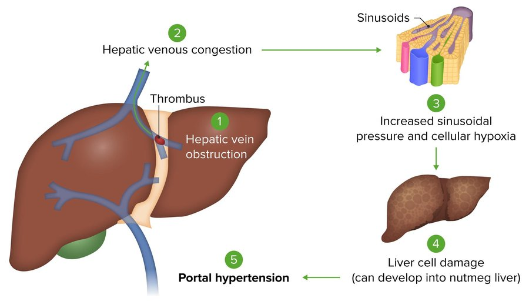 | **Pathophysiologic Mechanism of Portal Hypertension Due to Hepatic Vein Obstruction (Budd-Chiari Syndrome)** <code>cirrhosis_sos_vod_histology_zone3.jpg</code> *Schematic Diagram* [☁️ GitHub Raw](https://raw.githubusercontent.com/clinomaofficial/clinoma-images/main/curriculum/clinical/internal-medicine/hepatology/cirrhosis_and_portal_hypertension/cirrhosis_sos_vod_histology_zone3.jpg) | [⚡ jsDelivr CDN](https://cdn.jsdelivr.net/gh/clinomaofficial/clinoma-images@main/curriculum/clinical/internal-medicine/hepatology/cirrhosis_and_portal_hypertension/cirrhosis_sos_vod_histology_zone3.jpg) | This schematic illustrates the step-by-step cascade of Budd-Chiari syndrome, beginning with a hepatic vein thrombus causing outflow obstruction and hepatic venous congestion. The resulting sinusoidal pressure and cellular hypoxia lead to centrilobular liver cell damage, characteristic nutmeg liver appearance, and ultimately downstream portal hypertension.  *خد بالك يا دكتورنا إن انسداد الوريد الكبدي (Budd-Chiari syndrome) بيعمل احتقان وارتفاع في الضغط جوه الساينوسويدز، وده بيؤدي لنقص الأكسجين وتليف خلايا الكبد بتهتك وتظهر بالمنظر الشهير 'Nutmeg liver' اللي بينتهي في الآخر بارتفاع ضغط الدم البابي (Portal Hypertension).* |
| 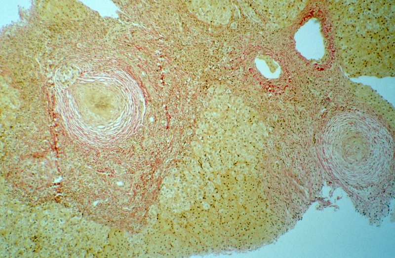 | **Concentric Periductal Fibrosis ("Onion Skin") in Primary Sclerosing Cholangitis on Liver Histology** <code>cirrhosis_schistosomiasis_pipestem.jpg</code> *Histological Micrograph* [☁️ GitHub Raw](https://raw.githubusercontent.com/clinomaofficial/clinoma-images/main/curriculum/clinical/internal-medicine/hepatology/cirrhosis_and_portal_hypertension/cirrhosis_schistosomiasis_pipestem.jpg) | [⚡ jsDelivr CDN](https://cdn.jsdelivr.net/gh/clinomaofficial/clinoma-images@main/curriculum/clinical/internal-medicine/hepatology/cirrhosis_and_portal_hypertension/cirrhosis_schistosomiasis_pipestem.jpg) | This reticulin-stained liver biopsy micrograph shows classic concentric periductal fibrosis ('onion skin' appearance) around an obliterated bile duct within an expanded portal tract, pathognomonic for primary sclerosing cholangitis. Over time, this chronic fibro-obliterative destruction of the intrahepatic and extrahepatic biliary tree leads to secondary biliary cirrhosis and severe portal hypertension.  *خد بالك يا دكتورنا، المنظر ده شبه قشر البصل (Onion skin fibrosis) وحوالين القنوات المرارية في الكبد، وده بيعبر عن التهاب القنوات المرارية المصلب الأولي (PSC). التليف التدريجي ده بيقفل القنوات وبيقود المريض في النهاية لتليف كبدي صفراوي وارتفاع ضغط الوريد البابي.* |
| 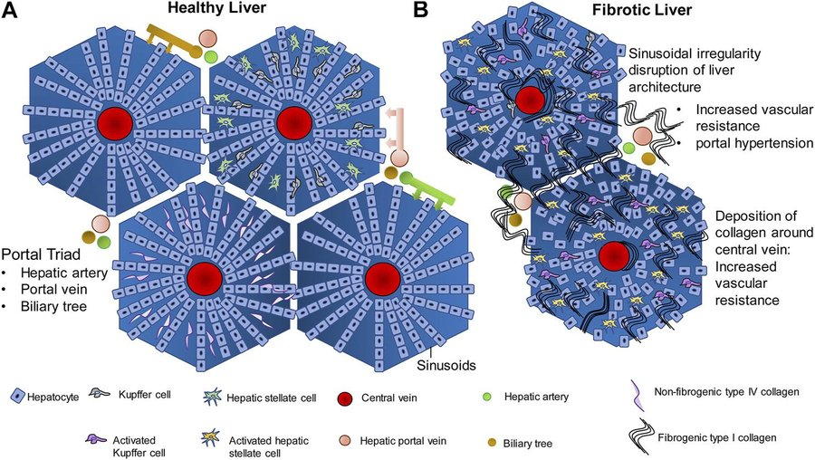 | **Comparison of Healthy Liver Architecture versus Fibrotic Liver with Portal Hypertension** <code>cirrhosis_sinusoidal_capillarization_stellate.jpg</code> *Schematic Diagram* [☁️ GitHub Raw](https://raw.githubusercontent.com/clinomaofficial/clinoma-images/main/curriculum/clinical/internal-medicine/hepatology/cirrhosis_and_portal_hypertension/cirrhosis_sinusoidal_capillarization_stellate.jpg) | [⚡ jsDelivr CDN](https://cdn.jsdelivr.net/gh/clinomaofficial/clinoma-images@main/curriculum/clinical/internal-medicine/hepatology/cirrhosis_and_portal_hypertension/cirrhosis_sinusoidal_capillarization_stellate.jpg) | This comparative diagram contrasts normal hepatic lobular architecture with a fibrotic liver exhibiting sinusoidal distortion, extracellular matrix remodeling via fibrogenic type I collagen deposition, and disruption of the portal triad. These architectural distortions increase intrahepatic vascular resistance, ultimately leading to portal hypertension and impaired hepatic function.  *خد بالك يا دكتورنا، التليف الكبدي (Fibrotic Liver) مش مجرد شوية التهاب، ده بيحصل فيه إعادة تشكيل كاملة للأنسجة وترسب للكولاجين نوع أول، وده اللي بيقفل الساينوسويدز ويعمل مقاومة لتدفق الدم ويزود الضغط في البوابة الكبدية (Portal Hypertension).* |
| 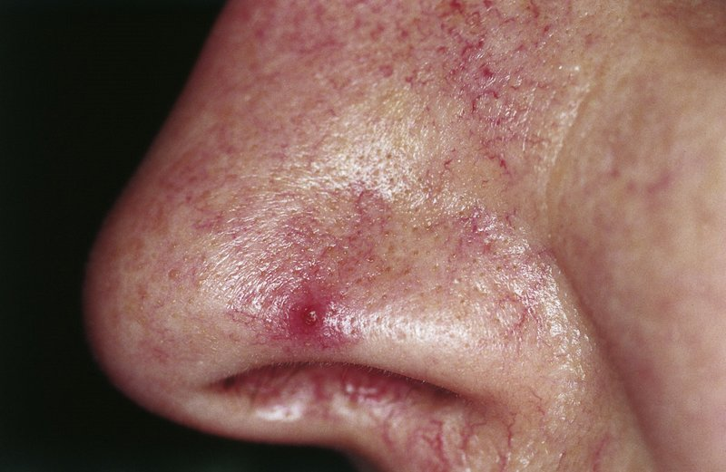 | **Spider Angioma (Spider Nevus) on Nasal Skin in Chronic Liver Disease** <code>cirrhosis_spider_angioma_skin.jpg</code> *Clinical Photo* [☁️ GitHub Raw](https://raw.githubusercontent.com/clinomaofficial/clinoma-images/main/curriculum/clinical/internal-medicine/hepatology/cirrhosis_and_portal_hypertension/cirrhosis_spider_angioma_skin.jpg) | [⚡ jsDelivr CDN](https://cdn.jsdelivr.net/gh/clinomaofficial/clinoma-images@main/curriculum/clinical/internal-medicine/hepatology/cirrhosis_and_portal_hypertension/cirrhosis_spider_angioma_skin.jpg) | A classic spider angioma displaying a central pulsatile arteriole with radiating spider-like capillary branches on the nose. This cutaneous vascular lesion is driven by hyperestrogenemia and high peripheral blood flow commonly seen in patients with chronic liver disease and cirrhosis.  *يا دكتورنا، الـ Spider angioma دي علامة كلاسيكية من علامات تليف الكبد وارتفاع ضغط الباب الكبدي بسبب زيادة الإستروجين وتوس الشعيرات الدموية، وتتميز بأن الضغط على مركزها بيخليها تختفي وترجع تاني لما تسيبها.* |
| 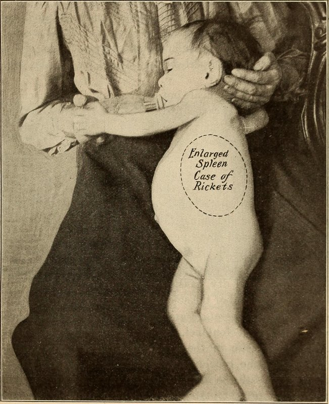 | **Enlarged Spleen in Infantile Rickets** <code>cirrhosis_splenomegaly_hypersplenism_ct.jpg</code> *Clinical Photo* [☁️ GitHub Raw](https://raw.githubusercontent.com/clinomaofficial/clinoma-images/main/curriculum/clinical/internal-medicine/hepatology/cirrhosis_and_portal_hypertension/cirrhosis_splenomegaly_hypersplenism_ct.jpg) | [⚡ jsDelivr CDN](https://cdn.jsdelivr.net/gh/clinomaofficial/clinoma-images@main/curriculum/clinical/internal-medicine/hepatology/cirrhosis_and_portal_hypertension/cirrhosis_splenomegaly_hypersplenism_ct.jpg) | Historical clinical photograph demonstrating hepatosplenomegaly in an infant with rickets. Splenomegaly in chronic systemic conditions may result from extramedullary hematopoiesis or reticuloendothelial hyperplasia.  *خد بالك يا دكتورنا إن تضخم الطحال في الحالات التاريخية دي ممكن يكون بسبب تنشيط الجهاز الشبكي البطاني أو تكون الدم خارج النخاع، وغالباً بيتصاحب مع أعراض نقص فيتامين د الحادة وتشوهات العظام.* |
| 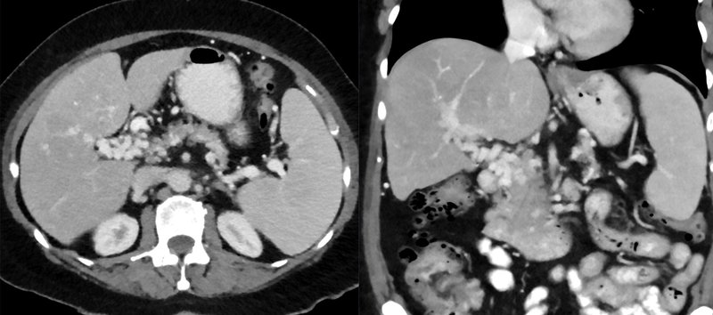 | **Abdominal Contrast-Enhanced CT in Cirrhosis Demonstrating Portal Hypertension with Splenomegaly and Portosystemic Collaterals** <code>cirrhosis_portal_cavernoma_mri_or_us.jpg</code> *Radiological Imaging* [☁️ GitHub Raw](https://raw.githubusercontent.com/clinomaofficial/clinoma-images/main/curriculum/clinical/internal-medicine/hepatology/cirrhosis_and_portal_hypertension/cirrhosis_portal_cavernoma_mri_or_us.jpg) | [⚡ jsDelivr CDN](https://cdn.jsdelivr.net/gh/clinomaofficial/clinoma-images@main/curriculum/clinical/internal-medicine/hepatology/cirrhosis_and_portal_hypertension/cirrhosis_portal_cavernoma_mri_or_us.jpg) | Axial and coronal contrast-enhanced CT scans of the abdomen in a patient with cirrhosis showing marked splenomegaly, attenuated intrahepatic branches, and extensive peripancreatic/retroperitoneal portosystemic collateral veins. These radiological features are classic signs of advanced chronic liver disease complicated by clinically significant portal hypertension.  *خد بالك يا دكتورنا، الأشعة المقطعية بالصبغة دي بتوضح تليف الكبد في مراحله المتقدمة مع وجود ضغط عالي في الوريد البابي (Portal Hypertension)، واللي واضح جداً فيه تضخم الطحال الملحوظ والأوردة الالتفافية (Portosystemic collaterals) حوالين البنكرياس وفي منطقة البطن.* |
| 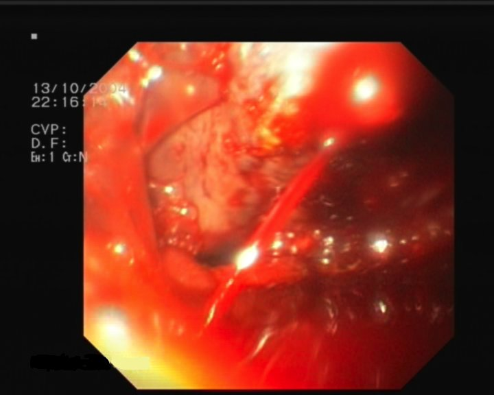 | **Active Esophageal Variceal Bleeding on Endoscopy** <code>cirrhosis_splenic_vein_thrombosis_gastric_varices.jpg</code> *Endoscopy / Laparoscopy* [☁️ GitHub Raw](https://raw.githubusercontent.com/clinomaofficial/clinoma-images/main/curriculum/clinical/internal-medicine/hepatology/cirrhosis_and_portal_hypertension/cirrhosis_splenic_vein_thrombosis_gastric_varices.jpg) | [⚡ jsDelivr CDN](https://cdn.jsdelivr.net/gh/clinomaofficial/clinoma-images@main/curriculum/clinical/internal-medicine/hepatology/cirrhosis_and_portal_hypertension/cirrhosis_splenic_vein_thrombosis_gastric_varices.jpg) | Endoscopic visualization showing acute active spurting hemorrhage from ruptured esophageal varices secondary to portal hypertension in a patient with cirrhosis. This represents a life-threatening medical emergency requiring immediate endoscopic hemostasis such as band ligation or sclerotherapy alongside vasoactive drugs.  *خد بالك يا دكتورنا، المنظر ده بيوريك نزيف نشط من دوالي المريء (Active variceal bleeding) نتيجة ارتفاع ضغط الوريد البابي في مريض تليف الكبد. الحالة دي طوارئ قصوى وعايزة تدخل منظار عاجل للربط (Variceal band ligation) وإعطاء أدوية قابضة للأوعية زي الأوكتريوتيد عشان ننقذ المريض.* |
| 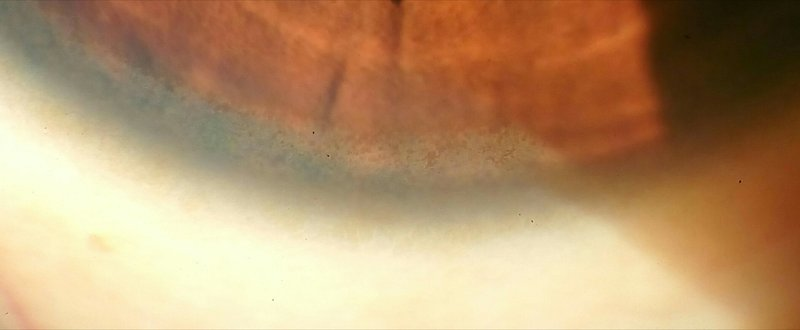 | **Kayser-Fleischer Ring in Wilson's Disease on Slit-Lamp Examination** <code>cirrhosis_wilsons_kayser_fleischer_ring.jpg</code> *Clinical Photo* [☁️ GitHub Raw](https://raw.githubusercontent.com/clinomaofficial/clinoma-images/main/curriculum/clinical/internal-medicine/hepatology/cirrhosis_and_portal_hypertension/cirrhosis_wilsons_kayser_fleischer_ring.jpg) | [⚡ jsDelivr CDN](https://cdn.jsdelivr.net/gh/clinomaofficial/clinoma-images@main/curriculum/clinical/internal-medicine/hepatology/cirrhosis_and_portal_hypertension/cirrhosis_wilsons_kayser_fleischer_ring.jpg) | Slit-lamp examination demonstrates a greenish-brown Kayser-Fleischer ring at the periphery of the cornea, caused by copper deposition in Descemet's membrane. This pathognomonic finding is essential for the diagnosis of Wilson's disease, which can present with hepatic cirrhosis and portal hypertension.  *حلقة كايزر-فليشر (Kayser-Fleischer ring) بتظهر كخط لونه بني على مخضر في أطراف القرنية نتيجة ترسب النحاس في غشاء ديسيميه. دي علامة أساسية بتساعدنا نشخص مرض ويلسون (Wilson's disease) اللي ممكن يظهر بتليف كبدي وارتفاع ضغط الدم البابي.* |
| 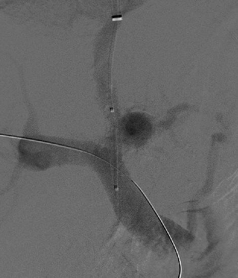 | **Transjugular Intrahepatic Portosystemic Shunt (TIPS) Placement and Portal Venogram** <code>cirrhosis_tips_stent_fluoroscopy.jpg</code> *Radiological Imaging* [☁️ GitHub Raw](https://raw.githubusercontent.com/clinomaofficial/clinoma-images/main/curriculum/clinical/internal-medicine/hepatology/cirrhosis_and_portal_hypertension/cirrhosis_tips_stent_fluoroscopy.jpg) | [⚡ jsDelivr CDN](https://cdn.jsdelivr.net/gh/clinomaofficial/clinoma-images@main/curriculum/clinical/internal-medicine/hepatology/cirrhosis_and_portal_hypertension/cirrhosis_tips_stent_fluoroscopy.jpg) | This fluoroscopic angiogram demonstrates the creation of a Transjugular Intrahepatic Portosystemic Shunt (TIPS) for the management of complications related to portal hypertension and cirrhosis, such as refractory variceal bleeding or ascites. The procedure involves deploying a stent between the hepatic vein and portal vein to decompress the portal venous system.  *خد بالك يا دكتورنا إن رسم الأشعة ده بيوضح تركيب دعامة TIPS (توصيلة وريدية كبدية داخل البوابة) لتقليل الضغط الوريدي البابى العالي وعلاج نزيف الدوالي أو الاستسقاء المقاوم للعلاج. المتابعة بالسونار والدوبلر بعد التركيب ضرورية جداً عشان نتأكد من سالكة الدعامة وعدم حدوث انسداد أو اعتلال دماغي كبدي.* |
| 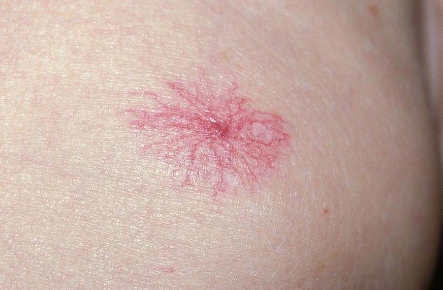 | **Spider Angioma (Spider Nevus) on Upper Trunk in Portal Hypertension** <code>cirrhosis_spider_angioma_clinical.jpg</code> *Clinical Photo* [☁️ GitHub Raw](https://raw.githubusercontent.com/clinomaofficial/clinoma-images/main/curriculum/clinical/internal-medicine/hepatology/cirrhosis_and_portal_hypertension/cirrhosis_spider_angioma_clinical.jpg) | [⚡ jsDelivr CDN](https://cdn.jsdelivr.net/gh/clinomaofficial/clinoma-images@main/curriculum/clinical/internal-medicine/hepatology/cirrhosis_and_portal_hypertension/cirrhosis_spider_angioma_clinical.jpg) | A classic spider angioma showing a central red arteriole with radiating branching capillaries resembling a spider's web, frequently observed on the upper trunk, face, and arms in patients with chronic liver disease and hyperestrogenemia due to impaired hepatic metabolism. These cutaneous vascular lesions blanch completely upon central pressure due to arterial retrograde filling.  *خد بالك يا دكتورنا، العرض ده اسمه سبايدر نيفوس أو وحمة عنكبوتية، وبتظهر كتير في حالات تليف الكبد بسبب زيادة هرمون الاستروجين وعدم قدرة الكبد المريض على تكسيره. لو ضغطت على المركز بتاعها هتلاقي الأوعية الدموية بتختفي وتبيض فوراً وده بيساعدك تشخص البورتال هايبرتنشن أو مضاعفات الكبد بسرعة.* |
