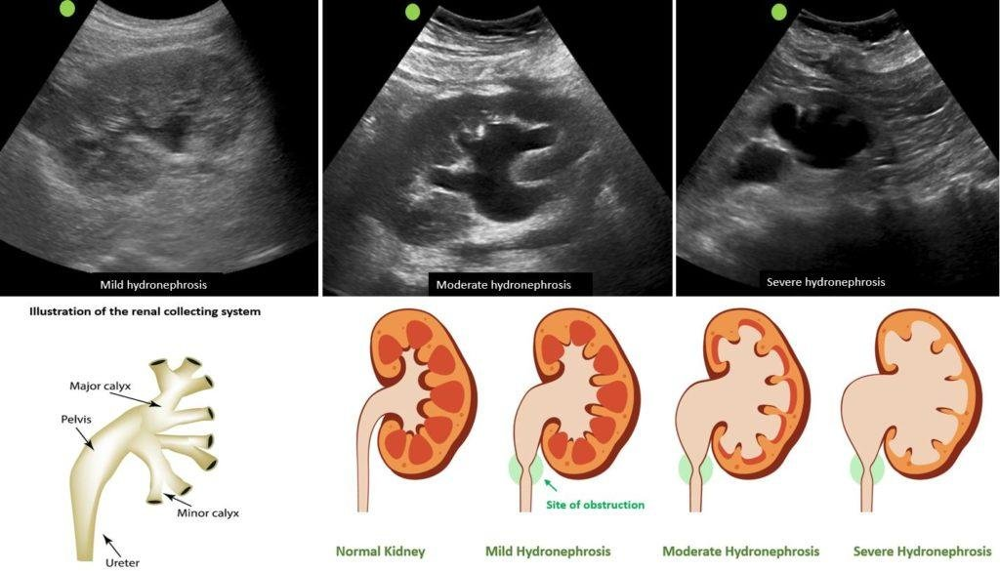
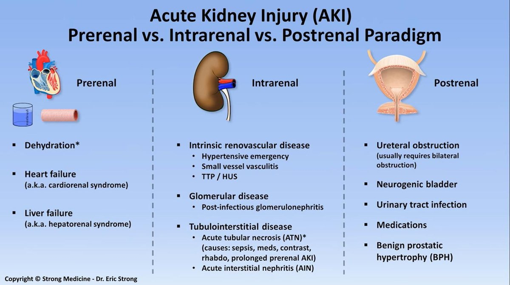
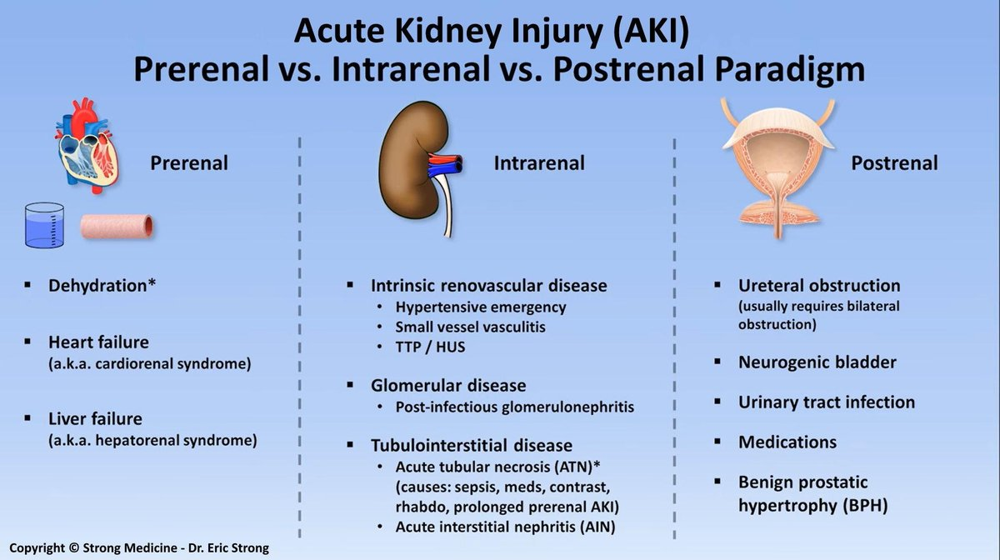

# Clinoma Visual Atlas: 06 Acute Kidney Injury

**Discipline / Module:** `curriculum/clinical/internal-medicine/nephrology/06_acute_kidney_injury`  
**Total Figures:** **6** Authentic Clinical & Pathological Images

| Figure | Clinical Identification | Academic & Bedside Description |
| :---: | :--- | :--- |
|  | **Acute Kidney Injury: Prerenal vs. Intrarenal vs. Postrenal Paradigm** `aki_raw_06.jpg` *Schematic Diagram* | This educational schematic categorizes Acute Kidney Injury (AKI) into three major pathophysiological groups: prerenal azotemia resulting from decreased renal perfusion, intrarenal parenchymal damage affecting glomeruli, tubules, or vessels, and postrenal obstructive uropathy. Identifying the correct paradigm is critical for timely diagnostic workup and targeted clinical intervention.  *خد بالك يا دكتورنا، تقسيم الـ AKI لـ Prerenal و Intrarenal و Postrenal هو أساس التشخيص السليم. الـ Prerenal بيكون بسبب نقص الـ Perfusion (زي Dehydration أو Heart Failure)، بينما الـ Intrarenal بيشمل مشاكل البارنشايما زي الـ ATN والـ Glomerulonephritis، والـ Postrenal بيتعلق بأي انسداد في طريق البول زي الـ BPH والـ Ureteral obstruction.* |
|  | **Renal Ultrasonography and Schematic Grading of Hydronephrosis Severity** `aki_raw_03.jpg` *Radiological Imaging* | Composite ultrasound and schematic diagram demonstrating the progressive grading of hydronephrosis from mild to severe. Dilation of the renal pelvis and calyces reflects urinary tract obstruction, potentially leading to obstructive acute kidney injury if bilateral or affecting a solitary kidney.  *خد بالك يا دكتورنا، تدرج الهيدرونيفروسيس (Hydronephrosis) في السونار بيعكس مدى انسداد الجهاز البولي. لو الـ Pelvis والـ Calyces متوسعين بسيط تبقى Mild، لكن لو الحوض متوسع جداً والبارنشايما بقت رقيقة (Thinned cortex) تبقى Severe، ودي حالة طارئة ممكن تعمل Acute Kidney Injury.* |
|  | **Renal Ultrasonography and Schematic Grading of Hydronephrosis Severity** `hydronephrosis_us.jpg` *Radiological Imaging* | Composite ultrasound and schematic diagram demonstrating the progressive dilation of the renal collecting system from mild to severe hydronephrosis due to urinary tract obstruction. The classification is based on the extent of pelvicalyceal blunting and subsequent thinning of the adjacent renal parenchyma. Early identification is crucial to prevent irreversible renal tubular atrophy and loss of glomerular filtration rate.  *خد بالك يا دكتورنا إن تصنيف الاستسقاء الكلوي (Hydronephrosis) بالسونار مهم جداً عشان تحدد درجة الانسداد وتنقذ الكلية قبل ما يحصل ضمور في خلاياها وتأثر على وظائفها. في الغالب الانسداد ده بيعمل Acute Kidney Injury (AKI) لازم نستبعده فوراً بأشعة التلفزيون أول ما يجيلنا مريض عنده Anuria أو Oliguria.* |
|  | **Renal Ultrasonography and Schematic Grading of Hydronephrosis Severity** `aki_raw_04.jpg` *Radiological Imaging* | Composite ultrasound and schematic diagram illustrating progressive grades of hydronephrosis from mild to severe. Dilation of the renal collecting system results from urinary tract obstruction, leading to caliceal blunting, pelvic enlargement, and eventual parenchymal thinning if left untreated.  *خد بالك يا دكتورنا، تدرج الهيدرونفروز (استسقاء الكلى) بالسونار بيوضح الفرق بين الاتساع البسيط لحوض الكلى والاتساع الشديد مع ضغط وتآكل في نسيج الكلى. تقييم درجة الاستسقاء بيساعدنا نعرف مكان وقوة الانسداد البولي وسرعة التدخل اللازم لمنع الفشل الكلوي الحاد والمزمن.* |
|  | **Acute Kidney Injury Prerenal vs Intrarenal vs Postrenal Paradigm Schematic** `aki_raw_05.jpg` *Schematic Diagram* | This diagram classifies Acute Kidney Injury (AKI) into three primary etiologic categories: prerenal (decreased renal perfusion), intrarenal (direct parenchymal damage such as ATN or glomerulonephritis), and postrenal (urinary tract obstruction). Understanding these classifications is critical for determining the underlying pathophysiology and guiding targeted management in clinical practice.  *خد بالك يا دكتورنا، لما يجيلك عيان عنده Acute Kidney Injury، أول خطوة لازم تقسمها وتفرق بين الـ Prerenal والـ Intrarenal والـ Postrenal عشان تعرف الـ Cause وتلحق العين في الأول.* |
|  | **Acute Kidney Injury: Prerenal vs Intrarenal vs Postrenal Paradigm** `aki_classification.jpg` *Schematic Diagram* | This diagram categorizes Acute Kidney Injury (AKI) into three distinct pathophysiological paradigms: prerenal (decreased perfusion like dehydration and heart/liver failure), intrarenal (parenchymal damage like ATN and glomerulonephritis), and postrenal (obstructive etiologies like BPH and ureteral stones). Correctly identifying the specific category is critical for guiding targeted diagnostic evaluation and timely therapeutic interventions.  *التقسيمة دي هي أساس التعامل مع أي حالة AKI في الاستقبال؛ لازم تفرق كويس جداً بين المشكلة البريرنال الناتجة عن نقص التروية (زي الجفاف والهبوط)، والمشكلة جوه الكلية نفسها (Intrarenal زي الـ ATN والتهاب الكبيبات)، والمشكلة البوست‌رينال بسبب الانسداد (زي تضخم البروستاتا). التشخيص الصح في الأول هيوفر عليك كتير وهيمنع الكلية من الدخول في مرحلة متأخرة.* |