# Clinoma Visual Atlas: 08 Chronic Kidney Disease

**Discipline / Module:** `curriculum/clinical/internal-medicine/nephrology/08_chronic_kidney_disease`  
**Total Figures:** **20** Authentic Clinical & Pathological Images

| Figure | Clinical Identification | Academic & Bedside Description |
| :---: | :--- | :--- |
| 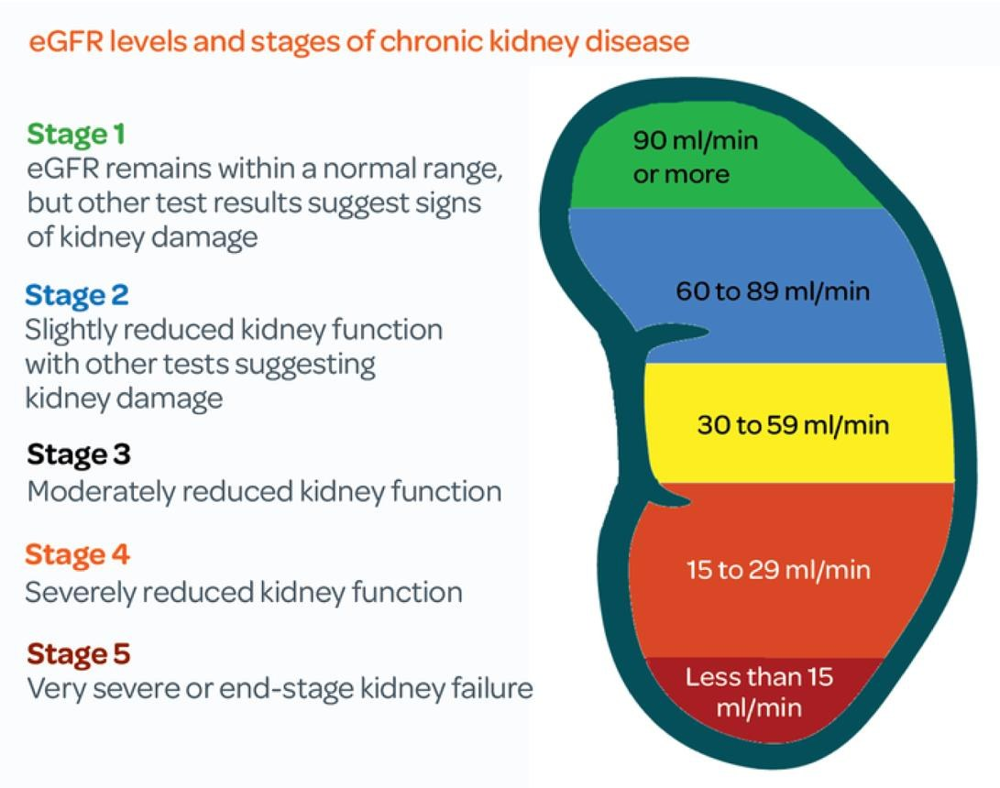 | **eGFR Levels and Stages of Chronic Kidney Disease Schematic Diagram** `ckd_chat_img_1.jpg` *Schematic Diagram* | This diagram categorizes chronic kidney disease into five distinct clinical stages based on estimated glomerular filtration rate (eGFR) values. Staging guides therapeutic interventions, prognostic evaluations, and the timing of specialist nephrology referrals.  *خد بالك يا دكتورنا، تقسيم مراحل الفشل الكلوي والمزمن بناءً على الـ eGFR مهم جداً في المتابعة العيادية. المراحل من واحد لخمسة بتحدد إمتى نبدأ نتدخل دوائياً وإمتى نحول المريض لطبيب الكلى المختص عشان نمنع المضاعفات الخطيرة.* |
| 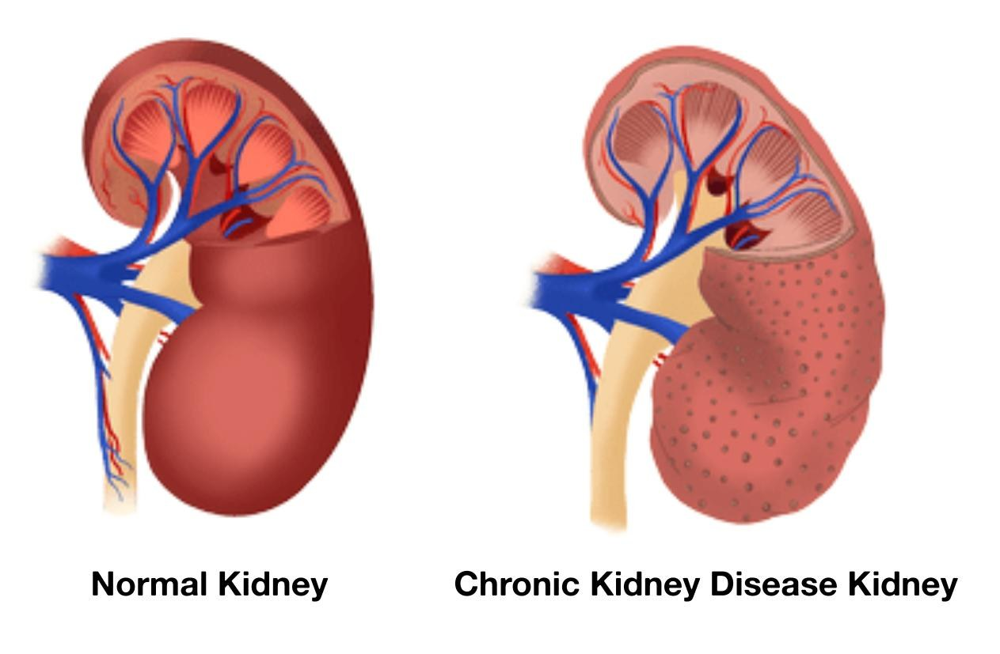 | **Comparative Schematic of Normal Kidney versus Chronic Kidney Disease (CKD) Kidney Architecture** `ckd_chat_img_2.jpg` *Schematic Diagram* | This comparative diagram illustrates the gross structural changes of chronic kidney disease (CKD) compared to a normal kidney. Progressive nephron loss leads to cortical thinning, parenchymal scarring, and a granular, shrunken external surface indicative of irreversible fibrosis and glomerulosclerosis.  *خد بالك يا دكتورنا، الكلى في الـ Chronic Kidney Disease بتكون shrunk و granular بسبب الـ interstitial fibrosis والـ glomerulosclerosis، وده بيخلينا نشوف الـ cortical thinning بوضوح مقارنة بالكلى الطبيعية.* |
| 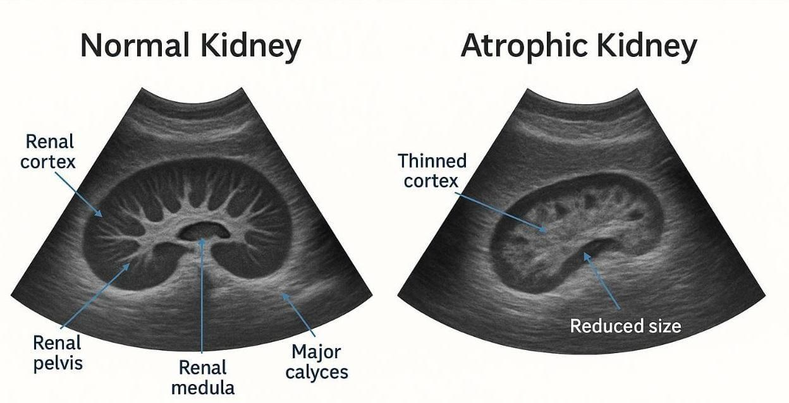 | **Renal Ultrasound Comparison of Normal Kidney vs. Atrophic Kidney in Chronic Kidney Disease** `ckd_chat_img_12.jpg` *Radiological Imaging* | Ultrasonographic comparison demonstrating the morphological hallmark of chronic kidney disease, where an atrophic kidney displays a globally reduced size, increased parenchymal echogenicity, and a significantly thinned renal cortex due to chronic glomerulosclerosis and interstitial fibrosis.  *خد بالك يا دكتورنا، لما تبص على السونار وتلاقي الكلية صغيرة في الحجم والـ Cortex (القشرة) بتاعتها رفيعة جدا ومبيّضة (Increased echogenicity)، ده بيدينا إنديكايشن قوي إن العيان دخل في Chronic Kidney Disease (CKD) ووصلنا لمرحلة الـ Atrophic Kidney نتيجة التليف المزمن.* |
| 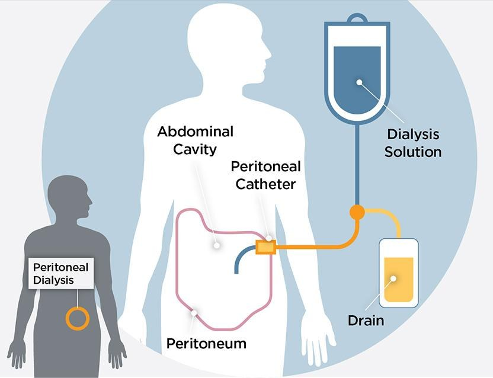 | **Schematic Overview of Peritoneal Dialysis Setup and Peritoneum Cavity** `ckd_chat_img_10.jpg` *Schematic Diagram* | This diagram illustrates the process of peritoneal dialysis, where a peritoneal catheter infuses dialysis solution into the abdominal cavity. The highly vascularized peritoneum acts as a semi-permeable membrane to filter waste products and excess fluids from the blood.  *الرسم التوضيحي بيبين طريقة الغسيل البريتوني (Peritoneal Dialysis)، ودا عن طريق إدخال محلول الغسيل في تجويف البطن باستخدام قسطرة بريتونية. الغشاء البريتوني بيشتغل كفلتر طبيعي بيسمح بتبادل السموم والسوائل الزائدة من الدم برا الجسم.* |
| 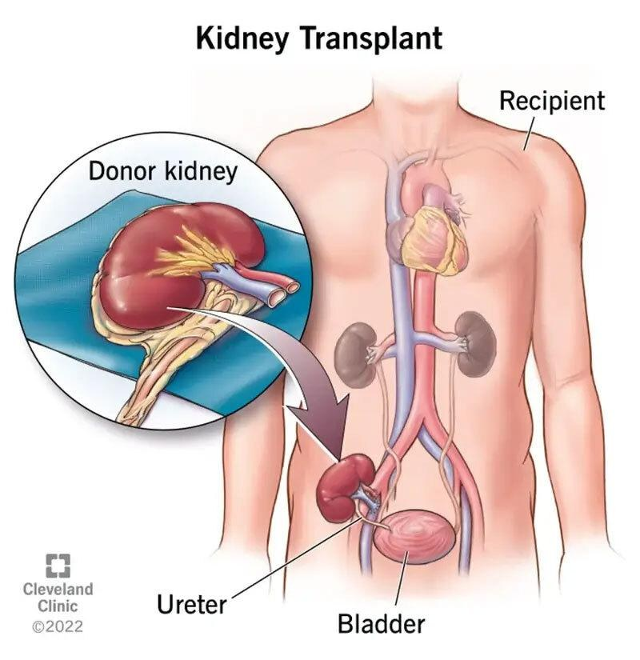 | **Kidney Transplant Anatomical Schematic** `ckd_chat_img_11.jpg` *Schematic Diagram* | This schematic diagram illustrates the surgical placement of a donor kidney into a recipient with chronic kidney disease. The allograft is typically placed in the lower abdomen (iliac fossa) with vascular anastomoses to the iliac vessels and the ureter connected directly to the urinary bladder, leaving the native diseased kidneys in situ.  *خد بالك يا دكتورنا إن الكلية الجديدة بتنزل في الحوض (Iliac fossa) وتتوصل بالشرايين والأوردة الحرقفية، والحالب بيتوصل مباشرة بالمثانة، وساعات بنسيب الكليتين الأصليين مكانهم لو مش عاملين مضاعفات زي ضغط عالي أو التهابات.* |
| 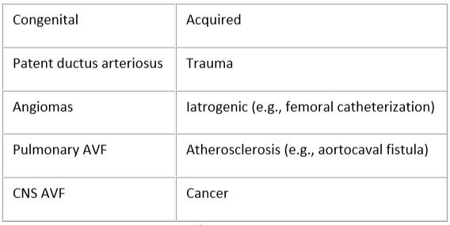 | **Etiological Classification of Arteriovenous Fistulas into Congenital and Acquired Causes** `ckd_arteriovenous_fistula.jpg` *Schematic Diagram* | This comparative table outlines the congenital and acquired etiologies of arteriovenous fistulas (AVFs), which are critical to evaluate in patients with chronic kidney disease being assessed for hemodialysis access. Acquired causes frequently involve trauma, iatrogenic interventions (e.g., femoral catheterization), or atherosclerosis, whereas congenital anomalies include patent ductus arteriosus and vascular malformations.  *خد بالك يا دكتورنا، في عيان الفشل الكلوي المزمن، تقييم الـ AVF مهم جداً عشان تفرق بين الأسباب الخ خلقية أو المكتسبة زي الإصابات أو القسطرة السابقة اللي ممكن تأثر على كفاءة الفاسكولار اكسس.* |
| 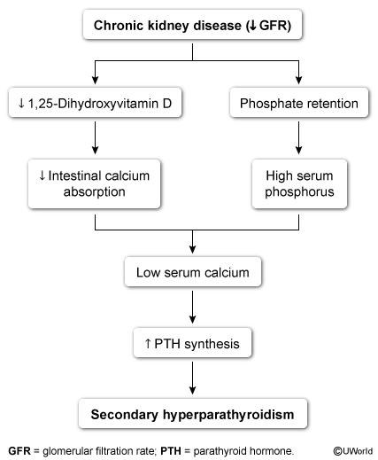 | **Pathophysiology of Secondary Hyperparathyroidism in Chronic Kidney Disease** `ckd_chat_img_7.jpg` *Schematic Diagram* | Chronic kidney disease leads to decreased glomerular filtration rate (GFR), resulting in reduced 1,25-dihydroxyvitamin D synthesis and phosphate retention. This causes decreased intestinal calcium absorption and hyperphosphatemia, culminating in hypocalcemia and subsequent parathyroid hormone (PTH) hypersecretion, known as secondary hyperparathyroidism.  *يا دكتورنا، العيان بتاع الـ CKD بيجيله هبوط في الـ GFR فبيقل فيتامين د النشط وبيحصل احتباس للفوسفات، وده بيعمل نقص كالسيوم الدم ويحفز الغدة الجار درقية تفرز PTH بزيادة عشان تعوض، فنلاقي الـ Secondary Hyperparathyroidism بيظهر في البانوراما المعملية.* |
| 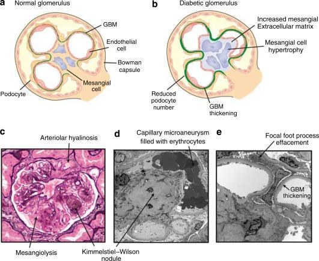 | **Diabetic Nephropathy: Glomerular and Ultrastructural Alterations** `ckd_chat_img_4.jpg` *Schematic Diagram* | Composite illustration displaying pathological changes in diabetic nephropathy, including GBM thickening, mesangial expansion, Kimmelstiel-Wilson nodule formation, and podocyte effacement. These progressive glomerular injuries lead to impaired filtration barrier function and clinical proteinuria.  *خد بالك يا دكتورنا، في اعتلال الكلى السكري بنشوف تخن في الغشاء القاعدي للكلية (GBM) وزيادة في الخلايا المسانجية مع تكون عقد كيميلستيل-ويلسون الشهيرة، ودي بتبان إكلينيكياً في صورة زلال في البول وتدهور تدريجي في وظائف الكلى.* |
| 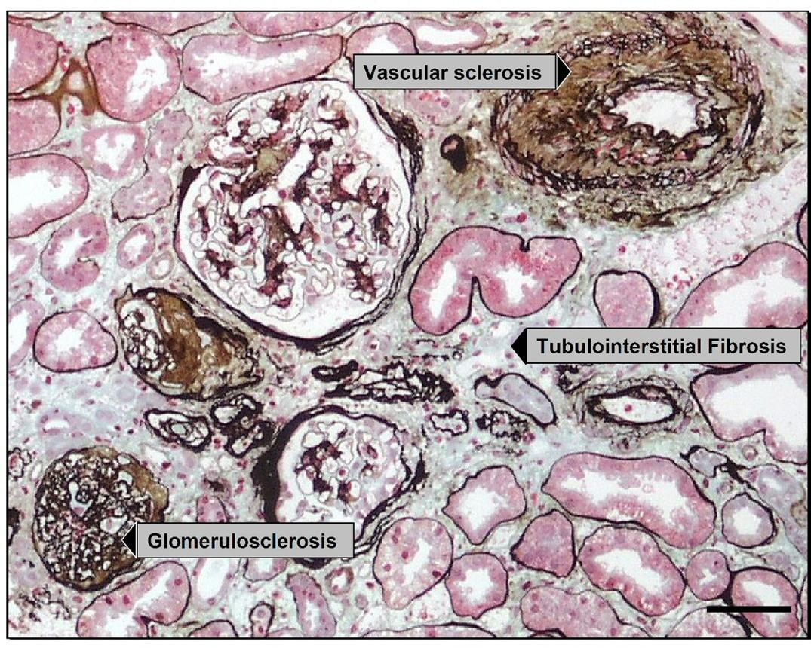 | **Chronic Kidney Disease Histopathology Demonstrating Glomerulosclerosis, Vascular Sclerosis, and Tubulointerstitial Fibrosis** `ckd_chat_img_3.jpg` *Histological Micrograph* | This silver-stained renal biopsy micrograph illustrates hallmark features of advanced chronic kidney disease, including global glomerulosclerosis, concentric medial hypertrophy and luminal narrowing of a blood vessel (vascular sclerosis), and extensive interstitial fibrosis separating damaged tubular profiles. These structural alterations reflect irreversible nephron loss and end-stage renal parenchymal remodeling driven by chronic hypertension and persistent glomerular injury.  *المنظر ده بيوضح التشريح المرضي لمراحل متقدمة من الفشل الكلوي المزمن، وفيه باين تليف الكبيبات (Glomerulosclerosis)، وتصلب الأوعية الدموية مع ضيق اللمعة (Vascular sclerosis)، وتليف أنسجة الخلالي الكلوي (Tubulointerstitial fibrosis). خد بالك يا دكتورنا إن التغيرات دي بتعكس فقدان دائم للوحدات الكلوية (Nephrons) وتليف غير مرتجع، وده اللي بنشوفه بوضوح في الحالات المتأخرة من الضغط المرتفع والسكري المزمن.* |
| 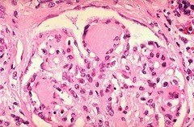 | **Diabetic Glomerulosclerosis (Kimmelstiel-Wilson Nodules) on Renal Biopsy** `ckd_diabetic_nephropathy_kimmelstiel.jpg` *Histological Micrograph* | This high-power histological micrograph shows nodular glomerulosclerosis, characteristic of diabetic nephropathy (Kimmelstiel-Wilson lesions). The characteristic acellular, eosinophilic hyaline nodules within the mesangial regions lead to progressive capillary loop compression, glomerular obliteration, and irreversible loss of renal function.  *خد بالك يا دكتورنا، العقد الأزميلية الوردية (Kimmelstiel-Wilson nodules) دي علامة كلاسيكية ومميزة جداً لاعتلال الكلية السكري (Diabetic Nephropathy) في عينات الكلى. لما بتشوف المنظر ده في مريض السكر مع وجود زلال في البول، ده بيدل على تلف متقدم في الأوعية الدقيقة داخل الكبيبات وبيؤدي في النهاية لفشل كلوي مزمن لو متلحقش بضبط سكر وضغط دم صارم.* |
| 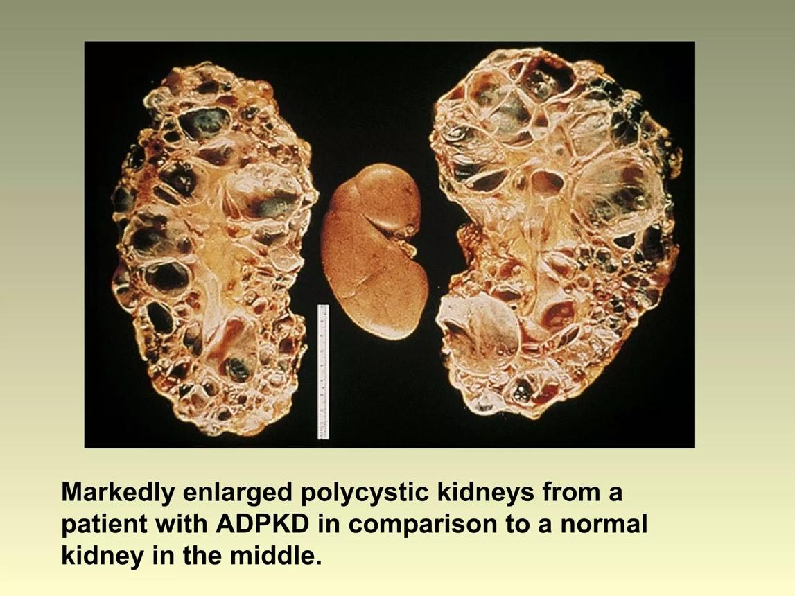 | **Markedly Enlarged Polycystic Kidneys in ADPKD Compared to Normal Kidney** `ckd_chat_img_5.jpg` *Gross Pathology* | Gross specimen demonstrating massively enlarged kidneys replaced by numerous fluid-filled cysts characteristic of Autosomal Dominant Polycystic Kidney Disease (ADPKD), shown alongside a normal-sized adult kidney for comparison. The progressive expansion of these cysts leads to destruction of surrounding renal parenchyma, ultimately resulting in end-stage renal disease (ESRD).  *خد بالك يا دكتورنا إن الكليتين في حالة الـ ADPKD بيبقوا كبار جداً ومليانين cysts بتدمر الـ parenchyma تدريجياً لحد ما نوصل لـ Chronic Kidney Disease وESRD، والمقارنة مع الكلية الطبيعية اللي في النص واضحة وقبيحة.* |
| 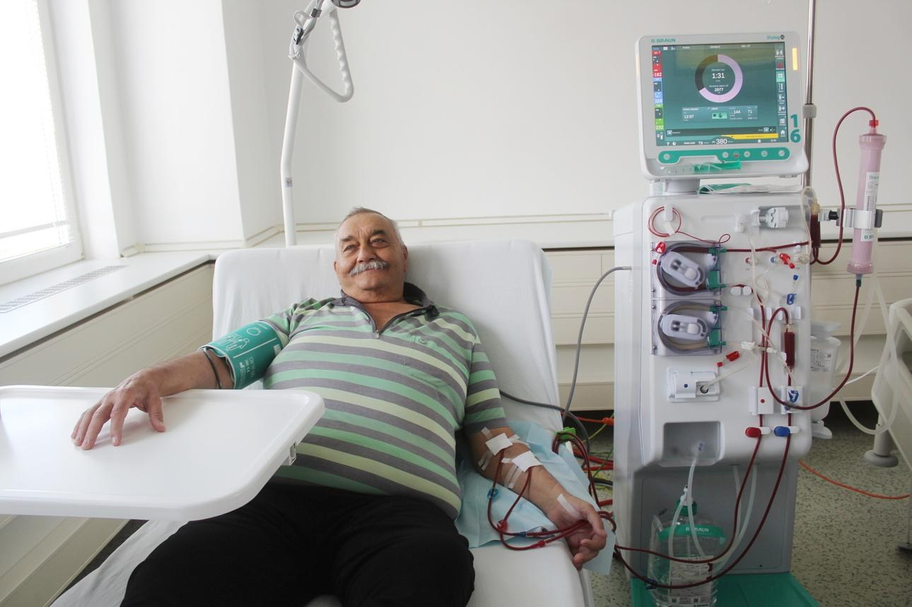 | **Hemodialysis Treatment Session in Chronic Kidney Disease** `ckd_chat_img_9.jpg` *Clinical Photo* | Hemodialysis is a renal replacement therapy used for patients with end-stage renal disease (ESRD) secondary to chronic kidney disease. The procedure utilizes an extracorporeal circuit to remove metabolic waste products, maintain electrolyte balance, and correct fluid overload.  *جلسة غسيل كلوي لمريض مصاب بالفشل الكلوي المزمن. الجهاز بيقوم بتنقية الدم وتعويض وظائف الكلى التالفة عن طريق إزالة السوائل الزائدة والسموم.* |
| 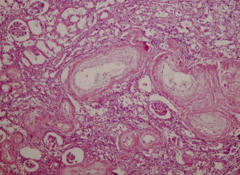 | **Hypertensive Nephrosclerosis with Onion-Skin Appearance** `ckd_hypertensive_nephrosclerosis.png` *Histological Micrograph* | This histological section from a kidney biopsy demonstrates malignant hypertension-induced nephrosclerosis, characterized by severe concentric hyperplastic arteriolosclerosis ('onion-skinning') leading to luminal obliteration. Such vascular changes result in profound ischemia, glomerular obsolescence, interstitial fibrosis, and progressive chronic kidney disease.  *خد بالك يا دكتورنا، الصورة دي بتوريك 'Onion-skinning' أو شكل بصلة المقاطع العرضية في الشرايين الصغيرة نتيجة الـ Malignant Hypertension. التغيرات دي بتعمل نقص تروية شديد في الـ Glomeruli وبتدمر أنسجة الكلى وتدخل العيان في Chronic Kidney Disease.* |
| 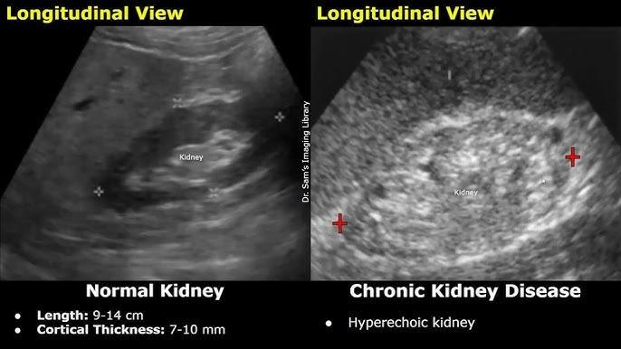 | **Renal Ultrasonography Comparison of Normal Kidney versus Chronic Kidney Disease** `ckd_chat_img_8.jpg` *Radiological Imaging* | Longitudinal ultrasound views comparing a normal kidney (showing preserved corticomedullary differentiation, normal length of 9-14 cm, and cortical thickness of 7-10 mm) with a chronic kidney disease kidney exhibiting diffuse increased echogenicity (hyperechogenicity) indicative of parenchymal scarring and fibrosis.  *خد بالك يا دكتورنا إن السونار في حالات الـ Chronic Kidney Disease بيبين الكلية Hyperechogenic وصغيرة في الحجم بسبب الـ Fibrosis وفقدان الـ Corticomedullary differentiation، وده مؤشر أساسي للتشخيص المبكر ومتابعة تدهور وظائف الكلى.* |
| 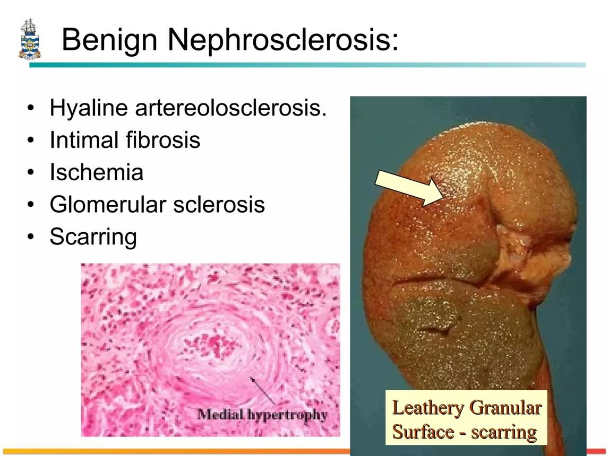 | **Benign Nephrosclerosis Gross Pathology and Histology** `ckd_chat_img_6.jpg` *Gross Pathology* | Benign nephrosclerosis is characterized by hyaline arteriolosclerosis, intimal fibrosis, and medial hypertrophy resulting from chronic hypertension. Grossly, the kidney displays a diffusely leathery, finely granular surface due to chronic ischemia, glomerular sclerosis, and parenchymal scarring.  *يا دكتور، الكلية في حالات الـ Benign Nephrosclerosis بتبان من بره كأنها منكمشة ولها ملمس محبب زي الجلد (Leathery Granular Surface) نتيجة الضغط العالي المزمن اللي بيعمل تليف وتصلب في الشرايين الصغيرة والأوعية الدموية.* |
| 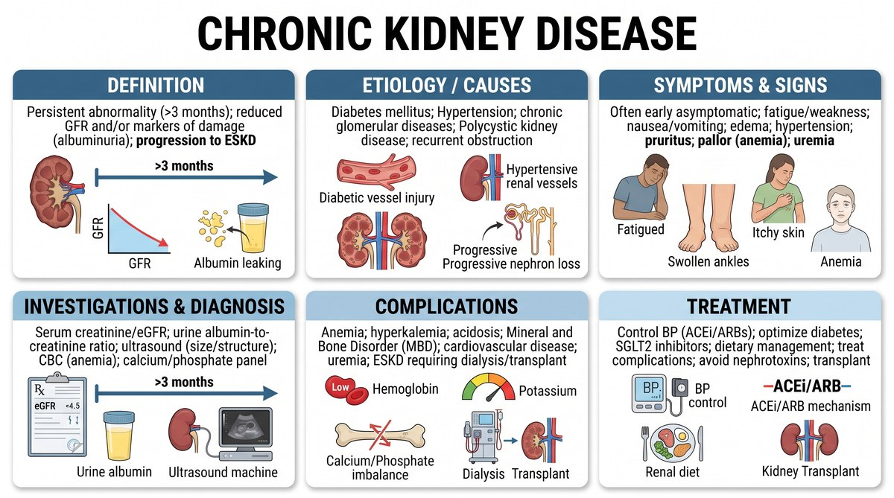 | **Chronic Kidney Disease Comprehensive Clinical Infographic** `ckd_ckd_master_infographic.jpg` *Schematic Diagram* | This schematic infographic illustrates the comprehensive overview of chronic kidney disease (CKD), detailing its definition, primary etiologies including diabetes and hypertension, typical clinical signs such as edema and uremia, diagnostic investigations like eGFR and albuminuria, systemic complications, and management strategies focusing on BP control, SGLT2 inhibitors, and renal replacement therapy.  *خد بالك يا دكتورنا، الفشل الكلوي المزمن بيبدأ غالباً بصمت تام من غير أعراض واضحة لحد ما الوظائف تقل جداً ويزيد الـ Albumin Leakage، وعشان كده المتابعة الدورية للـ eGFR والـ Urine Albumin-to-Creatinine Ratio هي طوق النجاة لحماية المريض من الوصول للـ ESKD والاحتياج للغسيل أو الكسبلة.* |
| 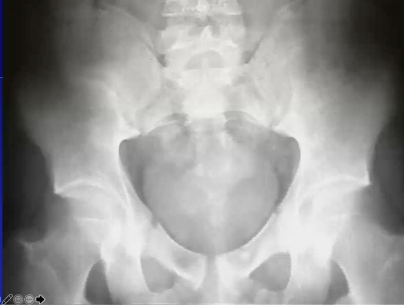 | **Renal Osteodystrophy Sub-periosteal Resorption and Bone Mineral Density Changes on Pelvis X-Ray** `ckd_osteomalacia_pseudofractures.jpg` *Radiological Imaging* | This pelvic radiograph illustrates severe bone demineralization and structural changes consistent with renal osteodystrophy secondary to chronic kidney disease. Impaired phosphate excretion and deficient active vitamin D lead to secondary hyperparathyroidism, resulting in sub-periosteal bone resorption and osteopenia.  *خد بالك يا دكتورنا، العيان ده عنده Chronic Kidney Disease وعامل Secondary Hyperparathyroidism؛ الصورة مبينة تآكل في العظام ونقص كثافة (Renal Osteodystrophy) نتيجة اضطراب الكالسيوم والفوسفور.* |
| 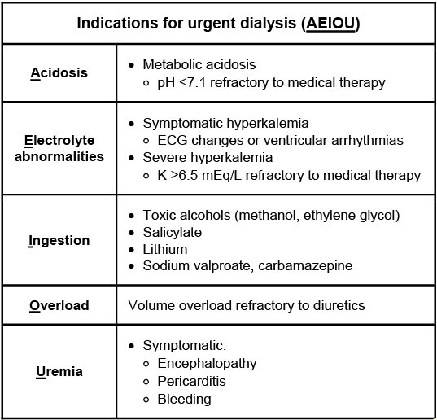 | **AEIOU Mnemonic for Indications of Urgent Dialysis in Renal Failure** `ckd_dialysis_indications_aeiou.jpg` *Schematic Diagram* | This mnemonic outlines the primary emergency indications for urgent hemodialysis, categorizing them into Acidosis, Electrolyte abnormalities, Ingestion of toxins, Volume overload, and Uremic complications. Prompt recognition of these life-threatening conditions is essential to prevent permanent organ damage and mortality in patients with acute kidney injury or end-stage renal disease.  *خد بالك يا دكتورنا إن اختصار الـ AEIOU ده هو المنقذ في حالات الفشل الكلوي الحاد أو المزمن اللي فيها خطر على حياة العيان. تفتكر دايماً إن الحموضة الشديدة، البوتاسيوم العالي اللي مش بيستجيب للعلاج، التسمم بمواد معينة، زيادة السوائل اللي عاملة ارتشاح، ومضاعفات اليوريما هي العلامات اللي بتقولك لازم تغسل فوراً.* |
| 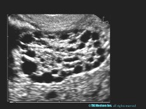 | **Polycystic Kidney Disease Cysts on Renal Ultrasound** `ckd_polycystic_kidney_disease.jpg` *Radiological Imaging* | Renal ultrasound demonstrates numerous anechoic, bilateral fluid-filled cysts replacing normal renal parenchyma, characteristic of autosomal dominant polycystic kidney disease. Progressive cyst expansion leads to compression of adjacent nephrons, interstitial fibrosis, and eventual end-stage chronic kidney disease.  *خد بالك يا دكتورنا، الأشعة دي بتوريني كلى مليانة أكياس مياه (Cysts) على الناحيتين، ودي العلامة الكلاسيكية للـ Polycystic Kidney Disease اللي بتدمر الأنسجة الطبيعية تدريجياً وتوصل المريض لـ Chronic Kidney Disease وتأثر على وظائف الكلى بمرور الوقت.* |
| 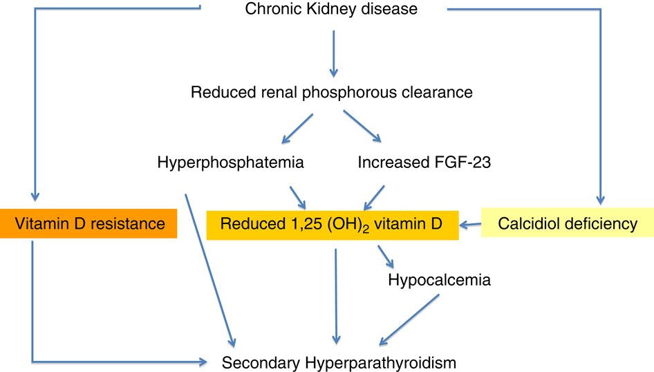 | **Pathophysiological Mechanisms of Secondary Hyperparathyroidism in Chronic Kidney Disease** `ckd_secondary_hyperparathyroidism.jpg` *Schematic Diagram* | This schematic diagram illustrates the multifaceted pathogenesis of secondary hyperparathyroidism in chronic kidney disease. Reduced renal clearance of phosphorous leads to hyperphosphatemia and elevated fibroblast growth factor 23 (FGF-23), which together suppress active vitamin D production, while concomitant calcidiol deficiency, vitamin D resistance, and resulting hypocalcemia further stimulate parathyroid hormone overproduction.  *خد بالك يا دكتورنا، العيان بتاع الفشل الكلوي بيجيله ثانوي زيادة نشاط الغدة جار درقية (Secondary Hyperparathyroidism) بسبب كذا ميكانيزم متداخلين: الفوسفور بيعلا والكلية مش قادرة تصفيه، وده بيزود الـ FGF-23 ويقلل تحويل فيتامين د لصورته النشطة، ومع نقص الكالسيوم ومقاومة فيتامين د بيحصل تحفيز مستمر للغدة الجار درقية.* |