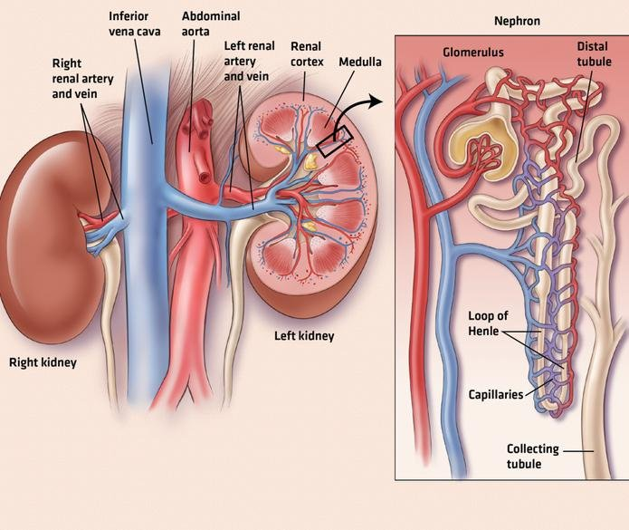
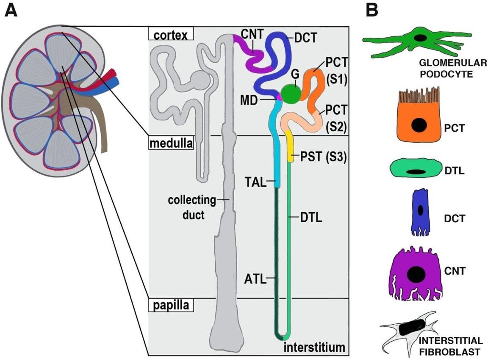
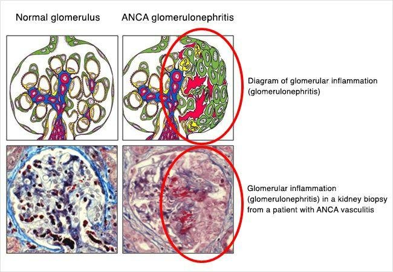
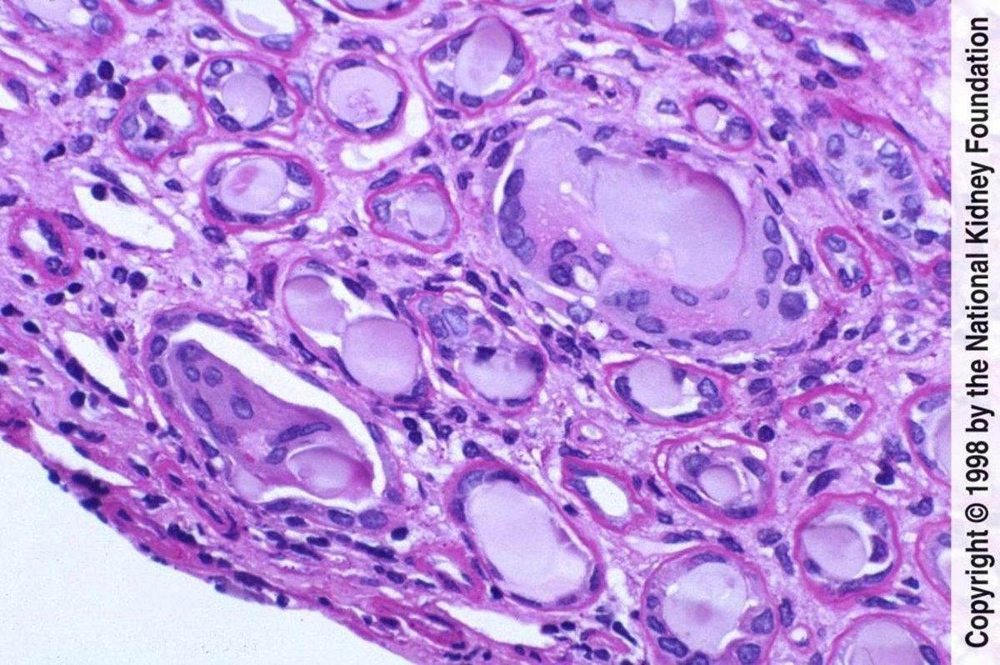
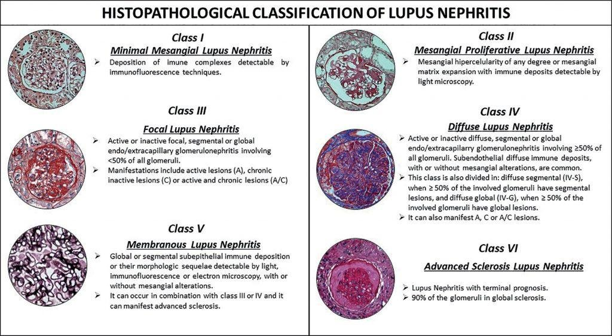
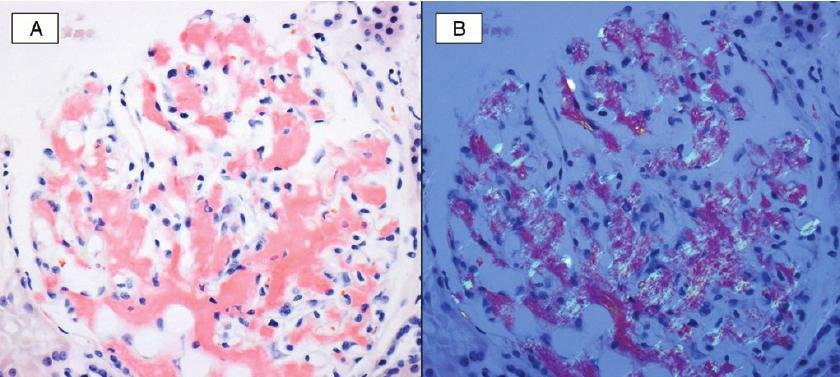
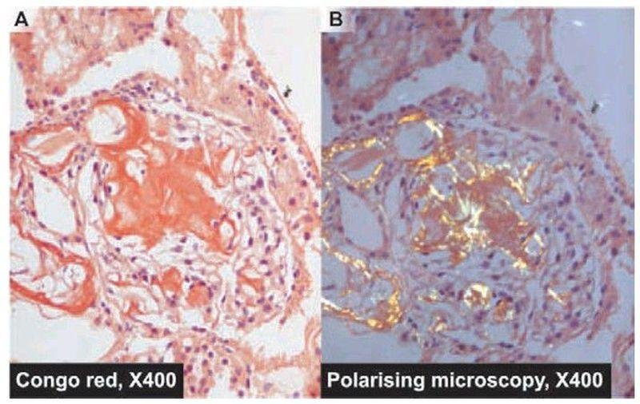
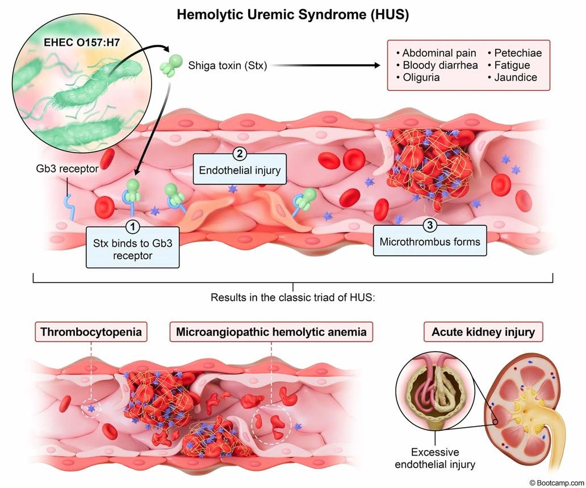
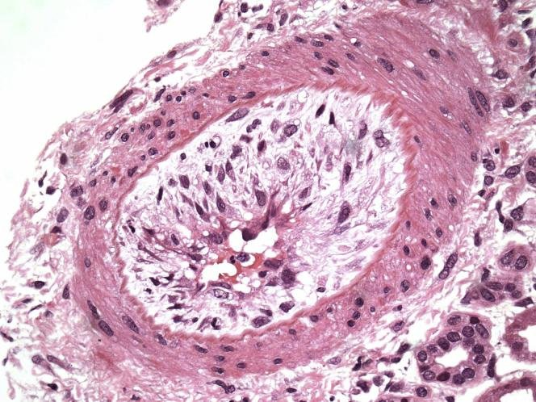

# Clinoma Visual Atlas: 09 Kidney In Systemic Diseases

**Discipline / Module:** `curriculum/clinical/internal-medicine/nephrology/09_kidney_in_systemic_diseases`  
**Total Figures:** **9** Authentic Clinical & Pathological Images  
**Repository Remote:** [`clinomaofficial/clinoma-images`](https://github.com/clinomaofficial/clinoma-images)  

| Figure | Clinical Identification & Repository Links | Academic & Bedside Description |
| :---: | :--- | :--- |
|  | **Anatomical Structure of Human Kidneys and Nephron Functional Unit** <code>kidney_systemic_chat_img_1_Chronic_Kidney_Injury.jpg</code> *Schematic Diagram* [☁️ GitHub Raw](https://raw.githubusercontent.com/clinomaofficial/clinoma-images/main/curriculum/clinical/internal-medicine/nephrology/09_kidney_in_systemic_diseases/kidney_systemic_chat_img_1_Chronic_Kidney_Injury.jpg) | [⚡ jsDelivr CDN](https://cdn.jsdelivr.net/gh/clinomaofficial/clinoma-images@main/curriculum/clinical/internal-medicine/nephrology/09_kidney_in_systemic_diseases/kidney_systemic_chat_img_1_Chronic_Kidney_Injury.jpg) | This diagram illustrates the gross anatomy of the human urinary system alongside a detailed micro-anatomical schematic of a nephron. The renal cortex, medulla, and major vascular networks feed into functional filtration units where blood is ultrafiltered through the glomerulus and processed via the Loop of Henle and collecting tubules.  *خد بالك يا دكتورنا، الرسمة دي بتوضح تفاصيل الكلية من بره ومن جوه لحد وحدة الشغل الأساسية اللي هي النيفرون (Nephron). الجلوميرولوس (Glomerulus) هي اللي بيحصل عندها الفلترة الأولى للدم، وأي خلل في الأوعية الدموية الدقيقة دي هو أساس الأمراض الكلوية الجهازية زي السكر والضغط.* |
|  | **Nephron Segmentation and Renal Histological Architecture** <code>kidney_systemic_chat_img_2_Regenerative_medicine_for_the_kidney_stem_cell_prospects_cha.jpg</code> *Schematic Diagram* [☁️ GitHub Raw](https://raw.githubusercontent.com/clinomaofficial/clinoma-images/main/curriculum/clinical/internal-medicine/nephrology/09_kidney_in_systemic_diseases/kidney_systemic_chat_img_2_Regenerative_medicine_for_the_kidney_stem_cell_prospects_cha.jpg) | [⚡ jsDelivr CDN](https://cdn.jsdelivr.net/gh/clinomaofficial/clinoma-images@main/curriculum/clinical/internal-medicine/nephrology/09_kidney_in_systemic_diseases/kidney_systemic_chat_img_2_Regenerative_medicine_for_the_kidney_stem_cell_prospects_cha.jpg) | This schematic diagram illustrates the precise structural organization and cellular composition of the nephron spanning from the renal cortex to the papilla. It correlates macroscopic zones with microscopic segments—including the glomerulus, proximal tubules, loops of Henle, distal tubules, and collecting ducts—which are critical targets in systemic kidney diseases such as glomerulonephritis and acute tubular necrosis.  *خد بالك يا دكتورنا، فهم التقسيم التشريحى للنيفرون من الكورتكس للميدولا بيساعدنا نحدد مكان الإصابة بدقة فى أمراض الكلى الجهازية، سواء كانت فى الجلوميرولوس أو الأنابيب الكلوية.* |
|  | **ANCA Glomerulonephritis with Crescent Formation: Schematic Diagram and Renal Biopsy** <code>kidney_systemic_chat_img_4_Diagram_showing_glomerulonephritis-_an_illustration_of_a_nor.jpg</code> *Schematic Diagram* [☁️ GitHub Raw](https://raw.githubusercontent.com/clinomaofficial/clinoma-images/main/curriculum/clinical/internal-medicine/nephrology/09_kidney_in_systemic_diseases/kidney_systemic_chat_img_4_Diagram_showing_glomerulonephritis-_an_illustration_of_a_nor.jpg) | [⚡ jsDelivr CDN](https://cdn.jsdelivr.net/gh/clinomaofficial/clinoma-images@main/curriculum/clinical/internal-medicine/nephrology/09_kidney_in_systemic_diseases/kidney_systemic_chat_img_4_Diagram_showing_glomerulonephritis-_an_illustration_of_a_nor.jpg) | This comparative figure illustrates the histological and schematic features of ANCA-associated glomerulonephritis, marked by severe necrotizing lesions and cellular crescent formation (encircled). These pauci-immune inflammatory changes lead to rapid loss of renal function and are characteristic of systemic small-vessel vasculitis.  *خد بالك يا دكتورنا، العيان اللي عنده ANCA vasculitis بيجيله التهاب كلوي حاد مع تكون أقواس (Crescents) واضحة في العينة، ودي من الحالات الخطيرة اللي بتحتاج تشخيص وعلاج فوري بمثبطات المناعة لمنع الفشل الكلوي.* |
|  | **Thyroidization of the Kidney in Chronic Pyelonephritis / End-Stage Renal Disease (PAS Stain)** <code>kidney_systemic_chat_img_7_-_03_-_MSD.jpg</code> *Histological Micrograph* [☁️ GitHub Raw](https://raw.githubusercontent.com/clinomaofficial/clinoma-images/main/curriculum/clinical/internal-medicine/nephrology/09_kidney_in_systemic_diseases/kidney_systemic_chat_img_7_-_03_-_MSD.jpg) | [⚡ jsDelivr CDN](https://cdn.jsdelivr.net/gh/clinomaofficial/clinoma-images@main/curriculum/clinical/internal-medicine/nephrology/09_kidney_in_systemic_diseases/kidney_systemic_chat_img_7_-_03_-_MSD.jpg) | Histological micrograph demonstrating chronic tubulointerstitial nephritis featuring tubular atrophy and dilation with prominent eosinophilic proteinaceous casts, closely mimicking the appearance of thyroid follicles (thyroidization). Periodic acid-Schiff (PAS) staining highlights the thickened, wrinkled tubular basement membranes and extensive interstitial fibrosis.  *خد بالك يا دكتورنا، المنظر ده بيسموه 'Thyroidization' أو تحول الأنابيب الكلوية لشكل الغدة الدرقية، وده بيبان واضح بصبغة الـ PAS في الحالات المزمنة زي Chronic Pyelonephritis أو الـ End-stage renal disease، نتيجة ضمور الأنابيب وامتلائها ببرواكتين إيوزينوفيلي بيفكرنا بالـ Colloid.* |
|  | **Histopathological Classification of Lupus Nephritis (ISN/RPS Classes I to VI)** <code>kidney_systemic_chat_img_3_Pediatric_lupus_nephritis_-_Brazilian_Journal_of_Nephrology.jpg</code> *Histological Micrograph* [☁️ GitHub Raw](https://raw.githubusercontent.com/clinomaofficial/clinoma-images/main/curriculum/clinical/internal-medicine/nephrology/09_kidney_in_systemic_diseases/kidney_systemic_chat_img_3_Pediatric_lupus_nephritis_-_Brazilian_Journal_of_Nephrology.jpg) | [⚡ jsDelivr CDN](https://cdn.jsdelivr.net/gh/clinomaofficial/clinoma-images@main/curriculum/clinical/internal-medicine/nephrology/09_kidney_in_systemic_diseases/kidney_systemic_chat_img_3_Pediatric_lupus_nephritis_-_Brazilian_Journal_of_Nephrology.jpg) | This educational chart summarizes the ISN/RPS histopathological classification of lupus nephritis into six distinct classes, ranging from minimal mesangial involvement (Class I) to advanced sclerotic lupus nephritis (Class VI). Each class is characterized by specific light microscopic, immunohistochemical, and ultrastructural findings that dictate prognostic outcomes and therapeutic management.  *الرسم التوضيحي ده بيشرح تقسيم التهاب الكلى الذئبي حسب منظمة الصحة العالمية لست درجات مختلفة، من أول الدرجة البسيطة لحد التليف المتقدم. الفحص المجهري ده أساسي جداً عشان نحدد خطة العلاج المناسبة لكل عيان ونعرف التوقع المستقبلي لحالته.* |
|  | **Renal Amyloidosis: Congo Red Staining with Apple-Green Birefringence** <code>kidney_systemic_chat_img_5_A_Congo_red_study_A_highlights_global_mesangial_and_segmenta.jpg</code> *Histological Micrograph* [☁️ GitHub Raw](https://raw.githubusercontent.com/clinomaofficial/clinoma-images/main/curriculum/clinical/internal-medicine/nephrology/09_kidney_in_systemic_diseases/kidney_systemic_chat_img_5_A_Congo_red_study_A_highlights_global_mesangial_and_segmenta.jpg) | [⚡ jsDelivr CDN](https://cdn.jsdelivr.net/gh/clinomaofficial/clinoma-images@main/curriculum/clinical/internal-medicine/nephrology/09_kidney_in_systemic_diseases/kidney_systemic_chat_img_5_A_Congo_red_study_A_highlights_global_mesangial_and_segmenta.jpg) | Panel A demonstrates classic amorphous salmon-pink deposits of amyloid within the glomerular tuft upon Congo red staining. Panel B reveals the pathognomonic apple-green birefringence under polarized light, confirming the diagnosis of renal amyloidosis.  *خد بالك يا دكتورنا، صبغة الكونجو ريد في الصورة الأولى بتدّي لون وردي مميز لأملاح الأميلويد جوه الجلوميرولس، وتحت البولارايزيد لايت (الصورة B) بتعمل الإضاءة الخضراء الشهيرة (Apple-green birefringence) اللي بتقطع الشك باليقين في تشخيص الـ Renal Amyloidosis.* |
|  | **Renal Amyloidosis on Congo Red and Polarizing Microscopy** <code>kidney_systemic_chat_img_6_Amyloidosis_kidney_Congo_red_stain_-_MEDizzy.jpg</code> *Histological Micrograph* [☁️ GitHub Raw](https://raw.githubusercontent.com/clinomaofficial/clinoma-images/main/curriculum/clinical/internal-medicine/nephrology/09_kidney_in_systemic_diseases/kidney_systemic_chat_img_6_Amyloidosis_kidney_Congo_red_stain_-_MEDizzy.jpg) | [⚡ jsDelivr CDN](https://cdn.jsdelivr.net/gh/clinomaofficial/clinoma-images@main/curriculum/clinical/internal-medicine/nephrology/09_kidney_in_systemic_diseases/kidney_systemic_chat_img_6_Amyloidosis_kidney_Congo_red_stain_-_MEDizzy.jpg) | Photomicrographs of renal biopsy showing glomerular amyloid deposition. Panel A displays characteristic salmon-pink staining with Congo red, while Panel B demonstrates apple-green birefringence under polarizing microscopy, which is pathognomonic for amyloidosis.  *خد بالك يا دكتورنا، صبغة الكونغو ريد (Congo Red) بتظهر ترسبات الأميلويد بلون أحمر سلمونى مميز، وتحت الميكروسكوب المستقطب (Polarized light) بتدّى لمعة تفاحية خضراء (Apple-green birefringence) قاطعة للشك فى تشخيص مرض الـ Amyloidosis.* |
|  | **Hemolytic Uremic Syndrome (HUS) Pathophysiology and Classic Triad** <code>kidney_systemic_chat_img_9_New_Free_120_NBME_Step_1_Explanations_April_2026.jpg</code> *Schematic Diagram* [☁️ GitHub Raw](https://raw.githubusercontent.com/clinomaofficial/clinoma-images/main/curriculum/clinical/internal-medicine/nephrology/09_kidney_in_systemic_diseases/kidney_systemic_chat_img_9_New_Free_120_NBME_Step_1_Explanations_April_2026.jpg) | [⚡ jsDelivr CDN](https://cdn.jsdelivr.net/gh/clinomaofficial/clinoma-images@main/curriculum/clinical/internal-medicine/nephrology/09_kidney_in_systemic_diseases/kidney_systemic_chat_img_9_New_Free_120_NBME_Step_1_Explanations_April_2026.jpg) | Hemolytic Uremic Syndrome (HUS) is classically triggered by Shiga toxin-producing E. coli (EHEC O157:H7). The Shiga toxin binds to Gb3 receptors on endothelial cells, causing endothelial injury and microthrombus formation, which manifests as the classic triad of thrombocytopenia, microangiopathic hemolytic anemia (MAHA), and acute kidney injury.  *خد بالك يا دكتورنا، متلازمة انحلال الدم اليوريمي (HUS) بتيجرز غالبا بعد عدوى EHEC، وبتتميز بالثلاثية الشهيرة: نقص الصفائح، انحلال الدم، والفشل الكلوي الحاد نتيجة لتكوین جلطات دموية دقيقة في الأوعية الدموية.* |
|  | **Hemolytic Uremic Syndrome (HUS): Thrombotic Microangiopathy in Renal Arteriole** <code>kidney_systemic_chat_img_8_Scleroderma_Renal_Crisis_in_a_Normotensive_Patient_-_PMC.jpg</code> *Histological Micrograph* [☁️ GitHub Raw](https://raw.githubusercontent.com/clinomaofficial/clinoma-images/main/curriculum/clinical/internal-medicine/nephrology/09_kidney_in_systemic_diseases/kidney_systemic_chat_img_8_Scleroderma_Renal_Crisis_in_a_Normotensive_Patient_-_PMC.jpg) | [⚡ jsDelivr CDN](https://cdn.jsdelivr.net/gh/clinomaofficial/clinoma-images@main/curriculum/clinical/internal-medicine/nephrology/09_kidney_in_systemic_diseases/kidney_systemic_chat_img_8_Scleroderma_Renal_Crisis_in_a_Normotensive_Patient_-_PMC.jpg) | This high-power histological micrograph demonstrates classic features of thrombotic microangiopathy in a renal interlobular artery, characteristic of Hemolytic Uremic Syndrome (HUS) or Thrombotic Thrombocytopenic Purpura (TTP). Prominent mucoid intimal thickening and endothelial cell swelling lead to severe luminal narrowing, predisposing to microangiopathic hemolytic anemia, thrombocytopenia, and acute kidney injury.  *خد بالك يا دكتورنا، المنظر ده بيوريك الـ Thrombotic Microangiopathy (TMA) في شريان كلوي، ودي العلامة المميزة للـ HUS (Hemolytic Uremic Syndrome). بتشوف ورم في بطانة الشريان (Endothelial swelling) مع تراكم مواد mucoid ضيقة جداً للومن، وده اللي بيعمل جلطات دقيقة ميكروسكوبية تكسر كرات الدم الحمراء وتعمل الفشل الكلوي الشهير.* |
