# Clinoma Visual Atlas: 10 Renal Replacement Therapy

**Discipline / Module:** `curriculum/clinical/internal-medicine/nephrology/10_renal_replacement_therapy`  
**Total Figures:** **13** Authentic Clinical & Pathological Images  
**Repository Remote:** [`clinomaofficial/clinoma-images`](https://github.com/clinomaofficial/clinoma-images)  

| Figure | Clinical Identification & Repository Links | Academic & Bedside Description |
| :---: | :--- | :--- |
| 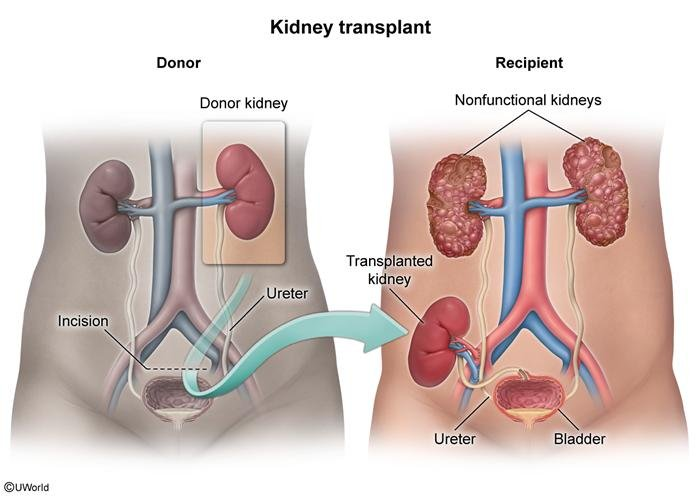 | **Kidney Transplant Anatomical Schematic Diagram** <code>rrt_chat_img_13_Renal_Anatomy_And_Physiology_-_Nephrology_UWorld_Medical_Lib.jpg</code> *Schematic Diagram* [☁️ GitHub Raw](https://raw.githubusercontent.com/clinomaofficial/clinoma-images/main/curriculum/clinical/internal-medicine/nephrology/10_renal_replacement_therapy/rrt_chat_img_13_Renal_Anatomy_And_Physiology_-_Nephrology_UWorld_Medical_Lib.jpg) | [⚡ jsDelivr CDN](https://cdn.jsdelivr.net/gh/clinomaofficial/clinoma-images@main/curriculum/clinical/internal-medicine/nephrology/10_renal_replacement_therapy/rrt_chat_img_13_Renal_Anatomy_And_Physiology_-_Nephrology_UWorld_Medical_Lib.jpg) | Schematic representation of a kidney transplant procedure showing the placement of the donor kidney in the right iliac fossa of the recipient, with vascular anastomoses to the iliac vessels and ureteral implantation into the urinary bladder. The native nonfunctional kidneys are typically left in place unless complications such as severe infection or hypertension arise.  *خد بالك يا دكتورنا إن الكلية المنقولة (Transplanted kidney) بتتحط عادةً في الحوض (Iliac fossa) عند العيان مش في مكانها الطبيعي، وبيتم توصيل شرايينها وأوردتها بالأوعية الحرقفية وتركيب الحالب في المثانة مباشرة، وكمان الكليتين القدام (Nonfunctional kidneys) بيسيبوهم مكانهم في الغالب إلا لو عملوا مشاكل زي ضغط عالي مستعصي أو التهابات متكررة.* |
| 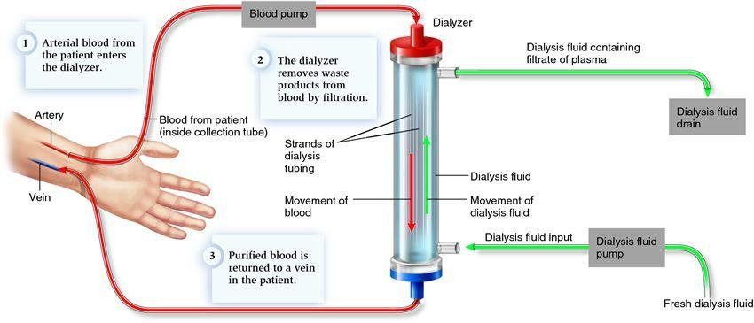 | **Hemodialysis Circuit and Dialyzer Schematic** <code>rrt_chat_img_4.jpg</code> *Schematic Diagram* [☁️ GitHub Raw](https://raw.githubusercontent.com/clinomaofficial/clinoma-images/main/curriculum/clinical/internal-medicine/nephrology/10_renal_replacement_therapy/rrt_chat_img_4.jpg) | [⚡ jsDelivr CDN](https://cdn.jsdelivr.net/gh/clinomaofficial/clinoma-images@main/curriculum/clinical/internal-medicine/nephrology/10_renal_replacement_therapy/rrt_chat_img_4.jpg) | This schematic illustrates the extracorporeal circuit used in hemodialysis. Arterial blood is pumped through a dialyzer containing semipermeable strands, allowing the removal of metabolic waste products and excess fluid via countercurrent flow with dialysis fluid before purified blood is returned to the venous circulation.  *الرسم التوضيحي بيبين دورة الغسيل الكلوي (Hemodialysis)، حيث يتم سحب الدم من الشريان ومروره عبر مضخة ومُرشح (Dialyzer) يحتوي على أنابيب نصف نافذة (Strands of dialysis tubing). يتم التخلص من السموم والسوائل الزائدة بطريقة التيار المعاكس (Countercurrent flow) مع محلول الغسيل، ثم يعود الدم النقي للوريد.* |
| 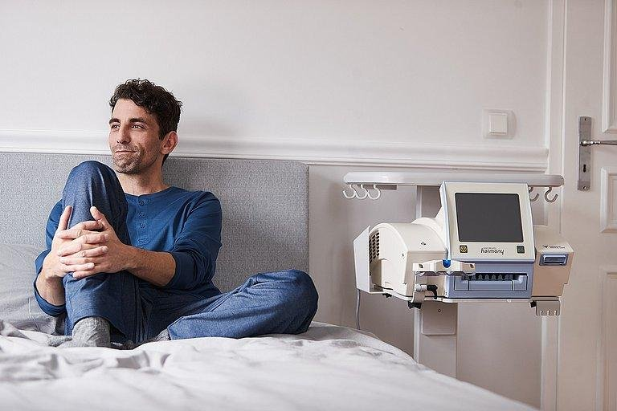 | **Home Hemodialysis System Setup with Patient** <code>rrt_chat_img_10_Fresenius_APD_Peritoneal_Dialysis_System.jpg</code> *Clinical Photo* [☁️ GitHub Raw](https://raw.githubusercontent.com/clinomaofficial/clinoma-images/main/curriculum/clinical/internal-medicine/nephrology/10_renal_replacement_therapy/rrt_chat_img_10_Fresenius_APD_Peritoneal_Dialysis_System.jpg) | [⚡ jsDelivr CDN](https://cdn.jsdelivr.net/gh/clinomaofficial/clinoma-images@main/curriculum/clinical/internal-medicine/nephrology/10_renal_replacement_therapy/rrt_chat_img_10_Fresenius_APD_Peritoneal_Dialysis_System.jpg) | A patient seated comfortably on a bed next to a compact home hemodialysis machine. Home hemodialysis provides frequent or nocturnal treatments, improving uremic clearance, volume control, and overall quality of life for patients with end-stage renal disease.  *خد بالك يا دكتورنا إن الغسيل الكلوي المنزلي بيدي المريض استقلالية كبيرة وبيحسن التحكم في السوائل والسموم مقارنة بالغسيل التقليدي في المركز، وده بينعكس إيجابياً على جودة حياة مريض الفشل الكلوي المزمن.* |
| 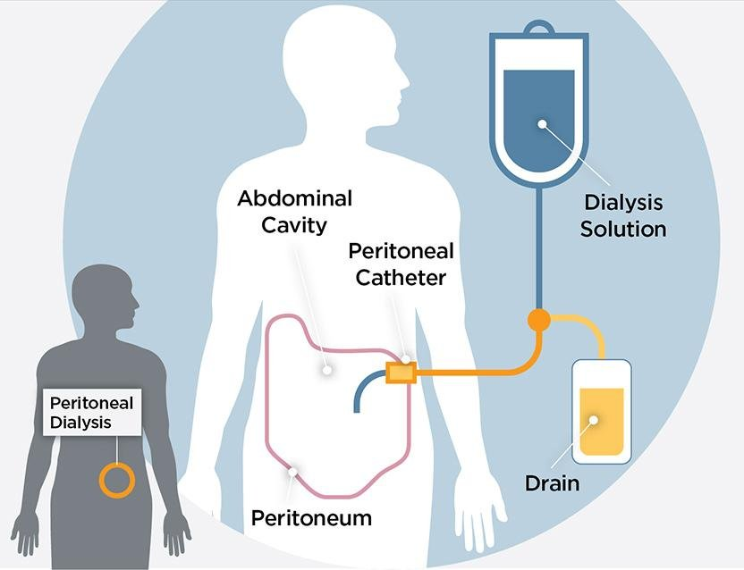 | **Schematic Diagram of Peritoneal Dialysis Procedure and Anatomy** <code>rrt_chat_img_2_Kidney_Dialysis_Treatment_-_UChicago_Medicine.jpg</code> *Schematic Diagram* [☁️ GitHub Raw](https://raw.githubusercontent.com/clinomaofficial/clinoma-images/main/curriculum/clinical/internal-medicine/nephrology/10_renal_replacement_therapy/rrt_chat_img_2_Kidney_Dialysis_Treatment_-_UChicago_Medicine.jpg) | [⚡ jsDelivr CDN](https://cdn.jsdelivr.net/gh/clinomaofficial/clinoma-images@main/curriculum/clinical/internal-medicine/nephrology/10_renal_replacement_therapy/rrt_chat_img_2_Kidney_Dialysis_Treatment_-_UChicago_Medicine.jpg) | This diagram illustrates the process of peritoneal dialysis, where a peritoneal catheter infuses dialysis solution into the abdominal cavity. The peritoneum acts as a semi-permeable membrane to filter waste products and excess fluid from the blood before the fluid is drained out.  *خد بالك يا دكتورنا، الرسم ده بيبين فكرة الغسيل الكلوي البريتوني؛ المحلول بيدخل جوه تجويف البطن عن طريق القسطرة، والبريتون بيشتغل كغشاء شبه منفذ عشان ينظف الدم من السموم والمياه الزائدة وبعدين يصرفهم في الكيس.* |
| 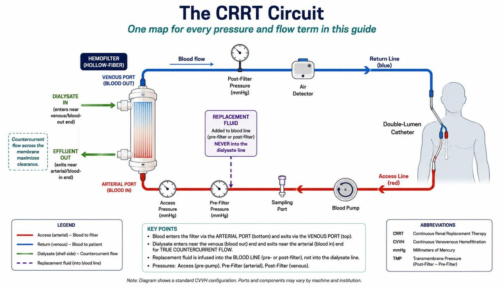 | **Continuous Renal Replacement Therapy (CRRT) Circuit Schematic Diagram** <code>rrt_chat_img_12_Continuous_Renal_Replacement_Therapy_CRRT_A_Clinical_Referen.jpg</code> *Schematic Diagram* [☁️ GitHub Raw](https://raw.githubusercontent.com/clinomaofficial/clinoma-images/main/curriculum/clinical/internal-medicine/nephrology/10_renal_replacement_therapy/rrt_chat_img_12_Continuous_Renal_Replacement_Therapy_CRRT_A_Clinical_Referen.jpg) | [⚡ jsDelivr CDN](https://cdn.jsdelivr.net/gh/clinomaofficial/clinoma-images@main/curriculum/clinical/internal-medicine/nephrology/10_renal_replacement_therapy/rrt_chat_img_12_Continuous_Renal_Replacement_Therapy_CRRT_A_Clinical_Referen.jpg) | Schematic representation of a standard CVVH Continuous Renal Replacement Therapy circuit, outlining the extracorporeal blood circuit from the vascular access line through the blood pump, hemofilter, and return line. It details the countercurrent flow mechanics of dialysate, replacement fluid administration points, and essential pressure monitoring sites.  *خد بالك يا دكتورنا إن السيركوت بتاع الـ CRRT بيمشي من الـ Access line للـ Blood pump وبعدين يعدي على الفلتر من تحت لفوق (Arterial لـ Venous port)، والدياليسات بيمشي بالعكس عشان يحصل Countercurrent clearance مثالي، ومهم جداً تتابع الـ Pressures (Access, Pre-filter, Post-filter) عشان تعرف حالة الفلتر والجلطات بدري.* |
| 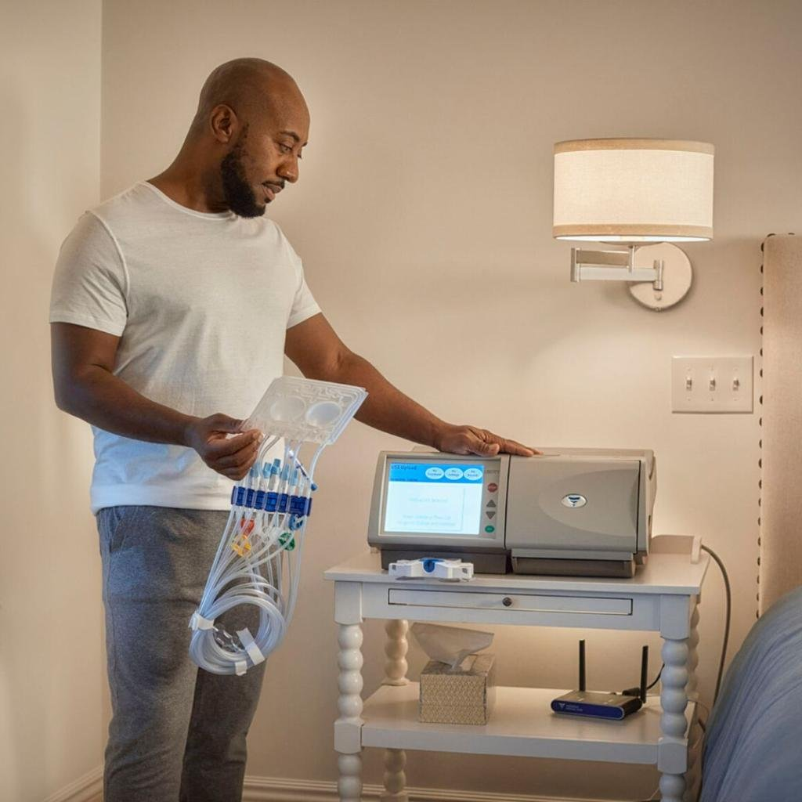 | **Automated Peritoneal Dialysis (APD) Setup and Cycler Operation** <code>rrt_chat_img_11_Do_you_know_about_the_unique_features_of_the_Liberty_Select.jpg</code> *Clinical Photo* [☁️ GitHub Raw](https://raw.githubusercontent.com/clinomaofficial/clinoma-images/main/curriculum/clinical/internal-medicine/nephrology/10_renal_replacement_therapy/rrt_chat_img_11_Do_you_know_about_the_unique_features_of_the_Liberty_Select.jpg) | [⚡ jsDelivr CDN](https://cdn.jsdelivr.net/gh/clinomaofficial/clinoma-images@main/curriculum/clinical/internal-medicine/nephrology/10_renal_replacement_therapy/rrt_chat_img_11_Do_you_know_about_the_unique_features_of_the_Liberty_Select.jpg) | Demonstration of a patient preparing an automated peritoneal dialysis (APD) cycler system for home treatment. The cycler automates the exchange of dialysis fluid through the peritoneal cavity to remove uremic toxins and excess fluid in patients with end-stage renal disease.  *تحضير جهاز الغسيل الكلوي البريتوني الآلي في البيت لعلاج الفشل الكلوي المزمن. الجهاز ده بيقوم بعملية تبديل السوائل بشكل آلي عشان ينضف الجسم من السموم والسوائل الزائدة وأنت نايم.* |
| 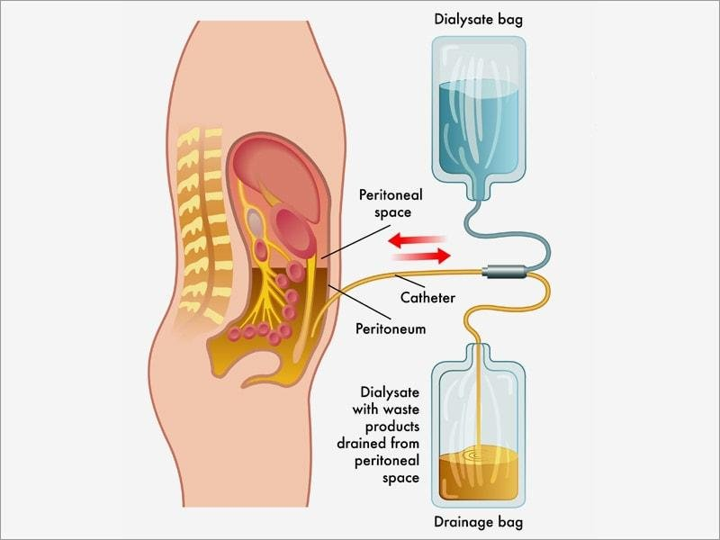 | **Schematic Diagram of Peritoneal Dialysis Mechanism and Setup** <code>rrt_chat_img_8_Initiating_Peritoneal_Dialysis_After_Catheter_Insertion.jpg</code> *Schematic Diagram* [☁️ GitHub Raw](https://raw.githubusercontent.com/clinomaofficial/clinoma-images/main/curriculum/clinical/internal-medicine/nephrology/10_renal_replacement_therapy/rrt_chat_img_8_Initiating_Peritoneal_Dialysis_After_Catheter_Insertion.jpg) | [⚡ jsDelivr CDN](https://cdn.jsdelivr.net/gh/clinomaofficial/clinoma-images@main/curriculum/clinical/internal-medicine/nephrology/10_renal_replacement_therapy/rrt_chat_img_8_Initiating_Peritoneal_Dialysis_After_Catheter_Insertion.jpg) | This diagram illustrates the physiological principles of peritoneal dialysis, where a sterile dialysate solution is infused into the peritoneal cavity via an indwelling catheter. Waste products and excess electrolytes diffuse across the semi-permeable peritoneal membrane from the blood into the dialysate before being drained out.  *خد بالك يا دكتورنا إن الغشاء البريتوني بيلعب دور الفلتر الطبيعي في الغسيل البريتوني؛ المحلول بينزل في التجويف البطني عن طريق القسطرة، وفضلات الجسم والسموم بتعدي بالانتشار من الشعيرات الدموية للمحلول، وبعدين بيتسحب في كيس الصرف.* |
| 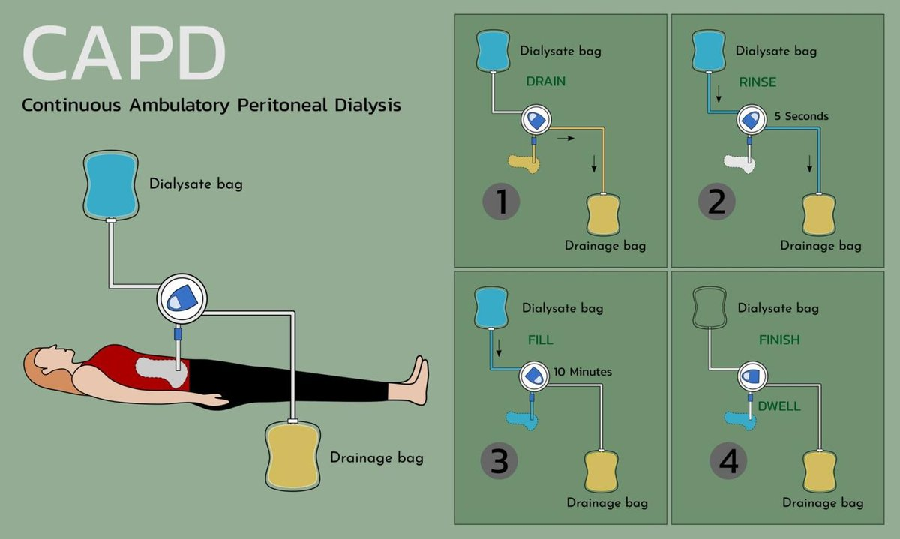 | **Continuous Ambulatory Peritoneal Dialysis (CAPD) Procedure Steps** <code>rrt_chat_img_9_Continuous_Ambulatory_Peritoneal_Dialysis_CAPD_vector_illust.jpg</code> *Schematic Diagram* [☁️ GitHub Raw](https://raw.githubusercontent.com/clinomaofficial/clinoma-images/main/curriculum/clinical/internal-medicine/nephrology/10_renal_replacement_therapy/rrt_chat_img_9_Continuous_Ambulatory_Peritoneal_Dialysis_CAPD_vector_illust.jpg) | [⚡ jsDelivr CDN](https://cdn.jsdelivr.net/gh/clinomaofficial/clinoma-images@main/curriculum/clinical/internal-medicine/nephrology/10_renal_replacement_therapy/rrt_chat_img_9_Continuous_Ambulatory_Peritoneal_Dialysis_CAPD_vector_illust.jpg) | Continuous Ambulatory Peritoneal Dialysis (CAPD) is a manual form of renal replacement therapy utilizing the patient's peritoneal membrane as a natural filter. The cyclical four-step process involves Draining used dialysate, Rinsing lines, Filling fresh dialysate, and Dwell time for solute and fluid exchange.  *الغسيل البريتوني المستمر المتجول بيعتمد على غشاء البريتون كمصفاة طبيعية لتنقية الدم من السموم والسوائل الزائدة. الخطوات الأربعة الأساسية هي: تصريف السائل القديم (Drain)، غسيل الوصلة (Rinse)، ملء سائل جديد (Fill)، وأخيراً فترة الحضانة (Dwell) اللي بيحصل خلالها تبادل السموم.* |
| 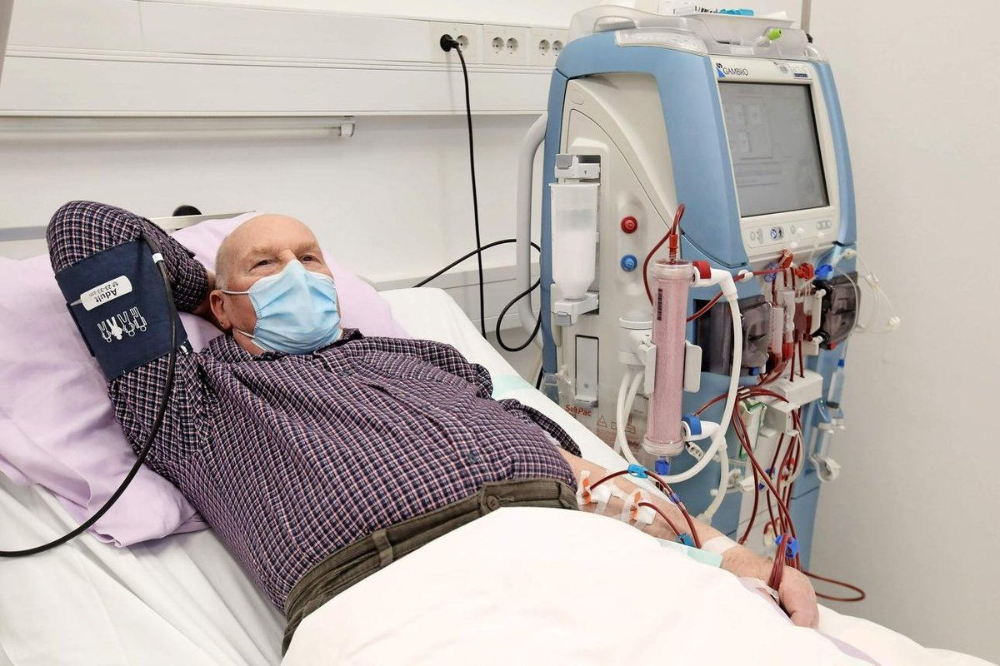 | **Hemodialysis Session in a Patient with End-Stage Renal Disease** <code>rrt_chat_img_1_Gorenjski_glas_-_Arhiv_S_pomojo_dialize_lahko_ivim.jpg</code> *Clinical Photo* [☁️ GitHub Raw](https://raw.githubusercontent.com/clinomaofficial/clinoma-images/main/curriculum/clinical/internal-medicine/nephrology/10_renal_replacement_therapy/rrt_chat_img_1_Gorenjski_glas_-_Arhiv_S_pomojo_dialize_lahko_ivim.jpg) | [⚡ jsDelivr CDN](https://cdn.jsdelivr.net/gh/clinomaofficial/clinoma-images@main/curriculum/clinical/internal-medicine/nephrology/10_renal_replacement_therapy/rrt_chat_img_1_Gorenjski_glas_-_Arhiv_S_pomojo_dialize_lahko_ivim.jpg) | This clinical photograph demonstrates a patient undergoing standard hemodialysis therapy utilizing an extracorporeal circuit. Blood is pumped through a dialyzer containing a semipermeable membrane to filter uremic toxins, excess electrolytes, and fluid overload before returning to the patient's vascular access.  *المريض هنا بيعمل جلسة غسيل كلوي باستخدام جهاز الكلى الصناعية وفلتر الدم لتنقية الجسم من السموم والسوائل الزائدة. خد بالك يا دكتورنا إن متابعة الوصلة الوعائية (AV Fistula) وفحص ضغط الدم بانتظام خطوة أساسية أثناء الجلسة لتجنب الهبوط المفاجئ.* |
| 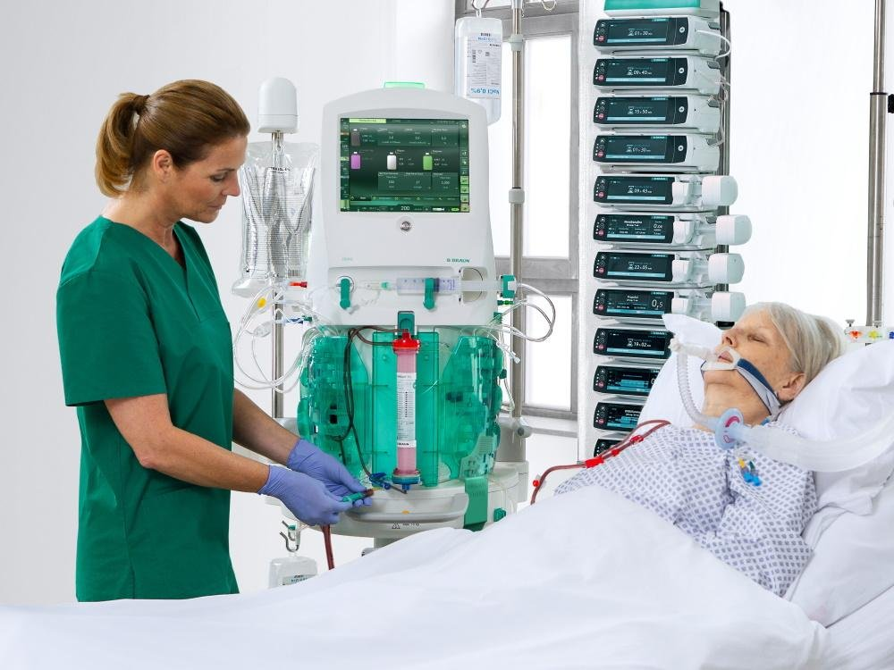 | **Continuous Renal Replacement Therapy (CRRT) Circuit and Bedside Nursing Management** <code>rrt_chat_img_3_Acute_Kidney_Injury_Treatment_-_B_Braun.jpg</code> *Clinical Photo* [☁️ GitHub Raw](https://raw.githubusercontent.com/clinomaofficial/clinoma-images/main/curriculum/clinical/internal-medicine/nephrology/10_renal_replacement_therapy/rrt_chat_img_3_Acute_Kidney_Injury_Treatment_-_B_Braun.jpg) | [⚡ jsDelivr CDN](https://cdn.jsdelivr.net/gh/clinomaofficial/clinoma-images@main/curriculum/clinical/internal-medicine/nephrology/10_renal_replacement_therapy/rrt_chat_img_3_Acute_Kidney_Injury_Treatment_-_B_Braun.jpg) | Continuous renal replacement therapy is utilized in critically ill patients with acute kidney injury requiring hemodynamic stabilization. The bedside circuit incorporates a blood pump, hemofilter, effluent management, and multiple infusion pumps for precise fluid balance and solute clearance.  *العناية بالفشل الكلوي الحاد في العناية المركزة باستخدام الغسيل الكلوي المستمر CRRT ودور التمريض في ضبط الماكينات. خد بالك يا دكتورنا إن مراقبة السوائل الداخلة والخارجة بدقة هي أساس حماية المريض الموصول بجهاز التنفس الصناعي.* |
| 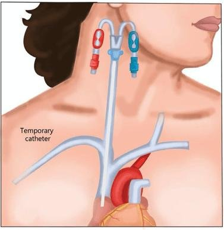 | **Temporary Hemodialysis Catheter Placement in Internal Jugular Vein** <code>rrt_chat_img_7_PREFERRED_TEMPORARY_DIALYSIS_CATHETER_LOCATION_FOR_DIALYSIS.jpg</code> *Schematic Diagram* [☁️ GitHub Raw](https://raw.githubusercontent.com/clinomaofficial/clinoma-images/main/curriculum/clinical/internal-medicine/nephrology/10_renal_replacement_therapy/rrt_chat_img_7_PREFERRED_TEMPORARY_DIALYSIS_CATHETER_LOCATION_FOR_DIALYSIS.jpg) | [⚡ jsDelivr CDN](https://cdn.jsdelivr.net/gh/clinomaofficial/clinoma-images@main/curriculum/clinical/internal-medicine/nephrology/10_renal_replacement_therapy/rrt_chat_img_7_PREFERRED_TEMPORARY_DIALYSIS_CATHETER_LOCATION_FOR_DIALYSIS.jpg) | Schematic representation of a temporary double-lumen hemodialysis catheter inserted via the right internal jugular vein. The catheter tip is positioned in the cavoatrial junction to ensure adequate blood flow rates for emergent renal replacement therapy.  *رسم توضيحي بيبين تركيب قسطرة غسيل كلوي مؤقتة (Temporary Dialysis Catheter) عن طريق الوريد الوداجي الداخلي (Internal Jugular Vein). خد بالك يا دكتور إن طرف القسطرة لازم يوصل لمنطقة اتصال الوريد الاجوف العلوي بالأذين الأيمن عشان يضمن تدفق دم كويس لجلسة الغسيل.* |
| 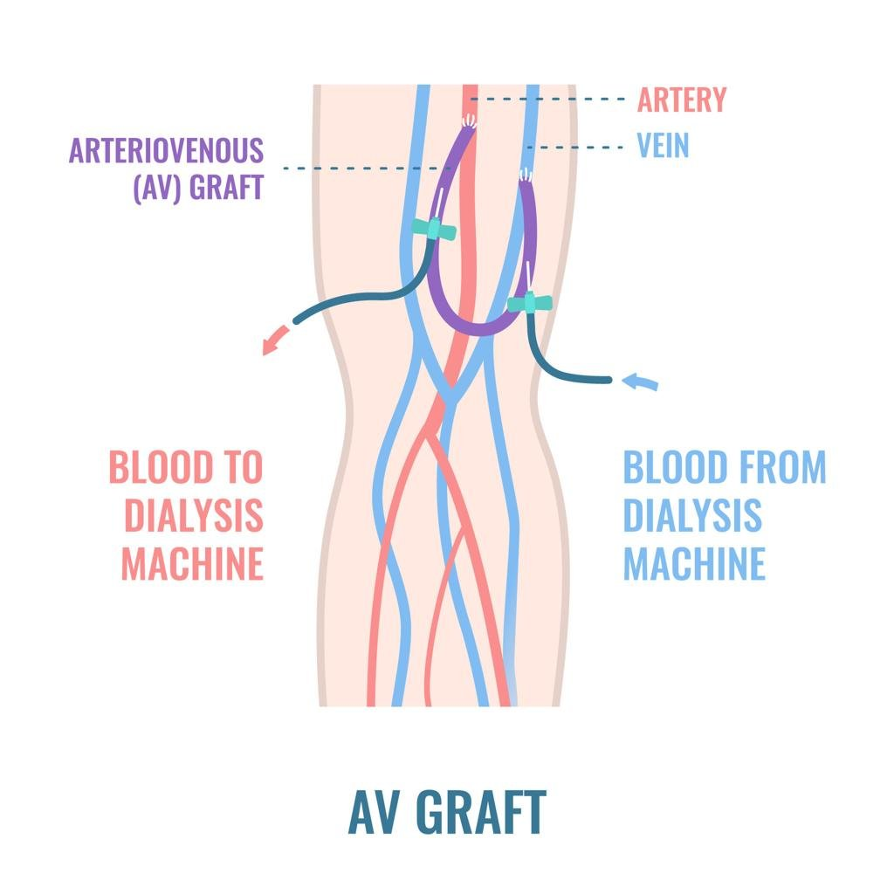 | **Arteriovenous (AV) Graft for Hemodialysis Access** <code>rrt_chat_img_6_Arteriovenous_dialysis_shunt_graft_catheter_in_arm.jpg</code> *Schematic Diagram* [☁️ GitHub Raw](https://raw.githubusercontent.com/clinomaofficial/clinoma-images/main/curriculum/clinical/internal-medicine/nephrology/10_renal_replacement_therapy/rrt_chat_img_6_Arteriovenous_dialysis_shunt_graft_catheter_in_arm.jpg) | [⚡ jsDelivr CDN](https://cdn.jsdelivr.net/gh/clinomaofficial/clinoma-images@main/curriculum/clinical/internal-medicine/nephrology/10_renal_replacement_therapy/rrt_chat_img_6_Arteriovenous_dialysis_shunt_graft_catheter_in_arm.jpg) | This schematic diagram illustrates an arteriovenous (AV) graft placed surgically between an artery and a vein to provide vascular access for hemodialysis. The graft allows high blood flow rates required for effective dialysis treatment by shunting arterial blood into the venous system.  *خد بالك يا دكتورنا، رسمة الـ AV graft دي بتوضح الوصلة الصناعية بين الشريان والوريد لما الـ native fistula متبقاش متاحة. بنسحب الدم للغسيل من ناحية الشريان ونرجعه تاني في الوريد، ولازم نتابع الـ thrill والbruit بانتظام عشان نتأكد إن الوصلة شغال تمام ومحصلش فيها thrombosis.* |
| 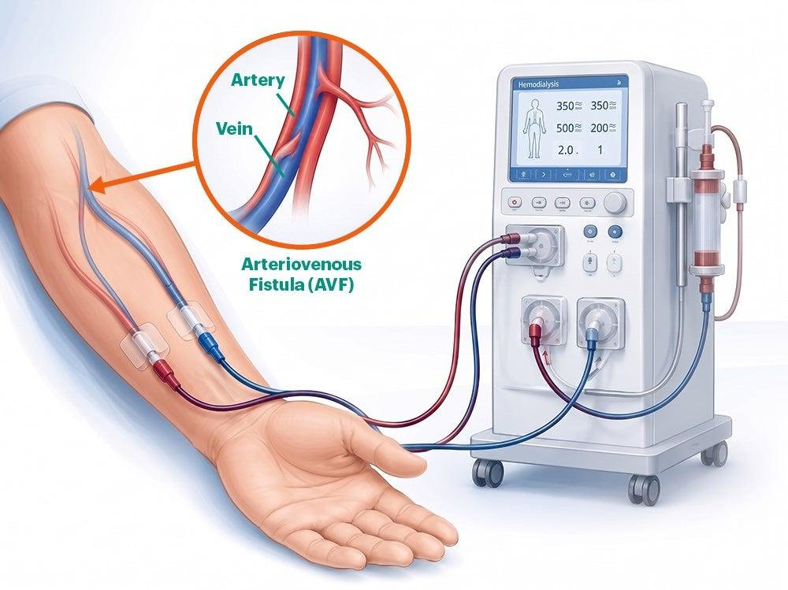 | **Hemodialysis Circuit with Arteriovenous Fistula (AVF) Vascular Access** <code>rrt_chat_img_5_KDOQI_Vascular_Access_Guidelines_and_Clinical_Tools_NKF.jpg</code> *Schematic Diagram* [☁️ GitHub Raw](https://raw.githubusercontent.com/clinomaofficial/clinoma-images/main/curriculum/clinical/internal-medicine/nephrology/10_renal_replacement_therapy/rrt_chat_img_5_KDOQI_Vascular_Access_Guidelines_and_Clinical_Tools_NKF.jpg) | [⚡ jsDelivr CDN](https://cdn.jsdelivr.net/gh/clinomaofficial/clinoma-images@main/curriculum/clinical/internal-medicine/nephrology/10_renal_replacement_therapy/rrt_chat_img_5_KDOQI_Vascular_Access_Guidelines_and_Clinical_Tools_NKF.jpg) | Schematic illustration of hemodialysis treatment utilizing a surgically created arteriovenous fistula (AVF) in the forearm as vascular access. Arterial blood is pumped through the dialyzer for filtration of metabolic waste products and excess fluid, and returned via the venous line.  *خد بالك يا دكتورنا إن الوصلة الشريانية الوريدية (AVF) هي الـ Gold Standard للغسيل الكلوي لأنها بتدفع تدفق عالي (High Blood Flow) وبيقلل نسب العدوى مقارنة بالقسطرة المؤقتة. لازم نتأكد ديمًا من الـ Thrill والـ Bruit أثناء الفحص السريري.* |
